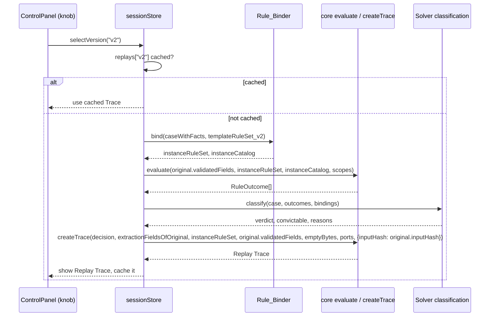
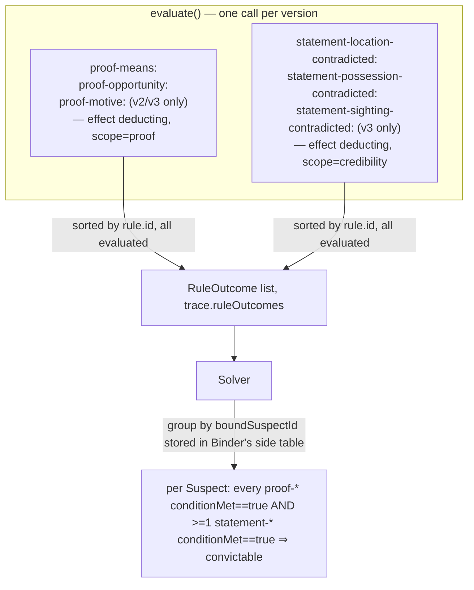
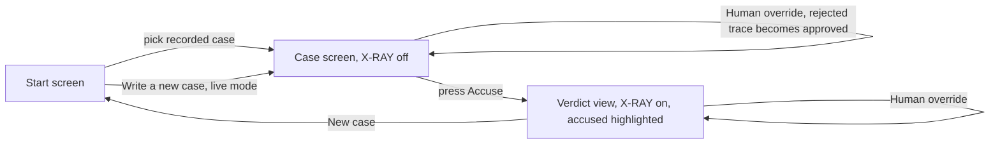

# Design Document: case-files

## Overview

Case Files is App 2 on the Bones skeleton: a ghost detective game in `apps/case-files`. The LLM proposes a case as structured JSON; it never decides anything. A deterministic, pure Solver proves whether exactly one Suspect can be convicted. The Trace, the rules engine, replay, override and the X-ray UI are the same mechanisms the expense-auditor app uses, re-applied to a new domain with its own schema, rules and solver.

This design was written by reading the real code, not by assuming it: `packages/core/src` (types, `evaluate`, `createTrace`, `replay`, `override`, the rule schema and AST, `validate`, extraction adapters), `packages/xray-ui/src` (`Shell`, `Stage`, `Hotspot`, `EcgBand`, `GlassCard`, `DoctorPanel`, `ControlPanel`, `Knob`/`Meter`/`Toggle`, `StartLayout`, `FilmSheet`, `HeaderBar`, the selector and layout model files, and the CSS tokens), the whole of `apps/expense-auditor` (pipeline, reducer, session store, rule catalog, live function, guards, Playwright config and specs, README), `rules/expense-auditor/*`, and the designs of `expense-auditor`, `visual-polish` and `visual-polish-2` for document conventions. No source file was changed to write this document; every doubt below was resolved in the design, not by editing code or `requirements.md`.

### Requirement adjustments

Reading `packages/core/src` against the requirements surfaced four places where the requirements describe core slightly differently than the code behaves, or rely on a core capability that does not exist in the form assumed. Each is resolved in this design without changing core; `requirements.md` should be amended with the exact wording below before tasks are written.

| ID | Requirement(s) | What the code actually does | Resolution used in this design | Exact amendment |
|---|---|---|---|---|
| CF-A1 | R4.6, R9.2 | `evaluate`'s `Decision.amountCents` is `anyReduced ? ... : scope.claimedCents` **summed over every scope in `amountScopes`**, clamped per scope to `[0, claimedCents]` (`packages/core/src/rules/evaluate.ts`, Step 6). It is not "the final amount of one scope"; it is a sum across all scopes passed in. With two scopes (`proof`, `credibility`), `Decision.amountCents` is `remaining proof points + remaining credibility points`, not a convictable count. | The App **ignores** `evaluate`'s own `Decision.amountCents` and `Decision.result` for the game result. The Solver computes `convictable`/`verdict` from `RuleOutcome.conditionMet` per rule directly (R5.2–R5.3), and the pipeline builds `Trace.result`/`Trace.amountCents` itself from the Solver's verdict (R6.1–R6.2), passing only `decision.ruleOutcomes` through from `evaluate`'s return value. `evaluate`'s own `result`/`amountCents` fields are computed (because `evaluate` always returns them) but never read. | Add to R9.2: "The pipeline SHALL read only `ruleOutcomes` from the return value of core `evaluate`, and SHALL discard its `result` and `amountCents` fields, replacing them with the Solver-derived values of Requirement 6." |
| CF-A2 | R4.6 | `AmountScope.claimedCents` must be a **positive integer** per the `AmountScope` doc comment, but `evaluate` does not reject 0 at runtime — the type comment is advisory only (no zod schema validates `AmountScope`, it is a plain TS interface passed by the caller). A case where a Rule_Set binds zero `proof-*` or zero `statement-*` instances to a Suspect (e.g., a Rule_Set with only location rules under v1, and a Suspect with zero `location` statements) would need `claimedCents: 0` for the `credibility` scope for that Suspect's binding, since R4.6 says "omitting a scope that has no instance" per binder output, but the AmountScope array passed to `evaluate` is built once per `evaluate` call over the whole bound Rule_Set, not per Suspect. | Because exactly one bound Rule_Set (covering all Suspects) is evaluated in one `evaluate` call (R4.9, "evaluate bound rules... only"), there are always two global scopes at most, `proof` and `credibility`, each with `claimedCents` equal to the **total** instance count across all Suspects (R4.6 as written is about the whole bound Rule_Set, not per Suspect). This is never 0 in any Recorded_Case because every version binds at least one `proof-*` template and at least one `statement-*` template. The Solver does not use `claimedCents` or the returned `amountCents` at all (CF-A1), so a 0 value would be harmless even if it occurred. | No wording change needed; this row records the verification that R4.6's scope construction is whole-Rule_Set, not per-Suspect, and that the Solver's independence from `amountCents` (CF-A1) makes the edge case safe. Kept as a note, not a required amendment. |
| CF-A3 | R10.1, R10.4 | Core `replay(trace, ruleSetVersion, ruleSet, catalog, amountScopes, ports)` calls `evaluate(trace.validatedFields, ruleSet, catalog, amountScopes)` and then `createTrace(...)` with the **decision it got back**, i.e. `replay`'s returned `Trace.result`/`amountCents` are `evaluate`'s own (summed, clamped) values (`packages/core/src/replay.ts`). Per CF-A1 these are not the game result. | The app's own `replayTrace`-equivalent (`solveAndTrace`, see Components) does not call core `replay` at all. It re-runs `Fact_Deriver` (idempotent, so safe to skip — not used, see below) is skipped because `validatedFields` are already derived and stored; it re-binds the Rule_Set, calls `evaluate` once for the rule outcomes, re-runs the Solver's classification over those outcomes, and calls `createTrace` directly with the Solver-derived `Decision`. This matches D10 exactly as decided, and this row documents why core `replay` is not used at all (not even for the mechanical parts): its returned `Decision` would be wrong at the one spot (`result`/`amountCents`) that must be Solver-derived, and there is no `resultMapper` hook (Q2) to fix that without re-doing the call itself. | Add to R10.1: "...and SHALL NOT call core `replay`; core `replay`'s own result/amount computation does not apply to this app (see Q2)." |
| CF-A4 | R9.5 | `Date.now`, `Math.random` and `crypto` are correctly absent from `evaluate`/`ast.ts`'s comparison path for the four AST node kinds used (`comparison`), but the AST also defines `date_in_range`, which **does** call `new Date(...)` inside `evaluateCondition` (`packages/core/src/rules/ast.ts`). This is dead code for this app only if no case rule uses `date_in_range`. | R4.10 already restricts case rules to `comparison` only, so `date_in_range`'s `new Date` is never reached. The guard of R20.7 ("no `new Date(` ... in the Fact_Deriver, the Binder, the Solver") correctly does not need to additionally forbid it inside `@bones/core` itself (out of scope, R1.10), and the rules-purity guard (R20.6, "use only `comparison` nodes") is what actually keeps this dead path unreached. | No wording change; this row records that R4.10 and R20.6 together are the enforcement for R9.5's intent, since R9.5 cannot itself constrain `@bones/core`. |

These four rows are the complete set of disagreements found; every other requirement matches the code read.

## Architecture

### Pipeline data flow

```mermaid
flowchart LR
    subgraph Extraction
        A1[RecordedCaseAdapter] -->|ExtractionResult| B
        A2[HttpCaseAdapter] -->|ExtractionResult| B
    end
    B[guardInput + size cap 32768B] --> C[core validate against Case_Schema]
    C -->|ValidatedFields: Case| D[Fact_Deriver]
    D -->|Case + counts| E[Rule_Binder]
    E -->|instance RuleSet + catalog| F[core evaluate]
    F -->|RuleOutcome list| G[Solver classification]
    G -->|verdict, convictable, reasons| H[Decision: result, amountCents, ruleOutcomes]
    H --> I[core createTrace]
    I --> J[(Trace, frozen)]
    J --> K[Anatomy_Builder]
    K --> L[Xray_UI: Shell / SkeletonEnsemble / GlassCard / DoctorPanel / ControlPanel]
    J --> M[Accusation function]
    J --> N[core override / effectiveResult]
    style C fill:#0b1620,color:#e8f4f8
    style F fill:#0b1620,color:#e8f4f8
    style I fill:#0b1620,color:#e8f4f8
```



Only the boxes `core validate`, `core evaluate` and `core createTrace` are `@bones/core` calls. `Fact_Deriver`, `Rule_Binder` and `Solver` are pure app-local functions (`apps/case-files/src/{pipeline,solver}`), mirroring how `apps/expense-auditor/src/pipeline/toRuleFields.ts` derives fields before calling `evaluate`, except here the derivation and the binding both happen before the single `evaluate` call, and a Solver classification step happens after it but before `createTrace`.

### Replay data flow (RULE VERSION knob)



No extraction adapter, no hasher and no network run during a replay (R10.2); the only port called is `clock` (for `createdAt`) and `id` (for `decisionId`), through the same `KernelPorts` factory the original run used, exactly as `apps/expense-auditor/src/pipeline/runPipeline.ts`'s `replayTrace` does with core `replay` — except, per CF-A3, Case Files does not delegate to core `replay` itself, only re-implements the same "evaluate on stored fields, then createTrace" shape with the Solver classification step inserted.

### Rule evaluation inside one `evaluate` call



All rules are `deducting` (D5, R4.2) because `blocking` would stop `evaluate` at the first fired rule (CF scope note in requirements' D5), which would hide later Suspects' bones. `deducting` never blocks; every rule in both passes always runs and contributes an outcome, which is exactly what both the Solver (needs every rule's `conditionMet`) and the X-ray UI (needs every bone's state, including "not applicable" for unbound rules and "passed" for bound-but-not-fired rules) require.

## Components and Interfaces

### Folder layout of `apps/case-files`

```
apps/case-files/
├── .env.example
├── README.md
├── index.html
├── package.json
├── tsconfig.json
├── vite.config.ts
├── vitest.config.ts
├── playwright.config.ts
├── vercel.json
├── api/
│   ├── case.ts
│   └── _lib/
│       ├── handler.ts
│       ├── provider.ts
│       ├── openrouter.ts
│       ├── rateLimit.ts
│       └── schema.ts
├── dev/
│   └── toWebRequest.ts
├── recorded/
│   ├── greenhouse.json
│   ├── candlesticks.json
│   └── empty-room.json
├── shared/
│   ├── iso.ts
│   └── wire.ts
├── src/
│   ├── main.tsx
│   ├── App.tsx
│   ├── anatomy.ts
│   ├── pipeline/
│   │   ├── schema.ts
│   │   ├── runCasePipeline.ts
│   │   ├── replayCase.ts
│   │   ├── ports.ts
│   │   ├── hash.ts
│   │   └── amountScopes.ts
│   ├── derive/
│   │   └── factDeriver.ts
│   ├── rules/
│   │   ├── binder.ts
│   │   └── catalog.ts
│   ├── solver/
│   │   ├── solve.ts
│   │   └── solverMessages.ts
│   ├── extraction/
│   │   ├── RecordedCaseAdapter.ts
│   │   ├── HttpCaseAdapter.ts
│   │   └── liveStatus.ts
│   ├── export/
│   │   └── exportTrace.ts
│   ├── state/
│   │   ├── reducer.ts
│   │   ├── sessionStore.ts
│   │   ├── selectors.ts
│   │   └── intro.ts
│   ├── format/
│   │   └── formatValue.ts
│   ├── ui/
│   │   ├── StartScreen.tsx
│   │   ├── CaseScreen.tsx
│   │   ├── VerdictView.tsx
│   │   ├── OverrideDialog.tsx
│   │   ├── ErrorPanel.tsx
│   │   ├── Toolbar.tsx
│   │   └── VersionNote.tsx
│   └── styles/
│       └── app.css
├── tests/
│   ├── setup.ts
│   ├── guards/
│   │   ├── no-expense-auditor.node.test.ts
│   │   ├── workspace-imports.node.test.ts
│   │   ├── no-secrets.node.test.ts
│   │   ├── no-llm-in-chat.node.test.ts
│   │   ├── no-llm-in-chat.runtime.test.tsx
│   │   ├── no-visual-in-app.node.test.ts
│   │   ├── no-raster.node.test.ts
│   │   ├── contrast.node.test.ts
│   │   ├── rules-purity.node.test.ts
│   │   └── solver-purity.node.test.ts
│   ├── helpers/
│   │   ├── arbitraries.ts
│   │   ├── fakes.ts
│   │   ├── build.ts
│   │   └── fixtures.ts
│   ├── parity/
│   │   └── recorded-parity.node.test.ts
│   ├── properties/
│   │   ├── schema-roundtrip.node.test.ts
│   │   ├── schema-rejection.node.test.ts
│   │   ├── fact-deriver-model.node.test.ts
│   │   ├── fact-deriver-order.node.test.ts
│   │   ├── binder-uniqueness.node.test.ts
│   │   ├── solver-determinism.node.test.ts
│   │   ├── solver-rejection-rule.node.test.ts
│   │   ├── solver-order-independence.node.test.ts
│   │   ├── solver-confidence-independence.node.test.ts
│   │   ├── pipeline-determinism.node.test.ts
│   │   ├── replay-equivalence.node.test.ts
│   │   ├── accusation-correctness.node.test.ts
│   │   ├── override-immutability.node.test.ts
│   │   ├── export-roundtrip.node.test.ts
│   │   ├── key-never-leaks.node.test.ts
│   │   └── kill-switch.node.test.ts
│   ├── unit/
│   │   ├── expected-matrix.node.test.ts
│   │   ├── rule-files.node.test.ts
│   │   ├── catalog.node.test.ts
│   │   ├── solverMessages.node.test.ts
│   │   ├── anatomy.node.test.ts
│   │   ├── ports.node.test.ts
│   │   ├── replayStore.node.test.ts
│   │   └── reducer.node.test.ts
│   ├── components/
│   │   ├── StartScreen.test.tsx
│   │   ├── CaseScreen.test.tsx
│   │   ├── VerdictView.test.tsx
│   │   ├── OverrideDialog.test.tsx
│   │   └── ErrorPanel.test.tsx
│   └── fixtures/
│       └── expected-matrix.ts
└── e2e/
    ├── fixtures/
    │   └── four-suspects.ts
    ├── __screenshots__/
    ├── fair-case.spec.ts
    ├── incorrect-accusation.spec.ts
    ├── knob-rejection.spec.ts
    ├── empty-room.spec.ts
    ├── override.spec.ts
    ├── keyboard.spec.ts
    ├── network.spec.ts
    ├── reference-1600.spec.ts
    └── no-scroll.spec.ts
```

`tests/fixtures/expected-matrix.ts` (the one place R7.5 requires) lives under `tests/`, not `e2e/`, since it is consumed by a Vitest unit test (`tests/unit/expected-matrix.node.test.ts`) that runs the real pipeline; `e2e/fixtures/four-suspects.ts` is the separate, e2e-only 4-suspect/5-statement Case that R21.3 requires and that must not live in `recorded/` (R21.3).

### `rules/case-files/` file layout

```
rules/case-files/
├── README.md
├── rules/
│   ├── proof-means.json                        (1.0.0)
│   ├── proof-means-v2.json                      (2.0.0)
│   ├── proof-opportunity.json                   (1.0.0)
│   ├── proof-opportunity-v2.json                 (2.0.0)
│   ├── proof-motive.json                        (1.0.0)
│   ├── proof-motive-v2.json                      (2.0.0)
│   ├── statement-location-contradicted.json      (1.0.0)
│   ├── statement-location-contradicted-v2.json    (2.0.0)
│   ├── statement-possession-contradicted.json    (1.0.0)
│   ├── statement-possession-contradicted-v2.json  (2.0.0)
│   └── statement-sighting-contradicted.json      (1.0.0)
└── rule-sets/
    ├── case-files-v1.json
    ├── case-files-v2.json
    └── case-files-v3.json
```

This is 11 rule files, matching R4.1 exactly (6 templates, 5 of which have a 2.0.0 variant, `statement-sighting-contradicted` has only 1.0.0). File naming follows `rules/expense-auditor`'s convention (`meal-limit-v1.json` / `meal-limit-v2.json` keyed by content, not filename — the JSON body's own `id`/`version` fields are what `parseRule` reads and what the catalog key `${id}@${version}` uses, exactly as `apps/expense-auditor/src/rules/catalog.ts`'s `buildBundle` does). The filename suffix `-v2` is a human hint only; the catalog key comes from the JSON body.

### Loading rules: Vite glob (browser) and Node fs (tests)

Browser (`src/rules/catalog.ts`), following `apps/expense-auditor/src/rules/catalog.ts` exactly:

```ts
const ruleModules = import.meta.glob("../../../../rules/case-files/rules/*.json", {
  eager: true,
  import: "default",
});
const ruleSetModules = import.meta.glob("../../../../rules/case-files/rule-sets/*.json", {
  eager: true,
  import: "default",
});
export function loadBundle(): RuleBundle | CoreError {
  return buildBundle(ruleModules, ruleSetModules);
}
```

`buildBundle` itself (the pure function that parses with `parseRule`/`parseRuleSet`, builds the catalog keyed `${id}@${version}`, and verifies every reference exists) is **byte-identical in algorithm** to the expense app's, parameterised only by the `RULE_SET_REFS` map (`{ id: "case-files", version: "1.0.0" | "2.0.0" | "3.0.0" }` per label) — copied, not shared, per D20.

Node tests (`tests/helpers/fixtures.ts`), following `apps/expense-auditor/tests/helpers/fixtures.ts` exactly:

```ts
import { readdirSync, readFileSync } from "node:fs";
export const rulesRoot = resolve(here, "../../../../rules/case-files");
export function readRuleDir(dir: "rules" | "rule-sets"): Record<string, unknown> {
  const base = resolve(rulesRoot, dir);
  const out: Record<string, unknown> = {};
  for (const name of readdirSync(base).filter((n) => n.endsWith(".json")).sort()) {
    out[name] = JSON.parse(readFileSync(resolve(base, name), "utf8"));
  }
  return out;
}
export function loadTestBundle(): RuleBundle | CoreError {
  return buildBundle(readRuleDir("rules"), readRuleDir("rule-sets"));
}
```

The browser path uses `buildBundle` against **template** rule modules (one rule per template id, not yet bound to any Suspect/Statement); the Rule_Binder (`src/rules/binder.ts`) runs **after** `loadBundle()`, producing a second, instance-level `RuleBundle`-shaped `{ instanceRuleSet, instanceCatalog }` pair per version label, per Case. Rule files on disk never contain a Suspect id; binding happens purely in memory, once per pipeline run / replay.

### `package.json` (exact pins, copied from `apps/expense-auditor/package.json`)

```json
{
  "name": "@bones/case-files",
  "version": "0.1.0",
  "private": true,
  "type": "module",
  "scripts": {
    "dev": "vite",
    "build": "vite build",
    "build:check": "tsc --noEmit && vite build",
    "preview": "vite preview",
    "test": "vitest --run",
    "typecheck": "tsc --noEmit",
    "test:e2e": "vite build && playwright test"
  },
  "dependencies": {
    "@bones/core": "workspace:*",
    "@bones/xray-ui": "workspace:*",
    "react": "18.3.1",
    "react-dom": "18.3.1",
    "zod": "3.23.8"
  },
  "devDependencies": {
    "@playwright/test": "1.65.1",
    "@testing-library/dom": "10.4.0",
    "@testing-library/jest-dom": "6.4.6",
    "@testing-library/react": "16.0.0",
    "@testing-library/user-event": "14.5.2",
    "@types/node": "20.14.0",
    "@types/react": "18.3.3",
    "@types/react-dom": "18.3.0",
    "@vitejs/plugin-react": "4.3.4",
    "fast-check": "3.19.0",
    "jsdom": "24.1.0",
    "typescript": "5.4.5",
    "vite": "5.4.21",
    "vitest": "1.6.0"
  }
}
```

Every dependency version is pinned identically to the expense app so `pnpm -r typecheck` and `pnpm -r test` see one consistent dependency graph (no peer-dependency drift between the two apps' React/Vite/Vitest versions).

### `tsconfig.json`, `vite.config.ts`, `vitest.config.ts` (ports 5201/5202)

`tsconfig.json` is identical to the expense app's (`packages/expense-auditor/tsconfig.json`), with `include` changed to this app's own folders:

```json
{
  "compilerOptions": {
    "target": "ES2022", "module": "ESNext", "moduleResolution": "bundler",
    "lib": ["ES2022", "DOM", "DOM.Iterable"], "jsx": "react-jsx", "strict": true,
    "noUncheckedIndexedAccess": true, "exactOptionalPropertyTypes": true,
    "isolatedModules": true, "resolveJsonModule": true, "skipLibCheck": true,
    "noEmit": true, "types": ["vite/client", "node", "@testing-library/jest-dom"]
  },
  "include": ["src", "api", "shared", "dev", "tests", "e2e", "vite.config.ts", "vitest.config.ts", "playwright.config.ts"],
  "exclude": ["node_modules", "dist"]
}
```

`vite.config.ts` (D17: dev port 5201, `strictPort: true`; mirrors `apps/expense-auditor/vite.config.ts`'s `devExtractApi` dev-only middleware, renamed for `/api/case`):

```ts
export default defineConfig(({ command, mode }) => ({
  plugins: [react(), ...(command === "serve" ? [devCaseApi(mode)] : [])],
  server: { host: "127.0.0.1", port: 5201, strictPort: true, fs: { allow: [repoRoot] } },
  preview: { host: "127.0.0.1", port: 5202, strictPort: true },
  build: { target: "es2022", sourcemap: false },
}));
```

`devCaseApi` is `devExtractApi` renamed and repointed at `/api/case` and `./api/case.ts`; the middleware body (load env into `process.env` once, `server.ssrLoadModule`, pipe the Web `Response` into the Node response) is unchanged.

`vitest.config.ts` is identical to the expense app's: `environment: "jsdom"`, `environmentMatchGlobs: [["tests/**/*.node.test.ts", "node"]]`, `setupFiles: ["./tests/setup.ts"]`.

### `rules/case-files/README.md` table (R4.12)

| Rule set | Means | Opportunity | Motive | Location lie | Possession lie | Sighting lie | Reliability used |
|---|---|---|---|---|---|---|---|
| v1 (`case-files@1.0.0`) | any | any | — | any | — | — | `...Any` counts |
| v2 (`case-files@2.0.0`) | any | any | any | any | any | — | `...Any` counts |
| v3 (`case-files@3.0.0`) | firm | firm | firm | firm | firm | firm | `...Firm` counts |

Plus the nine-combination verdict matrix reproduced from Requirement 7 (Data Models section below) — this is the single source that R4.12's README table and R7.5's `tests/fixtures/expected-matrix.ts` both read from conceptually; the design keeps the actual numbers only once, in the Data Models section below, to avoid the two drifting.

### Rule_Template JSON — concrete, for all three versions

Core's rule schema (`packages/core/src/rules/schema.ts`) allows exactly `kind: "comparison" | "sum" | "date_in_range" | "membership"` for `ConditionNode`, and R4.10 restricts case rules to `comparison` only. A `comparison` node is `{ left: LiteralOrPath, op, right: LiteralOrPath }`, so there is **no AND, no OR, no for-each** (confirmed against `packages/core/src/rules/ast.ts`) — this is exactly D4's stated limitation and what makes the Fact_Deriver (joins + counts) and Rule_Binder (one rule instance per target) necessary.

**`proof-means.json` (1.0.0)** — compares `subject.meansAny`:

```json
{
  "id": "proof-means",
  "version": "1.0.0",
  "effect": "deducting",
  "condition": {
    "kind": "comparison",
    "left": { "kind": "path", "segments": ["subject", "meansAny"] },
    "op": ">=",
    "right": { "kind": "literal", "value": 1 }
  },
  "effectConfig": { "deductionAmount": 1, "scope": "proof" },
  "messageTemplate": "{{subject.name}} holds a clue tying them to the weapon."
}
```

**`proof-means-v2.json` (2.0.0)** — identical shape, `meansFirm`:

```json
{
  "id": "proof-means",
  "version": "2.0.0",
  "effect": "deducting",
  "condition": {
    "kind": "comparison",
    "left": { "kind": "path", "segments": ["subject", "meansFirm"] },
    "op": ">=",
    "right": { "kind": "literal", "value": 1 }
  },
  "effectConfig": { "deductionAmount": 1, "scope": "proof" },
  "messageTemplate": "{{subject.name}} holds a firm clue tying them to the weapon."
}
```

**`proof-opportunity.json` (1.0.0)**:

```json
{
  "id": "proof-opportunity",
  "version": "1.0.0",
  "effect": "deducting",
  "condition": {
    "kind": "comparison",
    "left": { "kind": "path", "segments": ["subject", "opportunityAny"] },
    "op": ">=",
    "right": { "kind": "literal", "value": 1 }
  },
  "effectConfig": { "deductionAmount": 1, "scope": "proof" },
  "messageTemplate": "{{subject.name}} was placed at the scene during the crime window."
}
```

**`proof-opportunity-v2.json` (2.0.0)**: same shape with `opportunityFirm`, message `"{{subject.name}} was firmly placed at the scene during the crime window."`.

**`proof-motive.json` (1.0.0)** (bound only from v2 onward, per R4.4; the template exists and parses at v1 too, R4.10's test requires every rule file to parse, but `case-files-v1.json` does not reference it):

```json
{
  "id": "proof-motive",
  "version": "1.0.0",
  "effect": "deducting",
  "condition": {
    "kind": "comparison",
    "left": { "kind": "path", "segments": ["subject", "motiveAny"] },
    "op": ">=",
    "right": { "kind": "literal", "value": 1 }
  },
  "effectConfig": { "deductionAmount": 1, "scope": "proof" },
  "messageTemplate": "{{subject.name}} had a motive."
}
```

**`proof-motive-v2.json` (2.0.0)**: `motiveFirm`, message `"{{subject.name}} had a firmly established motive."`.

**`statement-location-contradicted.json` (1.0.0)**:

```json
{
  "id": "statement-location-contradicted",
  "version": "1.0.0",
  "effect": "deducting",
  "condition": {
    "kind": "comparison",
    "left": { "kind": "path", "segments": ["subject", "conflictsAny"] },
    "op": ">=",
    "right": { "kind": "literal", "value": 1 }
  },
  "effectConfig": { "deductionAmount": 1, "scope": "credibility" },
  "messageTemplate": "{{subject.authorName}}'s account of their location does not hold up."
}
```

**`statement-location-contradicted-v2.json` (2.0.0)**: `conflictsFirm`, message `"{{subject.authorName}}'s account of their location is firmly contradicted."`.

**`statement-possession-contradicted.json` (1.0.0)**:

```json
{
  "id": "statement-possession-contradicted",
  "version": "1.0.0",
  "effect": "deducting",
  "condition": {
    "kind": "comparison",
    "left": { "kind": "path", "segments": ["subject", "conflictsAny"] },
    "op": ">=",
    "right": { "kind": "literal", "value": 1 }
  },
  "effectConfig": { "deductionAmount": 1, "scope": "credibility" },
  "messageTemplate": "{{subject.authorName}}'s claim about the weapon does not hold up."
}
```

**`statement-possession-contradicted-v2.json` (2.0.0)**: `conflictsFirm`, message `"{{subject.authorName}}'s claim about the weapon is firmly contradicted."`.

**`statement-sighting-contradicted.json` (1.0.0)** — R4.3: this one rule compares `conflictsFirm` even at 1.0.0 (the one deliberate exception the requirement states):

```json
{
  "id": "statement-sighting-contradicted",
  "version": "1.0.0",
  "effect": "deducting",
  "condition": {
    "kind": "comparison",
    "left": { "kind": "path", "segments": ["subject", "conflictsFirm"] },
    "op": ">=",
    "right": { "kind": "literal", "value": 1 }
  },
  "effectConfig": { "deductionAmount": 1, "scope": "credibility" },
  "messageTemplate": "{{subject.authorName}}'s account of who they saw is firmly contradicted."
}
```

Every `messageTemplate` is well under the 240-character cap (R4.2) and uses only `{{subject.…}}` slots, which the Binder rewrites to `{{suspects.<i>.…}}` or `{{suspects.<i>.statements.<j>.…}}` (next section) before `renderTemplate` (`packages/core/src/rules/template.ts`) ever sees it — `renderTemplate`'s slot syntax is untyped text substitution (`{{path}}` or `{{path | money}}`) against `ValidatedFields`, so a rewritten, fully-qualified path resolves exactly as a hand-written one would.

### Rule_Set JSON

**`case-files-v1.json`**:

```json
{
  "id": "case-files",
  "version": "1.0.0",
  "rules": [
    { "ruleId": "proof-means", "ruleVersion": "1.0.0" },
    { "ruleId": "proof-opportunity", "ruleVersion": "1.0.0" },
    { "ruleId": "statement-location-contradicted", "ruleVersion": "1.0.0" }
  ]
}
```

**`case-files-v2.json`**:

```json
{
  "id": "case-files",
  "version": "2.0.0",
  "rules": [
    { "ruleId": "proof-means", "ruleVersion": "1.0.0" },
    { "ruleId": "proof-opportunity", "ruleVersion": "1.0.0" },
    { "ruleId": "proof-motive", "ruleVersion": "1.0.0" },
    { "ruleId": "statement-location-contradicted", "ruleVersion": "1.0.0" },
    { "ruleId": "statement-possession-contradicted", "ruleVersion": "1.0.0" }
  ]
}
```

**`case-files-v3.json`**:

```json
{
  "id": "case-files",
  "version": "3.0.0",
  "rules": [
    { "ruleId": "proof-means", "ruleVersion": "2.0.0" },
    { "ruleId": "proof-opportunity", "ruleVersion": "2.0.0" },
    { "ruleId": "proof-motive", "ruleVersion": "2.0.0" },
    { "ruleId": "statement-location-contradicted", "ruleVersion": "2.0.0" },
    { "ruleId": "statement-possession-contradicted", "ruleVersion": "2.0.0" },
    { "ruleId": "statement-sighting-contradicted", "ruleVersion": "1.0.0" }
  ]
}
```

These are **template** Rule_Sets: their `rules` entries name template rule ids (`proof-means`, not `proof-means:dana`), matching R1.2's "same JSON format that `parseRule`/`parseRuleSet` accept for `rules/expense-auditor`" — the expense app's Rule_Sets also name template-shaped rules directly since it has no binding step. The Rule_Binder consumes these template Rule_Sets plus the Case and produces **instance** Rule_Sets (next section) that are what is actually passed to `evaluate`.

### Case_Schema (zod, `src/pipeline/schema.ts`)

```ts
import { z } from "zod";

const ID = z.string().regex(/^[a-z][a-z0-9-]{0,31}$/);
const MIN = z.number().int().min(0).max(1439);
const TEXT = (max: number) => z.string().min(1).max(max)
  .refine((s) => s.trim().length > 0, "must not be only whitespace")
  .refine((s) => !/[\u0000-\u0008\u000b\u000c\u000e-\u001f]/.test(s), "must not contain control characters");

const Victim = z.object({ name: z.string().min(1).max(40) }).strict();
const Place = z.object({ id: ID, name: z.string().min(1).max(60) }).strict();
const Item = z.object({ id: ID, name: z.string().min(1).max(60) }).strict();
const Crime = z.object({
  placeId: ID, startMin: MIN, endMin: MIN, weaponItemId: ID,
}).strict().refine((c) => c.startMin <= c.endMin, { message: "startMin must be <= endMin", path: ["endMin"] });

const LocationStatement = z.object({
  id: ID, kind: z.literal("location"), text: TEXT(160), placeId: ID, startMin: MIN, endMin: MIN,
}).strict().refine((s) => s.startMin <= s.endMin, { message: "startMin must be <= endMin", path: ["endMin"] });
const PossessionStatement = z.object({
  id: ID, kind: z.literal("possession"), text: TEXT(160), itemId: ID, held: z.boolean(),
}).strict();
const SightingStatement = z.object({
  id: ID, kind: z.literal("sighting"), text: TEXT(160), seenSuspectId: ID, placeId: ID, startMin: MIN, endMin: MIN,
}).strict().refine((s) => s.startMin <= s.endMin, { message: "startMin must be <= endMin", path: ["endMin"] });
const Statement = z.discriminatedUnion("kind", [LocationStatement, PossessionStatement, SightingStatement]);

const Suspect = z.object({
  id: ID, name: z.string().min(1).max(40), statements: z.array(Statement).min(1).max(5),
}).strict();

const PresenceClue = z.object({
  id: ID, kind: z.literal("presence"), text: TEXT(120), reliability: z.enum(["firm", "weak"]),
  suspectId: ID, placeId: ID, startMin: MIN, endMin: MIN,
}).strict().refine((c) => c.startMin <= c.endMin, { message: "startMin must be <= endMin", path: ["endMin"] });
const HoldingClue = z.object({
  id: ID, kind: z.literal("holding"), text: TEXT(120), reliability: z.enum(["firm", "weak"]),
  suspectId: ID, itemId: ID,
}).strict();
const MotiveClue = z.object({
  id: ID, kind: z.literal("motive"), text: TEXT(120), reliability: z.enum(["firm", "weak"]), suspectId: ID,
}).strict();
const Clue = z.discriminatedUnion("kind", [PresenceClue, HoldingClue, MotiveClue]);

const FORBIDDEN_KEY = /culprit|guilty|verdict|convict|solution|score/i;

export const caseFieldsSchema = z.object({
  title: TEXT(60),
  setting: TEXT(240),
  victim: Victim,
  crime: Crime,
  places: z.array(Place).min(2).max(6),
  items: z.array(Item).min(1).max(6),
  suspects: z.array(Suspect).min(2).max(4),
  clues: z.array(Clue).min(1).max(16),
}).strict();

export const confidenceSchema = z.record(z.string(), z.number().min(0).max(1));

export const modelOutputSchema = caseFieldsSchema.and(
  z.object({ confidence: confidenceSchema }).strict(),
) /* refined below with cross-reference checks and the forbidden-key scan */;
```

Cross-reference checks (R2.8, R2.9) and the unique-id checks (R2.6) are added with `.superRefine` on `caseFieldsSchema` after the structural schema (zod's `.superRefine` is how `apps/expense-auditor`'s `ruleFieldsSchema` adds the trip-window cross-check in `pipeline/schema.ts`'s pattern, generalised here): the refine walks `places`/`items`/`suspects`/`clues`, builds four `Set<string>` of known ids, and for every `placeId`, `itemId`, `suspectId`, `seenSuspectId`, `weaponItemId` field at every nesting level pushes a zod issue at that exact path if the id is unknown; for `sighting.seenSuspectId === <enclosing suspect's id>` it pushes an issue at `suspects.<i>.statements.<j>.seenSuspectId` (R2.9). Uniqueness (R2.6) is checked by collecting all `places[].id`, all `items[].id`, all `suspects[].id`, all `suspects[*].statements[*].id` (flattened across every suspect, since R2.6 says "unique... across all suspects"), and all `clues[].id` into four separate `Set`s and flagging the second occurrence of any duplicate. The forbidden-key scan (R2.10) is a **separate**, static unit test over `caseFieldsSchema`'s own zod shape (walking `.shape`/`._def` recursively at every object layer, never at runtime against instance data) asserting no key name anywhere matches `FORBIDDEN_KEY`; since the schema is `.strict()` everywhere, an LLM cannot smuggle an extra `verdict` field past validation regardless of this test, but the test additionally guarantees nobody will *add* such a field to the schema later.

`validate(proposedFields, modelOutputSchemaWithRefinements)` (the one call into core, R2.14) is the sole gate; its return type is `ValidatedFields | CoreError`, exactly `@bones/core`'s existing signature — no core change needed, since `validate` is already schema-agnostic (`packages/core/src/validation.ts` takes any `z.ZodTypeAny`).

The 32,768-byte cap (R2.13) is checked on the **raw string** before `JSON.parse`, in `runCasePipeline`, returning `{ kind: "input_too_large", message, byteLength, maxBytes: 32768 }` — reusing the existing `CoreError` variant (already defined in `packages/core/src/types.ts` with a generic `maxBytes` field, used by `guardInput` at 10 MB for the extraction-layer cap; Case Files passes its own 32 KB limit as a second, earlier check specific to this app, since `guardInput`'s constant is fixed at import time inside core and cannot be parameterised without a core change — out of scope per R1.10).

## Data Models

#### Domain types (`src/pipeline/schema.ts`, inferred from the zod schema)

```ts
export type CaseFields = z.infer<typeof caseFieldsSchema>;
export type Statement = CaseFields["suspects"][number]["statements"][number];
export type Clue = CaseFields["clues"][number];
export type Suspect = CaseFields["suspects"][number];
```

#### Derived fields added by the Fact_Deriver (what `ValidatedFields` actually holds)

```ts
export interface DerivedSuspect extends Suspect {
  meansAny: number; meansFirm: number;
  opportunityAny: number; opportunityFirm: number;
  motiveAny: number; motiveFirm: number;
  statements: DerivedStatement[];
}
export interface DerivedStatement {
  id: string; kind: "location" | "possession" | "sighting"; text: string;
  // kind-specific fields unchanged from CaseFields' Statement, plus:
  conflictsAny: number;
  conflictsFirm: number;
  authorName: string;
}
export interface DerivedCase extends Omit<CaseFields, "suspects"> {
  suspects: DerivedSuspect[];
}
```

`DerivedCase` **is** `Trace.validatedFields` (cast through the `ValidatedFields` index-signature type, exactly as `apps/expense-auditor`'s `RuleFields` is spread into a plain object before being passed to `evaluate`/`createTrace`, per `runPipeline.ts`'s `const validated: ValidatedFields = { ...fields };` line). Evidence paths that `evaluate` records (e.g. `suspects.1.meansAny`) therefore resolve directly against this stored shape at replay time with no re-derivation, matching R3.9 ("Replay relies on this").

### Fact_Deriver (`src/derive/factDeriver.ts`)

Pure function `deriveFacts(case: CaseFields): DerivedCase`. Per Suspect `s`:

- `meansAny` = count of `holding` Clues with `suspectId === s.id` and `itemId === crime.weaponItemId`. `meansFirm` = same, filtered to `reliability === "firm"`.
- `opportunityAny` = count of `presence` Clues with `suspectId === s.id`, `placeId === crime.placeId`, and `overlaps({startMin, endMin}, crime)` (closed-interval overlap: `clue.startMin <= crime.endMin && crime.startMin <= clue.endMin`, per the Glossary's `Overlap` definition). `opportunityFirm` = same, firm only.
- `motiveAny` = count of `motive` Clues with `suspectId === s.id`. `motiveFirm` = firm only.

Per Statement `st` of Suspect `s`, by kind:

- `location`: `conflictsAny` = count of `presence` Clues of `s` with `placeId !== st.placeId` and `overlaps(clue, st)`. `conflictsFirm` = firm-only.
- `possession`: `conflictsAny` = (`st.held === false` ? count of `holding` Clues of `s` with `itemId === st.itemId` : 0). `conflictsFirm` = firm-only version of the same count (0 whenever `held === true`, matching R3.4 exactly: "0 when `held` is `true`").
- `sighting`: `conflictsAny` = count of `presence` Clues of the **seen** Suspect (`suspectId === st.seenSuspectId`) with `placeId !== st.placeId` and `overlaps(clue, st)`. `conflictsFirm` = firm-only.
- Every Statement also gets `authorName = s.name` (R3.6).

`deriveFacts` never compares a count to a threshold (R3.7: that happens only in rule files) and never reads `confidence` (it takes `CaseFields`, which has no confidence field — confidence lives only in the extraction-layer `ExtractionResult`, never passed to `deriveFacts`). It is a single pass building per-Suspect and per-Clue-kind indices (`Map<suspectId, Clue[]>` by kind) once, then a second pass computing counts — O(suspects × statements + clues) overall, no nested re-scans of the full clue list per statement beyond the pre-built index lookup, well within the R2.2 size bounds (≤4 suspects × 5 statements, ≤16 clues ⇒ at most 36 comparisons-ish per Suspect in the worst case, trivial).

### Rule_Binder (`src/rules/binder.ts`)

Pure function `bindRuleSet(templateRuleSet: RuleSet, templateCatalog: RuleCatalog, derivedCase: DerivedCase): { ruleSet: RuleSet; catalog: RuleCatalog; bindings: Map<string, { kind: "suspect" | "statement"; suspectId: string; statementId?: string }> } | CoreError`.

Algorithm:

1. For each `RuleRef` in `templateRuleSet.rules`, resolve the template `Rule` from `templateCatalog` (already validated at `loadBundle()` time, so this never fails here for a well-formed rule module set — but the binder still returns `rule_not_found` defensively, reusing the existing `CoreError` variant, if a ref is missing).
2. If the template id is `proof-means`, `proof-opportunity`, or `proof-motive`: bind once **per Suspect** in `derivedCase.suspects` order. Instance id = `` `${templateId}:${suspect.id}` `` (e.g. `proof-means:dana`). Rewrite `condition.left.segments` from `["subject", "meansAny"]` to `["suspects", String(i), "meansAny"]` (array-index path segment, which `getPath` in `packages/core/src/rules/ast.ts` resolves because it walks `current[segment]` generically against a parsed JS array — a numeric-string segment on an array works exactly like a property key). Rewrite every `{{subject.…}}` slot in `messageTemplate` the same way, and additionally substitute `{{subject.name}}`'s *rendered* text eagerly is **not** needed: `renderTemplate` resolves `{{suspects.1.name}}` against `validatedFields` at `evaluate` time, so the Binder only rewrites the **path prefix**, never the surrounding text.
3. If the template id matches `statement-(location|possession|sighting)-contradicted`: bind once **per Statement of that kind**, across all Suspects, in `(suspect index, statement index)` order. Instance id = `` `${templateId}:${statement.id}` ``. Rewrite paths to `["suspects", String(i), "statements", String(j), <field>]`.
4. If the template id matches neither pattern, or a template's condition's `left.segments[0] !== "subject"`: return `{ kind: "invalid_rule_schema", message, fieldErrors: [...] }` (R4.8, reusing the existing `CoreError` variant since a dedicated `invalid_rule_schema` already carries `fieldErrors: {path, issue}[]`).
5. Build `effectConfig.scope`: `"proof"` for every `proof-*` instance, `"credibility"` for every `statement-*` instance (R4.6).
6. Build the two `AmountScope`s: `{ name: "proof", claimedCents: countOfProofInstances }`, `{ name: "credibility", claimedCents: countOfStatementInstances }`, omitting a scope whose count is 0 (R4.6) — this can only happen for `credibility` if a Case had zero Statements, which R2.2/R2.3 make impossible (≥1 Statement per Suspect, ≥2 Suspects), so in practice both scopes always exist, but the omission logic is still implemented generically.
7. Return the instance `RuleSet` (same `id`/`version` as the template Rule_Set, R4.7) and the instance `RuleCatalog` keyed `${instanceId}@${version}` (R4.7), plus the `bindings` map the Solver needs to know which outcome belongs to which Suspect.

Binder complexity: O(templates × (suspects + statements)), at most `6 × (4 + 20) = 144` rule instances well under the 200-reference cap (R4.7); R4.11's "number of instances SHALL equal the number of matching targets" is true by construction (one instance per loop iteration, no filtering after the fact).

### Solver (`src/solver/solve.ts`)

```ts
export interface SolverProof { suspectId: string; convictable: boolean; proof: RuleOutcome[]; missing: string[] }
export interface SolverReason
  = { code: "one"; suspectId: string }
  | { code: "none"; closestSuspectId: string; missing: string[] }
  | { code: "many"; suspectIds: string[] };
export interface SolveResult {
  ruleSetVersion: string;
  outcomes: RuleOutcome[];
  suspects: SolverProof[];
  convictable: string[];
  verdict: "accepted" | "unfair_none" | "unfair_many";
  reasons: SolverReason[];
}
export function solve(
  derivedCase: DerivedCase,
  versionLabel: VersionLabel,
  bundle: RuleBundle,
): SolveResult | CoreError
```

Algorithm (pure, deterministic, no I/O):

1. `bindRuleSet(bundle.templateRuleSets[versionLabel], bundle.templateCatalog, derivedCase)` → `{ ruleSet, catalog, bindings }`; propagate any `CoreError`.
2. `evaluate(derivedCase as ValidatedFields, ruleSet, catalog, amountScopesFor(ruleSet))` → `Decision | CoreError`; propagate any `CoreError`. (Per CF-A1, only `decision.ruleOutcomes` is used from here on.)
3. Group `decision.ruleOutcomes` by `bindings.get(outcome.ruleId)`. For each Suspect `s` at index `i`:
   - `requiredProof` = the instance ids of every `proof-*` rule the **template Rule_Set** binds for a Suspect (i.e. every `proof-*` template reference that version includes — v1 has 2, v2 and v3 have 3).
   - `firedProof` = outcomes with `conditionMet === true` whose `ruleId` is a `proof-*:s.id` instance.
   - `firedStatement` = outcomes with `conditionMet === true` whose `ruleId` is a `statement-*:<id>` instance where the binding's `suspectId === s.id`.
   - `convictable = requiredProof.every(id => firedProof has id) && firedStatement.length >= 1` (D6, R5.3).
   - `missing` = `requiredProof` ids not in `firedProof`, plus the literal marker `"no-contradicted-statement"` appended when `firedStatement.length === 0` (R5.4).
   - `proof` = all outcomes bound to `s` (both proof and statement instances), **in the order they appear in `decision.ruleOutcomes`** (R5.4: "evaluation order") — `evaluate`'s own output order is "blocking pass, then capping pass, then deducting pass, each pass sorted by `rule.id` ascending" (`packages/core/src/rules/evaluate.ts` Steps 3–5); since every case rule is `deducting`, the order actually produced is simply **all case rule outcomes sorted by `rule.id` string** (e.g. `proof-means:ada` sorts before `proof-opportunity:ada` sorts before `statement-location-contradicted:<id>`, alphabetically, since colons and letters compare normally) — the Solver does not need to re-sort; it filters `decision.ruleOutcomes` in place, preserving that order.
4. `convictable: string[]` = the ids of Suspects classified convictable, **in Case suspect order** (R5.5) — not evaluation order; this is a second, separate ordering requirement the Solver must apply explicitly (`derivedCase.suspects.filter(s => bySuspect.get(s.id).convictable).map(s => s.id)`).
5. `verdict`: `convictable.length === 1 ? "accepted" : convictable.length === 0 ? "unfair_none" : "unfair_many"` (R5.6–R5.8, and this is exactly the iff relationship R5.12 requires by construction, not by a separate check).
6. `reasons`: one structured item per the verdict's code; for `"none"`, `closestSuspectId` = the Suspect with the fewest `missing` entries, ties broken by Case suspect order (R5.10) — `derivedCase.suspects.map(s => ({id: s.id, missingCount: bySuspect.get(s.id).missing.length})).sort by missingCount then original index, take first`.

Determinism (R5.11) follows from every step being a pure function of its inputs with no iteration-order dependency beyond explicit, stated sort keys (Case suspect order, or `evaluate`'s own stable `rule.id` sort). Order independence (R5.13) follows because the Fact_Deriver's counts are permutation-invariant sums (R3.10) and the Binder's per-target instance ids are derived from stable ids (`suspect.id`, `statement.id`), not from array position, so permuting `suspects`, `statements`, or `clues` in the input Case changes neither the derived counts nor which rule instances fire — only `decision.ruleOutcomes`' *order* could change (since it is sorted by instance id string, and instance ids embed the target's stable id, not its position), and the Solver's `convictable` list is explicitly re-sorted to Case suspect order in step 4 regardless. Confidence independence (R5.14) follows because `solve`'s signature takes `DerivedCase`, which has no `confidence` field at all — it is structurally impossible for the Solver to read it (R5.15).

### Proof structure returned to the UI

`SolverProof.proof: RuleOutcome[]` is exactly the `RuleOutcome[]` shape core already defines (`ruleId`, `ruleVersion`, `effect`, `conditionMet`, `evidence`, `renderedMessage`, `deductedCents`, `amountBeforeCents`, `amountAfterCents`) — the Anatomy_Builder and `selectBones` (xray-ui) consume `Trace.ruleOutcomes` directly by `ruleId` lookup (`packages/xray-ui/src/model/selectors.ts`'s `selectBones`), so the Solver's internal grouping is a convenience for the Solver's own reasons/missing computation; the Trace itself stores the full, flat `decision.ruleOutcomes` list exactly as `evaluate` returned it (R9.2, each instance id like `proof-means:dana` becomes one bone's `ruleId` in the Anatomy, see UI section).

### Recorded cases — full JSON and hand-verified walkthroughs

Each file `recorded/<id>.json` has the shape `{ id, title, extraction: ExtractionResult }` (R7.1) where `extraction.proposedFields` is the `CaseFields` object below, `extraction.sources = {}` (D21), `extraction.rawModelOutput` is that same object serialized to JSON text, and `extraction.confidence` maps the paths listed in R2.12 to numbers, with at least one below 0.80 per case (R7.6).

#### `greenhouse.json` — "The Midnight Greenhouse" (fair case, 3 suspects)

```json
{
  "title": "The Midnight Greenhouse",
  "setting": "A locked greenhouse behind a manor, smelling of soil and bitter almond.",
  "victim": { "name": "Edgar Voss" },
  "crime": { "placeId": "greenhouse", "startMin": 1320, "endMin": 1380, "weaponItemId": "shears" },
  "places": [
    { "id": "greenhouse", "name": "the greenhouse" },
    { "id": "library", "name": "the library" },
    { "id": "kitchen", "name": "the kitchen" }
  ],
  "items": [
    { "id": "shears", "name": "a pair of pruning shears" },
    { "id": "letter", "name": "a torn letter" }
  ],
  "suspects": [
    {
      "id": "widow", "name": "the widow",
      "statements": [
        { "id": "st-widow-1", "kind": "location", "text": "I was reading in the library all evening.",
          "placeId": "library", "startMin": 1300, "endMin": 1400 }
      ]
    },
    {
      "id": "gardener", "name": "the gardener",
      "statements": [
        { "id": "st-gardener-1", "kind": "location", "text": "I was in the kitchen the whole time.",
          "placeId": "kitchen", "startMin": 1310, "endMin": 1390 }
      ]
    },
    {
      "id": "nephew", "name": "the nephew",
      "statements": [
        { "id": "st-nephew-1", "kind": "sighting", "text": "I saw the gardener in the greenhouse at that hour.",
          "seenSuspectId": "gardener", "placeId": "greenhouse", "startMin": 1320, "endMin": 1360 }
      ]
    }
  ],
  "clues": [
    { "id": "cl-1", "kind": "holding", "text": "The shears were found wiped clean in the widow's coat pocket.", "reliability": "firm", "suspectId": "widow", "itemId": "shears" },
    { "id": "cl-2", "kind": "presence", "text": "A witness firmly places the widow in the greenhouse at the time of the murder.", "reliability": "firm", "suspectId": "widow", "placeId": "greenhouse", "startMin": 1330, "endMin": 1350 },
    { "id": "cl-3", "kind": "motive", "text": "The widow stood to inherit the estate and argued with Edgar that week.", "reliability": "firm", "suspectId": "widow" },
    { "id": "cl-4", "kind": "holding", "text": "The gardener had access to the shears earlier in the day.", "reliability": "weak", "suspectId": "gardener", "itemId": "shears" },
    { "id": "cl-5", "kind": "motive", "text": "The gardener had recently been threatened with dismissal.", "reliability": "firm", "suspectId": "gardener" },
    { "id": "cl-6", "kind": "presence", "text": "The gardener is firmly placed in the kitchen at the time of the murder.", "reliability": "firm", "suspectId": "gardener", "placeId": "kitchen", "startMin": 1320, "endMin": 1380 }
  ]
}
```

**Fact_Deriver output (per Suspect):**

| Suspect | meansAny/Firm | opportunityAny/Firm | motiveAny/Firm |
|---|---|---|---|
| widow | 1/1 (cl-1, firm) | 1/1 (cl-2, firm, overlaps [1320,1380]) | 1/1 (cl-3, firm) |
| gardener | 1/0 (cl-4, weak) | 0/0 (cl-6 places gardener in **kitchen**, not `greenhouse`, so it does not count toward opportunity at all — `opportunityAny` requires `placeId === crime.placeId`) | 1/1 (cl-5, firm) |
| nephew | 0/0 | 0/0 | 0/0 |

**Statement conflicts:**

| Statement | conflictsAny/Firm | Why |
|---|---|---|
| widow `st-widow-1` (location, library, [1300,1400]) | 1/1 | cl-2 is a `presence` Clue of the widow at `greenhouse` (≠ `library`) overlapping [1300,1400] ∩ [1330,1350] ≠ ∅ → contradicts |
| gardener `st-gardener-1` (location, kitchen, [1310,1390]) | 0/0 | cl-6 is a `presence` Clue of the gardener at `kitchen`, same place as the statement, so it does **not** count (needs `placeId !== st.placeId`) — consistent, not contradicted |
| nephew `st-nephew-1` (sighting, seen=gardener, greenhouse, [1320,1360]) | 1/1 | the **seen Suspect** (gardener) has `presence` Clue cl-6 at `kitchen` (≠ `greenhouse`) overlapping [1320,1360] ∩ [1320,1380] ≠ ∅ → the nephew's sighting claim is contradicted by the gardener's own firm alibi |

**Rule outcomes per version:**

| Version | widow proof-* fired | widow statement-* fired | widow convictable | gardener proof-* fired | gardener statement-* fired | gardener convictable | nephew | Verdict |
|---|---|---|---|---|---|---|---|---|
| v1 (means,opp any; location any) | means✓, opp✓ | location✓ | **yes** | means✓ (cl-4 weak still counts in `Any`), opp✗ (0 opportunity) | location✗ (no conflict) | no (opp missing) | no statements of required kinds / no proof | `accepted`, `[widow]` |
| v2 (adds motive any; +possession any) | means✓, opp✓, motive✓ | location✓ | **yes** | means✓, opp✗, motive✓ | — | no (opp missing) | no proof at all | `accepted`, `[widow]` |
| v3 (firm only; +sighting) | means✓(firm), opp✓(firm), motive✓(firm) | location✓(firm) | **yes** | means✗ (cl-4 is weak, `meansFirm=0`), opp✗, motive✓(firm) | — | no (means and opp both missing) | sighting✓(firm, conflictsFirm=1) but **no proof-\* bound to nephew ever fires** (nephew has 0 means/opportunity/motive clues) | `accepted`, `[widow]` |

Verdict `accepted` with `[widow]` as the sole convictable suspect under v1, v2 and v3 — matching R7.2 exactly. The nephew's contradicted sighting statement never makes him convictable because D6 requires **every bound `proof-*` rule** to fire, and the nephew has zero evidentiary clues of any kind.

#### `candlesticks.json` — "Two Candlesticks" (unfair under v1, fair under v2/v3, 3 suspects)

```json
{
  "title": "Two Candlesticks",
  "setting": "A dim parlour where two silver candlesticks stood on the mantel, now one short.",
  "victim": { "name": "Mrs. Pemberton" },
  "crime": { "placeId": "parlour", "startMin": 1260, "endMin": 1320, "weaponItemId": "candlestick" },
  "places": [
    { "id": "parlour", "name": "the parlour" },
    { "id": "study", "name": "the study" },
    { "id": "hall", "name": "the hall" }
  ],
  "items": [
    { "id": "candlestick", "name": "a silver candlestick" }
  ],
  "suspects": [
    {
      "id": "ada", "name": "Ada",
      "statements": [
        { "id": "st-ada-1", "kind": "location", "text": "I was in the study reading.",
          "placeId": "study", "startMin": 1250, "endMin": 1330 }
      ]
    },
    {
      "id": "bram", "name": "Bram",
      "statements": [
        { "id": "st-bram-1", "kind": "location", "text": "I never left the hall that night.",
          "placeId": "hall", "startMin": 1255, "endMin": 1325 }
      ]
    },
    {
      "id": "clara", "name": "Clara",
      "statements": [
        { "id": "st-clara-1", "kind": "possession", "text": "I never touched the candlestick.",
          "itemId": "candlestick", "held": false }
      ]
    }
  ],
  "clues": [
    { "id": "cl-1", "kind": "holding", "text": "Ada's gloves had wax residue matching the missing candlestick.", "reliability": "firm", "suspectId": "ada", "itemId": "candlestick" },
    { "id": "cl-2", "kind": "presence", "text": "Ada is firmly seen entering the parlour at the time of the murder.", "reliability": "firm", "suspectId": "ada", "placeId": "parlour", "startMin": 1270, "endMin": 1300 },
    { "id": "cl-3", "kind": "motive", "text": "Ada was named out of Mrs. Pemberton's will that very morning.", "reliability": "firm", "suspectId": "ada" },
    { "id": "cl-4", "kind": "holding", "text": "Bram's cufflink, matching the candlestick's polish, was found at the scene.", "reliability": "firm", "suspectId": "bram", "itemId": "candlestick" },
    { "id": "cl-5", "kind": "presence", "text": "Bram is firmly placed in the parlour at the time of the murder.", "reliability": "firm", "suspectId": "bram", "placeId": "parlour", "startMin": 1265, "endMin": 1310 }
  ]
}
```

**Fact_Deriver output:**

| Suspect | meansAny/Firm | opportunityAny/Firm | motiveAny/Firm |
|---|---|---|---|
| ada | 1/1 (cl-1) | 1/1 (cl-2) | 1/1 (cl-3) |
| bram | 1/1 (cl-4) | 1/1 (cl-5) | 0/0 |
| clara | 0/0 | 0/0 | 0/0 |

**Statement conflicts:**

| Statement | conflictsAny/Firm | Why |
|---|---|---|
| ada `st-ada-1` (location, study, [1250,1330]) | 1/1 | cl-2 presence at `parlour` (≠ `study`) overlaps [1250,1330] ∩ [1270,1300] ≠ ∅ |
| bram `st-bram-1` (location, hall, [1255,1325]) | 1/1 | cl-5 presence at `parlour` (≠ `hall`) overlaps [1255,1325] ∩ [1265,1310] ≠ ∅ |
| clara `st-clara-1` (possession, held=false) | 0/0 | no `holding` Clue names Clara at all, so the count (Clues of Clara for `candlestick`) is 0 regardless of `held` |

**Verdicts:**

| Version | ada | bram | clara | Verdict |
|---|---|---|---|---|
| v1 (means,opp any; location any; **no motive bound**) | means✓, opp✓, location✓ → **convictable** | means✓, opp✓, location✓ → **convictable** | no proof, no statement | `unfair_many`, `[ada, bram]` |
| v2 (adds motive any; +possession any) | means✓, opp✓, motive✓, location✓ → **convictable** | means✓, opp✓, **motive✗** (0 motive clues) → missing `proof-motive` → not convictable | possession rule bound to `st-clara-1` but `conflictsAny=0` → does not fire; Clara has no proof at all | `accepted`, `[ada]` |
| v3 (firm only; +sighting, no sighting statements exist in this case so that template binds to 0 targets) | means✓(firm), opp✓(firm), motive✓(firm), location✓(firm) → **convictable** | means✓(firm), opp✓(firm), **motive✗** → not convictable | no proof | `accepted`, `[ada]` |

Matches R7.3 exactly: `unfair_many` with `[ada, bram]` under v1 (v1 binds no `proof-motive` template at all per `case-files-v1.json`, so neither Ada nor Bram needs a motive to be convictable under v1 — both have means+opportunity+a contradicted location statement), and `accepted` with `[ada]` once motive is required (v2, v3), because only Ada has a motive clue.

#### `empty-room.json` — "The Empty Room" (unfair under v1 and v3, fair under v2, 3 suspects)

```json
{
  "title": "The Empty Room",
  "setting": "A bare back room, swept clean except for a single dropped glove.",
  "victim": { "name": "Mr. Okafor" },
  "crime": { "placeId": "back-room", "startMin": 1200, "endMin": 1260, "weaponItemId": "wrench" },
  "places": [
    { "id": "back-room", "name": "the back room" },
    { "id": "office", "name": "the office" }
  ],
  "items": [
    { "id": "wrench", "name": "an iron wrench" }
  ],
  "suspects": [
    {
      "id": "dana", "name": "Dana",
      "statements": [
        { "id": "st-dana-1", "kind": "possession", "text": "I never held the weapon.",
          "itemId": "wrench", "held": false }
      ]
    },
    {
      "id": "felix", "name": "Felix",
      "statements": [
        { "id": "st-felix-1", "kind": "location", "text": "I was in the office the entire time.",
          "placeId": "office", "startMin": 1190, "endMin": 1270 }
      ]
    },
    {
      "id": "greta", "name": "Greta",
      "statements": [
        { "id": "st-greta-1", "kind": "location", "text": "I was in the office too, with Felix.",
          "placeId": "office", "startMin": 1195, "endMin": 1265 }
      ]
    }
  ],
  "clues": [
    { "id": "cl-1", "kind": "presence", "text": "Dana is firmly seen in the back room during the murder.", "reliability": "firm", "suspectId": "dana", "placeId": "back-room", "startMin": 1210, "endMin": 1250 },
    { "id": "cl-2", "kind": "motive", "text": "Dana had a firmly documented grudge against Mr. Okafor.", "reliability": "firm", "suspectId": "dana" },
    { "id": "cl-3", "kind": "holding", "text": "A smudged print, possibly Dana's, was lifted from the wrench.", "reliability": "weak", "suspectId": "dana", "itemId": "wrench" }
  ]
}
```

**Fact_Deriver output:**

| Suspect | meansAny/Firm | opportunityAny/Firm | motiveAny/Firm |
|---|---|---|---|
| dana | 1/0 (cl-3 weak) | 1/1 (cl-1 firm) | 1/1 (cl-2 firm) |
| felix | 0/0 | 0/0 | 0/0 |
| greta | 0/0 | 0/0 | 0/0 |

**Statement conflicts:**

| Statement | conflictsAny/Firm | Why |
|---|---|---|
| dana `st-dana-1` (possession, held=false) | 1/0 | cl-3 is a `holding` Clue of Dana for `wrench`, `reliability: weak`; since `held === false`, the count is "holding Clues of the author for the same item" = 1 (any), 0 (firm, because cl-3 is weak) |
| felix `st-felix-1` (location, office) | 0/0 | no presence clue of felix at all |
| greta `st-greta-1` (location, office) | 0/0 | no presence clue of greta at all |

**Verdicts:**

| Version | dana | Verdict |
|---|---|---|
| v1 (means,opp any; location any; **no possession rule bound**) | opp✓(any), means✓(any) → proof satisfied; but v1 binds only `statement-location-contradicted`, and Dana has **no** `location` statement (hers is `possession`), so Dana's required statement rule (`statement-location-contradicted`) is never bound to her at all → `firedStatement.length === 0` → **not convictable** (`missing` includes `no-contradicted-statement`) | `unfair_none`, `[]` |
| v2 (adds motive any; +possession any) | means✓, opp✓, motive✓ (proof complete); `statement-possession-contradicted` **is** bound to `st-dana-1` and `conflictsAny = 1 ≥ 1` → fires → **convictable** | `accepted`, `[dana]` |
| v3 (firm only; +sighting) | means✗ (`meansFirm = 0`, since cl-3 is weak) → proof-means never fires → missing `proof-means:dana` → **not convictable** regardless of the statement rule | `unfair_none`, `[]` |

Matches R7.4 exactly: `unfair_none` under v1 (the only Statement Dana has is `possession`, and v1 doesn't bind that template at all — this is precisely "no contradicted `location` Statement" from the requirement text, generalised correctly: it's "no bound-and-fired statement rule", which v1's binder produces because the template set for v1 doesn't include `statement-possession-contradicted` in the first place), `accepted` with `[dana]` under v2 (the weak holding clue is exactly enough to contradict the `possession` statement at the `Any` threshold), and `unfair_none` again under v3 because v3 requires `meansFirm`, which the weak clue cannot supply.

### Expected matrix (`tests/fixtures/expected-matrix.ts` and `rules/case-files/README.md`'s table)

| Case | v1 | v2 | v3 |
|---|---|---|---|
| greenhouse | accepted, [widow] | accepted, [widow] | accepted, [widow] |
| candlesticks | unfair_many, [ada, bram] | accepted, [ada] | accepted, [ada] |
| empty-room | unfair_none, [] | accepted, [dana] | unfair_none, [] |

All nine cells differ in at least one pair across versions for at least one case (R7 preamble, D7: "the three recorded cases are chosen so that the verdict differs between versions") — candlesticks and empty-room both do; greenhouse is intentionally invariant across versions as the one "obviously fair regardless of rule strictness" anchor case, which is consistent with every acceptance criterion (nothing requires greenhouse itself to vary).

### Pipeline (`src/pipeline/runCasePipeline.ts`)

```ts
export interface CasePipelineArgs {
  input: { raw: string; bytes: Uint8Array };
  adapter: ExtractionPort;
  versionLabel: VersionLabel;
  bundle: RuleBundle; // template-level: { templateCatalog, templateRuleSets }
  portFactory: PortFactory;
  sha256?: (bytes: Uint8Array) => Promise<string>;
}
export async function runCasePipeline(args: CasePipelineArgs): Promise<Trace | CoreError> {
  const extraction = await args.adapter.extract(args.input.raw);
  if (isCoreError(extraction)) return extraction;
  if (new TextEncoder().encode(extraction.rawModelOutput).byteLength > 32_768) {
    return { kind: "input_too_large", message: "...", byteLength: ..., maxBytes: 32_768 };
  }
  const validated = validate(extraction.proposedFields, modelOutputSchema); // core validate
  if (isCoreError(validated)) return validated;
  const caseFields = extractCaseFields(validated); // strips `confidence`, validated separately above
  const derived = deriveFacts(caseFields);
  const solved = solve(derived, args.versionLabel, args.bundle);
  if (isCoreError(solved)) return solved;
  const decision: Decision = {
    result: solved.verdict === "accepted" ? "approved" : "rejected",
    amountCents: solved.convictable.length,
    ruleOutcomes: solved.outcomes,
  };
  const hex = await (args.sha256 ?? sha256Hex)(args.input.bytes);
  return createTrace(
    decision,
    extraction,
    args.bundle.templateRuleSets[args.versionLabel], // id/version shown to the user stay the template Rule_Set's
    derived as unknown as ValidatedFields,
    args.input.bytes,
    args.portFactory.forInput(hex, args.input.bytes.byteLength),
  );
}
```

Order matches R9.1 exactly: extraction → size guard → `validate` → Fact_Deriver → Solver (which internally binds and evaluates) → `createTrace`, returning the first `CoreError` without running later steps. `Trace.ruleSetId`/`ruleSetVersion` come from the **template** Rule_Set passed to `createTrace` (not the Binder's instance Rule_Set) so the UI's knob and header show `case-files`/`1.0.0` etc., matching what `apps/expense-auditor`'s `createTrace` call does with its (unbound, since expense has no binding step) Rule_Set.

`Trace.validatedFields` is `DerivedCase` (R9.3: "the Case plus the derived counts"). `Trace.inputHash` = SHA-256 hex of `input.bytes` (the UTF-8 bytes of `rawModelOutput`, D22/R9.4) via the same `KernelPorts.hasher` injection pattern as `apps/expense-auditor/src/pipeline/ports.ts`'s `forInput` (hasher returns a precomputed hex and asserts byte-length equality defensively). `Trace` is deep-frozen by `createTrace` itself (`packages/core/src/trace.ts`'s `deepFreeze`, unchanged, R9.6).

Determinism (R9.7): every one of `validate`, `deriveFacts`, `bindRuleSet`, `evaluate`, and the Solver's classification is a pure function; the only non-pure values (`createdAt`, `decisionId`) come from `KernelPorts` and R9.7 does not claim those are equal, only `validatedFields`, `ruleOutcomes`, `result`, `amountCents` — all four are pure outputs of the pure chain above, so running the pipeline twice with the same `rawModelOutput` string necessarily reproduces them identically.

Clock/id/hasher are threaded only through `KernelPorts` (R9.5); `Date.now`, `Math.random`, `crypto` appear nowhere in `src/derive`, `src/rules/binder.ts`, `src/solver`, or the `evaluate` call site itself — enforced by the `solver-purity.node.test.ts` and `rules-purity.node.test.ts` guards (R20.6, R20.7).

### Replay (`src/pipeline/replayCase.ts`)

```ts
export function replayCase(args: {
  original: Trace; label: VersionLabel; bundle: RuleBundle; ports: KernelPorts;
}): Trace | CoreError {
  const derived = args.original.validatedFields as unknown as DerivedCase;
  const solved = solve(derived, args.label, args.bundle);
  if (isCoreError(solved)) return solved;
  const decision: Decision = {
    result: solved.verdict === "accepted" ? "approved" : "rejected",
    amountCents: solved.convictable.length,
    ruleOutcomes: solved.outcomes,
  };
  const extraction: ExtractionResult = {
    rawModelOutput: args.original.rawModelOutput,
    proposedFields: args.original.proposedFields,
    confidence: args.original.confidence,
    sources: args.original.sources,
  };
  const ruleSet = { ...args.bundle.templateRuleSets[args.label] };
  return createTrace(decision, extraction, ruleSet, args.original.validatedFields, new Uint8Array(0), args.ports, {
    inputHash: args.original.inputHash,
  });
}
```

Per CF-A3, this does not call core `replay` — it re-derives the Decision itself via `solve` (which re-binds and re-`evaluate`s, since binding depends on `versionLabel`) and calls `createTrace` directly with `options.inputHash` set, exactly mirroring what core `replay` would have done for the hash/extraction-reconstruction half, while fixing the result/amount half per CF-A1. No extraction adapter, no hasher, no network (R10.2); the Fact_Deriver is **not** re-run (facts are already in `original.validatedFields`, and R3.9 guarantees it is Rule_Set-independent so re-running it would be redundant, not wrong — this design chooses not to, to keep replay's only dependency the stored facts, matching R10.1's "from the `validatedFields` of the Original_Trace").

The app keeps one `ReplayStore` per session (R10.3), structurally identical to `apps/expense-auditor/src/pipeline/replayStore.ts`: `type ReplayStore = Readonly<Partial<Record<VersionLabel, Trace>>>`, `initialReplayStore(original) = { v1: original }`, `putReplay` never overwrites `"v1"`.

Replay equivalence (R10.4): `replayCase({ original, label, bundle, ports })` and `runCasePipeline({ ..., versionLabel: label, ... })` both ultimately call `solve(derivedFacts, label, bundle)` with the **same** `derivedFacts` (since `deriveFacts` is deterministic and Rule_Set-independent, R3.9, the facts computed fresh by a new pipeline run equal the facts already stored from the original run) and thus produce equal `ruleOutcomes`/`result`/`amountCents`; `validatedFields` is literally the same object reference reused. This is the proof sketch backing the Property section's replay-equivalence property.

### Session reducer and store

The reducer (`src/state/reducer.ts`) is the expense app's `reducer.ts` with vocabulary substitutions only: `DecisionState` → `CaseState` (`screen: "case"` and a third screen `"verdict"` added as a derived **view**, not a reducer state — see below), `Origin` narrowed to `{ kind: "recorded"; caseId: RecordedCaseId } | { kind: "live"; theme: Theme }`, and one new field `accusation: AccusationRecord | null` plus one new action `{ type: "accused"; record: AccusationRecord }`:

```ts
export interface CaseState {
  screen: "case";
  sessionId: string;
  origin: Origin;
  original: Trace;
  replays: ReplayStore;
  selected: VersionLabel;
  overrides: readonly Override[];
  accusation: AccusationRecord | null;
  selectedSuspectId: string | null;
  xray: boolean; // replaces the expense app's `intro` xray/pending pair: D15 starts X-RAY off, no auto-timer flips it
  notice: DecisionNotice | null;
}
export type AppState = StartState | CaseState;
```

Unlike the expense app's `IntroState` (which auto-flips X-RAY on after `INTRO_DELAY_MS`), D15 requires X-RAY to start off and stay off until the player toggles it or presses Accuse — so `CaseState.xray: boolean` is a plain reducer-controlled flag, not an intro timer state machine; the `intro.ts` module is kept **only** for `Shell`'s required `introPhase` prop plumbing (xray-ui's own `useIntro` hook still drives the light-up animation timing when `xray` flips true, Shell's intro machinery is unconditional on `xray`, see xray-ui mapping below), but the app never auto-triggers `{ type: "timer" }`.

"Verdict view" (R14.6) is not a fourth reducer state; it is `CaseState` with `accusation !== null`, rendered by a different top-level component (`VerdictView` instead of `CaseScreen`) that shares the same `Shell`/`SkeletonEnsemble` composition with `xray` forced true and `data-accused="true"` passed down. `App.tsx`'s `Screens` switches on `state.screen === "start" ? <StartScreen/> : state.accusation ? <VerdictView/> : <CaseScreen/>`.

`sessionStore.ts` (`src/state/sessionStore.ts`) mirrors `apps/expense-auditor/src/state/sessionStore.ts`'s `createSessionStore` shape (`getState`/`subscribe`/dispatch-via-closure), with:

- `loadRecordedCase(id)`: builds a `RecordedCaseAdapter(id)`, runs `runCasePipeline` with `versionLabel: "v1"`, dispatches `case_ready`.
- `loadLiveCase(theme)`: builds `HttpCaseAdapter()`, same pipeline call with `{ theme }` as the raw input (JSON-stringified before hashing, since the adapter's wire request carries `{theme}` but the **hash** must be of the model's `rawModelOutput`, i.e. the hash is computed from the bytes the adapter returns in `ExtractionResult.rawModelOutput`, not from the request — exactly as the expense app hashes the uploaded photo bytes, which are the *input* to extraction, not its output; here the case text is the *output*, and R2.2 of this spec area plus D22 say `inputHash` = hash of `rawModelOutput`, so Case Files' hash target differs in kind from the expense app's by design, not by oversight — this is the one place the two apps' pipelines hash a different stage, and it is intentional because Case Files' "model output" is the entire artifact being judged, analogous to the expense app hashing the photo, not the merchant name it reads from the photo).
- `selectVersion(label)`: identical shape to the expense store's `selectVersion`, calling `replayCase` instead of `replayTrace`.
- `accuse(suspectId)`: pure function `computeAccusation(displayedTrace, suspectId, solveResultOfDisplayedTrace, ports.clock)` → `AccusationRecord`; dispatches `{ type: "accused", record }`, which also flips `xray: true` (R11.7) in the same reducer transition.
- `submitOverride(form)`: identical shape to the expense store's, calling core `override` (unchanged signature).
- `reset()`: dispatches `{ type: "reset" }`, discarding all state back to `StartState` (R11.11).

### Trace fields and `createTrace` call (recap against R9.3–R9.4)

| Trace field | Source |
|---|---|
| `proposedFields`, `confidence`, `sources` | `extraction` (from the adapter), unchanged pass-through |
| `rawModelOutput` | `extraction.rawModelOutput` |
| `validatedFields` | `DerivedCase` (Case fields plus Fact_Deriver counts) |
| `ruleSetId` / `ruleSetVersion` | the template Rule_Set's own `id`/`version` for the label used |
| `ruleOutcomes` | `decision.ruleOutcomes` = `solve(...).outcomes`, i.e. `evaluate`'s raw outcome list for the bound instance Rule_Set |
| `result` | `"approved"` iff Solver verdict `"accepted"`, else `"rejected"` (R6.1–R6.2) |
| `amountCents` | `1` when accepted; else `convictable.length` (0 or ≥2) (R6.1–R6.2) |
| `inputHash` | SHA-256 hex of `rawModelOutput`'s UTF-8 bytes (D22) |
| `decisionId` | id port (UUID) |
| `createdAt` | clock port, ISO 8601 |

`verdictOf(trace)` (R6.3) is a small pure helper: `bindRuleSet` + `evaluate` + the Solver's classification step, run again against `trace.validatedFields` and `trace.ruleSetVersion`'s matching template Rule_Set from the Bundle, returning the same `{ verdict, convictable }` shape — it is exactly `solve`'s first three steps exposed standalone, used by tests and by the UI to double-check a stored Trace without needing a `VersionLabel` lookup (it reads `trace.ruleSetVersion` directly and resolves the matching label from `RULE_SET_REFS`).

### Accusation (`src/state/selectors.ts` or a dedicated `accusation.ts`)

```ts
export interface AccusationRecord {
  decisionId: string; ruleSetVersion: string; suspectId: string;
  verdict: "correct" | "incorrect"; proofRuleIds: string[]; createdAt: string;
}
export function computeAccusation(
  trace: Trace, suspectId: string, convictable: readonly string[], clock: () => Date,
): AccusationRecord {
  const proofRuleIds = trace.ruleOutcomes
    .filter((o) => o.conditionMet && boundTo(o.ruleId) === suspectId)
    .map((o) => o.ruleId);
  return {
    decisionId: trace.decisionId, ruleSetVersion: trace.ruleSetVersion, suspectId,
    verdict: convictable.includes(suspectId) ? "correct" : "incorrect",
    proofRuleIds, createdAt: clock().toISOString(),
  };
}
```

`boundTo(ruleId)` recovers the Suspect id from an instance id of the form `<template>:<suspectId>` (proof rules) or looks up the Binder's stored `bindings` map for `<template>:<statementId>` (statement rules, since their instance id does not directly carry the suspect id — it carries the statement id, and the statement's owning suspect must be resolved via the bindings map the Binder returned alongside the instance Rule_Set). This is a pure function of `(trace, suspectId, convictable)` only — it does not read `proposedFields`, `rawModelOutput`, or `confidence` (R11.12, R11.8's "pure function of the Trace and the suspect id"). `AccusationRecord` is **not** passed through `createTrace`/`deepFreeze`; it is a plain object stored in `CaseState.accusation` and included verbatim in `exportTrace`'s output (D11: "a record, not a second Trace").

### Human override

`src/state/sessionStore.ts`'s `submitOverride` is the expense app's `submitOverride` unchanged in shape: calls core `override(displayedTrace, form, ports.base, { app: "case-files" })`, dispatches `{ type: "override_added", override }` on success, returns `{ok:false, field, message}` on a `CoreError` of kind `invalid_override_input`. `effectiveView` (R12.4) is `apps/expense-auditor/src/state/selectors.ts`'s `effectiveView` copied verbatim (it is already domain-free: it calls core `effectiveResult` and formats the reviewer name, reading no expense-specific field). The clock port's strictly-increasing guarantee (R12.8) comes from reusing `makeClock` verbatim from `apps/expense-auditor/src/pipeline/ports.ts` (`let last = -Infinity; return () => { const t = Math.max(now(), last + 1); last = t; return new Date(t); }`), copied per D20.

Accuse-button enablement after an override (R12.5–R12.6) is computed in the UI layer from `effectiveView(state)?.result ?? displayedTrace.result`, exactly as the expense app's `DecisionView` does — no new selector logic beyond what `effectiveView` already returns.

### Extraction port adapters

`RecordedCaseAdapter` (`src/extraction/RecordedCaseAdapter.ts`) is `apps/expense-auditor/src/extraction/RecordedSampleAdapter.ts`'s browser-twin pattern, renamed and re-typed: constructor `(caseId: RecordedCaseId, cases: readonly unknown[] = RECORDED_CASES)`, `extract` guards input, finds the matching entry by `id`, parses it with a `recordedCaseSchema` (mirroring `sampleSchema`), and returns `structuredClone(entry.extraction)` — or `fixture_not_found` / `fixture_invalid` CoreErrors (R7.9), matching Q6's documented limitation (core's `RecordedAdapter` is Node-only; this browser twin is unavoidable duplication, recorded as Q6, not fixed).

`HttpCaseAdapter` (`src/extraction/HttpCaseAdapter.ts`) is `HttpExtractionAdapter.ts`'s shape with the request body changed from `{imageBase64, mediaType}` to `{theme}` and the response schema changed from the expense app's `extractionResultWireSchema` to a Case Files-specific one in `shared/wire.ts` (same `ExtractionResult`-shaped envelope, `proposedFields` typed as the full `CaseFields & {confidence}` instead of the receipt shape). It sends `POST /api/case`, validates the response against the shared wire schema, and maps every failure kind to `extraction_failed` with `reason` ∈ `{network, bad_response, upstream, disabled}` (R8.2) — identical reason vocabulary and mapping table to the expense app's `CODE_MESSAGES`. It sends no key, no secret header, no model name (R8.3) by construction: the adapter's `fetch` call carries only `{theme}` as the body and the default `content-type` header.

### Screens and layout



**Start screen** (`src/ui/StartScreen.tsx`): built from `ShellFrame` + `StartLayout` + `FilmSheet` × 3 (greenhouse, candlesticks, empty-room) + a fourth `FormStrip`-based card "Write a new case" with a `<select>` of 4 themes and a submit button — same composition `apps/expense-auditor/src/ui/StartScreen.tsx` uses for its sample sheets plus its live-photo form, with the photo/trip fields replaced by a theme select. `FilmSheet`'s `lines` prop (3–5 short text lines on the paper thumbnail) is filled with `[case.title, "<n> suspects", case.setting.slice(0, 60)]`-derived strings built client-side from the recorded JSON's own fields — no new xray-ui prop needed, `FilmSheet` is already fully generic (R13 note: `FilmSheet` "knows no result and no domain text"). When Live_Mode is off (`liveAvailable === false`, same `fetchLiveStatus`-style GET against `/api/case` reused verbatim), the fourth card renders `disabled` with the note text, exactly like the expense app's live-photo form gates on `liveAvailable`.

**Case screen** (`src/ui/CaseScreen.tsx`): composes `Shell` (xray-ui) directly rather than hand-assembling `DocumentPanel`/`Stage`/`GlassCard`/`DoctorPanel`/`ControlPanel` separately — `Shell` already arranges exactly these five regions in the grid areas R14.4 names (`.xr-doc` left, stage-cell centre with `.xr-glass` overlaid top-centre, `.xr-doctor` right, `.xr-cpanel` spanning the bottom, per `packages/xray-ui/src/styles/shell.css`'s `grid-template-areas`-equivalent rules). The one structural difference from the expense app's use of `Shell` is that Case Files needs **several** skeletons in the stage area instead of one: `Shell`'s own `<Stage trace anatomy>` call is not reusable as-is for N members, so `CaseScreen` does **not** use `Shell` directly for the stage region — instead it composes the same five regions manually (`DocumentPanel`, `SkeletonEnsemble` replacing `Stage`, `GlassCard`, `DoctorPanel`, `ControlPanel`), reusing `ShellFrame` (the header/steel-frame/lightbox wrapper that takes a `controls` slot and `children`, with no built-in stage assumption) instead of `Shell`. This is why `SkeletonEnsemble` is a new xray-ui export rather than a prop added to `Stage` (see next section) — `ShellFrame` already supports arbitrary `children`, so `CaseScreen` is:

```tsx
<ShellFrame heading="Bones Case Files" xray={state.xray} controls={<ControlPanel .../>} introPhase={introPhase}>
  <DocumentPanel trace={combinedTrace} anatomy={combinedAnatomy} source={caseTextSource} />
  <div className="xr-shell-stagecell">
    {state.xray && (
      <SkeletonEnsemble
        trace={combinedTrace}
        members={suspectMembers}
        xray={state.xray}
        selectedId={state.selectedSuspectId}
        onSelect={(id) => store.selectSuspect(id)}
        selectLabel="Choose a suspect"
      />
    )}
    <GlassCard trace={combinedTrace} anatomy={combinedAnatomy} />
  </div>
  <DoctorPanel trace={combinedTrace} anatomy={combinedAnatomy} claimedCents={1} effective={...} extraMessages={solverExtraMessages} onReplay={...} onOverride={...} />
</ShellFrame>
```

`claimedCents` is hard-coded to `1` (the "amount asked for" the progress bar divides by is always "1 convictable suspect" in the approved case, matching D9's "progress bar share is convictable suspects divided by suspects" — actually re-reading D9 precisely: the share is **convictable ÷ suspects**, not **convictable ÷ 1**, so `claimedCents` is in fact `derivedCase.suspects.length`, and `ResultFooter`'s existing `progressShare(trace.amountCents, claimedCents)` division (`packages/xray-ui/src/model/progress.ts`) then computes `convictable / totalSuspects` exactly as D9 specifies, with no xray-ui change needed since `progressShare` already does `approvedCents / claimedCents` generically).

**Verdict view** (`src/ui/VerdictView.tsx`): the same composition as `CaseScreen`, with `xray` forced `true`, `SkeletonEnsemble`'s `members` array carrying a `data-accused="true"` marker on the accused member's plate (R14.6; `SkeletonEnsemble` exposes this via each member rendering its own name-plate `button`/`[role=radio]` element, which `VerdictView` passes `data-accused` into through a per-member prop — see the `SkeletonEnsemble` API below), and a `Result_Banner` (new, app-local `ui/ResultBanner.tsx`, built from `solverMessages.ts` templates plus the `AccusationRecord`, rendered inside the centre column below `GlassCard` per R14.6) replacing the plain "Replay"/"Accuse" button row with "Replay" and "New case".

### `SkeletonEnsemble` (new xray-ui component, R13)

```ts
// packages/xray-ui/src/types.ts additions
export interface EnsembleMember {
  id: string;
  label: string;
  anatomy: Anatomy;
  /** Additive, default false. Highlights this member, e.g. the accused party. */
  accused?: boolean;
}
export interface SkeletonEnsembleProps extends CommonProps {
  trace: Trace;
  members: EnsembleMember[];
  xray: boolean;
  selectedId: string | null;
  onSelect: (id: string) => void;
  selectLabel: string;
}
```

```tsx
// packages/xray-ui/src/components/stage/SkeletonEnsemble.tsx
export function SkeletonEnsemble({ trace, members, xray, selectedId, onSelect, selectLabel, reducedMotion, className }: SkeletonEnsembleProps) {
  const listRef = useRef<HTMLDivElement>(null);
  const onKeyDown = (e: KeyboardEvent) => { /* roving tabindex, ArrowLeft/ArrowRight/Home/End, same pattern as Knob's tick list */ };
  return (
    <div className={cx("xr-ensemble", className)} data-xray={xray ? "true" : "false"}>
      <div ref={listRef} role="radiogroup" aria-label={selectLabel} className="xr-ensemble-plates" onKeyDown={onKeyDown}>
        {members.map((m) => (
          <button key={m.id} type="button" role="radio" aria-checked={m.id === selectedId}
                  tabIndex={m.id === selectedId ? 0 : -1} className="xr-ensemble-plate"
                  data-accused={m.accused ? "true" : "false"} onClick={() => onSelect(m.id)}>
            {m.label}
          </button>
        ))}
      </div>
      {xray && (
        <div className="xr-ensemble-stage">
          {members.map((m) => (
            <div key={m.id} className="xr-ensemble-member" data-selected={m.id === selectedId} data-accused={m.accused ? "true" : "false"}>
              <Stage trace={trace} anatomy={m.anatomy} {...(reducedMotion !== undefined ? { reducedMotion } : {})} />
            </div>
          ))}
        </div>
      )}
    </div>
  );
}
```

`SkeletonEnsemble` is built entirely from existing parts (`Stage`, which already accepts any `Anatomy` against the one shared `Trace` — `Stage`'s `selectBones(trace, anatomy)` call means N `Stage`s with N different per-member `Anatomy` objects, all reading the same `trace.ruleOutcomes`, naturally produce N independent bone sets with zero new selector logic, satisfying R13.2–R13.3 ("from `selectBones(trace, member.anatomy)` only... the same Trace serves all Members") directly). Each member's `Anatomy.bones[].ruleId` is scoped to that Suspect's own instance rule ids (e.g. `proof-means:dana`), so a rule instance bound to a different Suspect is simply absent from this member's `Anatomy` and renders as nothing — not "not-applicable" — for that member, which is correct: a bone for `proof-means:dana` should only ever appear on Dana's skeleton.

`xray === false` renders only the plates (R13.4), satisfying D15/R11.3's "statements only, skeletons hidden" requirement at the component level — `CaseScreen` additionally never mounts `SkeletonEnsemble` at all while `!state.xray` (see composition above), so the `xray` prop and the mount condition are redundant-but-consistent (the component is defensively correct even if a future caller forgets the mount guard, per R13.4's own wording being a hard requirement on the component, not just the app).

Roles/keyboard (R13.5–R13.6): `role="radiogroup"` with `aria-label={selectLabel}`, each plate `role="radio" aria-checked` with roving `tabIndex` (0 for the selected plate, -1 otherwise) and arrow-key movement — the same pattern `packages/xray-ui/src/components/panel/Knob.tsx`'s tick-list keyboard handling already implements for the RULE VERSION knob, reused here rather than invented fresh.

Layout for 1–4 members (R13.7): `.xr-ensemble-stage` is `display: grid; grid-auto-flow: column; grid-auto-columns: minmax(160px, 1fr); gap: calc(8 * var(--xr-u))`, so each member gets an equal fraction of the stage-cell width with a `160px` floor (R13.7's literal "at least 160 CSS pixels... at 1280x720" — `minmax(160px, 1fr)` guarantees the floor in absolute pixels regardless of `--xr-u`'s computed value, and at 1280x720 with 4 members, `--xr-u = min(1,1) = 1px`, so the floor binds exactly at the boundary case). `.xr-ensemble-member` each contain their own `Stage`, whose `SkeletonPhoto` already clips to its container (`overflow: hidden` on `.xr-photo`), so N skeletons naturally tile side by side without overlap as long as the grid track math above holds — no new clipping logic needed beyond what `Stage`/`SkeletonPhoto` already do per-member.

No domain word, no raster, `--xr-u`/percent sizing only (R13.8): `SkeletonEnsemble.tsx` and its CSS block (appended to `packages/xray-ui/src/styles/stage.css`) contain no occurrence of `receipt|expense|alcohol|meal|trip|suspect|clue|culprit`; `EnsembleMember`/`SkeletonEnsembleProps` use `id`/`label`/`anatomy`/`accused` only. `Shell`, `Stage` (used internally, unmodified), and every other existing component's rendering is unchanged (R13.9) because `SkeletonEnsemble` is a pure addition — no existing export's prop list, default value, or JSX changes.

Component tests and the fracture-count property (R13.11) live in `packages/xray-ui/src/__tests__/components/SkeletonEnsemble.test.tsx` and `.../properties/ensemble-fracture-count.test.tsx`, following the file-naming and `fast-check` patterns already used by `.../properties/fracture-count.test.tsx` (the existing single-skeleton version) — generating 1–4 members with random `Anatomy`/outcome combinations and asserting `rendered fractured-bone DOM nodes count === Σ (selectBones(trace, member.anatomy).filter(fractured).length)`.

### Anatomy_Builder (`src/anatomy.ts`)

```ts
export function buildCombinedAnatomy(derivedCase: DerivedCase, bindings: BindingsMap): Anatomy {
  const bones: AnatomyBone[] = [];
  derivedCase.suspects.forEach((s) => {
    bones.push({ ruleId: `proof-motive:${s.id}`, label: `${s.name}: Motive`, region: "skull" });
    bones.push({ ruleId: `proof-means:${s.id}`, label: `${s.name}: Means`, region: "arm-right" });
    bones.push({ ruleId: `proof-opportunity:${s.id}`, label: `${s.name}: Opportunity`, region: "leg-right" });
    s.statements.forEach((st, j) => {
      const region = STATEMENT_REGIONS[j] ?? "ribs"; // ["ribs","spine","arm-left","pelvis","leg-left"][j]
      bones.push({ ruleId: `statement-${st.kind}-contradicted:${st.id}`, label: `${s.name}: Statement ${j + 1}`, region });
    });
  });
  return { bones, fieldLabels: FIELD_LABELS, formatValue };
}
export function buildSuspectAnatomy(combined: Anatomy, suspect: DerivedSuspect): Anatomy {
  return { ...combined, bones: combined.bones.filter((b) => b.ruleId.endsWith(`:${suspect.id}`) || suspect.statements.some((st) => b.ruleId.endsWith(`:${st.id}`))) };
}
```

D18's bone mapping is encoded directly: `skull` = motive, `arm-right` = means, `leg-right` = opportunity, and statement bone N (1-indexed) maps to region `["ribs","spine","arm-left","pelvis","leg-left"][N-1]` — 5 statement slots + 3 proof bones = 8 bones max per Suspect (D18), matching `REGIONS`'s 8-region enum in `packages/xray-ui/src/types.ts` one-to-one, with no region reused across the two bone groups (motive/means/opportunity never share a region with a statement slot). Labels are at most 40 characters (R15.2): `"<name>: Statement 2"` with a 40-char Suspect name (R2.3's own max) gives `40 + 15 = 55` in the worst case, which **exceeds** 40 — the Binder/Anatomy_Builder therefore truncates `s.name` to at most `40 - " : Statement N".length` characters when building the label (a small `truncateName(name, suffix)` helper), satisfying R15.2's hard 40-character cap without constraining the Case_Schema's own 40-character Suspect-name limit (R2.3 is unrelated and untouched).

`fieldLabels` (R15.3) carries English labels for the derived evidence paths used in rule conditions (`meansAny`, `meansFirm`, `opportunityAny`, `opportunityFirm`, `motiveAny`, `motiveFirm`, `conflictsAny`, `conflictsFirm`, `authorName`) plus `title`, `setting`, `victim`, `crime`. `formatValue` (R15.3) special-cases the `crime` path: `` `${placeName(crime.placeId)}, ${hhmm(crime.startMin)}-${hhmm(crime.endMin)}, ${itemName(crime.weaponItemId)}` ``, with `placeName`/`itemName` resolved by closing over the Case's `places`/`items` arrays (the formatter is built per-Case, not a module-level pure function, mirroring how `apps/expense-auditor/src/format/formatValue.ts`'s `formatValue` is itself stateless but Case Files' crime formatting needs a lookup table — so `buildCombinedAnatomy` constructs the closure-capturing `formatValue` and attaches it to the returned `Anatomy`, which is exactly the shape `Anatomy.formatValue?: (path, value) => string` already supports).

### Dr. Bones, Glass_Card, confidence meter mapping

| Concept (requirement) | xray-ui component used | Data passed |
|---|---|---|
| Dr. Bones messages (R15.4) | `DoctorPanel` → `buildChatMessages(trace, anatomy)` (unchanged, xray-ui-internal) | `combinedTrace`, `combinedAnatomy` |
| Solver reason / accusation text (R15.5) | `DoctorPanel`'s `extraMessages` (new optional prop, D19) | `solverMessages.ts` templates fed the `SolveResult.reasons` and the `AccusationRecord` |
| Glass_Card = case folder (D14) | `GlassCard` with `overruled`/`stampDetail` (new optional props, D19) | `overruled={effectiveResult === "rejected"}`, `stampDetail={displayedTrace.ruleSetVersion}` |
| Rule version knob | `ControlPanel`'s `Knob` (unchanged) | `versions={["v1","v2","v3"]}`, `value={state.selected}` |
| AI READ CONFIDENCE meter (R15.9) | `ControlPanel`'s `Meter` (unchanged) | `trace={combinedTrace}` — `gaugeValue` (`packages/xray-ui/src/model/confidence.ts`) already falls back to the mean of all finite `trace.confidence` values whenever no fractured bone's evidence keys intersect `confidence`'s keys, which is always true here since case rule evidence keys are `suspects.N.meansAny` etc. and confidence keys are `title`/`setting`/`crime`/`suspects.N.statements.M`/`clues.K` (R2.12) — disjoint sets by construction, so the gauge's mean-fallback path is the only path ever taken (D13, Q5's documented limitation) |
| X-RAY switch | `ControlPanel`'s `Toggle` (unchanged) | `xray={state.xray}` |
| Result line / convictable count (R15.10) | `ResultFooter` inside `DoctorPanel`, via `Anatomy.formatValue("amountCents", n)` | the Anatomy_Builder's `formatValue` special-cases `"amountCents"` to return `` `${n} convictable` `` (never a currency symbol, since `formatMoney` is never called for this path) |
| Rule box on hover/focus (R15.11) | `Stage`'s existing `RuleBox` (unchanged, inside each member's `Stage`) | per-member `Anatomy`, so a hovered bone's rule box shows that Suspect's own evidence/labels |
| Not-applicable bone (R15.12) | `Hotspot`'s existing `"not-applicable"` state (unchanged) | a bone whose `ruleId` has no matching `trace.ruleOutcomes` entry for the *displayed* Rule_Set version (e.g. `proof-motive:ada` when v1 is displayed, since v1 never binds a motive rule) |

### Dr. Bones chat builder inputs

`buildChatMessages(trace, anatomy)` is unchanged xray-ui code; its inputs are `combinedTrace` (all Suspects' outcomes together) and `combinedAnatomy` (all bones, unique `ruleId`, R15.1), so the fracture messages it produces walk `trace.ruleOutcomes` in evaluation order and look up each outcome's bone via the combined Anatomy — exactly the same call shape `apps/expense-auditor`'s `DecisionView` already makes. The **additional**, app-supplied `extraMessages` (D19's new optional `DoctorPanel` prop) are built by `solverMessages.ts`:

```ts
export function buildSolverMessages(result: SolveResult, accusation: AccusationRecord | null): ChatMessage[] {
  const out: ChatMessage[] = [];
  if (result.verdict !== "accepted") {
    const reason = result.reasons[0]!; // exactly one reason per solve (R5.9's shape: one of one/none/many per call)
    out.push({ id: "solver-reason", kind: "summary", text: renderReasonTemplate(reason) });
  }
  if (accusation) {
    out.push({ id: "accusation", kind: "result", text: accusation.verdict === "correct"
      ? `Case closed: ${nameOf(accusation.suspectId)} is guilty.`
      : `Wrong suspect: ${nameOf(accusation.suspectId)} cannot be convicted.` });
  }
  return out;
}
```

`renderReasonTemplate` is the "closed set of English templates... that take only ids, names and version labels" R5.9 requires, literally a `Record<SolverReason["code"], (r, names) => string>` map with no string interpolation beyond id→name lookups and the `ruleSetVersion` label — no LLM, no free text, matching R15.4's "no message SHALL come from an LLM" and the `no-llm-in-chat` guard's intent.

### Visual-polish-2 look reuse (R16.1)

| Look element | Source | Reuse |
|---|---|---|
| Dark lightbox, cyan glow | `styles/tokens.css`, `styles/xray.css`'s `.xr-viewport` | unchanged, via `ShellFrame`/`Lightbox` |
| Brushed-steel frame | `styles/frame.css`'s `.xr-steel` | unchanged, via `SteelFrame` (inside `ShellFrame`) |
| Control strip bottom-left | `ControlPanel` + `shell.css`'s `.xr-shell .xr-cpanel { grid-area: 2/1/3/3 }` | unchanged grid placement (Case Files reuses `Shell`'s CSS grid area names by giving its own hand-assembled grid the identical `grid-template-columns`/`grid-template-areas` as `.xr-shell .xr-viewport`, copied once into `app.css`'s layout-only rules, not into xray-ui) |
| Film clips | `FilmClip`'s `.xr-clip` | unchanged, via `DocumentPanel` |
| Red fracture glow, splinters, pulse ring | `Hotspot`'s `FractureFx`, `BoneGlyph`'s pulse ring | unchanged, driven per-member by each `Stage` inside `SkeletonEnsemble` |
| ECG line, red spike at fracture | `EcgBand` | unchanged, one per member inside each member's `Stage` |
| Stamp "OVERRULED BY RULE" | `GlassCard`'s existing stamp rendering, now gated by the new `overruled` prop instead of the existing fields-overruled computation | additive prop, default behavior (fields-based) unchanged when `overruled` is omitted |
| 1950s radiology typography/colour tokens | `styles/tokens.css` | unchanged; `app.css` references the same `--xr-*` custom properties, never new literal colours (R16.1, R14.10) |

No new raster, no new font, no sound (R16.2): the Dr. Bones avatar reuses `drBonesUrl` (`dr-bones.webp`), each Skeleton_Ensemble member reuses `skeletonUrl` (`skeleton.webp`) — both already exported from `packages/xray-ui/src/assets/index.ts` and consumed unchanged by `AssetImage`. The asset-budget test (R16.3) needs no change since no file is added to `Asset_Dir`; `checkAssets`'s `expected` list and `ASSET_BUDGET` constant in `packages/xray-ui/src/__tests__/assets.test.ts` are untouched.

### xray-ui changes list (additive, optional-only)

| # | Change | File | Shape | Default behaviour when omitted |
|---|---|---|---|---|
| 1 | New export `SkeletonEnsemble` | `components/stage/SkeletonEnsemble.tsx` (new file), `index.ts`, `types.ts` | New component + new types `EnsembleMember`, `SkeletonEnsembleProps` | N/A — opt-in by import; no existing export changes shape |
| 2 | Optional `stage` slot on `Shell` | `components/shell/Shell.tsx` | `stage?: ReactNode` — when provided, renders in place of the built-in single `<Stage>` call inside `.xr-shell-stagecell` | Omitted ⇒ `Shell` renders its existing single-`Stage` body unchanged, byte-identical DOM |
| 3 | Optional `speedMs` pass-through to `DoctorPanel` (already exists) | `components/panels/DoctorPanel.tsx` | Already optional (`speedMs?: number`), confirmed present and unchanged; D19 only restates that Case Files uses it, no new xray-ui work | Omitted ⇒ default 24 ms/char (unchanged, `useTypewriter`'s default) |
| 4 | Optional `extraMessages` on `DoctorPanel` | `components/panels/DoctorPanel.tsx`, `types.ts` | `extraMessages?: ChatMessage[]` — appended after `buildChatMessages`' own output, before `ChatLog` renders | Omitted/`undefined` ⇒ `ChatLog` receives exactly `buildChatMessages(trace, anatomy)`, unchanged |
| 5 | Optional `overruled` and `stampDetail` on `GlassCard` | `components/panels/GlassCard.tsx`, `types.ts` | `overruled?: boolean; stampDetail?: string` — when `overruled === true`, forces the cracked/stamped rendering regardless of `fieldViews`' own overruled computation; `stampDetail` replaces the bone-label text after "OVERRULED BY RULE" with the given string (e.g. `"v1"`) | Both omitted ⇒ `anyOverruled` computed exactly as today from `fieldViews(...).some(f => f.overruled)`, unchanged |

Change #2 (`stage` slot on `Shell`) is listed for completeness since R13.10 anticipates it ("WHERE the Case_Files_App needs the additions of Decision D19"), but this design's `CaseScreen`/`VerdictView` do **not** actually use `Shell` (they use `ShellFrame` directly, as explained above, because `Shell` hard-codes a single `<Stage>` and `<DoctorPanel claimedCents>` call that would need several more optional props to generalize safely). Adding the `stage` slot to `Shell` is **not required** by this design and is removed from the task list to minimize xray-ui surface area — flagged here only because D19 names it as *allowed*, not *required*; this design uses only changes #1, #4 and #5 from the table, which is the minimal set.

Every change keeps default rendering pixel-identical (R19.9/D19): changes #1 is a pure addition (no existing file's exported shape changes), and changes #4/#5 are optional props with early-return-equivalent default paths, verified by the existing `DoctorPanel.test.tsx` / `GlassCard.layout.test.tsx` / the expense e2e reference screenshots continuing to pass unmodified (no snapshot regenerated for those specs). The xray-ui domain-isolation test (`domain-isolation.test.ts`) gets its forbidden-word list extended from `/\b(receipt|expense|alcohol|meal|trip|suspect)\b/i` to additionally include `clue` and `culprit` (R19.8, matching the requirements' explicit mention) — `/\b(receipt|expense|alcohol|meal|trip|suspect|clue|culprit)\b/i` — and the new `SkeletonEnsemble.tsx`/its CSS block are written to contain none of these eight words (verified: `EnsembleMember`, `SkeletonEnsembleProps`, `.xr-ensemble*` class names, `selectLabel`, `accused` — no match).

### Test impact summary (xray-ui)

| Existing suite | Impact |
|---|---|
| `Shell.test.tsx`, `ShellFrame.test.tsx` | Unchanged (no Shell prop used by Case Files beyond what already exists; `stage` slot not implemented in this design) |
| `DoctorPanel.test.tsx` | Unchanged assertions; one new test added for `extraMessages` appended after built-in messages |
| `GlassCard.layout.test.tsx` | Unchanged assertions; two new tests added for `overruled`/`stampDetail` forcing the stamp independent of `fieldViews` |
| `domain-isolation.test.ts` | Forbidden-word regex extended; re-run passes because no xray-ui file (old or new) contains `clue`/`culprit` |
| `assets.test.ts` | Unchanged (no new asset) |
| New: `SkeletonEnsemble.test.tsx`, `properties/ensemble-fracture-count.test.tsx` | New files, new coverage only |
| All expense-auditor tests/e2e | Unchanged, unmodified, re-run green as part of R20.8/R20.9's required diff-empty check |

### Live mode (optional, `api/case.ts`)

`api/_lib/handler.ts`'s `createExtractHandler` shape is reused verbatim for structure (`createCaseHandler`), with these substitutions against `apps/expense-auditor/api/_lib/handler.ts`:

- Request body schema: `{ theme: Theme }` (`Theme = "manor" | "train" | "university" | "lighthouse"`, a closed 4-value enum, R17.4/R23 "closed list of 4 themes") replacing `{imageBase64, mediaType}`.
- No magic-byte / decoded-image-size checks (no image); instead a direct `1024`-character body cap (R17.5) checked the same way the expense handler checks `MAX_BODY_CHARS` (`declared` header check, then actual `text.length` check), reusing the same two-step pattern.
- `LlmClient.readReceipt` renamed `LlmClient.writeCase({ theme }): Promise<{ok:true; text:string} | {ok:false; kind:"upstream"}>` — identical return shape, same timeout/AbortController pattern (25 s, `DEFAULT_TIMEOUT_MS`), same "collapse every failure to `{ok:false, kind:"upstream"}`, no retries" rule.
- Model output validation: `modelOutputSchema` (this app's Case_Schema + confidence, not the expense receipt schema) plus the 32,768-byte cap (R17.6) — the handler-level cap mirrors `runCasePipeline`'s own cap so a live response is checked twice redundantly (once server-side before forwarding, once client-side in the pipeline after receiving) which is intentional defence in depth, matching how the expense handler's `modelOutputSchema.safeParse` already revalidates server-side what the client will revalidate again via `validate`.
- Error codes/shape: identical `{error: {reason, code, message}}` envelope and the same code set `disabled, forbidden_origin, method_not_allowed, bad_request, too_large, rate_limited, upstream_failed, model_output_invalid` (R17.9) — `shared/wire.ts`'s `errorBodySchema`/`ERROR_CODES` copied verbatim.
- `GET /api/case` → `{live: boolean}`, same kill-switch logic: `LIVE_EXTRACTION === "on"` AND the chosen provider's key is non-empty AND `EXTRACTION_MODEL` is non-empty (R17.2).
- Provider selection by `LLM_PROVIDER` (`anthropic` default, `openrouter`), 403 `disabled` for any other value (R17.3) — `api/_lib/provider.ts` and `api/_lib/openrouter.ts` are copied with `readReceipt`→`writeCase` renamed and the Anthropic request body's `content` array changed from `[{type:"image",...},{type:"text",...}]` to `[{type:"text", text: userTextFor(theme)}]` (no image block at all — the model only receives the theme as text, R23's "no free text reaches the prompt").
- `api/_lib/schema.ts`'s `SYSTEM_PROMPT` is Case Files-specific, listing the closed vocabulary (Statement kinds, Clue kinds, reliability values, id pattern, all the numeric limits of R2) and explicitly instructing: "You never name a culprit, a verdict, or a solution. Do not include any field named culprit, guilty, verdict, convict, solution or score." `MODEL_JSON_SCHEMA` is the JSON-Schema mirror of `caseFieldsSchema` plus `confidence`, with `additionalProperties: false` at every object level (mirroring the expense schema's own `additionalProperties: false`, which is what makes the model's own JSON-mode output already shaped close to valid before `modelOutputSchema.safeParse` re-validates it).
- `api/_lib/rateLimit.ts` is copied byte-for-byte (`RATE_LIMIT_MAX = 10`, `RATE_LIMIT_WINDOW_MS = 10 * 60_000`, same sweep logic) — no change needed, the algorithm is domain-free already.
- `vercel.json`: `functions: { "api/case.ts": { "maxDuration": 30 } }`, same security headers block copied verbatim (R17.5's "30 in `vercel.json`").
- `dev/toWebRequest.ts` copied verbatim (it is already a generic Node-request-to-Web-Request bridge with zero domain content).
- `.env.example`: `LIVE_EXTRACTION=off`, `LLM_PROVIDER=anthropic`, `ANTHROPIC_API_KEY=`, `OPENROUTER_API_KEY=`, `EXTRACTION_MODEL=` (R17.10).

Canary-key bundle guard (R20.3): `tests/helpers/build.ts` is copied verbatim in algorithm (temp-dir production build with canary env vars injected, scan every output file for the canary strings, provider hosts, `Bearer`, `x-api-key`, `anthropic-version`, source maps) — only the two canary constant strings are re-generated as new random-looking fake secrets (so a canary leak in one app's test fixtures cannot be mistaken for the other app's), and the function under test is `api/case.ts` instead of `api/extract.ts`.

### Guards (Requirement 20)

| Guard | File | Pattern reused from expense-auditor |
|---|---|---|
| No cross-app import, Case Files side | `tests/guards/no-expense-auditor.node.test.ts` | `no-case-files.node.test.ts`'s `FORBIDDEN = ["expense", "auditor"].join("-")` two-part construction, scanning `src, api, shared, tests, e2e`, with positive/negative self-tests (R20.1) |
| No cross-app import, expense-auditor side (already exists) | `apps/expense-auditor/tests/guards/no-case-files.node.test.ts` | Already present and unmodified; this task only confirms it stays green once `apps/case-files` exists for it to (correctly) not find |
| Workspace-import guard | `tests/guards/workspace-imports.node.test.ts` | `apps/expense-auditor`'s `workspace-imports.node.test.ts` verbatim algorithm, `ALLOWED_WORKSPACE = new Set(["@bones/core", "@bones/xray-ui"])` (R20.2) |
| No-secrets guard + canary build scan | `tests/guards/no-secrets.node.test.ts` | `no-secrets.node.test.ts` pattern list (`sk-`, `api key`, `x-api-key`, `VITE_*KEY/SECRET`) plus `tests/helpers/build.ts`'s canary-build-and-scan (R20.3) |
| No-LLM-in-chat (static + runtime) | `tests/guards/no-llm-in-chat.node.test.ts`, `.runtime.test.tsx` | Source scan for `anthropic`/`openai` imports in `src/ui`,`src/state`; runtime `fetch` spy asserting 0 calls while `ChatLog` types out a fixture Trace's messages (R15.6, R20.4) |
| No-visual-in-app | `tests/guards/no-visual-in-app.node.test.ts` | `RULES` array (image import, `url(`, `@keyframes`, `transition`, `animation`, `style=` on Shell-like elements, visual declarations outside `body` in `app.css`) copied verbatim (R14.10, R20.5) |
| No-raster | `tests/guards/no-raster.node.test.ts` | New but trivial: `readdirSync` walk of `src,api,shared,tests` excluding `e2e/__screenshots__`, asserting no `.png/.jpg/.jpeg/.webp/.gif/.avif` file exists (R16.4) |
| Contrast | `tests/guards/contrast.node.test.ts` | `apps/expense-auditor/tests/guards/contrast.node.test.ts`'s token-resolution-and-ratio-check pattern, re-pointed at this app's `app.css`-referenced token set and this app's own text/background pairs (R16.7, R20.5) |
| Rules-purity | `tests/guards/rules-purity.node.test.ts` | New: parses every file in `rules/case-files/rules/*.json` with `parseRule`, asserts `effect === "deducting"` and `condition.kind === "comparison"` for every one, and that every `{{…}}` slot in `messageTemplate` starts with `subject.` (R4.2, R20.6) |
| Solver/Deriver purity | `tests/guards/solver-purity.node.test.ts` | New: source-scans `src/derive/factDeriver.ts`, `src/rules/binder.ts`, `src/solver/solve.ts` for `Date.now(`, `new Date(`, `Math.random`, `crypto`, `fetch(`, `eval(`, `new Function` and asserts zero matches, plus asserts these three files import only from `@bones/core` and local files (R9.5, R20.7) |
| Core/xray-ui/expense-auditor tests stay green | N/A (CI-level) | `pnpm -r test` run as part of every task's end-check; `git diff --exit-code <start-commit> -- packages/core apps/expense-auditor` (R20.9) |

The forbidden-name construction for the Case-Files-side guard mirrors the existing expense-side guard's two-part join exactly, so the guard file does not accidentally match its own forbidden string when a future automated scan greps the whole repo for the literal "case-files".

## Correctness Properties

*A property is a characteristic or behavior that should hold true across all valid executions of a system — essentially, a formal statement about what the system should do. Properties serve as the bridge between human-readable specifications and machine-verifiable correctness guarantees.*

### Property 1: Case_Schema round trip

*For all* valid Cases, serialising to JSON, parsing and validating again through the Case_Schema SHALL produce an equal Case.

**Validates: Requirements 2.15**

### Property 2: Case_Schema rejects every limit violation

*For all* valid Cases and for each limit named in Requirement 2 (field length, numeric range, id pattern, uniqueness, cross-reference, `startMin <= endMin`, unknown key, forbidden key), mutating the Case to violate exactly that one limit SHALL cause the Case_Schema to fail with an issue at a path consistent with the violated field.

**Validates: Requirements 2.6, 2.7, 2.8, 2.9, 2.10, 2.11**

### Property 3: Fact_Deriver matches a naive reference model

*For all* valid Cases, the counts produced by `deriveFacts` (every `…Any`/`…Firm`/`conflictsAny`/`conflictsFirm` field) SHALL equal the counts produced by a naive reference implementation written directly against the acceptance-criteria text (nested loops with no indexing), for every Suspect and every Statement.

**Validates: Requirements 3.2, 3.3, 3.4, 3.5, 3.8**

### Property 4: Fact_Deriver is order-independent and Rule_Set-independent

*For all* valid Cases, any permutation of the `clues` array, and any Rule_Set label, `deriveFacts` SHALL return the same counts for each Suspect id and Statement id, and those counts SHALL not depend on which Rule_Set label is later used to evaluate the Case.

**Validates: Requirements 3.9, 3.10**

### Property 5: Rule_Binder produces unique instances with the right count

*For all* valid Cases and each of the three Rule_Set labels, the Rule_Binder SHALL produce an instance Rule_Set whose rule references have pairwise-unique instance ids, and the number of `proof-*` instances SHALL equal (templates bound at that label) × (number of Suspects), and the number of `statement-*-contradicted` instances SHALL equal the number of Statements whose kind has a bound template at that label.

**Validates: Requirements 4.11**

### Property 6: Solver is deterministic

*For all* valid Cases and version labels, calling `solve` twice on the same inputs SHALL return deeply equal results.

**Validates: Requirements 5.11**

### Property 7: Solver verdict is exactly the convictable-count partition

*For all* valid Cases and version labels, the Solver's `verdict` SHALL be `"accepted"` if and only if `convictable.length === 1`, `"unfair_none"` if and only if `convictable.length === 0`, and `"unfair_many"` if and only if `convictable.length >= 2`.

**Validates: Requirements 5.12**

### Property 8: Solver is order-independent

*For all* valid Cases, version labels, and permutations of the Suspect list, the Statement list within each Suspect, and the Clue list, the **set** of Convictable Suspect ids returned by the Solver SHALL be unchanged.

**Validates: Requirements 5.13**

### Property 9: Solver is confidence-independent

*For all* valid Cases and version labels, changing any value in the Case's `confidence` map SHALL leave `convictable`, `verdict`, and `outcomes` unchanged.

**Validates: Requirements 5.14**

### Property 10: Pipeline determinism

*For all* valid raw model outputs and version labels, running `runCasePipeline` twice with the same raw output SHALL produce equal `validatedFields`, equal `ruleOutcomes`, equal `result`, and equal `amountCents` (though `decisionId` and `createdAt` may differ).

**Validates: Requirements 9.7**

### Property 11: Replay equivalence

*For all* valid Cases and version labels, replaying the Original_Trace with a label via `replayCase` SHALL produce a Trace whose `validatedFields`, `ruleOutcomes`, `result`, and `amountCents` equal those of a fresh pipeline run against the same raw model output with that label as the pipeline's version.

**Validates: Requirements 10.4**

### Property 12: Accusation correctness

*For all* Cases, version labels, and accused Suspect ids, the accusation function SHALL return `verdict: "correct"` if and only if the accused id is a member of the displayed Trace's `convictable` list, and SHALL never read `rawModelOutput` or `confidence`.

**Validates: Requirements 11.12**

### Property 13: Override immutability

*For all* sequences of valid Overrides applied to a Trace, the Trace's `validatedFields` and `ruleOutcomes`, and the rule-derived `result` recoverable via `verdictOf(trace)`, SHALL stay equal to those before the first Override.

**Validates: Requirements 12.9**

### Property 14: Export round trip

*For all* export payloads built by `buildCaseExport`, serialising to JSON, parsing, and serialising again SHALL produce byte-identical JSON text.

**Validates: Requirements 9.8**

### Redundancy check performed before writing the list above

The prework identified several additional candidate properties that were folded into the ones above to avoid duplication: a separate "convictable implies every proof rule fired" property is subsumed by Property 7 (the iff partition already forces this, since `verdict` is derived from `convictable.length`, which is itself derived from the per-Suspect `every(proof fired)` check — testing the partition end-to-end covers the per-Suspect rule as a special case any counterexample would also violate). A separate "Fact_Deriver never reads confidence" property is subsumed by Property 9 (Solver confidence-independence), since the Solver's independence from confidence already implies the Fact_Deriver's independence — the Fact_Deriver's signature (`CaseFields` only, no `confidence` parameter) makes a dedicated runtime property unnecessary; this is instead checked once, statically, by a type-level assertion plus the `solver-purity` guard's source scan. "Binder rewrites paths correctly" and "Binder emits the right scope per instance" were combined into Property 5, since a wrong-scope or wrong-path instance would also produce a wrong count or a duplicate/missing instance id, which Property 5 already detects.

## Error Handling

| Failure | Where caught | `CoreError` kind / app error | User-visible outcome |
|---|---|---|---|
| Raw input not valid JSON, or fails Case_Schema | `runCasePipeline`, after `validate` | `validation_failed` (core) | "CASE REJECTED" panel with up to 8 field errors (R18.3), no Trace created (R2.14/D24) |
| Raw input > 32,768 bytes | `runCasePipeline`, before `validate` | `input_too_large` (core) | Same rejection panel, generic size message |
| Rule file fails to parse at build time | `loadBundle()` | `invalid_rule_schema` / `invalid_rule_set_schema` (core) | App fails to mount; `App.tsx`'s `bundleError` path (mirrors expense app's `store === null` branch) shows "The rules could not be loaded" |
| Binder sees a malformed template (wrong path root or id pattern) | `bindRuleSet` | `invalid_rule_schema` (core, app-constructed) | Same bundle-error path; this can only happen from a rules authoring mistake, caught by `rules-purity` guard before it ships |
| `evaluate` fails (e.g. a referenced rule missing from catalog) | `solve`, propagated from core `evaluate` | `rule_not_found` (core) | Same bundle-error path (should never occur once `loadBundle`'s own reference check passes) |
| Recorded Case id unknown / fixture malformed | `RecordedCaseAdapter.extract` | `fixture_not_found` / `fixture_invalid` (core) | `ErrorPanel` on the start screen (R7.9) |
| Live extraction network/parse/upstream failure | `HttpCaseAdapter.extract` | `extraction_failed` with `reason` (core) | `ErrorPanel`, message mapped from `reason`/`code` exactly as the expense app's `CODE_MESSAGES` table |
| Live model output invalid against Case_Schema | Server (`api/case.ts`) returns 502 `model_output_invalid`; client never re-validates a second schema pass beyond what `runCasePipeline` already does if the wire envelope somehow passed | `extraction_failed` (`reason: "bad_response"`) or, if the wire envelope itself validated but the inner case fields don't, `validation_failed` surfaces from the pipeline's own `validate` call | "CASE REJECTED" panel (R18.3) |
| Two Overrides share `createdAt` | `effectiveResult` (core), surfaced by `effectiveView` | `ambiguous_override` (core) | `role="alert"` panel; prevented in practice by the strictly-increasing clock (R12.7–R12.8) |
| Replay fails (should not occur once the original Trace validated, since `solve` on stored facts cannot newly fail) | `selectVersion` in the session store | any propagated `CoreError` | Previous Trace stays on screen, `role="alert"` panel (R10.6) |
| Override input invalid (empty name/reason, reason > 500 chars) | `override` (core), surfaced by `submitOverride` | `invalid_override_input` (core) | Inline field error in the dialog, dialog stays open (R12.3) |

## Testing Strategy

### Unit and property tests

Vitest + fast-check, named `*.node.test.ts` to force the Node environment (R19.1), mirroring `apps/expense-auditor`'s split between `tests/unit`, `tests/properties`, `tests/parity`, `tests/guards`, `tests/components`. Each property test in the Correctness Properties section above is implemented as **one** fast-check property with `{ numRuns: 100 }` minimum, tagged with a comment `// Feature: case-files, Property N: <text>` directly above the `fc.assert` call, per the required tag format.

The case arbitrary (`tests/helpers/arbitraries.ts`, R19.2) is a nested `fc.record`/`fc.array` builder respecting every Requirement 2 bound: 2–4 suspects, 1–5 statements per suspect covering all three kinds, 1–16 clues covering all three kinds and both reliabilities, minute intervals generated both overlapping and disjoint with the crime window (an explicit `fc.oneof` weighted toward "inside", "before", "after", "exactly touching" the window boundaries to exercise the closed-interval `<=`/`>=` edges), and ids generated from the `^[a-z][a-z0-9-]{0,31}$` pattern with an explicit uniqueness post-filter (`fc.array(...).filter(hasUniqueIds)` or a `fc.uniqueArray`-based generator) so generated Cases are valid by construction rather than relying on rejection sampling to find valid ones.

Unit tests (R19.4): the expected 3×3 matrix (`tests/unit/expected-matrix.node.test.ts`, running the real pipeline end-to-end for all nine combinations against the fixtures in `tests/fixtures/expected-matrix.ts`, which stores exactly the table from the Data Models section), every rule file's `parseRule`/`parseRuleSet` success and every Rule_Set's references resolving (`tests/unit/rule-files.node.test.ts`), the Bundle build's own error paths (missing rule, missing rule set) (`tests/unit/catalog.node.test.ts`), every `solverMessages.ts` template rendering with no empty slot for a representative set of ids/names (`tests/unit/solverMessages.node.test.ts`), the Anatomy_Builder's label-length and unique-rule-id invariants (`tests/unit/anatomy.node.test.ts`), the clock port's strictly-increasing guarantee (`tests/unit/ports.node.test.ts`), the replay store's `v1`-never-replaced invariant (`tests/unit/replayStore.node.test.ts`), and the reducer's screen transitions (`tests/unit/reducer.node.test.ts`).

Component tests (jsdom, R19.5): `StartScreen`, `CaseScreen`, `VerdictView`, `OverrideDialog`, `ErrorPanel`, each following the expense app's `tests/components/*.test.tsx` shape (`@testing-library/react` render + `userEvent`), including keyboard traversal of the Suspect radiogroup (arrow keys, Home/End) and the Accuse button's disabled state under a rejected Trace.

No real network, clock, or randomness in any test (R19.6): every pipeline/session test injects `portFactory`/`counterPorts()`-style fakes (`tests/helpers/fakes.ts`, copied in shape from the expense app's), and the live-mode tests use `fetch` stand-ins exactly as `tests/api/*.node.test.ts` does in the expense app.

The rejection-at-UI-level property (R19.7) is a `fast-check` property over generated Cases filtered (via the arbitrary's own construction, or a `.filter` on the Solver's own verdict) to those the Solver rejects, asserting the rendered `CaseScreen` component has its Accuse button `disabled`, plus **at least 3 fixed examples** — the three Recorded_Cases' own v1/v3 rejected combinations (`empty-room` v1, `empty-room` v3, `candlesticks` v1) serve directly as those three fixed examples, reusing the Data Models matrix rather than inventing new fixtures.

### Playwright plan (Requirement 21)

`playwright.config.ts` follows `apps/expense-auditor/playwright.config.ts` exactly, substituted for this app's ports:

```ts
export default defineConfig({
  testDir: "./e2e",
  snapshotPathTemplate: "{testDir}/__screenshots__/{testFileName}/{arg}{ext}",
  updateSnapshots: "none",
  timeout: 60_000,
  fullyParallel: false,
  retries: process.env.CI ? 1 : 0,
  expect: { timeout: 10_000, toHaveScreenshot: { maxDiffPixelRatio: 0.001, threshold: 0.2, animations: "disabled" } },
  use: {
    baseURL: "http://127.0.0.1:5202",
    viewport: { width: 1440, height: 900 },
    reducedMotion: "reduce", colorScheme: "dark", trace: "retain-on-failure",
  },
  projects: [
    { name: "chromium", testIgnore: /(reference-1600|no-scroll)\.spec\.ts/, use: { ...devices["Desktop Chrome"], viewport: { width: 1440, height: 900 } } },
    { name: "chromium-1600", testMatch: /(reference-1600|no-scroll)\.spec\.ts/, use: { ...devices["Desktop Chrome"], viewport: { width: 1600, height: 900 }, reducedMotion: "reduce", colorScheme: "dark" } },
  ],
  webServer: {
    command: "pnpm build && pnpm exec vite preview --host 127.0.0.1 --port 5202 --strictPort",
    url: "http://127.0.0.1:5202", timeout: 60_000, reuseExistingServer: !process.env.CI,
    env: { LIVE_EXTRACTION: "off" },
  },
  reporter: [["html", { open: "never" }], ["list"]],
});
```

`no-scroll.spec.ts` additionally parametrizes over 1280x720 by setting `page.setViewportSize` per-test rather than adding a third Playwright project (1280x720 is only needed for the no-scroll/no-overlap checks of R14.7–R14.8, not for pixel-reference screenshots, so a third project is unnecessary weight — the `layout.spec.ts` pattern in the expense app already does exactly this: one spec file, multiple `SIZES`, driven by `page.setViewportSize` inside a loop, reused verbatim here with `SIZES = [{1280,720},{1440,900},{1600,900}]` and `REGIONS = [".xr-doc", ".xr-glass", ".xr-ensemble-stage", ".xr-doctor", ".xr-cpanel"]`).

| Spec file | Flow (R21.2) |
|---|---|
| `fair-case.spec.ts` | (a) load `greenhouse`, accuse the widow, verdict `correct` |
| `incorrect-accusation.spec.ts` | (b) load `greenhouse`, accuse another Suspect, verdict `incorrect` |
| `knob-rejection.spec.ts` | (c) load `candlesticks`, v1 shows `unfair_many` with Accuse disabled, turn knob to v2, shows `accepted`, Accuse enabled |
| `empty-room.spec.ts` | (d) load `empty-room`, v1 `unfair_none`, knob v2 `accepted`, knob v3 `unfair_none` |
| `override.spec.ts` | (e) load a rejected case, Human override to `approved`, Accuse enabled, "overruled by" text shown |
| `keyboard.spec.ts` | (f) keyboard-only path: Tab through header → suspect plates (arrow keys) → knob → X-RAY switch → Accuse → Replay → Human override, reach the verdict view with no mouse event |
| `network.spec.ts` | (g) assert no request leaves `127.0.0.1:5202` except the one status `GET /api/case`, same `FONT_HOSTS` check as the expense app's `network.spec.ts` |
| `reference-1600.spec.ts` | Stores/compares the 6 Reference_Screenshots at 1600x900 and 1440x900: start screen, fair-case verdict view, `candlesticks` rejected under v1 (R21.4) |
| `no-scroll.spec.ts` | (R21.3) no page scroll / no overlap at all three Viewports using `e2e/fixtures/four-suspects.ts` (4 suspects × 5 statements) for the case screen; computed-style assertions for no dashed border anywhere, no box around label elements, and the stamp sitting inside `GlassCard` when cracked (R21.5) |

Determinism: every spec drives only Recorded_Cases (no live network, `LIVE_EXTRACTION=off` in the `webServer.env`, matching R21.2's "without network" and the expense app's own `webServer.env` pattern) and asserts on `role`/`data-*` attributes and screenshot diffs with `animations: "disabled"` and `reducedMotion: "reduce"` set globally, so timing never affects a result.

The final task (R21.7) produces a side-by-side composite image of `design/mockups/bones-6-casefiles-b.png` and the finished case screen at 1600x900, written to `.kiro/specs/case-files/review/` as the "checkpoint ui done" artifact (R23.3) — generated by a small one-off Node script using `sharp` (already a devDependency of `packages/xray-ui`, reused here per-task via `pnpm --filter ...` rather than added as a new dependency of `apps/case-files` itself) that places the two PNGs side by side; this script is not part of the committed test suite, only a checkpoint-review artifact generator run once.

### Why some parts have no property

The UI composition (`CaseScreen`/`VerdictView`/`StartScreen`/`OverrideDialog` JSX structure, D14's crack/stamp visual trigger, D15's X-RAY-off start state) is tested with component tests and Playwright, not PBT: these are concrete rendering/interaction behaviors with no "for all inputs" shape beyond what the underlying `Anatomy`/`Trace`-driven xray-ui components already cover via their own property tests (R13.11). The live-mode server handler (`api/case.ts`) is tested with example-based + mock-based unit tests (R17.11's key-never-leaks and kill-switch are themselves fast-check properties over provider-outcome/env-value spaces, since those *do* vary meaningfully with input — provider response shape, env var presence — while the handler's HTTP-method/order-of-checks logic is example-based, matching the "Decision Guide" in this workflow: deterministic, low-cardinality branching is an integration/unit concern, not a PBT concern).

## Risks

| Risk | Detail | Mitigation in this design |
|---|---|---|
| Rule expressiveness ceiling | Core's `comparison` node can only compare one path to one literal; there is no AND/OR/for-each (D4, CF rows in Requirement adjustments). Every piece of real logic (joins, counts, per-target binding, "every proof rule AND at least one statement rule") had to move into app-local pure functions (Fact_Deriver, Rule_Binder, Solver) rather than the rule files themselves. If a future rule version needs, say, "means OR opportunity" instead of "means AND opportunity", the current D6 contract (every bound `proof-*` must fire) cannot express it without either a new Fact_Deriver-computed boolean field (e.g. precompute `meansOrOpportunity` as a single 0/1 count) or a core AST change (out of scope, R1.10). | Keep D6's "every proof-* AND at least one statement-*" contract fixed for all three shipped versions; any new version within the Time_Box must stay expressible as "some subset of already-derived counts crossing a `>= 1` threshold", which the three recorded cases and R4's version table already confirm is sufficient. |
| Solver/Rules coupling | The Solver's classification (step 3 of `solve`) hard-codes the convention that a rule instance id's template prefix is `proof-` or `statement-<kind>-contradicted`, and recovers the owning Suspect from the Binder's `bindings` map rather than from the Rule_Set/catalog alone. A rule file renamed outside this convention breaks the Solver silently (it would simply never find `requiredProof` entries for a Suspect, misclassifying as not-convictable) rather than failing loudly. | The `rules-purity` guard (R20.6) is extended to additionally assert every rule file's `id` matches `/^proof-(means|opportunity|motive)$/` or `/^statement-(location|possession|sighting)-contradicted$/` — turning a silent misclassification risk into a guard failure at the rule-authoring stage, before any Case ever reaches the Solver. |
| Four-skeleton layout at 1280x720 | `SkeletonEnsemble`'s `minmax(160px, 1fr)` grid guarantees the 160px floor (R13.7) but does not independently guarantee no page scroll at 1280x720 with 4 Suspects × 5 Statements (R14.7, the hardest layout combination this app ships) — this depends on `DocumentPanel`'s and `DoctorPanel`'s own box heights at that viewport too, which were sized for a *single* skeleton's worth of surrounding chrome in the expense app and have not been measured against a 4-member Ensemble stage. | `no-scroll.spec.ts` (R21.3) runs against exactly this worst case (`e2e/fixtures/four-suspects.ts`) at all three Viewports as a **blocking** e2e check, not a best-effort one; if it fails, the scope-cut order's item 6 (dropping the `sighting` kind) does not help here since it doesn't reduce Suspect/Statement count — the actual lever is capping the Recorded_Cases and the e2e fixture at a number of Suspects/Statements the measured layout supports, documented as a fallback if task (5)/(6)'s checkpoint shows a failure, without changing R2.2's upper bound in the schema itself (only the *fixture* would use fewer, which R14.7's own wording ("4 Suspects of 5 Statements each") would then need amending if hit — not pre-emptively amended here since the measurement has not yet been taken). |
| Time box (28.11.2026) | The task order (R23.1) front-loads schema/Fact_Deriver/cases, then rules/Binder, then Solver with a hard checkpoint before any UI work begins — by design, so that if time runs out, everything through "checkpoint solver done" is a complete, tested, UI-less pipeline, and the scope cut order has a well-defined fallback at every later stage. | Followed as specified in R23; this design's own component boundaries (Fact_Deriver / Binder / Solver / pipeline as four separately testable pure modules) directly support cutting at any of the five named cut points without having to disentangle intertwined code written for speed. |

## Scope cut order (R23.7, as designed-for, not re-decided)

1. Live mode and its README part (Requirements 17, 18) — cutting this removes `api/`, `shared/wire.ts`'s live-specific schema, `HttpCaseAdapter`, and the "Write a new case" start-screen card; the Recorded_Case flow (R7, R9–R14) is entirely unaffected since `runCasePipeline` is adapter-agnostic.
2. Trace export and the export round-trip property (9.8) — cutting this removes `src/export/exportTrace.ts` and the `Toolbar`'s download action; nothing else in the pipeline depends on export.
3. `extraMessages` (15.5) — cutting this means `DoctorPanel` shows only its own built-in `buildChatMessages` output; the Solver's reason and the accusation text then show on the Glass_Card only (as literal text appended below the field rows, not through xray-ui's chat), per the cut order's own fallback text.
4. `overruled`/`stampDetail` on `GlassCard` (xray-ui change #5) — cutting this means the card never visually cracks on override; `ResultFooter`'s own "overruled by"/"Rules decided" text (already unconditional, not part of this cut) remains the only visible sign of an override.
5. Typed animation of the Result_Banner — cutting this shows the banner's full text at once rather than through `useTypewriter`; this affects only `ui/ResultBanner.tsx`, not any xray-ui component.
6. The `sighting` kind and its rule — cutting this removes `statement-sighting-contradicted` from `rules/case-files/rules/`, removes `sighting` from the Case_Schema's Statement union, and removes the `empty-room`/`greenhouse` v3 "+sighting" column note from the README table (v3 would then differ from v2 only by the `Firm` threshold, still a meaningfully different rule set, satisfying R4's remaining structure); the knob still offers v1/v2/v3 unchanged.

Not cut under any time pressure (R23.8): Recorded mode and the three Recorded_Cases, the Solver and its property tests, the full pipeline (Trace, replay, override), all guards, the no-scroll checks at the three Viewports, keyboard access, and reduced motion — these are exactly the parts of this design that have no fallback path described above, because they are the mechanisms the rest of the Bones product depends on being trustworthy (D1's core premise: "the LLM never decides, rules decide, and the decision is auditable").
