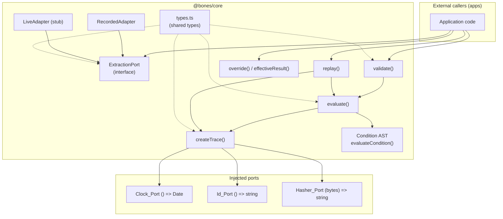

# Design Document: packages/core

## Overview

`packages/core` is the decision kernel of the Bones platform. It is a pure TypeScript library with no UI, no domain-specific logic, and no I/O beyond injected ports. Its responsibilities are:

1. Define the typed interfaces for pluggable extraction adapters (the **Extraction Port**).
2. Validate LLM-proposed fields against an app-supplied Zod schema.
3. Evaluate a versioned, declarative rule set against validated fields to produce a deterministic **Decision**.
4. Record every decision as an immutable, self-describing **Trace**.
5. Replay any stored Trace against a different rule set version without re-running extraction.
6. Allow a human reviewer to **override** a Decision without mutating the original Trace.
7. Express every error as a typed **CoreError** discriminated union — never by throwing.

The package is published as `@bones/core` within a pnpm workspace and imported by the two demo applications (`apps/expense-auditor` and `apps/case-files`). It has no runtime knowledge of either domain; all domain data (schemas, rules, fixtures) is supplied at call time.

---

## Architecture



Key architectural properties:

- **Pure core**: `evaluate()` is a pure function — no I/O, no randomness, no `Date.now()`. Identical inputs always produce identical outputs.
- **Port injection**: `createTrace`, `replay`, and `override` receive `KernelPorts` as a parameter. Tests inject deterministic stubs.
- **No exceptions from kernel code**: every function in `src/` returns `Result<T, CoreError>` or equivalent. Third-party exceptions (e.g. Zod parsing) are caught and wrapped.
- **`Object.freeze` on Trace**: returned Trace objects are deep-frozen to enforce the immutability requirement at runtime.

---

## Components and Interfaces

The kernel exposes eight public entry points, each a standalone function or class. All share types from `src/types.ts` and communicate through `KernelPorts`. No component has circular dependencies.

| Component | File | Signature |
|-----------|------|-----------|
| `ExtractionPort` | `extraction/port.ts` | Interface: `extract(input) → Promise<ExtractionResult \| CoreError>` |
| `LiveAdapter` | `extraction/live.ts` | Stub: always returns `CoreError("live_adapter_not_implemented")` |
| `RecordedAdapter` | `extraction/recorded.ts` | Reads JSON fixture file, returns stored `ExtractionResult`. Node-only: exported from `@bones/core/node` (`src/node.ts`), never from the main barrel |
| `validate` | `validation.ts` | `(proposedFields, schema) → ValidatedFields \| CoreError` |
| `evaluate` | `rules/evaluate.ts` | `(fields, ruleSet, catalog, amountScopes) → Decision \| CoreError` |
| `evaluateCondition` | `rules/ast.ts` | `(node, fields) → { result, evidence } \| CoreError` |
| `createTrace` | `trace.ts` | `(decision, extractionResult, ruleSet, validatedFields, rawInputBytes, ports, options?: { inputHash?: string }) → Trace \| CoreError` |
| `replay` | `replay.ts` | `(trace, ruleSetVersion, ruleSet, catalog, amountScopes, ports) → Trace \| CoreError` |
| `override` | `override.ts` | `(trace, input, ports) → Override \| CoreError` |
| `effectiveResult` | `override.ts` | `(trace, overrides[]) → DecisionResult \| CoreError` |

**Dependency order** (no cycles):

```
types.ts
  └── rules/ast.ts
        └── rules/evaluate.ts
              └── trace.ts
                    ├── replay.ts
                    └── override.ts
extraction/port.ts
  ├── extraction/live.ts
  └── extraction/recorded.ts
validation.ts
index.ts  (re-exports everything above)
```

---

## Module Structure

```
packages/core/
├── src/
│   ├── types.ts              ← all shared types (ExtractionResult, Rule, RuleSet, Trace, Override, CoreError, port interfaces…)
│   ├── extraction/
│   │   ├── port.ts           ← ExtractionPort interface + input-size guards
│   │   ├── live.ts           ← LiveAdapter stub (warns, returns CoreError)
│   │   └── recorded.ts       ← RecordedAdapter (reads JSON fixture files)
│   ├── validation.ts         ← validate(proposedFields, schema) → ValidatedFields | CoreError
│   ├── rules/
│   │   ├── ast.ts            ← Condition AST type defs + evaluateCondition()
│   │   └── evaluate.ts       ← evaluate(fields, ruleSet, catalog, amountScopes) → Decision | CoreError
│   ├── trace.ts              ← createTrace(..., ports) → Trace | CoreError
│   ├── replay.ts             ← replay(trace, ruleSetVersion, ruleSet, catalog, ports) → Trace | CoreError
│   ├── override.ts           ← override(..., ports) + effectiveResult()
│   └── index.ts              ← public barrel export
├── test-fixtures/
│   └── expense/
│       └── recorded/
│           └── signature-scenario.json
├── package.json
├── tsconfig.json
└── vitest.config.ts
```

No file under `src/` may import from `test-fixtures/`. Domain-specific identifiers (`expense`, `receipt`, `alcohol`, `meal`, `trip`, `suspect`, `case`) are forbidden inside `src/`.

---

## Type Definitions

All shared types live in `src/types.ts`. The file has no runtime dependencies beyond `zod` type imports (used in the `validate` signature).

### Primitive types

```typescript
/** Closed interval [0, 1] representing extraction confidence. */
type Confidence = number; // validated at runtime: 0 <= n <= 1

/** Per-field location in the original input. */
type SourceLocation =
  | { kind: "line"; lineIndex: number }           // non-negative integer
  | { kind: "bbox"; x: number; y: number; width: number; height: number }; // all in [0,1]

type ProposedFields = Record<string, unknown>;
type ValidatedFields = Record<string, unknown>;
```

### Extraction types

```typescript
interface ExtractionResult {
  proposedFields: ProposedFields;
  confidence: Record<string, Confidence>;
  sources: Record<string, SourceLocation | undefined>;
  rawModelOutput: string;
}
```

### Rule types

```typescript
type RuleEffect = "blocking" | "capping" | "deducting";

// effectConfig depends on effect:
type BlockingConfig  = Record<string, never>;          // empty object {}
type CappingConfig   = { cap: number | ConditionNode }; // constant cents or AST expression
type DeductingConfig = { deductionAmount: number };     // positive integer cents

interface Rule {
  id: string;
  version: string;           // MAJOR.MINOR.PATCH
  effect: RuleEffect;
  condition: ConditionNode;
  effectConfig: BlockingConfig | CappingConfig | DeductingConfig;
  messageTemplate: string;   // ≤ 1024 chars, may contain {{path}} and {{path|money}} slots
}

interface RuleRef {
  ruleId: string;
  ruleVersion: string;
}

interface RuleSet {
  id: string;
  version: string;           // MAJOR.MINOR.PATCH
  rules: RuleRef[];          // 0–200 entries
  currencySymbol?: string;   // 1 to 4 characters (UTF-16 code units), default "$"
}

type RuleCatalog = Map<string, Rule>; // key: `${id}@${version}`
```

### Decision and AmountScope

```typescript
type DecisionResult = "approved" | "partially_approved" | "rejected";

interface AmountScope {
  name: string;
  claimedCents: number; // positive integer
}

interface RuleOutcome {
  ruleId: string;
  ruleVersion: string;
  effect: RuleEffect;
  conditionMet: boolean;
  evidence: Record<string, unknown>;
  renderedMessage: string;
  deductedCents?: number;   // deducting rules only
  appliedCapCents?: number; // capping rules only
  // Running amount in the rule's scope immediately before / after this rule.
  // Integer cents. Absent on blocking outcomes. traceSchemaVersion stays "1".
  amountBeforeCents?: number;
  amountAfterCents?: number;
}

interface Decision {
  result: DecisionResult;
  amountCents: number;      // integer >= 0
  ruleOutcomes: RuleOutcome[];
}
```

### Trace

```typescript
const TRACE_SCHEMA_VERSION = "1" as const;

interface Trace {
  readonly traceSchemaVersion: typeof TRACE_SCHEMA_VERSION;
  readonly decisionId: string;
  readonly createdAt: string;           // ISO 8601 UTC
  readonly inputHash: string;           // SHA-256 hex
  readonly rawModelOutput: string;
  readonly proposedFields: ProposedFields;
  readonly confidence: Record<string, Confidence>;
  readonly sources: Record<string, SourceLocation | undefined>;
  readonly validatedFields: ValidatedFields;
  readonly ruleSetId: string;
  readonly ruleSetVersion: string;
  readonly ruleOutcomes: readonly RuleOutcome[];
  readonly result: DecisionResult;
  readonly amountCents: number;
}
```

### Override

```typescript
interface Override {
  readonly decisionId: string;           // links to Trace.decisionId
  readonly reviewerName: string;
  readonly reason: string;
  readonly replacementResult: DecisionResult;
  readonly createdAt: string;            // ISO 8601 UTC
  readonly metadata?: Record<string, unknown>;
}
```

### Port interfaces

```typescript
interface KernelPorts {
  clock:  () => Date;
  id:     () => string;
  hasher: (bytes: Uint8Array) => string;
}
```

---

## Data Models

The kernel's data model is a strict hierarchy: raw input → `ExtractionResult` → `ValidatedFields` → `Decision` → `Trace` → `Override`. Each stage is immutable after creation and typed via the interfaces below.

### ExtractionResult → ValidatedFields → Decision flow

```
RawInput (string | Uint8Array)
  │  ExtractionPort.extract()
  ▼
ExtractionResult { proposedFields, confidence, sources, rawModelOutput }
  │  validate(proposedFields, schema)
  ▼
ValidatedFields (Record<string, unknown>, Zod-checked)
  │  evaluate(fields, ruleSet, catalog, amountScopes)
  ▼
Decision { result, amountCents, ruleOutcomes[] }
  │  createTrace(..., ports)
  ▼
Trace (immutable, deep-frozen)
  │  override(..., ports)      │  effectiveResult(trace, overrides[])
  ▼                            ▼
Override                   DecisionResult (effective)
```

### Zod validation schemas

While `validate()` accepts any `z.ZodTypeAny` at call time, the kernel ships Zod helpers for validating `Rule` and `RuleSet` shapes:

- `ruleSchema` — validates id, version pattern, effect enum, condition node, effectConfig, messageTemplate length.
- `ruleSetSchema` — validates id, version pattern, rules array length (0–200), each `{ ruleId, ruleVersion }` entry.

These schemas are used internally during rule catalog resolution and are also exported for app-level pre-validation.

### Amount arithmetic invariants

- All amounts are integer cents (`number` satisfying `Number.isInteger(n) && n >= 0`).
- Caps apply first, one rule at a time: `Math.max(0, Math.min(runningAmount, cap))`.
- Deductions apply afterwards, clamped to 0: `Math.max(0, runningAmount - deductionAmount)`.
- The running amount starts at `claimedCents`, so the final amount never exceeds the claimed total.
- Final `amountCents` in Decision is the sum of all scope final amounts.

---

## CoreError Variants

`CoreError` is a closed discriminated union. Every variant carries `kind` (a unique string literal) and `message` (non-empty string). No `kind` value overlaps with `"approved"`, `"partially_approved"`, or `"rejected"`.

```typescript
type CoreError =
  | { kind: "live_adapter_not_implemented"; message: string }
  | { kind: "fixture_not_found";            message: string; fixturePath: string }
  | { kind: "fixture_invalid";              message: string; fixturePath: string; parseError: string }
  | { kind: "validation_failed";            message: string; fieldErrors: { path: string; issue: string }[] }
  | { kind: "rule_not_found";               message: string; ruleId: string; ruleVersion: string }
  | { kind: "invalid_condition_ast";        message: string; nodeKind: string }
  | { kind: "trace_schema_mismatch";        message: string; found: string; expected: string }
  | { kind: "ambiguous_override";           message: string; createdAt: string }
  | { kind: "invalid_rule_schema";          message: string; ruleId?: string; fieldErrors: { path: string; issue: string }[] }
  | { kind: "invalid_rule_set_schema";      message: string; fieldErrors: { path: string; issue: string }[] }
  | { kind: "invalid_effect_config";        message: string; ruleId: string; ruleVersion: string }
  | { kind: "input_empty";                  message: string }
  | { kind: "input_too_large";              message: string; byteLength: number; maxBytes: number }
  | { kind: "invalid_replay_arguments";     message: string; missingField: string }
  | { kind: "invalid_override_input";       message: string; field: "reviewerName" | "reason" }
  | { kind: "extraction_failed";            message: string; reason: "disabled" | "network" | "bad_response" | "upstream" };
```

`"extraction_failed"` is the sixteenth variant. A live extraction adapter needs a way to report that its call failed: `disabled` (live mode is off), `network` (the request did not complete), `bad_response` (the reply was not a valid extraction) and `upstream` (the model provider reported an error). Without it the adapter could only reuse an unrelated variant.

**Design rationale**: extra fields (e.g. `fixturePath`, `fieldErrors`, `ruleId`) give callers everything needed for programmatic handling and user-facing messages without a second lookup. The union is sealed — adding a variant is a breaking change requiring a new major version of `@bones/core`.

Helper type guard:

```typescript
function isCoreError(v: unknown): v is CoreError {
  return typeof v === "object" && v !== null && "kind" in v &&
    CORE_ERROR_KINDS.has((v as { kind: string }).kind);
}
```

---

## Condition AST Design

Types live in `src/rules/ast.ts`. The evaluator (`evaluateCondition`) also lives there.

### Node kinds

```typescript
type LiteralOrPath =
  | { kind: "literal"; value: unknown }
  | { kind: "path";    segments: string[] }; // dot-separated, 1–10 segments, total ≤ 256 chars

type ComparisonOp = "==" | "!=" | "<" | "<=" | ">" | ">=";

type ConditionNode =
  | { kind: "comparison";   left: LiteralOrPath; op: ComparisonOp; right: LiteralOrPath }
  | { kind: "sum";          collection: string; field: string }   // path to array; field within each element
  | { kind: "date_in_range"; dateField: string; startField: string; endField: string }
  | { kind: "membership";   valueField: string; set: unknown[] };
```

Only these four node kinds are accepted. Any other `kind` string causes the evaluator to return a `CoreError` with variant `"invalid_condition_ast"`.

### evaluateCondition algorithm

```typescript
function evaluateCondition(
  node: ConditionNode,
  fields: ValidatedFields
): { result: boolean; evidence: Record<string, unknown> } | CoreError
```

1. **comparison**: resolve `left` and `right` (look up path segments via `get(fields, segments)`, or use literal directly). Collect both values into `evidence`. Apply the operator; use `===`/`!==` for equality and `Number()` coercions for ordering. Return `CoreError("invalid_condition_ast")` if either side is a path with > 10 segments.
2. **sum**: resolve `collection` path to an array in `fields`. Map over elements extracting the named `field`. Sum numeric values, ignoring non-numeric. Record the array path and the computed sum in `evidence`.
3. **date_in_range**: resolve three fields to ISO 8601 date strings. Parse to `Date` objects. Return `true` if `dateField` is ≥ `startField` and ≤ `endField`. Record all three values in `evidence`. Return `CoreError` if any value is not a valid ISO date string.
4. **membership**: resolve `valueField` to a concrete value. Return `true` if the value is deeply equal (via `JSON.stringify` comparison for objects) to any element in `set`. Record `valueField`'s value and `set` in `evidence`.

All resolutions use a helper `getPath(fields, path: string): unknown` that performs dot-split, segment-by-segment descent, and returns `undefined` if any segment is missing (never throws).

---

## Evaluate Algorithm

Lives in `src/rules/evaluate.ts`.

```typescript
function evaluate(
  fields: ValidatedFields,
  ruleSet: RuleSet,
  catalog: RuleCatalog,
  amountScopes: AmountScope[]
): Decision | CoreError
```

### Step 1: Resolve all rule refs

For every `{ ruleId, ruleVersion }` in `ruleSet.rules`, look up `catalog.get(`${ruleId}@${ruleVersion}`)`. If any is missing, return `CoreError("rule_not_found", …)`. This ensures the rest of the algorithm never encounters a missing rule.

### Step 2: Partition and sort

Partition resolved rules into three buckets:
- `blocking[]`
- `capping[]`
- `deducting[]`

Within each bucket, sort by `id` lexicographically (ensures deterministic outcome regardless of RuleSet ordering, satisfying Req 4.11 / 11.8).

### Step 3: Blocking pass (first-fail-wins)

Iterate `blocking` in sorted order. For each rule, call `evaluateCondition(rule.condition, fields)`. If the result is a `CoreError`, propagate it. If `conditionMet === true`, immediately construct and return:

```typescript
{
  result: "rejected",
  amountCents: 0,
  ruleOutcomes: [{ ruleId, ruleVersion, effect: "blocking", conditionMet: true, evidence, renderedMessage }]
}
```

Remaining blocking rules that were not evaluated receive `conditionMet: false` with empty evidence in the final `ruleOutcomes` array.

Each scope keeps a running amount that starts at its `claimedCents`.

### Step 4: Capping pass

For each capping rule in ascending `rule.id` order, one rule at a time: `before = running[scope]`. If `conditionMet === true`, evaluate `effectConfig.cap` (a constant or an AST expression over `fields`) to obtain `capCents`, then `after = Math.max(0, Math.min(before, capCents))`, `running[scope] = after` and `appliedCapCents = capCents`. Otherwise `after = before`. Set `amountBeforeCents = before` and `amountAfterCents = after` on the outcome. Caps are not collected or minimised across rules; each one lowers the running amount in turn.

### Step 5: Deducting pass

For each deducting rule in ascending `rule.id` order, after all caps: `before = running[scope]`. If `conditionMet === true`, `after = Math.max(0, before - deductionAmount)`, `running[scope] = after` and `deductedCents = deductionAmount`. Otherwise `after = before`. Set `amountBeforeCents` and `amountAfterCents` on the outcome.

> **Scope matching**: `effectConfig` for capping and deducting rules also carries a `scope: string` field identifying which `AmountScope.name` the rule applies to.

Because caps run first, a deduction is taken from the already capped amount. Example (signature scenario): scope `total` starts at 48000; `line-item-cap` 48000 → 4800; `meal-limit` 4800 → 4800; `alcohol-deducting` 4800 → 4150.

### Step 6: Determine result and build Decision

- Compute `totalAmountCents` as the sum over all scopes.
- If any scope's final amount < its `claimedCents`: result is `"partially_approved"`.
- Otherwise: result is `"approved"`.

Collect `RuleOutcome` entries for all evaluated rules (capping and deducting), including those whose condition was `false`. Blocking outcomes carry no amount fields.

Return:

```typescript
{
  result,
  amountCents: totalAmountCents,
  ruleOutcomes: [...blockingOutcomes, ...cappingOutcomes, ...deductingOutcomes]
}
```

### messageTemplate rendering

`renderTemplate` and `formatMoney` live in `src/rules/template.ts` and are exported from `index.ts` together with `DEFAULT_CURRENCY_SYMBOL` (`"$"`). `evaluate` calls `renderTemplate(template, fields, ruleSet.currencySymbol ?? DEFAULT_CURRENCY_SYMBOL)` before attaching `renderedMessage` to each `RuleOutcome`:

```typescript
const SLOT = /\{\{([^}]+)\}\}/g;

// Precondition: Number.isSafeInteger(cents). Integer arithmetic only.
function formatMoney(cents: number, symbol: string): string {
  const negative = cents < 0;
  const abs = Math.abs(cents);
  const frac = abs % 100;
  const whole = (abs - frac) / 100;
  const grouped = String(whole).replace(/\B(?=(\d{3})+(?!\d))/g, ",");
  return `${negative ? "-" : ""}${symbol}${grouped}.${frac < 10 ? "0" : ""}${frac}`;
}

function renderTemplate(
  template: string,
  fields: ValidatedFields,
  currencySymbol: string = DEFAULT_CURRENCY_SYMBOL,
): string {
  return template.replace(SLOT, (_m, inner: string) => {
    const bar = inner.indexOf("|");
    const path = (bar < 0 ? inner : inner.slice(0, bar)).trim();
    const filter = bar < 0 ? undefined : inner.slice(bar + 1).trim();
    const val = getPath(fields, path);
    if (val === undefined) return "";
    if (filter === "money" && typeof val === "number" && Number.isSafeInteger(val)) {
      return formatMoney(val, currencySymbol);
    }
    return String(val);
  });
}
```

Slot syntax is `{{path}}` or `{{path|money}}`; whitespace around the path and the filter name is ignored. Rules:

- A missing path renders as `""`. No error is raised.
- `money` applies only to safe integers and formats cents as `<symbol><grouped whole>.<two digits>`, with a leading `-` for negative values (`48000` gives `$480.00`, `4150` gives `$41.50`, `-5` gives `-$0.05`).
- An unknown filter, or `money` on a value that is not a safe integer, renders the plain `String(value)`.
- The symbol comes from `RuleSet.currencySymbol` (default `"$"`). `ruleSetSchema` requires 1 to 4 characters, counted as UTF-16 code units (`z.string().min(1).max(4)`).

### Purity guarantee

`evaluate` calls no I/O, reads no external state, and performs no randomness. The only input is its four parameters. Two calls with identical arguments always return deeply equal results.

---

## Trace Immutability

`createTrace` in `src/trace.ts` calls `Object.freeze` recursively via a helper:

```typescript
function deepFreeze<T>(obj: T): Readonly<T> {
  if (obj === null || typeof obj !== "object") return obj;
  Object.getOwnPropertyNames(obj).forEach((name) => {
    const val = (obj as Record<string, unknown>)[name];
    if (val && typeof val === "object") deepFreeze(val);
  });
  return Object.freeze(obj);
}
```

The returned value is typed as `Readonly<Trace>`. In strict mode with `noUncheckedIndexedAccess`, TypeScript surfaces attempted mutation as a type error. At runtime, assignments to frozen object properties throw a `TypeError` in strict mode and silently no-op in sloppy mode — satisfying the requirement that mutation "raises an error or has no effect."

### Replay algorithm

`replay` in `src/replay.ts`:

1. Return `invalid_replay_arguments` if `ruleSetVersion`, `ruleSet` or `catalog` is absent, or if `trace.inputHash` is empty (`missingField: "inputHash"`).
2. Return `trace_schema_mismatch` if `trace.traceSchemaVersion !== TRACE_SCHEMA_VERSION`.
3. Re-run `evaluate` on `trace.validatedFields` with the supplied rule set, catalog and amount scopes.
4. Call `createTrace(decision, extraction, replayRuleSet, trace.validatedFields, new Uint8Array(0), ports, { inputHash: trace.inputHash })`. With `options.inputHash` set, `createTrace` uses that value as-is, never calls the Hasher_Port and does not read `rawInputBytes`, so the replayed Trace keeps the original `inputHash`. The original input bytes are not available during replay, and the encoded `rawModelOutput` must not be hashed in their place (Bug 2 in `bugs-found.md`).

`traceSchemaVersion` is the module-level constant `"1"`. A `trace_schema_mismatch` CoreError is returned during `replay` whenever `trace.traceSchemaVersion !== TRACE_SCHEMA_VERSION`.

---

## Port Injection

The `KernelPorts` interface is the single injection point for all non-deterministic concerns:

```typescript
interface KernelPorts {
  clock:  () => Date;
  id:     () => string;
  hasher: (bytes: Uint8Array) => string;
}
```

### Production defaults (provided by apps, not by `packages/core`)

| Port | Suggested production implementation |
|------|-------------------------------------|
| `clock` | `() => new Date()` |
| `id` | `() => crypto.randomUUID()` |
| `hasher` | `(b) => sha256hex(b)` using Web Crypto API |

### Test doubles

```typescript
const deterministicPorts: KernelPorts = {
  clock:  () => new Date("2024-01-01T00:00:00.000Z"),
  id:     () => "fixed-id-001",
  hasher: (b) => Array.from(b).map(x => x.toString(16).padStart(2,"0")).join("").slice(0, 64).padEnd(64,"0"),
};
```

Ports are **never called inside `evaluate()`**. Clock, ID, and hash concerns are handled in `createTrace` and `replay` only.

---

## Validation Module

`src/validation.ts`:

```typescript
import { z } from "zod";

function validate(
  proposedFields: ProposedFields,
  schema: z.ZodTypeAny
): ValidatedFields | CoreError
```

Implementation:

1. Guard: if `schema` is not a Zod schema object (duck-type check via `typeof schema?.parse !== "function"`), return `CoreError("validation_failed", "Invalid schema object provided")`.
2. Call `schema.safeParse(proposedFields)`.
3. If `result.success`: return `result.data` as `ValidatedFields`.
4. If `!result.success`: collect `result.error.issues`, map each to `{ path: issue.path.join("."), issue: issue.message }`, return `CoreError("validation_failed", …, fieldErrors)`.

`validate` is the **sole entry gate** to `evaluate`. No call path in `@bones/core` passes `ProposedFields` directly to the evaluator.

---

## Extraction Modules

### `src/extraction/port.ts`

Defines the `ExtractionPort` interface and the input guard function:

```typescript
type RawInput = string | Uint8Array;

interface ExtractionPort {
  extract(input: RawInput): Promise<ExtractionResult | CoreError>;
}

function guardInput(input: RawInput): CoreError | null {
  if (typeof input === "string" && input.length === 0)
    return { kind: "input_empty", message: "Input must not be empty." };
  if (input instanceof Uint8Array && input.byteLength === 0)
    return { kind: "input_empty", message: "Input must not be empty." };
  if (input instanceof Uint8Array && input.byteLength > 10_485_760)
    return { kind: "input_too_large", message: `…`, byteLength: input.byteLength, maxBytes: 10_485_760 };
  return null;
}
```

### `src/extraction/live.ts`

```typescript
// NOT FOR PRODUCTION USE
export class LiveAdapter implements ExtractionPort {
  extract(_input: RawInput): Promise<ExtractionResult | CoreError> {
    console.warn("[LiveAdapter] This adapter is a non-production stub.");
    return Promise.resolve({
      kind: "live_adapter_not_implemented",
      message: "LiveAdapter is not implemented. Use RecordedAdapter for demos.",
    });
  }
}
```

The compile-time marker is the `// NOT FOR PRODUCTION USE` JSDoc tag `@deprecated` on the class.

### `src/extraction/recorded.ts`

```typescript
export class RecordedAdapter implements ExtractionPort {
  constructor(private readonly fixturePath: string) {}

  async extract(_input: RawInput): Promise<ExtractionResult | CoreError> {
    const guard = guardInput(_input);
    if (guard) return guard;
    try {
      const raw = await fs.readFile(this.fixturePath, "utf-8");
      const parsed = JSON.parse(raw);
      // Validate shape matches ExtractionResult
      return parsed as ExtractionResult;
    } catch (e) {
      if ((e as NodeJS.ErrnoException).code === "ENOENT")
        return { kind: "fixture_not_found", message: `…`, fixturePath: this.fixturePath };
      return { kind: "fixture_invalid", message: `…`, fixturePath: this.fixturePath, parseError: String(e) };
    }
  }
}
```

Returns data **exactly as stored** — no transformation, no re-serialization.

---

## Test Fixture Layout

The expense rules and rule sets live in the versioned rules folder at the repo root (`rules/expense-auditor/rules/` and `rules/expense-auditor/rule-sets/`). The recorded scenario stays in `packages/core/test-fixtures/expense/recorded/`. No `src/` file imports from any of these paths.

### `rules/expense-auditor/rules/`

| File | Effect | Key config |
|------|--------|-----------|
| `meal-limit-v1.json` | `capping` | `cap: 5000` (cents) |
| `meal-limit-v2.json` | `capping` | `cap: 6000` (cents) |
| `meal-limit-v3.json` | `capping` | `cap: 7500` (cents) |
| `date-blocking.json` | `blocking` | `condition: date_in_range` on receipt date vs trip start/end |
| `alcohol-deducting.json` | `deducting` | `deductionAmount` = field `alcoholLineCents`; `scope: "total"` |
| `line-item-cap.json` | `capping` | `cap`: AST sum expression over line items |

### `rules/expense-auditor/rule-sets/`

| File | Included rules |
|------|---------------|
| `expense-v1.json` | date-blocking, alcohol-deducting, meal-limit-v1, line-item-cap |
| `expense-v2.json` | date-blocking, alcohol-deducting, meal-limit-v2, line-item-cap |
| `expense-v3.json` | date-blocking, alcohol-deducting, meal-limit-v3, line-item-cap |

### `test-fixtures/expense/recorded/signature-scenario.json`

This fixture exercises the full pipeline:

```json
{
  "proposedFields": {
    "claimedTotalCents": 48000,
    "lineItemSumCents": 4800,
    "alcoholLineCents": 650,
    "receiptDate": "2024-03-15",
    "tripStart": "2024-03-10",
    "tripEnd": "2024-03-20"
  },
  "confidence": {
    "claimedTotalCents": 0.97,
    "lineItemSumCents": 0.95,
    "alcoholLineCents": 0.91,
    "receiptDate": 0.99
  },
  "sources": {
    "claimedTotalCents": { "kind": "bbox", "x": 0.6, "y": 0.85, "width": 0.2, "height": 0.04 }
  },
  "rawModelOutput": "..."
}
```

**Expected Decision**: `partially_approved`, `amountCents: 4150` (4800 − 650).

The `line-item-cap` rule applies a dynamic cap of 4800 (because `claimedTotalCents` 48000 ≠ `lineItemSumCents` 4800), then `alcohol-deducting` subtracts 650, yielding 4150. With the scope starting at `claimedTotalCents` 48000, the outcomes record `line-item-cap` 48000 → 4800, `meal-limit` 4800 → 4800 and `alcohol-deducting` 4800 → 4150 (`amountBeforeCents` → `amountAfterCents`). Evidence on both outcomes includes both `claimedTotalCents: 48000` and `lineItemSumCents: 4800`.

---

## Package Configuration

### `packages/core/package.json`

```json
{
  "name": "@bones/core",
  "version": "0.1.0",
  "type": "module",
  "exports": {
    ".": "./src/index.ts"
  },
  "scripts": {
    "test": "vitest --run",
    "test:watch": "vitest",
    "coverage": "vitest --run --coverage"
  },
  "dependencies": {
    "zod": "3.23.8"
  },
  "devDependencies": {
    "typescript": "5.4.5",
    "vitest": "1.6.0",
    "@vitest/coverage-v8": "1.6.0",
    "fast-check": "3.19.0"
  }
}
```

> All versions are pinned exact. The `exports` field points directly to TypeScript source; consuming apps use `tsx` or Vite with `vite-tsconfig-paths` to resolve it at dev time.

### `packages/core/tsconfig.json`

```json
{
  "compilerOptions": {
    "target": "ES2022",
    "module": "ESNext",
    "moduleResolution": "bundler",
    "strict": true,
    "noUncheckedIndexedAccess": true,
    "exactOptionalPropertyTypes": true,
    "isolatedModules": true,
    "skipLibCheck": false,
    "outDir": "dist",
    "rootDir": "src"
  },
  "include": ["src", "test-fixtures"],
  "exclude": ["node_modules", "dist"]
}
```

### `packages/core/vitest.config.ts`

```typescript
import { defineConfig } from "vitest/config";

export default defineConfig({
  test: {
    globals: false,
    environment: "node",
    coverage: {
      provider: "v8",
      include: ["src/**"],
      exclude: ["src/index.ts"],
    },
  },
});
```

### `src/index.ts` (barrel)

```typescript
// Types
export type {
  ProposedFields, ValidatedFields, ExtractionResult,
  Rule, RuleSet, RuleCatalog, RuleRef, RuleEffect,
  ConditionNode, LiteralOrPath, ComparisonOp,
  Decision, DecisionResult, AmountScope, RuleOutcome,
  Trace, Override, CoreError, KernelPorts,
  SourceLocation, Confidence,
} from "./types.js";

// Constants
export { TRACE_SCHEMA_VERSION } from "./trace.js";

// Extraction
export type { ExtractionPort } from "./extraction/port.js";
export { LiveAdapter } from "./extraction/live.js";
// RecordedAdapter is NOT exported here: it imports node:fs/promises and would break
// browser bundles. It is exported from src/node.ts as `@bones/core/node`.

// Core pipeline
export { validate } from "./validation.js";
export { evaluate } from "./rules/evaluate.js";
export { evaluateCondition } from "./rules/ast.js";
export { createTrace } from "./trace.js";
export { replay } from "./replay.js";
export { override, effectiveResult } from "./override.js";

// Error helpers
export { isCoreError } from "./types.js";
```

---

## Correctness Properties

*A property is a characteristic or behavior that should hold true across all valid executions of a system — essentially, a formal statement about what the system should do. Properties serve as the bridge between human-readable specifications and machine-verifiable correctness guarantees.*

These tests use **fast-check** (version pinned in `package.json`). Each test runs a minimum of 100 iterations. Tests are tagged with a comment referencing the property number below.

### Property 1: evaluate is deterministic

*For any* `ValidatedFields` accepted without error by `validate` and any consistent `RuleSet` + `RuleCatalog`, calling `evaluate` twice with identical arguments returns two Decision values that are deeply structurally equal.

**Validates: Requirements 4.10, 4.11, 11.1**

### Property 2: replay round-trip preserves Decision

*For any* Trace produced by `createTrace`, calling `replay(trace, trace.ruleSetVersion, ruleSet, catalog, ports)` with the same `ruleSet` and `catalog` returns a new Trace whose `result` and `amountCents` are deeply structurally equal to those of the original Trace, and whose extraction fields (`rawModelOutput`, `proposedFields`, `confidence`, `sources`, `validatedFields`, `inputHash`) are identical to those in the original Trace.

**Validates: Requirements 6.1, 6.2, 11.2**

### Property 3: validate is the sole gate to evaluate

*For any* `ProposedFields` and Zod schema where `validate` returns a `"validation_failed"` CoreError, the return value of the combined call path is that same CoreError and `evaluate` is never invoked.

**Validates: Requirements 2.3, 11.3**

### Property 4: override never mutates the original Trace

*For any* Trace and any valid override input, the Trace object before and after calling `override(trace, …, ports)` is deeply structurally equal; `Object.freeze` prevents in-place mutation, and `override` must not create a modified copy that replaces the reference.

**Validates: Requirements 5.4, 6.4, 7.2, 11.4**

### Property 5: effectiveResult returns the latest Override

*For any* non-empty array of Override objects with strictly distinct `createdAt` timestamps, `effectiveResult(trace, overrides)` returns the `replacementResult` of the Override whose `createdAt` is strictly greatest. For an empty overrides array, `effectiveResult` returns the original Decision from the Trace.

**Validates: Requirements 7.3, 7.4, 11.5**

### Property 6: amountCents is always within [0, claimedTotalCents]

*For any* `ValidatedFields` accepted without error by `validate` and any `AmountScope[]`, the `amountCents` on every Decision produced by `evaluate` satisfies `0 <= amountCents <= sum(scope.claimedCents)`.

**Validates: Requirements 4.6, 11.6**

### Property 7: cap increase never decreases amountCents (monotonicity)

*For any* rule set containing at least one Capping_Rule, increasing the `cap` value of any single Capping_Rule by any positive integer amount — while holding all other inputs constant — never causes the `amountCents` on the resulting Decision to decrease.

**Validates: Requirements 4.3, 11.7**

### Property 8: rule permutation invariance

*For any* `RuleSet`, permuting the order of `rules` within the `RuleSet` while keeping all other inputs constant produces a Decision with an identical `result` and `amountCents`, and a `ruleOutcomes` array that contains the same set of outcomes (independent of order).

**Validates: Requirements 4.1, 4.11, 11.8**

### Property 9: deterministic ports produce byte-for-byte identical Trace JSON

*For any* `ValidatedFields` accepted without error by `validate`, when all three `KernelPorts` return fixed, deterministic values, `evaluate` followed by `createTrace` produces a `JSON.stringify` output that is byte-for-byte identical across two invocations with identical arguments.

**Validates: Requirements 5.5, 11.9**

### Property 10: RecordedAdapter returns fixture data unmodified

*For any* valid `ExtractionResult` JSON fixture written to disk, loading it via `RecordedAdapter` returns a result whose `proposedFields`, `confidence`, `sources`, and `rawModelOutput` are deeply equal to the original fixture object.

**Validates: Requirements 1.8**

### Property 11: Kernel never throws — all errors returned as CoreError

*For any* combination of inputs including invalid rules, malformed schemas, empty inputs, unknown AST node kinds, and mismatched trace versions, no function exported from `@bones/core` throws an unhandled exception; every error is returned as a `CoreError` value.

**Validates: Requirements 8.2**

### Property 12: messageTemplate rendering substitutes all present field paths

*For any* `messageTemplate` string containing one or more `{{fieldPath}}` and `{{fieldPath|money}}` slots and any `ValidatedFields`, the rendered message contains the string representation of every present field value in place of its plain slot, the formatted amount in place of every `|money` slot whose value is a safe integer, and an empty string in place of every absent field path.

**Validates: Requirements 4.8, 4.9**

---

## Error Handling

### Never-throw contract

Every function in `src/` returns `T | CoreError`. Third-party calls that can throw (Zod `safeParse`, `JSON.parse`, `fs.readFile`) are wrapped in `try/catch` and their errors are mapped to the appropriate `CoreError` variant before returning.

### Result pattern

The codebase does not use a functional `Result<T, E>` monad type. Instead it uses the idiomatic TypeScript pattern:

```typescript
function foo(): ValueType | CoreError { … }

const result = foo();
if (isCoreError(result)) {
  // handle error
  return result; // or transform
}
// use result as ValueType
```

`isCoreError` is exported from `index.ts` to allow callers to discriminate cleanly.

### Port errors during Trace creation

If any `KernelPorts` call throws during `createTrace` or `replay`, the exception is caught and returned as a `CoreError("invalid_replay_arguments" | "trace_schema_mismatch")` as appropriate. A partial `Trace` is never returned.

---

## Testing Strategy

### Dual approach

- **Property-based tests** (fast-check): validate the 12 correctness properties listed above across ≥ 100 generated inputs each.
- **Unit / example tests** (Vitest): validate specific behaviors, edge cases, and error paths where property tests are not applicable (e.g., LiveAdapter returning the specific CoreError variant, `trace_schema_mismatch` on version mismatch, fixture-not-found scenarios).

### Test file layout

```
packages/core/src/
  __tests__/
    extraction.test.ts      ← RecordedAdapter, LiveAdapter, guardInput edge cases
    validation.test.ts      ← validate() examples + Property 3
    rules/
      ast.test.ts           ← evaluateCondition() for each node kind + edge cases
      evaluate.test.ts      ← evaluate() Properties 1, 6, 7, 8 + blocking/deducting/capping examples
    trace.test.ts           ← createTrace() Property 4, 9 + immutability + port error cases
    replay.test.ts          ← replay() Property 2 + schema mismatch + null-arg cases
    override.test.ts        ← override() + effectiveResult() Properties 4, 5 + error cases
    recorded.test.ts        ← RecordedAdapter Property 10 + fixture-invalid case
    error-model.test.ts     ← Property 11 (kernel-never-throws) + isCoreError()
    template.test.ts        ← messageTemplate Property 12
    fixtures/
      expense-scenarios.test.ts ← signature scenario end-to-end test (Req 10.5)
```

### Property test configuration

Each property-based test file includes:

```typescript
// Feature: core, Property N: <property title>
fc.assert(fc.property(arbitraryInput, (input) => {
  // …assertion…
}), { numRuns: 100 });
```

### Bug tracking

When a property test finds a failing example, the bug is recorded in `.kiro/specs/core/bugs-found.md` with: the property number, the failing fast-check counterexample, the root cause, and the fix applied. The property test is never weakened to make the bug disappear — the implementation is fixed instead.

### Unit test balance

Property tests handle coverage of wide input spaces. Unit tests focus on:

- Exact error variant and extra fields for each `CoreError` case
- The signature expense scenario (Req 10.5)
- LiveAdapter deprecation warning and CoreError return
- Fixture path not found / malformed JSON
- Replay with `null` arguments
- `effectiveResult` with tied `createdAt` timestamps
- Rule permutation with 0 and 1 rules (boundary cases)
