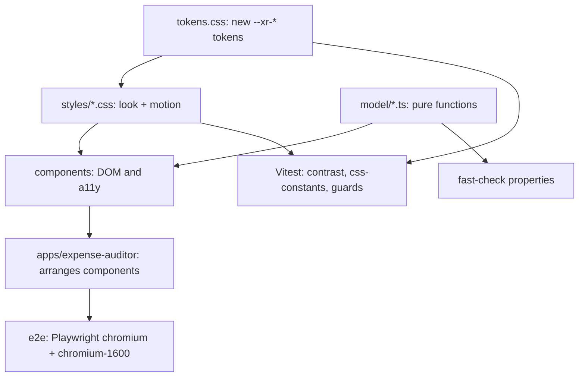
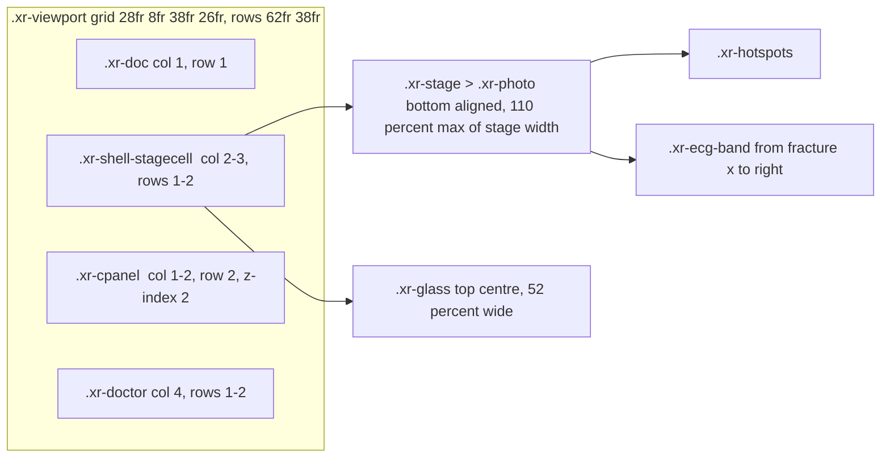

# Design Document: visual-polish-2

## Overview

visual-polish-2 moves the Signature screen and the start screen of the expense-auditor from "works but stiff" to the concept image `design/mockups/bones-7-retro-b.png`. It changes look only. `packages/core`, rules, trace, replay, override and export are untouched. All look and motion live in `packages/xray-ui` with domain-free names; the app arranges components and passes data.

This design is built on code reading and on measurements, not on guesses:

- The mockup (2048x1152), `/tmp/cur-signature.png` and `/tmp/cur-start.png` (1600x900, reduced motion) were compared region by region.
- A temporary Playwright script outside the repo (`/tmp/measure-vp2.mjs`, against `vite preview` of the existing `dist`) measured every region of the current Signature screen at 1600x900, 1440x900 and 1280x720. These numbers are quoted as "measured" below.
- A temporary `sharp` script (`/tmp/skel-bounds*.mjs`, `/tmp/contrast-calc.mjs`) measured the opaque extent of `skeleton.webp` and the average, lightest and darkest pixel of `brushed-steel.webp` and `film.webp`. Contrast numbers quoted below come from it.

No source file was changed to write this document.

### What the comparison shows (summary)

| # | Mockup | Current (measured) | Target |
|---|---|---|---|
| 1 | Labels are engraved text on steel or printed text, no boxes | Light plaques under each control, dark chips on the receipt, dashed result outline, dashed stamp border | Text only; engraved on steel; chips hidden until hover |
| 2 | Cracked glass card top centre, stamp across it | Card bottom left over the lower skeleton (x 470..787, y 470..859 at 1600x900) | Card top centre above the ribs, 52 % of stage width, stamp across the diagonal |
| 3 | ECG starts at the fracture, runs right | ECG spans the full stage (x 456..1176) | Starts at the left-most fractured hotspot |
| 4 | Soft red or cyan bone glow | Hard 2 px rings | Radial-gradient glow, no border |
| 5 | White thermal receipt, tilted, on blue-grey film, red scan line on the total | Flat cream box, monospace, boxed chips, line under the total row | White paper, tilt -2 deg, blue-grey film, scan line centred on the total row |
| 6 | One steel panel with notch, big knob, rectangular VU meter, toggle with amber lamp above | Three plaques, 79 u dial, round gauge | One panel, dial 145 u, VU meter, lamp above toggle |
| 7 | Phone with pill notch, "Dr. Bones · Radiologist", teal bubbles, thin bar, two pill buttons with icons | "Dr. Bones", dark bubbles, 12 u bar with cyan border, boxed buttons, dashed outline | As mockup |
| 8 | Quiet framed header, muted pill, ghost icon buttons | Full-width bar, solid cyan pill, boxed actions, visible "Trip:" text | Rounded framed bar, muted glass pill, ghost pills with icons, trip text hidden |

### Requirement adjustments (conflicts found while checking the numbers)

These are the places where two criteria cannot both be met as written, or where a criterion needs a precise definition. **`requirements.md` must be amended as listed here before the tasks are written.** Nothing in this design deviates silently from a criterion that is not in this table.

| ID | Criteria | Conflict or ambiguity (with numbers) | Resolution in this design | Amendment to requirements.md |
|---|---|---|---|---|
| A1 | R3.5 vs R3.2 vs R10.4 | The photo box must be at least 90 % of the stage height, and the card sits at the stage top. At 1600x900 the stage is 720 x 800 px, so a 90 % box (720 px) leaves 80 px above it. The card needs about 160 px. A card that does not overlap the photo box is impossible. In the mockup the card also covers the skull. | The photo box (`.xr-photo`) is 731.6 px tall (91.5 %) at 1600x900 and the card overlaps its upper part, where the skull is. The card does not touch the rib cage (A2). | R10.4: add "the Glass_Card may overlap the upper 22 % of the Skeleton_Photo box". R3.5 stays as written (1600x900 only). |
| A2 | R3.1 | "Above the top of the rib cage" has no measurable definition. | Rib cage top = 22 % of the photo box height from its top. Derived from `REGION_BOXES.ribs.y = 150 of 900` and `CROP = 3..65`: (16.67 - 3) / 62 = 22.05 %. At 1600x900 this is y = 229 px from the stage top. | R3.1: "the top of the rib cage (22 % of the Skeleton_Photo height from its top)". |
| A3 | R3.3 vs R3.4 | The stamp must cross the diagonal of the card and the rows must stay readable at 4.5:1. A stamp drawn across rows hides the text under it. | The stamp is part of the picture, as in the mockup. Rows are readable at 4.5:1 outside the stamp box. The stamp text itself meets 4.5:1 on its own fill. Row text stays in the DOM. | R3.3: "...readable ... except where the Overrule_Stamp is drawn over it". |
| A4 | R5.2 | "Diameter of the current Knob" is ambiguous: root box 120 u, dial 79.2 u. A 1.8x root box (216 u) does not fit the panel row (243 u with label and padding). | The measure is the dial, `.xr-pknob-dial` `offsetWidth` (layout size, not the rotated bounding box). Old 79.2 u (99 px at 1600x900). New 144.8 u (181 px), ratio 1.83. | R5.2: "diameter of the dial (`.xr-pknob-dial`)". |
| A5 | R5.1, R5.11, R10.4 | The panel must hold a 145 u dial, a VU meter and a toggle. Its current width (28 % of the lightbox) holds 112 u of controls plus the old small ones and is already full. Needed: about 414 u of content. | The panel spans 36 % of the lightbox width and overlaps the empty lower-left corner of the stage cell by 141 px at 1600x900. The skeleton's opaque pixels stay at least 13 px away at all three viewports (see Layout math). The panel still does not overlap the Document_Panel or the Doctor_Panel. | R10.4: "the Control_Panel may overlap the transparent margin of the Skeleton_Photo box, not its opaque pixels". |
| A6 | R4.8, R9.2 | A Field_Mark is a `span` in a `pre`. It is not focusable. Making each mark a tab stop adds 3 to 4 stops before the stage and changes the tab order that `a11y-roles` and `signature.spec.ts` rely on. | The mark label shows on hover of the mark line and whenever the linked rule is hovered or focused (the existing `data-highlighted="true"`, set when a Hotspot has focus). Keyboard users reach the label through the Hotspot. No new tab stop. | R4.8 and R9.2: remove "Field_Mark has keyboard focus"; add "or the linked Hotspot has focus". |
| A7 | R11.5, R11.8, R11.9 | The 1440x900 references must be updated only in the last task, but the look changes in the first task, so the two 1440 reference tests fail from then on. The 1600 references must be updated "on acceptance", but a task must end with a green suite. | The two 1440 reference tests (`start-screen`, `signature-case`) are skipped with a one-line reason from the first look task until the last task. 1600 references are regenerated at the end of every task (suite stays green) and ratified at the checkpoint. If the user asks for changes, the next task regenerates them. | R11.5: "except the two 1440x900 reference tests, which are skipped until the last task". R11.8: "ratified on acceptance". |
| A8 | D8 | "Moves to the Rule_Box context" needs a domain-free data path from the app into the Rule_Box. The Rule_Box has none. | The trip text stays in the DOM, visually hidden, in the header (`contextNote` prop). Showing it in the Rule_Box is not done. | D8: "...stays in the DOM (visually hidden) in the header". |
| A9 | D2 | The app guard `no-visual-in-app.node.test.ts` does not check colours. It only forbids `url(`, `@keyframes`, `transition`, `animation` and images. The move is not blocked. | The guard gets a new rule that makes the move stick (see App guard). | D2: "If the app guard blocks the move" becomes "The app guard is extended to forbid visual declarations in `app.css`". |
| A10 | R3.5 | At 1440x900 the photo box is 81 % of the stage height, not 90 %, because the box width is capped at 1.1x the stage width so that it never reaches the control panel. | Accepted. R3.5 is stated for 1600x900 only. 1280x720 gives 91.5 %. | None. Noted for the reviewer. |

## Architecture

### Layers and where each change lands



### Shell grid before and after

Current (measured, lightbox 1565 x 800 at 1600x900): columns `28fr 46fr 26fr`, rows `62fr 38fr`, areas `doc stage doctor / ctrl stage doctor`.

Target: four columns `28fr 8fr 38fr 26fr` with explicit placement, so the control panel can reach under the stage cell and the stage is still `46fr`.



`shell.css` change: replace `grid-template-columns: 28fr 46fr 26fr` and `grid-template-areas` with the four-column template and explicit `grid-area` values: `.xr-doc { grid-area: 1 / 1 / 2 / 2 }`, `.xr-shell-stagecell { grid-area: 1 / 2 / 3 / 4 }`, `.xr-cpanel { grid-area: 2 / 1 / 3 / 3 }`, `.xr-doctor { grid-area: 1 / 4 / 3 / 5 }`. The `grid-area: doc|stage|doctor|ctrl` lines in `panels.css` and `controls.css` are removed so one file owns placement (`shell.css`).

### Design decisions

| Decision | Choice | Why |
|---|---|---|
| Class names | Keep `.xr-hs-ring`, `.xr-cpanel-plaque`, `.xr-mark-tag`, `.xr-pmeter-needle`, `.xr-pknob-*`, `.xr-ptoggle-*`, `.xr-doctor-*`, `.xr-footer-btn`, `.xr-scan`, `.xr-clip`, `.xr-doc-paper`. Add new classes only for new elements. | At least 14 existing tests query these names. Renaming adds churn without changing the picture. |
| Hotspot glow | Restyle `.xr-hs-ring` in place (no ring). | Same reason; `hotspot.test.tsx` asserts `.xr-hs-ring--<state>`. |
| Meter | Rewrite as inline SVG, remove `meter.webp` and `meterUrl`. | Rectangular face with red zone is easier to draw than to cut from a bitmap; saves 29,192 B. |
| Knob | Keep `knob.webp` for the dial, new size and label ring. | The bakelite dial is the part of the old look that is already close to the mockup. |
| Notch | CSS: corner radius plus two pseudo-element fillets that reuse the steel tile through `mask`. | No raster file (D4). |
| ECG start | Model change (`startX` in `EcgModel`), not a CSS clip. | A CSS clip leaves the DOM box at x = 0 and cannot be tested by bounding box. |
| Photo size | CSS only: `--xr-photo-w: min(110cqw, 99.58cqh)`, bottom aligned, stage clips. | Percent anchors and `toCropPercent` stay exactly as they are; no DOM nesting change, so `fx-stacking`, `SkeletonPhoto.test` and anchor tests stay valid. |
| Reference size | New project `chromium-1600`. | D3. |

### Research summary (what the numbers said)

1. The photo's opaque pixels span 22.4 % to 77.6 % of the image width. At crop rows 69 % to 100 % (the rows beside the control panel) the left edge is at 22.4 % to 38 %; the worst row is 86.7 %. This limits how far the control panel may reach into the stage (Layout math).
2. `brushed-steel.webp` has an average colour of rgb(128,127,122). Dark text `#14202a` reaches only 4.12:1 on it, below the 4.5:1 that R5.10 asks. `#0b1218` reaches 4.70:1. The token `--xr-text-on-steel` changes for this reason.
3. The current scan line (`.xr-scan`) sits at 50 % of `.xr-film-line`, an inline span. The inline-block `.xr-mark-tag` makes that span taller, so the line lands under the row (screenshot: line at y 397, row at y 385). Hiding the tag fixes it, and `display: block` on the line makes the scan span the paper width.
4. `snapshotPathTemplate` in `playwright.config.ts` is `{testDir}/__screenshots__/{testFileName}/{arg}{ext}` with no project name. A 1600 reference taken by the existing spec files would overwrite the 1440 references. The 1600 references therefore live in a new spec file.
5. The motion guard requires, per CSS file, either the exact selector inside a `prefers-reduced-motion: reduce` block with `none`, or (for `.xr-shell ...` selectors) the `[data-motion="reduce"]` / `[data-motion="auto"]` pair in the same file. `form.css` and `header.css` need that pair if they get transitions.
6. `domain-isolation.test.ts` uses `\b(receipt|expense|alcohol|meal|trip|suspect)\b`. The word "strip" does not match, so `xr-form-strip` is fine.
7. `.xr-result` (xray.css) draws a 2 px border and dashed style for `partially_approved` and `data-effective="partially_approved"`. `.xr-result-footer` carries both classes, which is the dashed outline in the screenshot. Two dashed rules exist (xray.css lines 472 and 490), R1.3 names one.

## Components and Interfaces

### Layout math (verified against the real CSS)

`--xr-u = max(1px, min(100vw / 1280, 100vh / 720))`. Measured values, current layout:

| Quantity | 1600x900 | 1440x900 | 1280x720 |
|---|---|---|---|
| u | 1.25 | 1.125 | 1 |
| Header height (52 u) | 65 | 58.5 | 52 |
| Lightbox (`.xr-viewport`) w x h | 1565 x 800 | 1408.5 x 810 | 1252 x 640 |
| Stage cell w x h (46 % of w) | 719.9 x 800 | 647.9 x 810 | 575.9 x 640 |
| Doc panel w x h (28 %, 62 %) | 438.2 x 496 | 394.4 x 502.2 | 350.5 x 396.8 |
| Doctor panel w | 406.9 | 366.2 | 325.5 |
| Photo box now | 719.9 x 665.1 (83.1 % of stage h) | 647.9 x 598.5 (73.9 %) | 575.9 x 532 (83.1 %) |
| Knob root / dial now | 150 / 99 | 135 / 89 | 120 / 79 |

Target formulas:

- Photo width `W = min(1.1 * stageW, 0.92 * stageH * 1.0824)`; `1.0824 = 1208 / 1116` (the crop aspect). Height `H = W / 1.0824`. Bottom aligned. Left and right overflow is clipped by the stage cell.
- Card: width `0.52 * stageW`, centred, `top = max(2u, stageH - H * 1.06)`.
- Rib top = `stageH - H + 0.22 * H`.
- Card height budget = `ribTop - 8u_px - cardTop`.
- Control panel right edge = `lightboxLeft + 0.36 * lightboxW`.
- Skeleton worst left edge = `stageLeft - (W - stageW) / 2 + 0.2243 * W`.

| Target quantity | 1600x900 | 1440x900 | 1280x720 |
|---|---|---|---|
| Photo W x H | 791.9 x 731.6 | 712.7 x 658.5 | 633.5 x 585.3 |
| Photo H / stage H | **91.5 %** | 81.3 % | **91.5 %** |
| Photo left overflow (each side) | 36.0 | 32.4 | 28.8 |
| Photo top (from stage top) | 68.4 | 151.5 | 54.7 |
| Skeleton centre vs stage centre | 0 | 0 | 0 |
| Card width (52 %) | 374.3 | 336.9 | 299.5 |
| Card top | 24.6 | 112.0 | 19.6 |
| Rib top (stage-relative) | 229.4 | 296.4 | 183.5 |
| Card height budget | 197 px (157 u) | 176 px (157 u) | 156 px (156 u) |
| Card content estimate | 138 u (172.5 px) | 138 u (155.3 px) | 138 u (138 px) |
| Card bottom as % of photo H (limit 45) | (24.6 + 172.5 - 68.4) / 731.6 = 17.6 % | 17.6 % | 17.6 % |
| Control panel right edge (36 %) | 581 | 522.9 | 464.7 |
| Skeleton worst left edge | 597.3 | 537.6 | 477.8 |
| **Gap panel to skeleton pixels** | **16.3** | **14.7** | **13.1** |
| ECG left (x of left fractured hotspot, 56.0 % of photo) | 863 | 777 | 691 |
| ECG band height (60/560 of photo W) | 84.8 | 76.4 | 67.9 |
| Panel usable width | 427 u | 427 u | 427 u |
| Panel content sum (188 + 150 + 52 + 24) | 414 u | 414 u | 414 u |
| Panel row height (38 %) | 243 u | 273 u | 243 u |
| Panel content height (188 + 14 + 6 + 26) | 234 u | 234 u | 234 u |

All three viewports have the same u-based panel numbers because `--xr-u` scales the lightbox. At 1440x900 the lightbox is taller than 16:9 (810 px against 720 u * 1.125), which is why the photo cap (1.1 x stage width) rather than the height binds, and the photo is smaller there.

Feasibility check of the three hard criteria together at 1600x900:

- Skeleton height >= 90 % of the stage: 731.6 / 800 = 91.5 %. Passes by 1.5 points. The binding term is the 1.1 width cap (791.9). The height term alone would allow 796.6.
- Card bottom at or above 45 % of the photo height: the card ends at stage y 24.6 + 172.5 = 197.1, which is 128.7 px below the photo top (68.4), i.e. 17.6 %. Passes with a wide margin.
- Card above the rib cage: 197.1 against 229.4. Passes by 32 px.
- ECG starts at the fracture: by construction (model).

At 1280x720 the card has 156 px and needs 138 px. This is the tightest case. If the card content grows, the row layout (one line per field) is the lever, not the card width.

### Region comparison tables

#### Region 1: Global look and boxed labels (R1)

| Element | Mockup | Current | Target |
|---|---|---|---|
| "RULE VERSION", "AI READ CONFIDENCE", "X-RAY" | Dark engraved caps on steel, no box | `.xr-cpanel-plaque`: bg `--xr-bg-metal-light`, mono 11 u, radius 2 u | No background, sans 500, `--xr-text-on-steel`, `text-shadow: var(--xr-engrave)` |
| Receipt chips "1: Merchant" | Not visible | `.xr-mark-tag`: dark plate, mono, always visible | Always in DOM, opacity 0 at rest, visible on hover/highlight, no box |
| Doctor name | Plain text beside avatar | `.xr-doctor-title` h3, no box | Plain text, sans 500 |
| Result block | Plain line and thin bar | `.xr-result.xr-result-footer`: 2 px cyan border, dashed when partially approved | No border, no outline |
| Stamp | Thick rounded outline on the glass | `.xr-glass-stamp`: `border: 2px dashed` | No CSS border; `stamp-frame.webp` is the frame (D5) |
| Hotspot rings | Soft glow | 2 px solid ring | Glow (Region 3) |
| Knob labels v1 v2 v3 | Engraved | `.xr-pknob-label`: bg metal-light plate | Engraved text, no bg |

Files and edits:

- `styles/xray.css`: delete `.xr-result[data-result="partially_approved"] { border-style: dashed; ... }` (line 472) and the `border-style: dashed` in `.xr-result[data-effective="partially_approved"]` (line 490), replacing both with `border-style: solid`. Replace `.xr-mark--bbox { border: 1px dashed ... }` and `.xr-mark--line { border-left: 2px dashed ... }` with `solid`.
- `styles/panels.css`: remove `border: 2px dashed var(--xr-text-stamp-live)` from `.xr-glass-stamp`. Add `.xr-doctor .xr-result.xr-result-footer { border: 0; background: transparent; box-shadow: none; outline: 0; }`. Specificity (0,3,0) beats `.xr-result[data-result=...]` and `.xr-result[data-effective=...]` (0,2,0) regardless of file order.
- `styles/controls.css`: `.xr-cpanel-plaque` and `.xr-pknob-label` lose `background`, `border-radius`, `padding`.
- `styles/panels.css`: `.xr-doc .xr-mark-tag` loses plate colours (see Region 4).

Boxed_Element allow-list for the Playwright sweep on the Signature screen: `.xr-glass`, `.xr-rulebox`, `.xr-doctor`, `.xr-bubble`, `.xr-footer-btn`, `.xr-header` (R7 frames it), `.xr-header-pill`, `.xr-header-action`, `.xr-steel`, `.xr-cpanel`, `.xr-pmeter`, `.xr-doc-paper`, `.xr-doc-film`, `.xr-hotspot .xr-bone-btn` (transparent, focus only), and the image elements. Every other element with a visible border, background or shadow around text fails.

#### Region 2: Typography (R2)

| Where | Mockup | Current | Target |
|---|---|---|---|
| Wordmark BONES, start headline | Serif caps | Cormorant SC 700 | Same, via `--xr-font-serif` |
| UI text | One grotesque sans | `system-ui` in the app, `ui-monospace` in plaques, knob labels, receipt chips; weights 700 in many places | `--xr-font-sans` weight 400 or 500 everywhere except wordmark and headline |
| Receipt | Monospace | `ui-monospace, Menlo, Consolas, monospace` | `--xr-font-mono`, only under `.xr-doc` |

Tokens (`tokens.css`):

```css
--xr-font-serif: "Cormorant SC", Georgia, "Times New Roman", serif;
--xr-font-sans: ui-sans-serif, "Helvetica Neue", Arial, sans-serif;
--xr-font-mono: ui-monospace, Menlo, Consolas, monospace;
```

Edits: `header.css` `.xr-wordmark` and `sheet.css` `.xr-start-title` use `var(--xr-font-serif)`. `.xr-root` and `.xr-shell` get `font-family: var(--xr-font-sans)`. `controls.css` removes the two `ui-monospace` declarations. `panels.css` `.xr-doc .xr-film-text` uses `var(--xr-font-mono)`. `sheet.css` `.xr-sheet-line` (start-screen thumbnails of the paper) keeps mono and is excluded from R2.3 because R2.3 is stated for the Signature screen.

Weights to lower to 500: `.xr-answer-head`, `.xr-field-value`, `.xr-rb-head`, `.xr-result-line`, `.xr-stamp-title`, `.xr-sheet-title`, `.xr-doctor-title`, `.xr-form-strip button`, `.app-button`. The wordmark and headline keep 700 (Cormorant SC is only bundled at 700, so a different weight would be synthesised).

R2.7: `font-display: swap` is already set. The header grid is `1fr auto 1fr`, so a wider fallback serif can not move the pill. The Playwright test blocks the woff2 and compares header child rectangles.

#### Region 3: Stage composition (R3)

| Element | Mockup | Current (1600x900 measured) | Target (1600x900) |
|---|---|---|---|
| Glass card | Top centre, x 715..1340 of 2048 (centre 1028, about 70 % of the stage), y 210..470; bottom at 31 % of the stage | x 470..787, y 470..859, left of skeleton, 388 px tall | x 628..1003 (centre 815.7 = stage centre), y 107..280; 374 x 173 px; bottom 197 px below stage top |
| Skeleton | Neck to hips, cropped at the thigh by the lightbox edge; about 66 % of stage height visible, skull behind the card | 719.9 x 665.1 box, 83 % of stage height | 791.9 x 731.6 box, 91.5 %, bottom aligned, clipped by stage |
| Hotspots | Soft cyan glow on a rib, large red glow with splinters on the hip | 44 u hit area, 2 px ring | Glow, same hit area |
| ECG | From the red glow to the right edge, thin, red spike | Full width 720 px, 77 px tall | From the left fractured hotspot (x 863) to the stage right edge |
| Rule box | Glass box with thin line to the bone | Same | Unchanged except font tokens |

Edits:

- `shell.css`: new grid (above). `.xr-shell-stagecell` gets `overflow: hidden; container-type: size; --xr-photo-w: min(110cqw, 99.58cqh);`. `.xr-shell-stagecell .xr-glass` becomes:

```css
.xr-shell-stagecell .xr-glass {
  position: absolute;
  left: 24%;
  width: 52%;
  top: max(calc(2 * var(--xr-u)), calc(100% - var(--xr-photo-w) / 1.0824 * 1.06));
  max-height: calc(160 * var(--xr-u));
  z-index: 3;
}
```
  The old `left: 2%; bottom: 3%; width: 44%; max-height: 62%` are removed. The flat view block (`data-xray="false"`) also sets `top: auto`.
- `stage.css`: `.xr-stage { place-items: end center; }`. `.xr-photo { width: var(--xr-photo-w); aspect-ratio: 1208 / 1116; flex: none; }` (replaces `width: min(100cqw, 100cqh * 1.0824)`). `.xr-ecg-band { left: var(--xr-ecg-start, 0%); right: 0; width: auto; height: calc(var(--xr-photo-w) * 60 / 560); aspect-ratio: auto; top: calc((50 - 3) / 62 * 100%); }`. The `top:` text stays identical because `css-constants.test.ts` parses it.
- `anchors.ts` (`CROP`, `placeBones`, `toCropPercent`): **no change.** The photo is still the crop box. `Stage.tsx`: no change except passing nothing new (the model derives the start from `anchors`).

Hotspot glow (R3.9 to R3.11), `stage.css`:

```css
.xr-hs-ring {
  position: absolute; inset: -14%; border: 0; border-radius: 50%;
  background: radial-gradient(circle, var(--xr-hs-core) 0%, var(--xr-hs-mid) 38%, transparent 70%);
  filter: blur(calc(1.5 * var(--xr-u, 1px)));
  box-shadow: none; pointer-events: none;
}
.xr-hs-ring--applied-no-change { --xr-hs-core: var(--xr-cyan-glow); --xr-hs-mid: rgba(61, 232, 255, 0.18); }
.xr-hs-ring--fractured { --xr-hs-core: var(--xr-red-glow); --xr-hs-mid: rgba(255, 90, 90, 0.22); inset: -30%; }
.xr-hs-ring--not-applicable { --xr-hs-core: rgba(143, 169, 181, 0.3); --xr-hs-mid: transparent; opacity: 0.5; }
```
The earlier second `.xr-hs-ring--fractured { background: radial-gradient(...) }` block at the end of `stage.css` is merged into the first. `.xr-hotspot .xr-bone-btn:focus-visible` keeps the white outline plus dark outer shadow, so the focus ring is not part of the glow (R3.10). `.xr-hs-check` stays (state is not colour only) but loses its size to `max(10px, 11 u)` and opacity 0.8.

ECG model change (R3.6, R3.7): see Data Models. Line style in `xray.css`: `.xr-ecg-line` stroke 1.5 with `filter: drop-shadow(0 0 2px var(--xr-cyan-glow))`; `.xr-ecg-spike` keeps `--xr-red` with a red drop-shadow. `filter` is an allowed animated property and these are static.

Stamp (R3.4), `panels.css`:

```css
.xr-glass-stamp {
  right: 9%; bottom: 14%; width: 62%; box-sizing: border-box;
  padding: calc(5 * var(--xr-u)) calc(10 * var(--xr-u));
  border: 0; background: rgba(58, 15, 20, var(--xr-stamp-alpha));
  transform: rotate(-9deg);
  text-align: center;
}
```
Card is 374 px wide: stamp 232 px wide, centre x = 374 - 34 - 116 = 224 px (60 % of card width); stamp height about 44 px, centre y = 173 - 24 - 22 = 127 px (73 %). R3.4 asks for the central 60 % (20 % to 80 %), and a diagonal crossing. 224/374 = 59.9 % and 127/173 = 73.4 % are inside; the diagonal from top-left to bottom-right passes at y = 0.6 * 173 = 104 at that x, within the stamp's 22 px half-height rotated by 9 degrees (extra 18 px), so it crosses. `.xr-glass[data-overruled="true"]` keeps `padding-bottom: calc(26 * var(--xr-u))` so the last row is not fully under the stamp.

Glass card rows (R3.3): `panels.css`:

```css
.xr-glass .xr-field { display: grid; grid-template-columns: 30% minmax(0, 1fr); gap: calc(8 * var(--xr-u)); font-size: max(11px, calc(12 * var(--xr-u))); line-height: 1.25; }
.xr-glass .xr-field dd { display: flex; flex-wrap: wrap; align-items: baseline; gap: 0 calc(8 * var(--xr-u)); }
.xr-glass .xr-conf { display: inline; font-size: max(10px, calc(10 * var(--xr-u))); }
```
This is one line per field in the common case, about 20 u per row. The text of every row is unchanged (`confidence 0.99`, the badge). `.xr-glass .xr-field dt { flex: 0 0 32% }` and the `dd` `flex: 1 1 0` lines are removed (the `GlassCard.layout` test asserts `gap:`, no `overflow: hidden` on field, dt, dd, and `overflow-y: auto` on `.xr-glass-body`; all stay true).

Glass keeps `backdrop-filter: blur(10px)`, `glass-cracks.webp` (opacity 0.55, `mix-blend-mode: screen`), border `1px solid var(--xr-cyan-glow)`, radius raised to `calc(14 * var(--xr-u))` to match the mockup's rounded card with a tab on the top left. The tab is not copied.

#### Region 4: Receipt on film (R4)

| Element | Mockup | Current | Target |
|---|---|---|---|
| Film | Blue-grey sheet, x 108..545, slightly larger than the paper, soft edge | None (paper on dark lightbox) | `.xr-doc::before`: gradient `--xr-bg-film` to `--xr-bg-film-deep`, radius 8 u, hairline `rgba(255,255,255,0.08)` |
| Paper | White, curled, tilted about -3 deg, soft shadow | `.xr-doc-paper`: cream `#efe6cc`, flat, square | `--xr-bg-paper-doc: #f7f6f1`, `rotate(-2deg)`, curl shadow, crease gradients |
| Clips | Two chrome clips on the film's top edge | Two clips at paper corners (top -6 u) | Same `clip.webp`, moved to the film's top edge |
| Text | Fine monospace | 12 u mono | Same, `letter-spacing: 0.02em` |
| Marks | Not visible on the receipt | Cyan left border, dark chip | 1.5 px cyan underline with glow; chip hidden |
| Scan line | Red glowing line across the total | 2 px red line, under the row | Same colours, centred on the row |

Edits in `panels.css`:

```css
.xr-doc { padding: calc(24 * var(--xr-u)) calc(16 * var(--xr-u)) calc(16 * var(--xr-u)); isolation: isolate; }
.xr-doc::before {            /* Film_Backdrop: 2 u inside the panel, so paper is >= 14 u inside it */
  content: ""; position: absolute; inset: calc(2 * var(--xr-u)); z-index: -1;
  border-radius: calc(8 * var(--xr-u));
  background: linear-gradient(160deg, var(--xr-bg-film) 0%, var(--xr-bg-film-deep) 62%, var(--xr-bg-film) 100%);
  box-shadow: inset 0 0 0 1px rgba(255, 255, 255, 0.08), inset 0 0 calc(30 * var(--xr-u)) rgba(5, 9, 13, 0.55);
}
.xr-doc-paper {
  padding: calc(26 * var(--xr-u)) calc(10 * var(--xr-u)) calc(14 * var(--xr-u));
  background:
    linear-gradient(115deg, transparent 38%, rgba(0, 0, 0, 0.05) 39%, transparent 41%),
    linear-gradient(65deg, transparent 58%, rgba(0, 0, 0, 0.04) 59%, transparent 61%),
    var(--xr-bg-paper-doc);
  transform: rotate(-2deg);
  box-shadow: 0 calc(8 * var(--xr-u)) calc(14 * var(--xr-u)) calc(-6 * var(--xr-u)) rgba(0, 0, 0, 0.6),
              0 calc(2 * var(--xr-u)) calc(3 * var(--xr-u)) rgba(0, 0, 0, 0.35);
}
.xr-doc-paper::after {       /* curl: lower right corner */
  content: ""; position: absolute; right: 0; bottom: 0; width: 18%; height: 9%;
  background: linear-gradient(135deg, transparent 50%, rgba(0, 0, 0, 0.16) 70%, rgba(255, 255, 255, 0.55) 100%);
  pointer-events: none;
}
```
The `paper.webp` url is removed from `.xr-doc-paper`. `.xr-doc-scroll` keeps `background: var(--xr-bg-paper-doc)` as an opaque underlay, so text never sits on the creases. `paper.webp` stays exported (the start-screen thumbnails use it).

Clips: `.xr-doc .xr-clip { top: calc(-24 * var(--xr-u)); }`. The clip box is 44 u tall, so it spans the film's top edge (paper top minus 22 u) down to just over the paper's top edge. The left and right offsets stay `8 u`, 22 u inside the film horizontally.

Marks (R4.6 to R4.8), `panels.css` replaces the current `.xr-doc .xr-mark--line` and `.xr-mark-tag` rules:

```css
.xr-doc .xr-film-line { display: block; position: relative; min-height: calc(18 * var(--xr-u)); }
.xr-doc .xr-mark--line, .xr-doc .xr-mark--line[data-highlighted="true"] {
  border: 0; border-bottom: 1.5px solid var(--xr-cyan); background: none;
  box-shadow: 0 calc(2 * var(--xr-u)) calc(6 * var(--xr-u)) calc(-2 * var(--xr-u)) var(--xr-cyan-glow);
}
.xr-doc .xr-mark-tag {
  position: absolute; right: 0; top: calc(-15 * var(--xr-u)); z-index: 2;
  opacity: 0; pointer-events: none; transition: opacity 150ms ease;
  font-family: var(--xr-font-sans); font-size: max(10px, calc(11 * var(--xr-u))); white-space: nowrap;
  color: var(--xr-text-on-paper); text-shadow: 0 1px 0 rgba(255, 255, 255, 0.6);
}
.xr-doc .xr-mark--line:hover .xr-mark-tag,
.xr-doc .xr-mark--line[data-highlighted="true"] .xr-mark-tag { opacity: 1; }
@media (prefers-reduced-motion: reduce) { .xr-doc .xr-mark-tag { transition: none; } }
```
**Checkpoint 5 verdict (supersedes the film, paper and mark values above).** `.xr-doc::before` is `inset: 0` (the film fills the panel) with a CSS-only X-ray texture (vignette, faint ribs, grain, all low alpha). `.xr-doc-paper` is `width: 67%`, centred; the panel padding is `30 u` on top (clips grip the film's top edge) and at least 36 px below, so the film shows at least 24 px left, right and below the tilted paper. A marked line wraps its text in `.xr-mark-text` (inline-block, `border-bottom: 1px solid rgba(61, 232, 255, 0.35)`), so the underline hugs the text; hover of the text or `data-highlighted` sets 2 px full cyan with glow. The scan line stays on the full-width line element. No border or shadow transition is used (motion guard).

`display: none` and `visibility: hidden` are never used on `.xr-mark-tag`. The existing `::before` highlight (opacity transition) stays and is replaced by the glow on the underline when highlighted: `[data-highlighted="true"]` sets `border-bottom-width: 2px`. `DocumentPanel.layout.test.tsx` asserts `white-space: nowrap` and `max-width: 100%` on the tag. `max-width: 100%` is kept in the block, `nowrap` is kept. The "kept whole and unclipped" test remains true because the tag is only transparent, not clipped; its intent (label not cut off) is kept.

Scan line, `panels.css`: `.xr-scan { height: 2px; left: 0; right: 0; background: var(--xr-red); box-shadow: 0 0 calc(8 * var(--xr-u)) var(--xr-red-glow), 0 0 calc(2 * var(--xr-u)) var(--xr-red); }`. The scan is at `top: 50%` of a block line of 18 u, so its centre is at most 1 px from the row centre. Width: scroll area `W - 20 u` of the paper `W`: 93.8 % at 1280x720 (322 u paper, 302 u scroll). R4.10: no animation on the scan in this design (allowed but not needed).

Contrast (R4.1): `--xr-text-paper-doc #1a1a1a` on `--xr-bg-paper-doc #f7f6f1` = 16.08:1. On the crease gradient (darkest overlay alpha 0.05 over paper) well above 12:1. The contrast test replaces its "darkest opaque paper.webp pixel" check for this surface by "token and token multiplied by 0.88" (12.25:1) and keeps the `paper.webp` check only for the thumbnail in the start sheet.

#### Region 5: Control panel (R5)

| Element | Mockup | Current (1600, measured) | Target |
|---|---|---|---|
| Surface | One steel panel, rounded top-right, notch where it meets the window | `.xr-cpanel` 455.7 x 242.7, square, 3 items, 3 plaques | One panel, 36 % of lightbox + 14 u frame overlap, radius, notch, sheen |
| Knob | Dial about 190 px of 2048 (9 %), labels v1 v2 v3 engraved on a circle with tick lines, label "RULE VERSION" above | Root 150 px, dial 99 px (79 u), labels on 46 % circle with plates | Root 188 u, dial 144.8 u (181 px), same 46 % label circle, engraved |
| Meter | Cream rectangle with bezel, scale numbers, red zone at right, needle from bottom centre | 212 x 159 px round gauge image, plaque below | 150 u x 79 u rectangle, cream face, red zone 0.75..1.0, label above |
| Toggle | Chrome lever, amber lamp above it, label "X-RAY" below | Lever 64 u and lamp 40 u side by side | Lamp 26 u above lever 52 u, label below |

Edits:

- `ControlPanel.tsx`: item order and markup. Knob item: plaque, then Knob. Meter item: plaque, then Meter. Toggle item: Toggle, then plaque. Tab order unchanged (Knob, then Toggle). The four screws stay. The surface classes stay (`xr-cpanel`, `xr-cpanel-item`).
- `Toggle.tsx`: the button content becomes `<Lamp/>` then the lever (column). The lever DOM and the `data-on` and `data-lit` attributes do not change.
- `Knob.tsx`: `LABEL_RADIUS` stays 46. Add `data-index` to labels. The label button stays `aria-hidden="true"` with `tabIndex={-1}`. Add tick lines as a decorative inline SVG (`aria-hidden="true"`) behind the labels: `knobTicks(count)`, three short lines from radius 40 % to 44 % at each `knobAngle`. This is a pure function (Data Models).
- `Meter.tsx`: rewritten (see Data Models for the geometry). Root stays `.xr-pmeter` with `role="meter"` and the same `aria-*`. The needle group stays `.xr-pmeter-needle` with `data-angle`, `--from/--over/--to` and a `key` on the value, so `Meter.test.tsx` passes unchanged.
- `controls.css`: new `.xr-cpanel`, `.xr-pknob`, `.xr-pmeter`, `.xr-ptoggle` blocks (below). `.xr-cpanel-plaque` becomes engraved text.
- `motion.css`: `.xr-pmeter-needle { transform-origin: 100px 104px; transform-box: view-box; }` (pivot of the new SVG). The keyframes `xr-needle-swing` and the 700 ms duration stay (`css-constants.test.ts` asserts both).
- `assets/index.ts`: remove `meterUrl`. Delete `assets/meter.webp`. `assets.test.ts` expected list loses `meter.webp`.

Panel surface (R5.1):

```css
.xr-cpanel {
  grid-area: 2 / 1 / 3 / 3;
  margin: 0 0 calc(-14 * var(--xr-u)) calc(-14 * var(--xr-u));
  padding: calc(12 * var(--xr-u)) calc(12 * var(--xr-u)) calc(14 * var(--xr-u)) calc(26 * var(--xr-u));
  gap: calc(8 * var(--xr-u));
  border-radius: 0 calc(28 * var(--xr-u)) 0 0;
  background:
    linear-gradient(180deg, var(--xr-steel-sheen), rgba(255, 255, 255, 0) 60%),
    url("../assets/brushed-steel.webp") 0 0 / 512px 512px repeat, #3a444b;
  box-shadow: inset 1px 1px 0 rgba(255, 255, 255, 0.35), inset -1px -1px 0 rgba(0, 0, 0, 0.6),
              0 calc(-6 * var(--xr-u)) calc(18 * var(--xr-u)) rgba(0, 0, 0, 0.5);
}
.xr-cpanel::before {           /* notch: concave fillet where the panel top meets the left frame */
  content: ""; position: absolute; left: calc(14 * var(--xr-u)); top: calc(-22 * var(--xr-u));
  width: calc(22 * var(--xr-u)); height: calc(22 * var(--xr-u)); pointer-events: none;
  background: url("../assets/brushed-steel.webp") 0 0 / 512px 512px repeat, #3a444b;
  -webkit-mask: radial-gradient(circle at 100% 0, transparent calc(21.5 * var(--xr-u)), #000 calc(22 * var(--xr-u)));
          mask: radial-gradient(circle at 100% 0, transparent calc(21.5 * var(--xr-u)), #000 calc(22 * var(--xr-u)));
}
```
There is no `transition` here. The fillet sits in the empty strip between the panel's top and the film panel. The convex top-right radius (28 u) is the rounded notch at the stage side. If the fillet looks wrong at the checkpoint, the fallback is an inline SVG path in `ControlPanel.tsx` (`aria-hidden`), listed in Risks.

Knob (R5.2, R5.3), `controls.css`:

```css
.xr-pknob { width: calc(188 * var(--xr-u)); aspect-ratio: 1; }
.xr-shell .xr-pknob-dial { inset: 11.5%; }       /* dial = 77 % of 188 u = 144.8 u */
.xr-pknob-label {
  background: none; border: 0; padding: 0; border-radius: 0;
  font: 500 max(11px, calc(13 * var(--xr-u))) / 1 var(--xr-font-sans);
  color: var(--xr-text-on-steel); text-shadow: var(--xr-engrave);
}
.xr-pknob-label[data-active="true"] { color: var(--xr-text-on-steel-active); text-shadow: var(--xr-engrave-active); outline: 0; }
```
The active label keeps weight 500 (R2.4 allows only 400 or 500) and gets the darker colour and the stronger highlight for "higher contrast". The old `.xr-pknob-label[data-active="true"] { outline: 1px solid ... }` rule is removed (it drew a box).

The "RULE VERSION" etc. plaques, `controls.css`:

```css
.xr-cpanel-plaque {
  padding: 0; background: none; border: 0; border-radius: 0;
  font: 500 max(11px, calc(12 * var(--xr-u))) / 1.2 var(--xr-font-sans);
  letter-spacing: 0.1em; color: var(--xr-text-on-steel); text-shadow: var(--xr-engrave);
}
```
Proximity (R5.9): each item is a flex column with `gap: 6 u`, label first (knob, meter) or last (toggle); the item is `align-items: center`, so the label centre equals the control centre within 1 px. Vertical gap is 6 u, below the 40 px limit at u >= 1 (7.5 px at 1600x900).

Panel content width check (all values in u): knob root 188, meter 150, toggle block 52, three gaps of 8: 24. Sum = 414. The panel has 465 u (36 % of the lightbox = 563.4 px / 1.25 = 450.7 u, plus 14 u frame overlap) and padding 26 + 12 = 38 u. Usable = 427 u. Sum 414 fits with 13 u spare. Height: knob 188 + plaque 14 + gap 6 + padding 26 = 234 u against 243 u (row) + 14 u (frame overlap).

Contrast of engraved labels (R5.10): `--xr-text-on-steel` changes from `#14202a` (4.12:1 on the average steel pixel, fails) to `#0b1218` (4.70:1 on rgb(128,127,122) without sheen). `--xr-steel-sheen: rgba(255,255,255,0.14)` raises the average to about rgb(146,145,141), which lifts the ratio above 5.5:1. The contrast test blends the sheen over the image average and requires 4.5:1. `--xr-text-on-steel-active: #000000` gives the "higher contrast" for the active version label. The light `text-shadow` highlight is not counted in the ratio.

**Checkpoint 8 revision (R5.2, R5.3, R5.5, R5.8, R5.9).** The panel is a two-row grid: row 1 holds the "RULE VERSION" and "AI READ CONFIDENCE" plaques on one baseline, row 2 holds knob, meter and toggle centred on one axis, with at least 16 px of steel below the meter. Knob root 164 u, dial 145 u (inset 5.8 %), visible bakelite radius 35.2 % of the root; `KNOB` in `model/knobLabels.ts` puts the v1/v2/v3 label centres on radius 43.5 % (about 13.6 u, 17 px at 1600x900, from the dial edge) at -120, 0 and +120 degrees, with engraved ticks from 36.6 % to 39 %. The meter viewBox is `0 0 200 150` (180 u x 135 u, within 15 % of the dial height), pivot (100, 128), scale radius 104, numbers 13 viewBox units (at least 11.7 px at 1280x720). The toggle drops `toggle.webp` (removed from assets and README) for a CSS conic-gradient chrome base plus an SVG tapered lever with a ball tip; the lever group rotates 0 degrees (up, on) or 180 degrees (down, off) about the base centre with a 120 ms transform transition.

Meter geometry and look are in Data Models. Toggle and Lamp:

```css
.xr-ptoggle { flex-direction: column; gap: calc(4 * var(--xr-u)); }
.xr-ptoggle-lever { width: calc(52 * var(--xr-u)); }
.xr-shell .xr-plamp { width: calc(26 * var(--xr-u)); }
```
`filter: brightness(0.8)` and the lit `drop-shadow(0 0 calc(10 * var(--xr-u, 1px)) var(--xr-amber-glow))` stay (`Toggle.test.tsx` asserts both strings).

#### Region 6: Phone panel (R6)

| Element | Mockup | Current | Target |
|---|---|---|---|
| Frame | Phone with dark bezel, radius about 30 px | `.xr-doctor`: radius 28 u, 2 px cyan border, glow | Keep radius, border `1px` `--xr-line-phone`, softer glow |
| Notch | Dark pill at top centre | Dark rectangle with bottom corners, 28 % wide | Pill: 28 % wide (114 px at 1600, 91 px at 1280), 14 u high, radius 999 |
| Header | Skull avatar 44 px, "Dr. Bones · Radiologist" | Avatar 40 u, "Dr. Bones" | Avatar 44 u, title "Dr. Bones · Radiologist" |
| Bubbles | Teal, radius about 12, no outline | `--xr-bg-bubble #132636` navy, red or cyan left border on fracture and result | `--xr-bg-bubble #1b4f4a`, radius 16 u |
| Result line | "PARTIALLY APPROVED $41.50", thin red bar | Bold, 12 u bar with cyan border, dashed box | 500 weight, 4 u bar, no box |
| Buttons | Two pills with icons | Two boxed buttons | Two pills with icons, min-height 44 px |
| Home indicator | White bar at bottom | None | `.xr-doctor-home` |

Edits:

- `DoctorPanel.tsx`: title text `Dr. Bones · Radiologist` (a `·` U+00B7). Add `<span className="xr-doctor-home" aria-hidden="true" />` as last child. The notch span stays with `aria-hidden`.
- `ResultFooter.tsx`: each button gets an inline `<svg className="xr-btn-icon" aria-hidden="true" focusable="false" width="18" height="18" viewBox="0 0 24 24">` before its text. Replay icon: circular arrow path. Override icon: raised hand or stamp path. Texts "Replay decision" and "Human override" and the `onClick` calls stay.
- `panels.css`: `.xr-doctor-notch { margin-top: calc(8 * var(--xr-u)); border-radius: 999px; height: calc(14 * var(--xr-u)); width: 28%; }`. `.xr-doctor-home { position: absolute; left: 50%; bottom: calc(6 * var(--xr-u)); width: 34%; height: calc(4 * var(--xr-u)); transform: translateX(-50%); border-radius: 999px; background: rgba(232, 244, 248, 0.75); }`. `.xr-doctor .xr-bubble { border-radius: calc(16 * var(--xr-u)); }` and bubbles keep their existing fracture/result left borders (a bubble is on the allow-list).
- Progress: `.xr-progress { height: clamp(2px, calc(4 * var(--xr-u)), 6px); min-height: 0; border: 0; border-radius: 999px; background: rgba(232, 244, 248, 0.14); box-shadow: none; }`. `.xr-progress-fill { background: var(--xr-bar-fill, var(--xr-cyan)); box-shadow: 0 0 calc(6 * var(--xr-u)) var(--xr-bar-glow, var(--xr-cyan-glow)); border-radius: inherit; }`. `.xr-result-footer[data-result="partially_approved"], [data-result="rejected"] { --xr-bar-fill: var(--xr-red); --xr-bar-glow: var(--xr-red-glow); }`. `ResultFooter.test.tsx` asserts `background:` and `border:` appear in the track block: `border: 0` satisfies the regexp; the comment in that test is updated.
- Footer buttons:

```css
.xr-footer-btn {
  display: inline-flex; align-items: center; justify-content: center; gap: calc(8 * var(--xr-u));
  min-height: max(44px, calc(40 * var(--xr-u))); padding: 0 calc(14 * var(--xr-u)); border-radius: 999px;
  background: var(--xr-bg-pillbtn); color: var(--xr-text-pillbtn);
  border: 1px solid var(--xr-line-pillbtn); font: 500 max(11px, calc(13 * var(--xr-u))) / 1 var(--xr-font-sans);
}
```
  `min-height: max(44px, ...)` guarantees 44 CSS px at every viewport, so the bounding box is at least 44 px high (R6.7).
- R6.9: `.xr-doctor-body` keeps `flex: 1 1 0; min-height: 0; overflow-y: auto`. The header with 44 u avatar adds 4 u over today, absorbed by the body. Measured at 1280x720 today: doctor panel 325.5 x 640. The footer needs about 120 u (line 18, bar 4, two 44 px buttons plus gaps); the body keeps about 400 u.

#### Region 7: Header (R7)

| Element | Mockup | Current | Target |
|---|---|---|---|
| Bar | Rounded frame with hairline, translucent, inset about 2 % | Full-width flat bar, `--xr-bg-header` opaque | Margin `6 u 14 u`, radius 14 u, 1 px `--xr-line-header`, fill `--xr-bg-header-glass` |
| Wordmark and tagline | "BONES — the skeleton ..." | Same, plus visible "Trip: ..." | Same, trip hidden, tagline 16 u right of wordmark |
| Pill | Muted glass with an X icon | Solid cyan fill, dark text | `--xr-bg-pill` alpha 0.3, 1 px `--xr-line-pill`, text `--xr-text-pill` |
| Actions | Round icon-only buttons | Boxed text buttons, radius 4 | Ghost pills with icon and label (D9) |

Edits:

- `header.css`: `.xr-header { height: calc(40 * var(--xr-u)); margin: calc(6 * var(--xr-u)) calc(14 * var(--xr-u)); border: 1px solid var(--xr-line-header); border-radius: calc(14 * var(--xr-u)); background: var(--xr-bg-header-glass); padding: 0 calc(18 * var(--xr-u)); }`. The shell row stays `52 u`. Width of the header = viewport - 28 u = 97.8 % at 1600 (>= 90 %).
- `.xr-header-pill`: `background: var(--xr-bg-pill); border: 1px solid var(--xr-line-pill); color: var(--xr-text-pill);` and `[data-on="true"]` no longer sets `--xr-bg-cyan-fill` (D7). It adds a small cyan dot via `::before` (decorative).
- `.xr-header-action`: `border-radius: 999px; background: rgba(232, 244, 248, 0.06); border: 1px solid rgba(232, 244, 248, 0.35); display: inline-flex; gap: 6 u; padding: 4 u 12 u; min-height: 30 u`. Gap between actions stays 14 u.
- `HeaderAction.tsx`: accepts `icon?: ReactNode`; renders `<span class="xr-header-action-icon" aria-hidden="true">{icon}</span>` before the children. Default icons by the app: `Toolbar.tsx` passes inline SVGs (arrow-down-tray, upload). SVG markup is arranging, not visual styling, so it is allowed in the app. To keep `no-visual-in-app` passing the SVGs use no `url(` and no images. Icons could also be exported from xray-ui (`HeaderIcons.tsx`: `IconDownload`, `IconLoad`) to keep the app free of paths; this design chooses that (domain-free names).
- `HeaderBar.tsx`: new optional prop `contextNote?: ReactNode`, rendered as `<span className="xr-visually-hidden">{contextNote}</span>` inside `.xr-header-brand`. `DecisionView.tsx` passes the trip text through `contextNote` instead of inside `statusNote`. `Shell` and `ShellFrame` forward the prop. The `h1` stays hidden and unique (R7.9).
- `.xr-header-status [role="status"]`: muted text, no box. This replaces `.app-note` (D2).
- Contrast: `--xr-text-header #e8f4f8` on `--xr-bg-header #0b1620` is 16.29:1; the glass fill is the same colour at alpha 0.72, over `--xr-bg-deep`. Pill text `#a8f2ff` on the pill fill over the lightest film pixel (the worst case) is 8.88:1; `--xr-cyan` would be 7.49:1.

#### Region 8: Start screen and live form (R8)

| Element | Mockup | Current (`/tmp/cur-start.png`) | Target |
|---|---|---|---|
| Header | As Region 7 | As Region 7 current | Same new header |
| Headline | Not in the mockup | Cormorant SC 52 u, scrim | Same, via `--xr-font-serif`; subline sans 400 |
| Sheets | Not in the mockup | Three film cards 337 x 312 px, 1 px cyan border, clips | Unchanged except fonts (title weight 500) |
| Live form | Not in the mockup | `FormStrip`: plate fill, cyan border, 28 px inputs, native file input | Steel strip with sheen, radius 18 u, engraved legend and labels, 44 px rounded controls, custom file button |

Edits:

- New `styles/form.css` (imported next to `sheet.css` in `index.ts`/css entry): `.xr-form-strip` (moved out of `sheet.css`), `.xr-file*`, `.xr-btn`, `.xr-btn--primary`, `.xr-input`, `.xr-field-label`, `.xr-note`, `.xr-status`, `.xr-dialog`, `.xr-error`. Rules for `.xr-form-strip*` and `.xr-form-strip input|button` are deleted from `sheet.css`.
- New `FormStripFile` in `FormStrip.tsx`:

```tsx
<FormStripFile label="Upload receipt photo" accept="image/jpeg,image/png" placeholder="Choose a photo" onFile={...} />
```
  DOM: `<span class="xr-form-strip-field xr-file"><span id={labelId} class="xr-file-label">{label}</span><input id={inputId} class="xr-file-input" type="file" aria-labelledby={labelId} .../><label htmlFor={inputId} class="xr-file-button" aria-hidden="true"><svg .../> <span class="xr-file-name">{name ?? placeholder}</span></label></span>`. The input is visually hidden by the clip pattern (not `display: none`), stays in the tab order, and `.xr-file-input:focus-visible + .xr-file-button` draws the ring (outline 3 px white, outer shadow `--xr-focus-contrast`, at least 3:1). `aria-labelledby` keeps the accessible name exactly "Upload receipt photo", so `getByLabelText("Upload receipt photo")` in `StartScreen.test.tsx` and `App.test.tsx` (it finds the input through `aria-labelledby`) keeps working. The app swaps its `<FormStripField><input type="file" ...></FormStripField>` for `FormStripFile`.
- Controls (`form.css`): `appearance: none; min-height: max(44px, calc(36 * var(--xr-u))); font-family: var(--xr-font-sans); border-radius: 999px (button, file button) or 10 u (inputs)`; input fill `rgba(5, 9, 13, 0.55)` with inner shadow, text `--xr-text`. Legend and labels use `--xr-text-on-steel` with `--xr-engrave`.
- Contrast: labels use the steel pair (4.70:1 plus sheen). Input text `--xr-text #d6f6ff` on `rgba(5,9,13,0.55)` over steel: darkest steel pixel rgb(59,57,51) blended gives about `#1b1e1f`; ratio above 9. The test adds this pair.
- Fit (R8.6): `.xr-form-strip` is `position: absolute; bottom: 14 u` inside the lightbox. At 1280x720 the strip is one row (file, two dates, button) in `max-width: 94 %` (1177 px) with `flex-wrap`; the sheets sit at y 370..682 at 1600x900 and the strip at about y 800..880, no overlap (measured sheet bottom 682 at 1600x900; strip top about 800).

#### Region 9: Accessibility, reduced motion, contrast (R9)

- Roles: Knob `slider`, Meter `meter`, Toggle `switch`, DoctorPanel log: unchanged. The rewritten Meter keeps the five `aria-*` attributes, and `a11y-roles.test.tsx` passes unchanged.
- Focus rings: existing pattern `outline: 3px solid var(--xr-focus)` plus `box-shadow: 0 0 0 5px var(--xr-focus-contrast)` on `.xr-pknob`, `.xr-ptoggle`, `.xr-hotspot .xr-bone-btn`, `.xr-footer-btn`, `.xr-header-action`, `.xr-file-input + .xr-file-button`, `.xr-btn`, `.xr-input`. The white ring alone has 1.41:1 on the lightest steel pixel, so the dark outer ring (14.14:1 on lightest steel, 11.54:1 white on darkest) is what carries 3:1. The contrast test gains two focus pairs: `--xr-focus-contrast` on the lightest steel pixel (after sheen) and `--xr-focus` on the darkest steel pixel.
- Decorative: notch, home indicator, avatar (`alt=""`, `aria-hidden`), button icons, `knobTicks`, meter scale, clips, curl: all `aria-hidden="true"` (already true for clips and screws).
- Motion: no new `@keyframes`. New transitions: `.xr-doc .xr-mark-tag` (opacity 150 ms), pill hover (opacity), `.xr-file-button` focus (box-shadow is not allowed; opacity only). Every new transition selector gets an exact-selector `prefers-reduced-motion: reduce` entry in the same file, or sits under `.xr-shell` with the data-motion pair in the same file. `form.css` and `header.css` get the pair copied from `controls.css`.
- Domain words: none of receipt, expense, alcohol, meal, trip, suspect in the new code. Class and prop names: `film`, `paper`, `mark`, `contextNote`, `FormStripFile`, `placeholder`. The default icon names are `IconDownload` and `IconLoad`. The placeholder text "Choose a photo" is passed by the app (it contains none of the words either).
- `url()`: only `../assets/brushed-steel.webp`, `clip.webp`, `film.webp`, `light-cone.webp`, `stamp-frame.webp`, `knob.webp`, `dr-bones.webp` (imports), the font. `assets-guard.test.ts` passes unchanged.

#### Region 10: Tests and layout (R10, R11)

See Testing Strategy. The Playwright layout plan and the checkpoint process are there.

#### Region 11: Assets (R12)

| Item | Now | After |
|---|---|---|
| Asset_Dir total | 648,598 B | 619,406 B (`meter.webp` 29,192 B removed) |
| New raster files | none | none (D4); fallback up to 2 webp, each <= 120,000 B, listed in the commit message |
| Fonts | 1 file | 1 file |
| `img` size attributes | present | new `` elements: none new (icons and the meter are SVG; `FormStripFile` has no img) |

Fallback triggers (decided at a checkpoint, not now): the VU meter face if the SVG gradient does not read as lacquered cream (candidate `meter-face.webp`), and the film backdrop if the gradient does not read as X-ray film (candidate `film-sheet.webp`). Sizes budgeted at 120,000 B each; the total would still be below 870,000 B.

### Component-by-component change list

| File | Change |
|---|---|
| `components/shell/HeaderBar.tsx` | add `contextNote`, hidden span |
| `components/shell/HeaderAction.tsx` | add `icon` prop |
| `components/shell/Shell.tsx`, `ShellFrame.tsx` | forward `contextNote` |
| `components/HeaderIcons.tsx` (new) | `IconDownload`, `IconLoad`, `IconReplay`, `IconOverride`, all `aria-hidden` SVG |
| `components/panels/GlassCard.tsx` | no DOM change; classes stay |
| `components/panels/DoctorPanel.tsx` | title text, home indicator |
| `components/panels/ResultFooter.tsx` | icons in buttons |
| `components/panels/DocumentPanel.tsx` | no DOM change (film backdrop is `::before`) |
| `components/panel/ControlPanel.tsx` | item order, plaque order |
| `components/panel/Knob.tsx` | tick SVG, `data-index`, new constants |
| `components/panel/Meter.tsx` | SVG rewrite, model-driven |
| `components/panel/Toggle.tsx` | lamp above lever |
| `components/stage/EcgBand.tsx` | pass `startX`, set `--xr-ecg-start`, new `viewBox` |
| `components/FormStrip.tsx` | add `FormStripFile` |
| `model/ecg.ts` | `ecgStartX`, `startX`, path start |
| `model/meterGeometry.ts` (new) | scale ticks, red zone arc, needle endpoint |
| `model/knobLabels.ts` (new) | `knobLabelPositions`, `knobTicks` (moves `polar` out of `Knob.tsx`) |
| `types.ts` | `EcgModel.startX` |
| `styles/tokens.css` | tokens table below |
| `styles/shell.css`, `stage.css`, `panels.css`, `controls.css`, `header.css`, `sheet.css`, `xray.css`, `motion.css` | as above |
| `styles/form.css` (new) | form, button, input, note, dialog, error |
| `index.ts` | export `FormStripFile`, `HeaderIcons`, new model functions if tested through the package |

### Token table

New or changed tokens in `tokens.css`. "Pair" is the text or foreground token and the background it is measured on in `contrast.test.ts`.

| Token | Value | Pair (background) | Ratio / note |
|---|---|---|---|
| `--xr-font-serif` | `"Cormorant SC", Georgia, "Times New Roman", serif` | n/a | wordmark, headline only |
| `--xr-font-sans` | `ui-sans-serif, "Helvetica Neue", Arial, sans-serif` | n/a | D1 |
| `--xr-font-mono` | `ui-monospace, Menlo, Consolas, monospace` | n/a | `.xr-doc` only |
| `--xr-text-on-steel` (changed) | `#0b1218` (was `#14202a`) | steel average with sheen: rgb(146,145,141); also on `--xr-bg-metal-light` | 4.70:1 on bare average, above 5.5:1 with sheen |
| `--xr-text-on-steel-active` | `#000000` | same | higher than the inactive labels |
| `--xr-steel-sheen` | `rgba(255, 255, 255, 0.14)` | blended over steel average | raises the average |
| `--xr-engrave` | `0 1px 0 rgba(255, 255, 255, 0.55), 0 -1px 0 rgba(0, 0, 0, 0.25)` | n/a | R5.9 light 1 px highlight |
| `--xr-engrave-active` | `0 1px 0 rgba(255, 255, 255, 0.7), 0 0 6px rgba(255, 255, 255, 0.45)` | n/a | active version label |
| `--xr-bg-paper-doc` (changed) | `#f7f6f1` (was `#efe6cc`) | `--xr-text-paper-doc #1a1a1a` | 16.08:1; each channel >= 235 |
| `--xr-bg-film` | `#2b4a5c` | n/a (R4.3: blue 0x5c minus red 0x2b = 49 >= 10) | film stop 1 |
| `--xr-bg-film-deep` | `#1b3342` | n/a (blue minus red = 39) | film stop 2 |
| `--xr-bg-bubble` (changed) | `#1b4f4a` (was `#132636`) | `--xr-text-bubble` | 8.81:1 with `#f2fbfa` |
| `--xr-text-bubble` (changed) | `#f2fbfa` (was `#e8f4f8`) | `--xr-bg-bubble` | 8.81:1 |
| `--xr-bg-phone-head` | `#10242c` (changed) | `--xr-text-phone-head #e8f4f8` | 14.29:1 |
| `--xr-line-phone` | `rgba(61, 232, 255, 0.35)` | n/a | frame line |
| `--xr-bg-pillbtn` | `#12303a` | `--xr-text-pillbtn #e8f4f8` | 12.41:1 |
| `--xr-text-pillbtn` | `#e8f4f8` | `--xr-bg-pillbtn` | 12.41:1 |
| `--xr-line-pillbtn` | `rgba(61, 232, 255, 0.4)` | n/a | 1 px |
| `--xr-bg-header-glass` | `rgba(11, 22, 32, 0.72)` | `--xr-text-header` | over `--xr-bg-deep`; worst case over lightest film still above 10:1 |
| `--xr-line-header` | `rgba(61, 232, 255, 0.28)` | n/a | R7.1 hairline |
| `--xr-bg-pill` | `rgba(11, 22, 32, 0.30)` | `--xr-text-pill` on blend over lightest film pixel rgb(49,86,94) | alpha 0.30 <= 0.35 |
| `--xr-text-pill` | `#a8f2ff` | blend of `--xr-bg-pill` over lightest film | 8.88:1 |
| `--xr-line-pill` | `rgba(61, 232, 255, 0.55)` | n/a | 1 px |
| `--xr-stamp-alpha` | `0.82` (plain number, like `--xr-glass-alpha`) | `--xr-text-stamp-live #ffd0d0` on `--xr-bg-stamp-live #3a0f14` blended over lightest film | 8.93:1 on a light backdrop; 12.07:1 on token |
| `--xr-meter-face-a` | `#f3e7c6` | `--xr-text-on-meter` | gradient top |
| `--xr-meter-face-b` | `#d8c18c` | `--xr-text-on-meter` | gradient bottom |
| `--xr-text-on-meter` | `#2a2118` | on `#e9dcb6` (face average) | 11.57:1 |
| `--xr-meter-zone` | `#b3261e` | on `#e9dcb6` | 4.79:1 (graphic needs 3:1) |
| `--xr-meter-bezel` | `#2b3338` | n/a | rounded rect frame |
| `--xr-hs-core`, `--xr-hs-mid` | set per state in `stage.css` (not in `tokens.css`) | n/a | glow stops |

`--xr-bg-cyan-fill` stays in `tokens.css` and keeps the pair `--xr-text-on-cyan` (D7). `--xr-bg-metal-light` stays for the `--xr-text-on-steel` pair.

CSS-source rule for every new size: the lengths in new rules are `calc(N * var(--xr-u, 1px))` or percentages. The only values above 120 u are the knob root (188 u), the knob dial inset (percent) and the meter (150 u). A Vitest check scans `styles/*.css` for `calc\((\d+)` and fails above 120 outside `.xr-pknob`, `.xr-pmeter`, `.xr-cpanel` (R10.5). Existing larger numbers (`.xr-sheet` 270 x 250, `.xr-burst` 80, `.xr-sheet-thumb` 242 x 430) are on a short allow-list in that test because they predate this feature and are outside it.

## Data Models

### EcgModel change (R3.6, R3.7)

```ts
export interface EcgModel {
  width: number; height: number; baseline: number;
  linePath: string; spikePath: string; spikeXs: number[];
  flatline: boolean; summary: string;
  /** Left end of the line in model units, 0..560. */
  startX: number;
}
```

```ts
export const ECG_CENTER = 280;                       // 50 % of 560
export function ecgStartX(bones: readonly BoneView[]): number {
  const xs = bones.filter((b) => b.state === "fractured").map((b) => clamp(b.position.x, SPIKE_MIN_X, SPIKE_MAX_X));
  return xs.length === 0 ? ECG_CENTER : Math.min(...xs);
}
export function ecgPath(spikeXs: readonly number[], flatline: boolean, startX = 0): { linePath: string; spikePath: string }
```

Rules (all pure, no I/O, no time, no randomness):

- `startX` is computed from all fractured bones, also for a rejected (flatline) result, so the flat line starts at the fracture too. With no fractured bone it is 280.
- Flat line: `M{startX},30 L560,30`.
- Normal line: `M{startX},30`, then beats at `x = 40, 120, ..., 520` only where `x - 14 >= startX` and no spike is within 14 units, then `L560,30`.
- Spike at `x`: `M{max(startX, x-8)},30 L{max(startX, x-3)},30 L{x},2 L{x+3},56 L{x+8},30`. For the left-most spike `x = startX`, so the path starts with a vertical rise at `startX`.
- Every x in `linePath` and `spikePath` is `>= startX`. The minimum x equals `startX` when there is at least one spike or beat.

`EcgBand.tsx`: `style={{ "--xr-ecg-start": `${(model.startX / model.width) * 100}%` }}` on the band, `viewBox = `${model.startX} 0 ${model.width - model.startX} ${model.height}``, `preserveAspectRatio="none"`. The band is `(100 - start) %` wide and `60/560 * photoW` tall, so the x scale is `photoW / 560` and the y scale is `photoW / 560`: uniform, same as before. `startX` rounding: the DOM left edge is `start * photoW`, so the rounding error is below 0.5 px (the criterion allows 8 px).

The existing `EcgBand.test.tsx` "aligns spike x positions" stays valid: spike x values still equal `clamp(anchor.x / 100 * 560, 12, 548)`. The regex in that test matches `L(-?[\d.]+),2(?=\s|$)`, i.e. the apex of each spike, and the apex format is unchanged.

### Knob label model (R5.3)

```ts
export interface KnobLabel { index: number; angleDeg: number; x: number; y: number; active: boolean }
export const KNOB = { center: 50, labelRadius: 46 } as const;
export function knobLabelPositions(count: number, activeIndex: number): KnobLabel[]
```
`angleDeg = knobAngle(index, count)` (existing), `x = 50 + 46 sin(a)`, `y = 50 - 46 cos(a)`, rounded to 0.1. `Knob.tsx` uses it instead of the inline `polar`. For `count = 3` the angles are -120, 0, 120: v1 at (10.2 %, 73 %), v2 at (50 %, 4 %), v3 at (89.8 %, 73 %) of the 188 u root, that is (19.2 u, 137.2 u), (94 u, 7.5 u), (168.8 u, 137.2 u). The dial radius is 72.4 u around (94 u, 94 u). Distance of v1 from the centre is 86.5 u; label half-width about 12 u, so the label's inner edge is at 74.5 u, outside the dial (72.4 u) by 2 u. If a checkpoint review shows the ring too tight, `labelRadius` moves to 47 and `.xr-pknob` to 192 u (the panel has 13 u spare).

`knobTicks(count)` returns `{x1,y1,x2,y2}` per detent from radius 40.5 % to 44 % along the same angles.

### Meter geometry (R5.5 to R5.7)

SVG viewBox `0 0 200 105`. Face rounded rect `x=8 y=6 w=184 h=84 rx=8`, bezel rounded rect `x=2 y=2 w=196 h=100 rx=12` with `--xr-meter-bezel`. Pivot `P = (100, 98)`. Needle length 70. Scale arc radius 76 from `needleAngle(0)` = -60 deg to `needleAngle(1)` = +60 deg (angles from vertical, clockwise positive, the same convention as `needleAngle`).

```ts
export const METER = { pivot: { x: 100, y: 98 }, needle: 70, scaleRadius: 76, tickMajor: 6, tickMinor: 4 } as const;
export const RED_ZONE = { from: 0.75, to: 1 } as const;
export function meterPoint(angleDeg: number, radius: number): { x: number; y: number }  // pivot + r*(sin, -cos)
export function meterTicks(majorCount: number): MeterTick[]       // value 0..1 evenly, angle = needleAngle(value)
export function redZoneArc(): { startAngle: number; endAngle: number; d: string }   // startAngle = needleAngle(0.75) = 30, endAngle = 60
```
The needle stays `<line x1=100 y1=98 x2=100 y2=28>` inside `<g class="xr-pmeter-needle" transform="rotate(angle 100 98)" data-angle>`. Angle comes from `buildGaugeModel(...).angle`, which is `needleAngle(value)`. The swing keyframes use the same `--from/--over/--to`. Reduced motion: the existing data-motion pair sets `animation: none`, so the `transform` attribute (final angle) shows. Colours: face gradient `--xr-meter-face-a` to `--xr-meter-face-b`, scale marks `--xr-text-on-meter`, red zone `--xr-meter-zone`, needle `--xr-red`, pivot cap `#2a2a2a`.

### Photo and layout constants

`model/skeletonLayout.ts` is not touched. A new `model/stageGeometry.ts` is **not** shipped. The layout formulas exist as CSS only; the test helper `__tests__/helpers/stageGeometry.ts` mirrors them (the 5 formulas in Layout math) to run a property over many viewports. It is verified against Playwright at the three real viewports within 2 px.

## Correctness Properties

*A property is a characteristic or behavior that should hold true across all valid executions of a system-essentially, a formal statement about what the system should do. Properties serve as the bridge between human-readable specifications and machine-verifiable correctness guarantees.*

Most of this feature is CSS and DOM look. It is tested by CSS-source checks (Vitest), component tests and Playwright (`getComputedStyle`, bounding boxes, screenshots), not by properties. The properties below are the pure parts: the ECG start, the knob label ring, the meter geometry, the progress share, the contrast tables, the CSS source invariants that are universally quantified over a finite list of selectors or declarations, and a layout model over many viewports.

**Property reflection.** From the prework list: (a) ECG start at the min fractured x, and "no part left of it", and "no fracture means the centre" are one property over bone sets with three clauses. (b) Anchor/placement unchanged is already covered by `anchors.test.ts`, `bone-partition.test.ts` and `rule-box-placement.test.ts`; adding a property would duplicate them, so the requirement is met by those tests staying unchanged. (c) The label ring has four clauses (on circle, distinct, ordered, one active) in one property. (d) Meter angle monotone, equals model and red zone start are two properties (model and DOM). (e) Boxed-label and font-family invariants are two source scans. (f) Contrast of every token pair is one table-driven property. (g) The progress properties already exist (`progress.test.ts`); one clause (aria-valuenow equals the rounded share) is added. (h) Layout model: one property.

### Property 1: ECG starts at the left-most fractured hotspot

*For any* set of bones with any states and x positions in 0..100 percent of the crop, and any result: `ecgStartX` equals the minimum of the clamped x of the fractured bones, or 280 when none is fractured. Every x coordinate in `linePath` and `spikePath` is greater than or equal to `startX`. When at least one bone is fractured and the result is not flatline, the minimum x coordinate of `spikePath` equals `startX`. The `startX` is never greater than the x of any fractured bone.

**Validates: Requirements 3.6, 3.7**

### Property 2: ECG spikes remain at the fractured positions and are red

*For any* set of bones, the apex x values of `spikePath` equal the clamped x values of the fractured bones (as before), their count equals `spikeXs.length`, and `summary` equals `"<n> spike(s)"` or `"flatline"`; a flatline result has no spike path.

**Validates: Requirements 3.6, 3.8**

### Property 3: Knob labels lie on one circle, are distinct and ordered

*For any* version count from 1 to 8 and any active index in range, every label position `(x, y)` satisfies `hypot(x - 50, y - 50) = 46` within 0.1, no two labels have the same position, labels appear in the order of their index with strictly increasing `angleDeg` (for count above 1), exactly one label has `active = true`, and `angleDeg` equals `knobAngle(index, count)`.

**Validates: Requirements 5.3, 5.4**

### Property 4: Meter needle follows the confidence model and is monotone

*For any* two confidences `a <= b` in 0..1, `needleAngle(a) <= needleAngle(b)`. *For any* confidence, the rendered needle `data-angle` equals `needleAngle(confidence)`, and a missing confidence gives `needleAngle(null)` (the resting minimum). The `aria-valuenow` equals `round(100 * confidence)`.

**Validates: Requirements 5.6, 5.7**

### Property 5: Meter scale geometry

*For any* major tick count from 2 to 12, `meterTicks` returns values strictly increasing from 0 to 1 with angles equal to `needleAngle(value)`, every tick point lies on the scale radius from the pivot within 0.01, and `redZoneArc().startAngle` equals `needleAngle(0.75)` and `endAngle` equals the sweep maximum.

**Validates: Requirements 5.5**

### Property 6: Progress share and bar

*For any* approved and claimed amounts in integer cents with `claimed > 0`, `progressShare` is in 0..1, the progressbar `aria-valuenow` equals `round(100 * share)`, the fill `scaleX` equals the share, and the result line format is `<RESULT LABEL> <amount>` in upper case.

**Validates: Requirements 6.5, 6.6**

### Property 7: Every text and focus pair meets its ratio

*For any* pair in the list `NEW_PAIRS` (every token pair added or changed by this feature, including the steel pair measured on the sheen-blended average of `brushed-steel.webp`, the pill pair on the lightest film pixel, the stamp pair blended over the lightest film pixel, the paper pair and the bubble pair), `contrastRatio(fg, bg)` is at least 4.5; *for any* pair in `FOCUS_PAIRS`, at least 3.

**Validates: Requirements 1.5, 4.1, 5.10, 6.3, 7.5, 9.3**

### Property 8: No label selector draws a box

*For any* selector in `LABEL_SELECTORS` (`.xr-cpanel-plaque`, `.xr-mark-tag`, `.xr-doctor-title`, `.xr-pknob-label`, `.xr-doc .xr-mark-tag`, `.xr-doc .xr-mark--line`), the merged declarations in `styles/*.css` contain no `border` other than `0`, `none` or the underline of the mark, no `background` other than `none` or `transparent`, and no `box-shadow` other than `none` (the mark underline glow is the one documented exception).

**Validates: Requirements 1.1, 4.6**

### Property 9: No dashed or dotted style and one font per role

*For any* declaration in `styles/*.css`, the value of `border-style`, `border`, `outline` and their side variants does not contain `dashed` or `dotted`. *For any* `font-family` declaration, the value is `var(--xr-font-sans)`, `var(--xr-font-serif)` or `var(--xr-font-mono)`, `var(--xr-font-serif)` appears only in `.xr-wordmark` and `.xr-start-title`, and `var(--xr-font-mono)` appears only in selectors that start with `.xr-doc` or `.xr-sheet-line`.

**Validates: Requirements 1.2, 1.3, 1.4, 2.1, 2.2, 2.3, 2.4**

### Property 10: Hidden mark label stays accessible

*For any* trace and text source, every mark has exactly one `.xr-mark-tag` with the text `<tag>: <label>` in the DOM; the CSS for `.xr-mark-tag` contains no `display: none` and no `visibility: hidden`, sets `opacity: 0` at rest and `opacity: 1` for the hover and highlighted states; and the file has the reduced-motion `transition: none` entry for it.

**Validates: Requirements 4.7, 4.8**

### Property 11: Layout model holds the stage criteria over the 16:9 family

*For any* viewport with width in 1280..2560 and height equal to width * 9 / 16, the model of the CSS formulas gives: photo height / stage height >= 0.9, card bottom <= ribTop and <= 45 % of photo height from the photo top, card height budget >= 150 u, and panel right edge at least 10 px left of the skeleton's worst left edge. The model is checked against Playwright rectangles at 1280x720 and 1600x900 within 2 px.

**Validates: Requirements 3.1, 3.2, 3.5, 5.11, 10.4**

## Error Handling

| Situation | Behaviour |
|---|---|
| Asset fails to load (`knob.webp`, `dr-bones.webp`, `skeleton.webp`) | `AssetImage` sets `data-failed="true"` and CSS keeps the layout box but hides the image (existing). The meter is SVG and has no asset. |
| Cormorant SC fails to load | Fallback serif from `--xr-font-serif`; the header grid keeps the pill centred (R2.7). |
| `backdrop-filter` unsupported | Existing `@supports not` rule gives the glass card an opaque `--xr-bg-panel` fill. The pill and the header use plain alpha fills, so nothing else depends on it. |
| `mask` unsupported (notch fillet) | The pseudo-element draws a square steel corner instead of a fillet. The panel stays correct. `-webkit-mask` is also declared. |
| `cq` units unsupported | `--xr-photo-w` is invalid, so `.xr-photo` falls back to `width: 100%` through a declared fallback line before the `var()` line. Anchors stay correct because they are percentages of the box. |
| Confidence missing | Meter needle rests at `needleAngle(null)`; `aria-valuenow` is omitted (existing behaviour kept). |
| No fractured bone | ECG starts at the skeleton centre (Property 1). |
| File input without a file | `FormStripFile` shows the placeholder; submit stays disabled by the app (`file === null`). |
| Result with `claimed = 0` | `progressShare` returns 0 (existing); bar is empty. |
| Reduced motion | The `data-motion` pair disables animation and transition; the needle, the bar and the marks show their final state. |

## Testing Strategy

### Approach

Look is judged by the user at checkpoints. Everything that can be measured is measured: CSS-source checks in Vitest (jsdom does not load the stylesheet files, so computed styles there are meaningless), component tests for DOM, roles and text, fast-check for the pure models, and Playwright for `getComputedStyle` and bounding boxes at real sizes.

- **Vitest, CSS source** (`__tests__/styles/*.test.ts`, new, using the same `block()` helper style as `GlassCard.layout.test.tsx`): selector-level invariants (Properties 8, 9, 10), stamp rotation and right/bottom numbers, no `display:none` on the mark tag, new px sizes <= 120 u, token existence.
- **Vitest, components** (existing files): text, roles, DOM order, icons present and `aria-hidden`.
- **fast-check** (Properties 1 to 7 and 11), at least 100 runs each, each tagged `Feature: visual-polish-2, Property N: <text>`. Library: fast-check (already used).
- **Playwright**: computed-style sweeps and rectangles at 1600x900, 1440x900 and 1280x720. This is what the criteria "computed `border-top-width` of 0" mean.

What jsdom cannot prove, and where it is proven:

| Criterion text | Vitest | Playwright |
|---|---|---|
| R1.1 computed border, background, shadow of labels | source scan of the selector blocks (Property 8) | `getComputedStyle` on `.xr-cpanel-plaque`, `.xr-mark-tag`, `.xr-doctor-title` |
| R1.2 no dashed anywhere | source scan (Property 9) | loop over `document.querySelectorAll("*")`, check four `border-*-style` and `outline-style` |
| R1.6 no boxed text | not possible | Boxed_Element sweep with the allow-list in Region 1 |
| R2.2 to R2.4 computed `font-family` and weight | source scan (Property 9) | loop over text elements; allow list for serif (wordmark) and mono (inside `.xr-doc`) |
| R3.9 hotspot border and radius | CSS source | `getComputedStyle(.xr-hs-ring)` |
| R5.2 knob ratio | not possible | `.xr-pknob-dial` `offsetWidth / (79 * u)` between 1.8 and 2.2 |
| R7.4 pill alpha | token value in `tokens.css` | parse `getComputedStyle().backgroundColor` alpha |

### Tests and guards that change, by step

All changes are in the same commit as the code that causes them, with a one-line comment naming `visual-polish-2 R<n>` and the superseded `visual-polish R<m>` (R13.8).

Steps: S0 scaffolding and baseline, S1 tokens, fonts, unboxing; S2 stage; S3 receipt and film; S4 control panel; S5 phone and header; S6 start screen, form, `app.css` move; S7 sweeps and a11y; S8 final references and side-by-side. Checkpoints (R11.6) CP1..CP7 end S1..S7; CP8 ends S8.

| Step | File | Change and why |
|---|---|---|
| S0 | `apps/expense-auditor/playwright.config.ts` | add project `chromium-1600`; `testIgnore: /reference-1600/` on `chromium`; `testMatch: /(reference-1600|layout)/` on `chromium-1600`. Reason: snapshot path has no project name. |
| S0 | `e2e/reference-1600.spec.ts` (new) | start screen and Signature screen screenshots; baseline taken from the current look. |
| S0 | `e2e/layout.spec.ts` | add `{1600, 900}` to `SIZES` and `SCROLL_SIZES`; add `1280x720` to `SCROLL_SIZES` (already there) |
| S1 | `__tests__/contrast.test.ts` | `--xr-text-on-steel` value changed; pair "steel plaque" now measured on the sheen-blended steel average; add new pairs for `--xr-bg-pill`, stamp alpha, bubble. Count assertion `>= 29` raised to the new total. |
| S1 | `__tests__/components/ControlPanel.test.tsx` | unchanged in S1 (class names stay) |
| S1 | `__tests__/components/DocumentPanel.layout.test.tsx` | tag block keeps `nowrap`, `max-width: 100%`; test name keeps "whole and unclipped" because opacity is not clipping |
| S1 | `apps/expense-auditor/e2e/signature-case.spec.ts`, `start-screen.spec.ts` | `test.skip(true, "refs return in S8 (visual-polish-2 R11.9)")` on the two 1440 reference tests only; the burst-corner test stays |
| S2 | `__tests__/components/GlassCard.layout.test.tsx` | stamp test: still `position: absolute`, `right:`, `bottom:`, no `top:`, `padding-bottom:` on overruled; shell block test: no `height:` (max-height is allowed) stays. Added: rotation in -20..-5. Reason: stamp moves and rotation changes. |
| S2 | `__tests__/properties/glass-document.test.tsx` | the "stamp rotation 5..12 degrees" test (line 202) becomes "-20..-5"; `-9deg` satisfies both, so only the comment changes. Blur range check stays. |
| S2 | `__tests__/components/EcgBand.test.tsx`, `__tests__/properties/ecg-model.test.ts` | keep; add the Property 1 and 2 file `properties/ecg-start.test.ts` |
| S2 | `__tests__/guards/fx-stacking.test.tsx` | unchanged: the photo is still the top of the chain (no new wrapper). Re-run to prove it. |
| S2 | `__tests__/css-constants.test.ts` | "places the ECG band at 50 %" keeps its regex: `top: calc((50 - 3) / 62 * 100%)` stays literal in `.xr-ecg-band`. |
| S2 | `e2e/layout.spec.ts` | `REGIONS` overlap check: exceptions `(.xr-glass, .xr-photo)` (exists) and `(.xr-cpanel, .xr-photo)` (new, A5); add skeleton-pixel gap check: `.xr-cpanel` right edge + 10 <= photo left + 0.2243 * photo width. |
| S3 | `__tests__/components/FilmClip.test.tsx`, `properties/glass-document.test.tsx` | unchanged: `.xr-mark-tag` stays in the DOM with the same text; `.xr-scan` count unchanged. |
| S3 | `__tests__/components/DocumentPanel.layout.test.tsx` | as S1 |
| S3 | `__tests__/contrast.test.ts` | paper test: token and 0.88 shade; `paper.webp` pixel check is kept only for the sheet thumbnail (`.xr-sheet-thumb`), not for `.xr-doc-paper` |
| S4 | `__tests__/components/Meter.test.tsx` | unchanged (needle class, `data-angle`, swing vars); add geometry test file `model/meterGeometry.test.ts` and Property 4, 5 |
| S4 | `__tests__/properties/controls.test.tsx` | unchanged; Knob label text, dial `data-angle` and `rotate()` stay. Property 3 file added. |
| S4 | `__tests__/assets.test.ts`, `__tests__/properties/images.test.tsx` | `meter.webp` removed from the expected list; if `images.test` lists `meterUrl`, remove it |
| S4 | `__tests__/css-constants.test.ts` | "control motion" tests keep matching: `.xr-pknob-dial` transition 350 ms, `.xr-ptoggle-img` 120 ms, `.xr-plamp` filter 300 ms, `xr-needle-swing` 700 ms. Selectors are not renamed. |
| S4 | `__tests__/components/ControlPanel.test.tsx` | plaque text list unchanged. Tab order test unchanged (lamp is not focusable; the toggle stays one button). |
| S5 | `__tests__/components/DoctorPanel.test.tsx` | `getByRole("heading", { name: "Dr. Bones" })` becomes `"Dr. Bones · Radiologist"`; add home indicator `aria-hidden` and notch assertions. Reason: R6.2. |
| S5 | `__tests__/components/ResultFooter.test.tsx` | icon `svg[aria-hidden="true"]` before each button text; `.xr-progress` source test: `border: 0` still matches `/border:/`. Reason: R6.5 to R6.7. |
| S5 | `__tests__/components/HeaderBar.test.tsx` | add `contextNote` hidden and in DOM; icons in `HeaderAction`. |
| S5 | `__tests__/contrast.test.ts` | header pair on glass fill; pill pair. |
| S6 | `__tests__/components/FormStrip.test.tsx` | add `FormStripFile`: input in DOM, not `display:none`, name shown after a change event, label name equals the passed label. |
| S6 | `apps/expense-auditor/tests/guards/no-visual-in-app.node.test.ts` | new rule "visual declaration in app.css" (see App guard). |
| S6 | `apps/expense-auditor/tests/guards/contrast.node.test.ts` | selector labels `.app-note`, `.app-button`, `.app-input` become `.xr-note`, `.xr-btn`, `.xr-input`; the token pairs are unchanged. |
| S6 | `apps/expense-auditor/tests/components/StartScreen.test.tsx`, `App.test.tsx` | unchanged if `aria-labelledby` keeps the name; they are the proof. |
| S7 | `__tests__/guards/motion-guard.test.ts` | unchanged (it scans); new files must pass it. |
| S7 | `__tests__/a11y-roles.test.tsx` | unchanged; proof. |
| S7 | `__tests__/fonts.test.ts`, `domain-isolation.test.ts`, `guards/assets-guard.test.ts`, `source-hygiene.test.ts` | unchanged; proof. |
| S8 | `apps/expense-auditor/e2e/__screenshots__/start-screen.spec.ts/start-screen.png`, `signature-case.spec.ts/signature-case.png` | regenerated; remove the S1 `test.skip`. Commit message lists both files (R11.9). |

### App guard and `app.css` move plan (D2)

Today `app.css` has these visual groups (all in `apps/expense-auditor/src/styles/app.css`):

| Selector | Visual part | Moves to |
|---|---|---|
| `body` | background, colour, `system-ui` font | stays; font becomes `var(--xr-font-sans)`; allow-listed in the guard for `body` only |
| `:focus-visible` | outline | `form.css`, under `.xr-shell, .xr-app` scope; the app root gets `className="xr-app"` |
| `.app-note` | bg plate, border, radius | `.xr-header-status [role="status"]` (header.css) |
| `.app-trip-text` | dim colour | removed; text goes to `contextNote` |
| `.app-button`, `.app-button-primary` | bg, border, radius, font | `.xr-btn`, `.xr-btn--primary` (form.css); `OverrideDialog.tsx` class names change |
| `.app-input`, `.app-field label`, `.app-counter`, `.app-field-error` | bg, border, colours | `.xr-input`, `.xr-field-label`, `.xr-counter`, `.xr-field-error` (form.css) |
| `.app-dialog` | bg, border, colours | `.xr-dialog` (form.css) |
| `.app-error` | bg, border, colours | `.xr-error` (form.css) |
| `.app-status` | colour | `.xr-status` (form.css) |
| `.app-sheets`, `.app-sheets + .app-status`, `.app-live-form ~ .app-status`, `.app-field` flex, `.app-actions` flex, `main` padding | layout only | stay in `app.css` |

Guard rule added to `no-visual-in-app.node.test.ts`:

```ts
{ construct: "visual declaration in app.css",
  pattern: /(?:^|[;{\s])(?:border(?:-[a-z]+)*|box-shadow|text-shadow|font-family|font-weight|color|background(?:-[a-z]+)*)\s*:/m,
  exts: [".css"] }
```
with the file scan skipping the declaration block of the selector `body` (a small parser strips `body { ... }` before matching). The existing sample tests (bad and clean) get two more entries. `.xr-app` and the class renames in `.tsx` files are arranging, so they pass `no-visual-in-app`. The app's `workspace-imports` guard is unaffected.

### Playwright plan (R11)

Config:

```ts
projects: [
  { name: "chromium", testIgnore: /(reference-1600|measure-1600)\.spec\.ts/, use: { ...devices["Desktop Chrome"], viewport: { width: 1440, height: 900 } } },
  { name: "chromium-1600", testMatch: /(reference-1600|measure-1600)\.spec\.ts/,
    use: { ...devices["Desktop Chrome"], viewport: { width: 1600, height: 900 }, reducedMotion: "reduce", colorScheme: "dark" } },
],
```
`updateSnapshots: "none"` stays (R11.3). `snapshotPathTemplate` stays; the 1600 references live at `e2e/__screenshots__/reference-1600.spec.ts/start-screen-1600.png` and `signature-case-1600.png`. `layout.spec.ts` stays in project `chromium` only. It sets its own viewport per test, so adding `{1600, 900}` to its size lists covers R10 and R11.2 there. The new `measure-1600.spec.ts` runs in `chromium-1600` and sets all three viewports itself. Each assertion runs once.

New assertions (`e2e/measure-1600.spec.ts`, run in `chromium-1600`):

| R | Assertion |
|---|---|
| R3.1, R3.2 | at 1600x900: glass centre within 5 % of stage width of photo centre; glass bottom <= photo top + 0.22 * photo height and <= photo top + 0.45 * photo height; no overlap with `.xr-doc`, `.xr-doctor`, `.xr-cpanel`, `.xr-header`; width 35..55 % of stage |
| R3.4 | stamp rect inside glass rect; stamp centre inside the central 60 %; computed `transform` matrix angle in -20..-5 |
| R3.5 | photo centre within 2 % of stage centre; photo height >= 0.9 * stage height |
| R3.6, R3.7 | left-most `.xr-hotspot[data-state="fractured"]` centre x vs `.xr-ecg-band` left within 8 px; band right >= stage right; no fracture: not covered by the Signature case, covered by the clean sample (open "Clean meal" in a second test) |
| R3.9 | `getComputedStyle(".xr-hs-ring")`: `borderTopWidth` "0px", `borderRadius` "50%", background contains `radial-gradient` |
| R4.x | paper `backgroundColor` channels >= 235; film rect larger than paper by 8 px each side; two `.xr-clip` rects inside film x range and touching its top; scan line vertical centre within 6 px of the `TOTAL` row; scan width >= 90 % of paper |
| R5.x | knob dial `offsetWidth / (79 * u)` in 1.8..2.2; each plaque within 8 px horizontally and 40 px vertically of its control; text-shadow contains `rgba(255, 255, 255` |
| R6.x | notch width 60..140 px; progress height 2..6 px; button heights >= 44 px; `svg[aria-hidden]` present |
| R7.x | header width >= 90 % viewport; pill alpha <= 0.35; pill centre within 2 px; actions gap >= 8 px; "Trip:" not visible (`isVisible` false) and in the accessibility snapshot |
| R1.x | Boxed_Element sweep, dashed sweep, label computed styles |
| R2.x | font-family sweep; no request to a font host; font blocked scenario |
| R10.x | `scrollHeight <= innerHeight` and `scrollWidth <= innerWidth` for start and Signature at 1600x900, 1440x900, 1280x720 |
| R9.2 | focus ring: tab through Knob, Toggle, a Hotspot, footer buttons, header actions; each has `outline-width >= 3px` |

Determinism: reduced motion on, fonts awaited (`document.fonts.ready`), `animations: "disabled"` in `toHaveScreenshot`, `LIVE_EXTRACTION=off`, recorded samples, fixed viewport, `colorScheme: dark`, wait for `.xr-shell[data-intro="done"]`. Screenshots mask nothing; the only noise sources are the `backdrop-filter` blur edge and the blur filter of the hotspot glow, so `maxDiffPixelRatio` stays at 0.001 and `threshold` 0.2 as configured. If the blur flakes, the fallback is `maxDiffPixelRatio: 0.002` for the 1600 spec only, with a comment.

### Review checkpoints (R11.6, R11.7)

At the end of each step the agent:

1. runs `pnpm test`, typecheck, lint and `pnpm e2e`;
2. takes 1600x900 screenshots of the Signature screen and the start screen with a temp Playwright script and saves them under `.kiro/specs/visual-polish-2/review/cp<N>-signature-1600.png` and `cp<N>-start-1600.png`;
3. builds `cp<N>-side-by-side.png` with `sharp` (mockup scaled to 1600 x 900 on the left, screenshot on the right) so the user compares region by region;
4. asks the user for a verdict and records it in `tasks.md` ("accepted" or the list of changes). The checkpoint is not marked done before that.

The side-by-side image for the final review (R11.10) is `review/final-side-by-side.png`. The `review/` folder is tracked in git (`.kiro/` is always tracked). PNGs are about 0.9 MB each; with 8 checkpoints and 3 files the folder is at most 25 MB. If that is too large, older checkpoints are deleted after acceptance, which the tasks may choose.

### Property-based testing configuration

Properties 1 to 7 and 11 use fast-check with `numRuns: 100` (at least). Each test has a comment `// Feature: visual-polish-2, Property N: <title>` and `// **Validates: Requirements X.Y**`. Each property is one test.

### Why some parts have no property

Hotspot glow, paper look, curl, notch, bubbles, header and form look are rendering. They get CSS-source examples, Playwright computed styles and the user's checkpoint review. Anchor and placement behaviour is covered by the existing `anchors`, `bone-partition` and `rule-box-placement` property tests, which must stay unchanged and green.

## Risks

| Risk | Likelihood | Effect | Mitigation |
|---|---|---|---|
| Subjective look: "like the mockup" cannot be asserted. | High | Rework after review | Eight checkpoints with side-by-side images; each region has a numeric target; the user decides. |
| CSS/SVG VU meter or film backdrop reads as flat next to a rendered bitmap. | Medium | Look gap | D4 fallback: at most 2 webp files <= 120,000 B each, decided at CP4 (meter) and CP3 (film). The design leaves room: total stays below 870,000 B. |
| Notch fillet with `mask` and a repeated steel background shows a seam or a wrong offset. | Medium | Visible seam at the junction | Seam is 22 u wide; the tile is noise-like. Fallback: inline `aria-hidden` SVG path in `ControlPanel.tsx`. |
| `backdrop-filter` plus `mix-blend-mode: screen` (cracks) plus the photo under the card. Blur re-renders when the card overlaps the photo, and the card moved from the lower left to a position over the skull. | Medium | Slow paint or colour shift in the cracks | The card is static; cracks use opacity 0.55. Check CP2 screenshot; if the blend misbehaves, set `isolation: isolate` on `.xr-glass` (allowed, it is not an ancestor of the burst). |
| `container-type: size` on `.xr-shell-stagecell` makes a stacking context above `.xr-stage`. | Low | Screen blend of burst vs photo changes | `.xr-stage` is already a container; the blend happens inside it. `fx-stacking.test.tsx` stays green (its chain ends at `.xr-photo`); the e2e "no black corner" test at 1440 proves the blend. |
| Photo box wider than the stage (up to 36 px per side at 1600x900) clips arms or hands. | Low | Cropped hand tip | Skeleton opaque pixels span 22.4..77.6 % of the box; the clip removes at most 4.5 % per side. Checked: 22.4 % of 791.9 = 177 px > 36 px. |
| 1.5-point margin on R3.5 (91.5 % against 90 %). | Medium | Failing assertion on a rounding change | The cap factor 1.1 and the 0.92 factor are two named constants; raising the cap to 1.12 gives 93.2 % and a panel gap of 1.4 px. Not needed now; the decision is kept for CP2. |
| Card content taller than 156 u at 1280x720. | Medium | Card reaches the rib cage | One-line rows, `max-height: 160 u` with `overflow-y: auto` on `.xr-glass-body` (existing); Playwright asserts the card bottom at all three sizes. |
| Screenshot flakiness from blur and gradient anti-aliasing. | Medium | False failures | Reduced motion, `animations: "disabled"`, fonts awaited, same machine. The 1600 spec may use `maxDiffPixelRatio: 0.002`; the 1440 spec keeps 0.001. CI is `retries: 1`. |
| System sans differs between macOS and Linux CI. | High if CI runs on Linux | Different glyph widths, different screenshots | References are made on the developer machine (as today); CI runs only if the platform matches. Flag in the S0 task. |
| `getByLabelText` with `aria-labelledby` and a visually hidden input. | Low | App tests fail | `StartScreen.test.tsx` and `App.test.tsx` are the proof; both run in S6 before commit. |
| Removing `meter.webp` breaks an import or a test list. | Low | Build failure | `assets/index.ts` and `assets.test.ts` change in one commit; `pnpm typecheck` proves it. |
| Class-name stability hides stale CSS. | Low | Dead rules | The S7 sweep greps each removed rule (`.xr-pknob-label` plate, `.xr-hs-ring` border) and the `xray.css` legacy section stays untouched because case-files and the old `XrayView` use it. |
| `.xr-result` dashed rules removed from `xray.css` change the old `ResultPlate`, which case-files uses. | Low | Case-files shows a solid outline for "partially approved" | R1.3 requires the removal; the icon and text still carry the state. Noted in the S1 commit. |
| Body and focus styles moved from `app.css` into `form.css` could leak into case-files. | Low | Style change in another app | Moved rules are scoped to `.xr-app` and `.xr-shell`; only the expense app sets `xr-app`. |

## Checkpoint 10 amendment: stamp strip and confidence line

- The stamp moves out of the rows into a reserved strip: `.xr-glass[data-overruled="true"]` keeps `padding-bottom: max(50px, 52 u)`, and the stamp is `left: 27%; width: 46%; bottom: 8 u; rotate(-6deg)` inside that strip. It overlaps the radial cracks of `glass-cracks.webp` below the impact point. The old "centre within the central 60 % of the height and across the diagonal" rule in R3.4 is replaced by the strip rule, because a strip below the last row cannot be in the middle of the card height.
- Each `dd` is a grid with areas `"value badge" "conf conf"`, so the confidence is always on its own line under the value. The confidence text uses the new token `--xr-text-on-glass-muted` (`#b4ccd6`), checked at 4.5:1 on the glass over the darkest and lightest film pixel in `contrast.test.ts`.
- To stay above the rib line the card starts 20 u higher and its `max-height` is `0.28 * photo height + 20 u - 2px`; at small viewports the card body keeps its internal scroll, the stamp strip stays outside the scroller.
