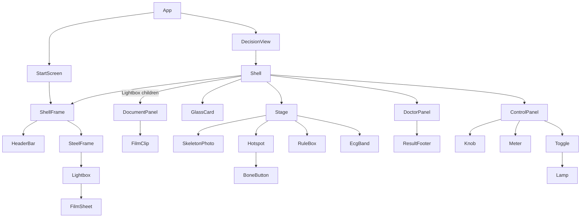
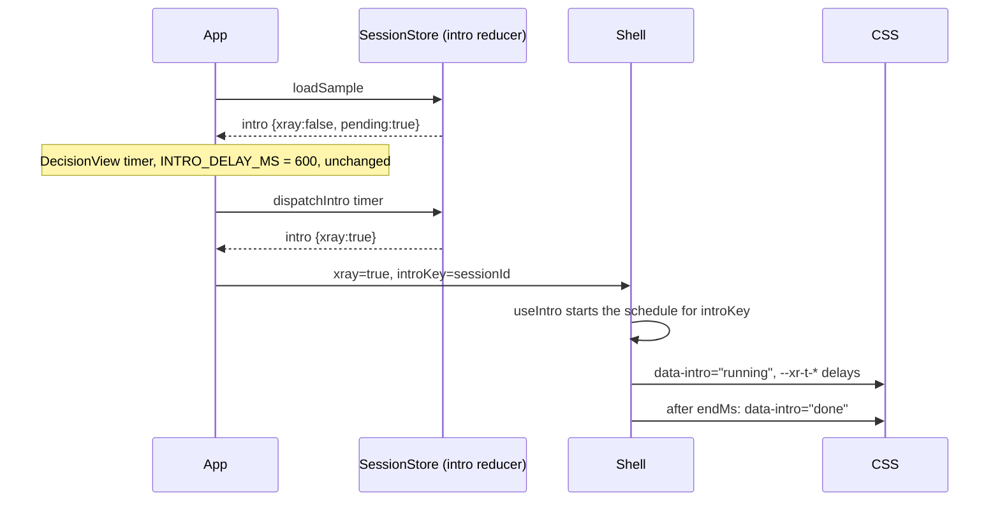

# Design Document: visual-polish

## Overview

This feature restyles the expense-auditor so it looks like `design/mockups/bones-7-retro-b.png`: brushed-steel frame, dark lightbox with a photographic skeleton, glowing hotspots, a frosted glass answer card that cracks, a phone-shaped Dr. Bones panel, and a metal control panel. All look and motion live in `packages/xray-ui`. The app only arranges components and passes data. `packages/core` is not touched.

### Design decisions that shape everything else

| # | Decision | Why |
|---|---|---|
| D1 | **Additive, not destructive.** New components are added next to the existing ones. `Skeleton`, `BoneGlyph`, `Tooltip`, `FilmClip`, `AnswerCard`, `DrBonesChat`, `ControlStrip`, `KnobControl`, `GaugeControl`, `ToggleSwitch`, `ResultPlate`, `XrayView` keep their props, class names, roles and text. | R20.3, R20.5 and R20.7 forbid editing existing tests outside a short exception list. The existing component tests assert DOM details (SVG silhouette, `aria-valuemax="1"`, "renders no img element"). Rewriting those components would break them. The old components stay exported, and the demo and the legacy tests keep using them. |
| D2 | **Where a new component can reuse an old one, it wraps it.** `DocumentPanel` wraps `FilmClip`, `Hotspot` wraps `BoneButton`, `DoctorPanel` shares a `ChatLog` extracted from `DrBonesChat`. | The mark logic, accessible names, and the typewriter logic are already tested. |
| D3 | **Decorative images are CSS backgrounds on `aria-hidden` elements. Content images are ``.** | CSS backgrounds fall back to a solid colour layer when a file fails (R5.8, R7.7). `` is used where an `onError` hook is needed to hide the broken-image icon (R13.8) or where the picture is content (skeleton photo, paper, avatar). |
| D4 | **Motion is CSS only, in `src/styles/`.** React toggles `data-*` attributes and a `.xr-live` class. No `requestAnimationFrame`, no canvas, no Web Animations. | R2, R15.3, R19.3 and the existing `<canvas` guard. CSS animations can be switched off by one selector. |
| D5 | **Anchors are percent of the full photo. The photo box is the only thing that scales.** | R10.7: hotspots stay within 0.1 % at any viewport. A percent position inside one fixed-aspect box cannot drift. |
| D6 | **One scale unit `--xr-u` drives every size.** | One screen, 1280x720 to 1920x1080, no page scroll (R3), no JavaScript on resize (R3.3: 100 ms). |

### Research summary

- **Vite asset imports.** Vite hashes any imported asset and any CSS `url()` that resolves to a file, and emits it under `assets/<name>-<hash>.<ext>`. Vite also ships ambient types for `*.webp` in `vite/client`. Source: [Vite static asset handling](https://vite.dev/guide/assets).
- **Playwright snapshots.** `toHaveScreenshot` accepts `maxDiffPixelRatio` and `threshold`, and `updateSnapshots: "none"` makes a missing reference a failure (the default `"missing"` writes it silently, which R21.7 forbids). Source: [Playwright visual comparisons](https://playwright.dev/docs/test-snapshots). `reducedMotion: "reduce"` is a context option.
- **Container query units** (`cqw`, `cqh`) are supported by Chromium 105+, Safari 16+ and Firefox 110+. They size the photo box by the cell it sits in. Source: [MDN CSS container queries](https://developer.mozilla.org/en-US/docs/Web/CSS/CSS_containment/Container_queries).
- **Font.** The wordmark uses Cormorant SC weight 700, latin subset, as one woff2 file from the `@fontsource/cormorant-sc` package (`latin-700-normal.woff2`, about 20,352 B, under the 30,720 B limit of R22.2). woff2 is supported by Chromium 105+, Safari 16+ and Firefox 110+, the same browsers the design already requires, so no woff fallback ships. The package CSS is not imported, because it declares woff next to woff2 and Vite would emit both. A custom `@font-face` points at the one woff2 file instead. Source: [@fontsource/cormorant-sc](https://fontsource.org/fonts/cormorant-sc).

### Requirement conflicts and interpretations to confirm

These are places where the requirements cannot all be true at once, or leave a choice open. The design picks the option on the right. Please confirm or change.

| Ref | Issue | Design choice |
|---|---|---|
| R15.6 | "Prop wins over the media query, as today." Today the JS follows the prop but the global CSS rule `[class*="anim-"]` under `@media (prefers-reduced-motion)` kills CSS animation even when the prop is `false`. | The prop wins in JS **and** in CSS for everything inside the new `Shell`. See *Reduced-motion resolution*. Legacy components used outside `Shell` keep today's behaviour. |
| R20.5 vs R9.6 | `GaugeControl.test.tsx` asserts `aria-valuemax="1"`, `aria-valuenow="0.5"`. R9.6 wants 0 to 100. R20.5 does not list this test as an allowed exception. | New `Meter` component with 0 to 100. `GaugeControl` is untouched. |
| R20.5 vs R4.5/R5 | Toolbar test lists three buttons; the Lightbox test asserts the pill and a title plate. | `Lightbox` gets two props, `pill` and `plate`, both default `true`. `Shell` passes `false`. Old tests pass unchanged. The Toolbar, App, DecisionView and StartScreen tests change (listed in *Tests to update*), which R20.5 allows. |
| R13.1 | "Shakes the Lightbox" for each Fracture_Moment, but R13.2 limits displacement to 4 px. Two overlapping shakes on nested elements would add up. | One shake per **batch** of moments (the intro, or one version change). Moments that start within 300 ms of each other share one shake. |
| R13.5 vs R13.7 | After a moment, splinters are at opacity 0. In reduced motion, splinters are shown at final still positions. | Full motion: splinters end at opacity 0. Reduced motion: splinters rest at their fly-out end point at opacity 0.7, so the still image shows a fracture. |
| R22.2 | "Only the glyphs used by the wordmark" cannot be met with a package file, which ships the whole latin subset. | Resolved: one woff2 file (Cormorant SC 700 latin, about 20,352 B) through a custom `@font-face`, tested against the 30,720 B limit. No woff file ships. |
| R22.1 | "Animate only transform, opacity, filter in any stylesheet." Legacy `xray.css` animates `background` (`.anim-mark`) and `stroke-dashoffset` (`xr-ecg-scroll`). | Both legacy rules are rewritten to equivalent `opacity` and `transform` rules. This is a visual no-op. No test asserts them. |
| R16.4 | `SAMPLE_BLURBS` in the app describe the result ("The rules cap it", "every rule accepts"). | New neutral one-line descriptions, `SAMPLE_FILM_LINES`, written from visible receipt facts. A test checks for result words. |
| R19.6 | "Same scope as before" for app audio/auth guards. I found no such guard in `apps/expense-auditor/tests` (grep for audio and `AudioContext` has zero hits). | Add one new app guard test for R2.2 and R2.6 that also covers audio and auth patterns. |
| R10.2 | `design/assets/README.md` has no leg anchors. | Proposed `leg-left (44, 58)`, `leg-right (57, 58)`. A Playwright screenshot review step must confirm they sit on the thighs. |

## Architecture

### Package layout

```
packages/xray-ui/src/
  assets/
    index.ts                 # the only module that exports image URLs (R1.4)
    *.webp, splinters/*.webp # byte copies of design/assets (paper.webp renamed)
    fonts/                   # none; the one font file is referenced from node_modules/@fontsource/cormorant-sc
  components/
    shell/   Shell.tsx  ShellFrame.tsx  HeaderBar.tsx  HeaderAction.tsx  SteelFrame.tsx  AssetImage.tsx
    stage/   Stage.tsx  SkeletonPhoto.tsx  Hotspot.tsx  RuleBox.tsx  EcgBand.tsx
    panels/  DocumentPanel.tsx  GlassCard.tsx  DoctorPanel.tsx  ResultFooter.tsx
    panel/   ControlPanel.tsx  Knob.tsx  Meter.tsx  Toggle.tsx  Lamp.tsx
    FilmSheet.tsx
    chat/ChatLog.tsx         # extracted from DrBonesChat, behaviour unchanged
    (existing components stay where they are)
  model/
    anchors.ts  introSchedule.ts  fractureDiff.ts  progress.ts  needleSwing.ts
    ruleBoxPlacement.ts  hotspotState.ts  splinterAssets.ts  motion.ts
  hooks/
    useIntro.ts  useFractureBatches.ts  useElementRect.ts
  styles/
    tokens.css  xray.css   # existing
    shell.css  frame.css  stage.css  panels.css  controls.css  intro.css  motion.css  fonts.css
  vite-env.d.ts            # /// <reference types="vite/client" />
```

All new model files are pure and contain no I/O, no `Date`, no `Math.random` (`source-hygiene` still applies).

### Component tree



`Shell` holds one `HoveredRuleProvider` (existing). `DocumentPanel`, `GlassCard` and `Stage` read the hovered rule from it. `Shell` never evaluates rules: a version change only calls `onVersionChange`.

### Data flow



The app state machine (`introReducer`, `INTRO_DELAY_MS`) is unchanged (R12.7). It decides **when `xray` first turns on**. The `Shell` timeline starts at that moment.

### Scaling strategy (1280x720 to 1920x1080, no page scroll)

The root is `.xr-shell { position: fixed; inset: 0; min-width: 1280px; min-height: 720px; }`. Below 1280x720, `html` gets `overflow: auto` so the page scrolls and keeps the 1280x720 layout (R3.6). Above it, `overflow: hidden`.

One CSS length drives all sizes:

```css
.xr-shell { --xr-u: min(100vw / 1280, 100vh / 720); }  /* 1px at 1280x720, 1.5px at 1920x1080 */
/* every size is calc(N * var(--xr-u)) */
```

Layout grid inside `.xr-shell` (rows: header, frame):

```
header   calc(52u)
frame    1fr          padding calc(14u), SteelFrame
  lightbox grid:
    columns  28fr  46fr  26fr
    areas   "doc    stage  doctor"
            "ctrl   stage  doctor"
    rows    62fr 38fr
```

- Extra width goes to the `fr` columns, extra height to the `fr` rows. `--xr-u` only follows the **smaller** of the two axes, so nothing can overflow. Corners checked in Playwright: 1280x720, 1280x1080, 1920x720, 1920x1080, plus 1440x900.
- `Control_Panel` sits in area `ctrl` and extends `calc(-18u)` to the left and bottom so it overlaps the Steel_Frame bevel (R9.1, R3.4). It is the only allowed overlap. It never reaches the `stage` column.
- The stage cell is `container-type: size`. The photo box inside it is `width: min(100cqw, 100cqh * 1.0824)` and `aspect-ratio: 1208 / 1116` (the visible crop: 62 % of 1800 px). It is centred. Hotspots, the ECG band and the scan line live inside this box in percent.
- The photo `` is `position: absolute; width: 100%; height: 161.29%; top: -4.839%`, so crop rows 3 % to 65 % fill the box exactly.
- `DoctorPanel` body: `overflow-y: auto; min-height: 0` (R3.5). `DocumentPanel` text area: same.
- Font sizes are `calc(N * var(--xr-u))` with a floor of `11px`, so text stays legible and contrast tests do not depend on size.

No JavaScript reads the viewport size for layout. A resize is a pure style recalculation (R3.3). The only measured quantity is the `RuleBox` rectangle (see below).

### Reduced-motion resolution (R15.6)

`useReducedMotion(override?)` already returns `override ?? media`. The rule is kept and extended to CSS:

| `reducedMotion` prop | Media query matches | Resolved Reduced_Motion | `data-motion` on `.xr-shell` | `.xr-live` class |
|---|---|---|---|---|
| `true` | any | true | `reduce` | absent |
| `false` | `true` | **false** (prop wins) | `full` | present |
| `false` | `false` | false | `full` | present |
| `undefined` | `true` | true | `auto` | absent |
| `undefined` | `false` | false | `auto` | present |

Three layers, all consistent with the table:

1. **JS gating.** All idle and intro animation selectors are written as `.xr-shell.xr-live ...`. When Reduced_Motion is true, `.xr-live` is absent and no animation selector matches. The typewriter, `useIntro` and `animClass` use the same resolved value.
2. **Prop true.** `.xr-shell[data-motion="reduce"], .xr-shell[data-motion="reduce"] * { animation: none !important; transition: none !important; }`. Covers transitions on controls (knob, toggle, lamp, needle), which are declared on base selectors and not behind `.xr-live`.
3. **Media query, only when the prop is absent.**
   ```css
   @media (prefers-reduced-motion: reduce) {
     .xr-shell[data-motion="auto"], .xr-shell[data-motion="auto"] * { animation: none !important; transition: none !important; }
   }
   ```
   `data-motion="full"` is not matched, so an explicit `false` keeps animation on even when the OS asks for less. This is the one place where the CSS differs from today. Today a legacy component with `reducedMotion={false}` still loses its CSS animation under the media query. Outside `Shell`, that legacy rule in `xray.css` stays as it is.

Both the prop and the media query are observed live: the prop through React, the media query through `useSyncExternalStore` in the existing hook. The new value applies on the next render, well under 100 ms (R15.7).

### Motion architecture

All `@keyframes` live in `src/styles/intro.css` and `src/styles/motion.css` (R15.3). Animated properties are limited to `transform`, `opacity` and `filter` (R22.1).

#### Intro timeline (driven by the existing intro state machine)

`introSchedule(order)` is a pure function. `order` is the list of hotspots in the **evaluation order of the Trace** (see *Data Models*), each with a `fractured` flag.

```
FLICKER_MS = 350            film flicker on          0 .. 350
CONE_FROM = 250, CONE_TO = 800    light cone fade in        250 .. 800
SWEEP_FROM = 800, SWEEP_TO = 1500 scan line, top to bottom  800 .. 1500
LIGHT_FROM = 1500           first hotspot lights
LIGHT_WINDOW = 800          all hotspots start lighting within [1500, 2300]
step   = n <= 1 ? 0 : min(250, floor(800 / (n - 1)))
start_i = 1500 + i * step                  strictly increasing for n >= 2
FRACTURE_MS = 1200          longest Fracture_Moment
endMs  = max(start_i + (fractured_i ? 1200 : 400)) <= 3500
```

For n = 20: step = 42, last start 2298, last fractured end 3498. For n = 1: start 1500, end 2700.

```mermaid
gantt
  dateFormat  x
  axisFormat  %L
  section Film
  Flicker            :0, 350
  Cone fade in       :250, 800
  Scan sweep         :800, 1500
  section Hotspots (n=5, step 200)
  Hotspot 1 lights   :1500, 1700
  Hotspot 2 lights   :1700, 1900
  Hotspot 3 lights   :1900, 2100
  Hotspot 4 (fractured) :2100, 3300
  Hotspot 5 lights   :2300, 2700
```



How it runs:

- `useIntro({ introKey, xray, reduced, schedule })` returns `"idle" | "running" | "done"`.
  - Reduced_Motion true: `"done"` on the first render (R12.6). No timers.
  - `xray` false and the intro has not started for this `introKey`: `"idle"`.
  - First render with `xray` true for this `introKey`: `"running"` on that same render (derived, so there is no flash of the final state). An effect starts one `setTimeout(endMs)` that sets `"done"`.
  - The state is stored as `{ key, phase }`. `phase` only advances for the matching key. Later toggles, hovers, version changes and re-renders find `key === introKey` and do nothing (R12.3, R12.4).
  - A new `introKey` while running: the effect cleanup clears the timer, and the next derived render is `"running"` for the new key (R12.8).
- The root carries `data-intro`. CSS only animates under `.xr-shell.xr-live[data-intro="running"]`. When it flips to `"done"`, every element is already at its animation end state (all intro animations use `animation-fill-mode: both`), so nothing jumps.
- Each hotspot gets its delay through a custom property on its own element: `style="--xr-t-light: 1700ms"`. The scan line, cone, and film use fixed delays from the constants above, exposed as CSS custom properties on the root (`--xr-t-sweep-from` and so on) so the TypeScript constants and CSS cannot drift. A test compares the constants with the parsed CSS.
- `data-intro="done"` is also the signal for Playwright (R21.2). In Reduced_Motion it is set on the first frame.
- Once per case: the key is `introKey`, a required string prop. The app passes `state.sessionId`.

#### Fracture moment

Triggered by CSS delay in the intro, and by a keyed remount after the intro. For a hotspot with `fxKey`:

| Effect | Element | Start | Duration | End state (full motion) |
|---|---|---|---|---|
| Bone flash | `.xr-hs-flash` (`opacity`) | 0 | 200 ms | opacity 0 |
| Burst scale-in | `` (`transform`, `opacity`) | 0 | 400 ms | scale 1, opacity 1, stays |
| Splinters fly | `.xr-splinter` (`transform`, `opacity`) | 100 ms | 800 ms | at fly-out point, opacity 0 |
| Red pulse | `.xr-hs-ring` (`transform`, `opacity`) | 0 | 1.4 s, infinite | keeps pulsing |
| ECG spike in | `.xr-ecg-spike` (`opacity`) | 0 | 100 ms | opacity 1, stays |
| Lightbox shake | `.xr-lightbox` (`transform`) | 0 | 300 ms | translate 0 |

The last non-infinite effect ends at 900 ms (< 1200 ms, R13.1). The shake keyframes only use `translate3d` values within +/-4 px and end at `0` (R13.2, R13.3). A CSS-parse test checks the amplitude and duration.

Fly-out direction and distance come from the existing `splinters(ruleId)` model: `angleDeg`, `length`. The distance is `calc((length + 20) * var(--xr-u))`, passed as `--dx` and `--dy` (precomputed with `cos`/`sin`, rounded to 2 decimals).

Version change after the intro (R13.6): `useFractureBatches(bones)` keeps the set of fractured bone keys from the previous render and returns, for each bone, a `fxKey` number that increments only when the bone **becomes** fractured (`fractureDiff(prev, next)`). The hotspot's fracture group is rendered with `key={fxKey}`, so the browser restarts the CSS animations. The Lightbox shake alternates between `xr-shake-a` and `xr-shake-b` class names (same keyframes, different names) once per batch, so a new batch retriggers it. A bone that was fractured before and after keeps its `fxKey` and plays nothing.

When the hotspot first mounts after the intro (for example after toggling X-ray back on), the fracture group renders in its end state: no animation, because `data-intro="done"` removes the intro delays and the keyed remount only fires on a diff.

#### Idle motion (toggle on, full motion)

| Rule | Keyframes | Cycle |
|---|---|---|
| `.xr-live[data-xray="true"] .xr-photo-img` | `filter: brightness()` 0.95 -> 1.05 -> 0.95, `alternate` | 4 s per full cycle, `ease-in-out` |
| `.xr-cone-flicker` (child of the intro-animated `.xr-cone`) | `opacity` steps 1, 0.93, 0.98, 0.91, 1 (max step 0.09) | 5 s, infinite |
| `.xr-ecg-head` | `transform: translateX(-10%) -> translateX(100%)` | 3.2 s `linear`, infinite |

Intro animation and idle animation sit on **different elements** (a wrapper for the intro, a child for the loop), so they never fight over one property. The ECG band is placed at `top: calc((50 - 3) / 62 * 100%)` = 75.81 % of the photo box (R14.3: 50 % of the full image). When the toggle is off, the stage is not rendered, so no idle animation exists (R14.8).

#### Control motion

| Control | Mechanism | Value |
|---|---|---|
| Knob | `transition: transform 350ms cubic-bezier(.3,1.4,.5,1)` on the knob image, angle from `knobAngle(index, count)` | 200..600 ms, ends exactly at the new angle |
| Needle | CSS animation `xr-needle-swing` with three custom properties `--from`, `--over`, `--to` from `needleSwing(prev, next)`, 700 ms | overshoot 1..8 degrees, settles on `--to` |
| Toggle lever | `transition: transform 120ms ease-out` on `scaleY(1) <-> scaleY(-1)` | <= 150 ms |
| Lamp | `transition: filter 300ms ease` (`drop-shadow`, `brightness`) and opacity | 150..500 ms |

The needle animation is restarted by keying the needle element on `value`. `prev` is kept in a ref and starts at `needleAngle(null)`, so the first mount sweeps the needle from rest during the intro.

## Components and Interfaces

All components are exported from `packages/xray-ui/src/index.ts`. All accept `className?` and `reducedMotion?` (the existing `CommonProps`). `exactOptionalPropertyTypes` is on, so optional props are spread only when defined, as in the existing code.

### Asset module and Vite typing

```ts
// src/assets/index.ts  (the only module that exports image URLs)
export { default as brushedSteelUrl } from "./brushed-steel.webp";
export { default as clipUrl } from "./clip.webp";
export { default as drBonesUrl } from "./dr-bones.webp";
export { default as filmUrl } from "./film.webp";
export { default as fractureBurstUrl } from "./fracture-burst.webp";
export { default as glassCracksUrl } from "./glass-cracks.webp";
export { default as knobUrl } from "./knob.webp";
export { default as lampUrl } from "./lamp.webp";
export { default as lightConeUrl } from "./light-cone.webp";
export { default as meterUrl } from "./meter.webp";
export { default as paperUrl } from "./paper.webp";          // renamed from receipt-paper.webp
export { default as screwUrl } from "./screw.webp";
export { default as skeletonUrl } from "./skeleton.webp";
export { default as stampFrameUrl } from "./stamp-frame.webp";
export { default as toggleUrl } from "./toggle.webp";
export { default as splinter1Url } from "./splinters/splinter-1.webp";
/* ... splinter2Url to splinter8Url ... */
export const SPLINTER_URLS: readonly string[] = [splinter1Url, /* ... */ splinter8Url]; // derived, not a new image
```

(`SPLINTER_URLS` imports the eight named exports at the top of the file, written out in the real module.)

- Typing: `src/vite-env.d.ts` contains `/// <reference types="vite/client" />`, and `tsconfig.json` of xray-ui gets `"vite/client"` in `types`. The app already lists `vite/client`, so `tsc --noEmit` passes in both (R1.7). `vite` is already a devDependency of xray-ui.
- CSS backgrounds use `url("../assets/<file>.webp")` from files in `src/styles/`. Vite hashes them (R1.3). Because the CSS paths and the module both point at the same files, a test checks that every file in `src/assets/` is exported by `index.ts` and that every CSS `url()` target exists.
- Vitest: Vite resolves `.webp` imports to path strings in tests, and the config has `css: false`, so CSS `url()` is not processed. No Vitest change.
- Copy step: a one-time copy of `design/assets/**` into `src/assets/` with `receipt-paper.webp` renamed to `paper.webp`. No build-time copy, so `design/` stays reference-only.

```ts
// components/shell/AssetImage.tsx
interface AssetImageProps {
  src: string; width: number; height: number;
  className?: string;
  alt?: string;               // default "" (decorative), then aria-hidden="true"
}
```

`AssetImage` always renders `width` and `height` (positive integers, R22.4), never sets `loading` (R1.6), and on `onError` sets `data-failed="true"`. CSS: `[data-failed="true"] { visibility: hidden; }`. The layout box keeps its size, so nothing shifts (R5.8, R13.8, R10.16).

### Shell, ShellFrame, HeaderBar, HeaderAction, SteelFrame, Lightbox

```ts
export interface ShellFrameProps extends CommonProps {
  heading: string;                 // the single visually hidden h1 (R4.8)
  xray: boolean;                   // header pill text
  headerActions?: ReactNode;       // right-aligned secondary actions
  lightboxLabel?: string;          // aria-label of the lightbox
  controls?: ReactNode;            // ControlPanel slot
  children?: ReactNode;            // Lightbox content
  introPhase?: "idle" | "running" | "done";
}

export interface ShellProps extends CommonProps {
  trace: Trace;
  anatomy: Anatomy;
  source: FilmSource;
  heading: string;
  lightboxLabel?: string;
  versions: string[];
  version: string;
  onVersionChange: (v: string) => void;
  xray: boolean;                    // controlled; the app owns the intro reducer
  onXrayChange: (next: boolean) => void;
  introKey: string;
  claimedCents: number;             // domain-free: "amount asked for"
  onReplay?: () => void;
  onOverride?: () => void;
  overrideRef?: Ref<HTMLButtonElement>;
  onMessagesComplete?: () => void;
  effective?: EffectiveResult;
  headerActions?: ReactNode;
}
```

`Shell` renders `ShellFrame` with the decision composition inside. `ShellFrame` alone is used by the start screen.

- **`HeaderBar`**: grid `1fr auto 1fr`. Left cell: wordmark `BONES` (class `xr-wordmark`, `font-family: "Cormorant SC", Georgia, serif; font-weight: 700`) and the tagline "the skeleton under every AI decision", gap `calc(16u)`. Middle cell: pill `X-RAY ON` / `X-RAY OFF` (`data-on`). Right cell: `headerActions`, `justify-self: end`. The pill is centred by the grid, not by the wordmark width (R4.3: within 2 px of centre). The header is a `<header>` with `role="banner"` is implicit; it holds no heading.
- **`HeaderAction`**: `<button type="button" className="xr-header-action">`. Font size `calc(13u)`, weight 400, below the wordmark in size and weight (R4.5).
- **Font loading** (R4.1, R4.9, R4.10, R22.2): `src/styles/fonts.css` holds one custom `@font-face { font-family: "Cormorant SC"; font-weight: 700; font-style: normal; font-display: swap; src: url("@fontsource/cormorant-sc/files/cormorant-sc-latin-700-normal.woff2") format("woff2"); }`. The package CSS (`@fontsource/cormorant-sc/700.css`) is **not** imported, because it also declares woff and Vite would emit both. There is no woff fallback: Chromium 105+, Safari 16+ and Firefox 110+ all support woff2. Vite resolves the bare package path from `node_modules`, hashes the file and emits exactly one font file. The package is a dependency of `packages/xray-ui`. The file name `latin-700-normal.woff2` is the fontsource pattern (`<id>-<subset>-<weight>-<style>.woff2`, here `cormorant-sc-latin-700-normal.woff2`). The package is not installed in the workspace yet, so the exact file name and its size (about 20,352 B) must be confirmed at install (`ls node_modules/@fontsource/cormorant-sc/files`). The fallback stack `Georgia, "Times New Roman", serif` has similar widths, and the header uses a fixed grid so layout does not move. A test checks the emitted font file count and size, and a Playwright test asserts no request leaves `127.0.0.1`.
- **`SteelFrame`**: `<div className="xr-steel">` with `background: url(brushed-steel.webp) 0 0 / 512px 512px repeat, #3a444b`. Four `<span className="xr-screw" aria-hidden="true">`, each a CSS background of `screw.webp` with `--xr-screw-rot` set to `[12, 97, 188, 271]` degrees (distinct, fixed, not random). Inner bevel: `box-shadow: inset 1px 1px 0 rgba(255,255,255,.35), inset -1px -1px 0 rgba(0,0,0,.6)`.
- **`Lightbox`** (existing component, two added props):
  ```ts
  interface LightboxProps extends CommonProps {
    title?: string; xray: boolean; children?: ReactNode;
    pill?: boolean;   // default true: render the X-RAY pill (legacy). Shell passes false.
    plate?: boolean;  // default true: render the title plate (legacy). Shell passes false.
  }
  ```
  With `plate={false}` the title is used only as `aria-label`. The Lightbox renders no ``. The film is `.xr-viewport { background: url(film.webp) center / cover, #05090d }`. The light cone is a `::before` pseudo-element with `url(light-cone.webp) top center / 100% auto no-repeat`, `mix-blend-mode: screen`. In the flat view (`data-xray="false"`), `.xr-viewport` keeps its size, drops the blend, film image and glow (R5.7, R5.9): background becomes the solid `--xr-bg-deep`, and the stage is not mounted.

### Stage, SkeletonPhoto, Hotspot, RuleBox, EcgBand

```ts
export interface StageProps extends CommonProps {
  trace: Trace;
  anatomy: Anatomy;
  introPhase: "idle" | "running" | "done";
  versionLabel: string;            // for the Hotspot accessible name (already in BoneView.version)
}
```

`Stage` computes `bones = selectBones(trace, anatomy)`, `placed = placeBones(bones)` (anchor table, below), the intro schedule, and the fracture batches. It owns the hover/focus/Escape logic that `Skeleton` has today (enter, leave, `dismissedRuleId`), calling `setHoveredRuleId` from the existing context.

```ts
export interface HotspotProps extends CommonProps {
  bone: BoneView;
  place: { xPct: number; yPct: number };    // percent of the visible crop box
  hotspotState: HotspotState;
  splinterFiles: readonly number[];          // 6 distinct indexes in 0..7
  introDelayMs: number;                      // --xr-t-light
  fxKey: number;
  describedBy?: string;
}
type HotspotState = "passed" | "applied-no-change" | "fractured" | "not-applicable";
```

DOM of one hotspot (inside the photo box):

```
div.xr-hotspot[data-state][style="left:..%;top:..%;--xr-t-light:..ms"]
  span.xr-hs-ring                          cyan ring / dim ring / red ring (class by state)
  span.xr-hs-check[aria-hidden]            only for applied-no-change (one check)
  [fractured] div.xr-fx[key=fxKey]
      span.xr-hs-flash
      AssetImage.xr-burst(fracture-burst)   mix-blend-mode: screen
      AssetImage.xr-splinter x6 (splinter-N) --dx --dy, screen
  BoneButton                                focusable button, aria-label from boneAriaLabel
```

- The state comes from `hotspotState(bone)`: `fractured` -> `"fractured"`, `not-applicable` -> `"not-applicable"`, `passed` with `isAppliedNoChange(outcome)` -> `"applied-no-change"`, else `"passed"`.
- `passed`: cyan glow ring only (R10.8). `applied-no-change`: ring plus one check (R10.9). `not-applicable`: dim ring, no glow (R10.11). The `BoneButton` already renders icon and state text, so state never depends on colour (R17.5). The state text stays visually hidden except on focus/hover (the RuleBox shows it).
- Splinters: 6 per fractured hotspot (`SPLINTER_COUNT`), inside the allowed 6..8. `splinterAssets(ruleId)` picks 6 distinct indexes from 0..7 with `hashString` and `nextRandom` (a partial Fisher-Yates), so the same trace always yields the same DOM (R10.15).
- Fallback: if the burst or a splinter fails, `AssetImage` hides it. The ring pulse (`.xr-hs-ring--red`) is a CSS gradient, so the red glow remains (R10.16).
- Reduced motion: `.xr-live` absent. The red ring is static, the burst is at scale 1, splinters sit at `translate(var(--dx), var(--dy))` with opacity 0.7, the ECG spike is visible.
- Focus ring: `outline: calc(3u) solid var(--xr-focus); box-shadow: 0 0 0 calc(5u) var(--xr-focus-contrast)`. Two tones, so it contrasts with any background (R10.14, R17.2).
- The tab order follows DOM order, which is the anatomy order. The hotspot DOM comes after `DocumentPanel` and before `DoctorPanel` (R17.4).

```ts
export interface RuleBoxProps {
  id: string;                     // tooltipId(ruleId), reused from Tooltip.tsx
  bone: BoneView;
  anatomy: Anatomy;
  rect: { left: number; top: number };   // from placeRuleBox, px inside the lightbox
}
```

- `RuleBox` renders `role="tooltip"` with `id`, head `"{ruleId} v{version}"`, state text, `renderedMessage`, and a `<dl>` of `evidenceRows`. With no rows it renders `<p class="xr-rb-empty">No evidence recorded</p>` (R11.9). The Hotspot's `BoneButton` gets `aria-describedby={id}` only while the box is open (R11.6). Focus never moves (R17.6). Because the box is associated by `aria-describedby`, assistive technology reads it as part of the hotspot (R17.7).
- Show/hide: React state toggled by `pointerenter`/`focus`/`pointerleave`/`blur`. The box mounts in the same commit as the event. CSS transition is `opacity 80ms`. That is under 100 ms (R11.1, R11.3). Escape sets `dismissedRuleId` (existing logic from `Skeleton`).
- Placement: `useElementRect` measures the lightbox element and the hotspot element with `getBoundingClientRect` in a layout effect and on `ResizeObserver` callbacks (guarded: `typeof ResizeObserver === "function"`). The pure function `placeRuleBox` returns the box position and the line. When rects are all zero (jsdom), the box renders without position and without the line. This keeps the render deterministic (R20.4).
- The line is an `<svg class="xr-rb-line" aria-hidden>` covering the lightbox, with one `<line stroke-width="2">` in `--xr-cyan` and one `<circle r="3.5">` at the hotspot end of the line (the dot). It sits under the box and above the photo.
- A highlight on the linked fields (R11.8) comes from `setHoveredRuleId(ruleId)`, read by `DocumentPanel` (via `FilmClip`) and by `GlassCard`.

```ts
export interface EcgBandProps extends CommonProps { trace: Trace; anatomy: Anatomy; anchors: Point[]; }
```

`EcgBand` calls the existing `buildEcgModel(trace, remappedBones)`, where `remappedBones` is `bones` with `position.x` replaced by `xPct / 100 * ECG.width`. `buildEcgModel` is unchanged. The spikes therefore line up with the hotspots. It renders a static glowing line (`linePath`), the red `spikePath`, a `.xr-ecg-head` moving highlight, and `<span class="xr-visually-hidden">{summary}</span>` (as `EcgLine` does today). Flatline (`rejected`) renders the flat line with no movement.

### Anchor table

```ts
// model/anchors.ts
export const CROP = { top: 3, bottom: 65 } as const;           // percent of full image height
export const ANCHORS: Record<Region, Point> = { ... };         // percent of FULL image
export const SPINE_LOWER: Point = { x: 50, y: 42 };            // second anchor of "spine"
export const LATTICE_STEP = 4;                                  // percent
export const MIN_SEPARATION = 3;                                // percent, R10.4
export function placeBones(bones: readonly Pick<AnatomyBone, "ruleId" | "label" | "region">[]): Point[];
export function toCropPercent(p: Point): Point;                 // y: (y - 3) / 62 * 100
```

| Region | x % | y % | Source |
|---|---|---|---|
| skull | 50 | 9 | README |
| ribs | 57 | 29 | README |
| spine (upper) | 50 | 33 | README |
| spine (lower) | 50 | 42 | README |
| pelvis | 56 | 47 | README |
| arm-right | 69 | 45 | README |
| arm-left | 31 | 45 | README |
| leg-left | 44 | 58 | **proposed**, inside the crop (3..65) |
| leg-right | 57 | 58 | **proposed**, inside the crop |

`ECG line` = 50 % (constant `ECG_Y = 50`).

**Mapping algorithm** (`placeBones`, pure, input order = Anatomy order; only `region` and the order are read, `ruleId` and `label` are accepted but ignored, which satisfies R10.6):

1. Pass 1, reserve anchors. For each region, the first bone gets `ANCHORS[region]`. For `spine`, the second bone gets `SPINE_LOWER`.
2. Pass 2, shared regions. Every other bone takes the next free point from a lattice walk around its region base. The base is `ANCHORS[region]`; for `spine` it is the midpoint `(50, 37.5)`. The walk visits lattice offsets `(i*4, j*4)` ring by ring (`max(|i|,|j|) = r`, ordered by `|i|+|j|`, then `i`, then `j`). A candidate is accepted when it is inside `x in [6, 94]`, `y in [6, 62]` (inside the crop with a 3 % margin) and no already placed point is closer than 3 % on **both** axes (`|dx| < 3 && |dy| < 3` is a conflict).
3. Because pass 1 runs first, the first bone of every region sits exactly on its anchor (R10.3, R10.5), and any two points differ by at least 3 % in x or y (R10.4).
4. The walk stops after 400 candidates. With a 4 % lattice inside the allowed box there are about 330 free cells, so up to 20 bones (R12.2) can never exhaust it. Beyond that, the remaining bones stack on their anchor. This is documented and not reachable by the intro limit.

The mapping has no viewport input. Percent positions are therefore identical at any viewport size (R10.7).

### DocumentPanel

```ts
export interface DocumentPanelProps extends CommonProps {
  trace: Trace; anatomy: Anatomy; source: FilmSource;
}
```

- DOM: `section.xr-doc[aria-label="Document"]` > `div.xr-doc-paper` (background `paper.webp` `contain`, solid cream fallback) > `FilmClip` (existing) with the clips drawn by the existing `.xr-clip--left` and `--right` spans, styled as `clip.webp` backgrounds under `.xr-doc` (exactly two clips, R6.1). The text area has `tabIndex={0}`, `role="region"` and `overflow: auto` so every line can be reached by scrolling and by keyboard (R6.2).
- Text is monospace, with a fixed `line-height: calc(18u)` and `white-space: pre`. Text colour `--xr-text-on-paper` on a paper-tone underlay behind the text (see *Contrast tests*).
- Highlights and source marks come from `FilmClip` and `sourceMarks` for the hovered rule. Nothing is drawn for other fields (R6.3). The `.anim-mark` transition is replaced by an `opacity` fade of a pseudo-element background, 150 ms (R6.4: removal within 200 ms; R22.1).
- Scan line (R6.5): `FilmClip` gets one optional prop `scanOverruled?: boolean` (default `false`, so the old DOM is unchanged). When true, for every overruled field whose source is a `line`, the line span gets a child `<span class="xr-scan" aria-hidden>` (`position: absolute; left: 0; right: 0; top: 50%`, red). For a `bbox` source, a `.xr-scan` child sits inside the bbox element. Unknown source: nothing is drawn (R6.6). The overruled paths come from the existing `fieldViews`.
- Image source (R6.7): the `` of `FilmClip` is shown inside the paper area.

### GlassCard

```ts
export interface GlassCardProps extends CommonProps { trace: Trace; anatomy: Anatomy; showUnlabelled?: boolean; }
```

It reuses `selectBones`, `fieldViews`, `hasFieldLabel`, `summariseValue` and the field-row markup of `AnswerCard` (class `xr-field`, `data-overruled`, `⚠ OVERRULED` badge), so R7.9 (one row per overruled field, existing text alternative) holds by the same code.

- Surface: `.xr-glass { background: var(--xr-glass-tint-rgba); backdrop-filter: blur(10px); }` (inside the 4..16 px range). `@supports not (backdrop-filter: blur(1px)) { .xr-glass { background: var(--xr-bg-panel); } }` gives an opaque panel (R7.2).
- Cracks (R7.3): `<AssetImage className="xr-cracks" src={glassCracksUrl}>` with `mix-blend-mode: screen`, `pointer-events: none`, `z-index` below the text, `opacity: .55`. Rendered only when at least one field is overruled.
- Stamp (R7.4, R7.5): exactly one `.xr-stamp`, rotated `-8deg` (inside 5..12). Frame is a `stamp-frame.webp` background on a wrapper with a CSS dashed border fallback. Live text: "OVERRULED BY RULE", then `"{label} {version}"` of the **first overruled field in rule order**: the first bone in `bones` (anatomy order) that is `fractured` and in the overruled set. `version` is `bone.version`. When nothing is overruled, neither cracks nor stamp render (R7.6).
- Highlight of linked fields: a field row gets `data-linked="true"` when the hovered rule's `relatedFields(bone)` contains its path (R11.8).
- Stacking: backdrop `<div>` / cracks z-index 1, rows z-index 2, stamp z-index 3. The `AnswerCard.styles` test keeps passing because `GlassCard` has its own class names.

### DoctorPanel and ResultFooter

```ts
export interface DoctorPanelProps extends CommonProps {
  trace: Trace; anatomy: Anatomy;
  claimedCents: number;
  effective?: EffectiveResult;
  speedMs?: number;
  onMessagesComplete?: () => void;
  onReplay?: () => void;
  onOverride?: () => void;
  overrideRef?: Ref<HTMLButtonElement>;
}
```

- Phone shell: rounded rectangle (`border-radius: calc(28u)`), notch element, header with `<AssetImage src={drBonesUrl} width={512} height={512}>` in a circular crop, and the `<h3>` "Dr. Bones".
- Body: `role="log" aria-live="polite"`, `overflow-y: auto`, rendering `ChatLog` (extracted unchanged from `DrBonesChat`; `DrBonesChat` imports it, its tests do not change). Text only from `buildChatMessages` (R8.4).
- `ResultFooter`:
  - Result line: `resultLine(shown, trace.amountCents, safeFormat(anatomy))` = `resultLabel(shown)` + `" "` + formatted amount, for example `PARTIALLY APPROVED $41.50` (R8.5). The money format comes from the app's `formatValue` through `anatomy.formatValue("amountCents", cents)`, as `ResultPlate` does. xray-ui never formats currency itself.
  - Progress bar: `<div role="progressbar" aria-valuemin=0 aria-valuemax=100 aria-valuenow={round(100*share)}>` with the fill `transform: scaleX(share)` (transform only, R22.1) and `transform-origin: left`. `share = progressShare(trace.amountCents, claimedCents)`.
  - Buttons: "Replay decision" calls `onReplay`, "Human override" calls `onOverride`, each once per activation (R8.9). `overrideRef` points to the override button so the app dialog can return focus to it.
  - With `effective`: show `resultLabel(effective.result)` and `overruled by {reviewerName}` (R8.12), and the rules' result in smaller text, as `ResultPlate` does.
  - The footer is a `role="status"` region like `ResultPlate`.

### ControlPanel, Knob, Meter, Toggle, Lamp

```ts
export interface ControlPanelProps extends CommonProps {
  trace: Trace; anatomy: Anatomy;
  versions: string[]; value: string; onVersionChange: (v: string) => void;
  xray: boolean; onXrayChange: (next: boolean) => void;
}
```

- Panel: `brushed-steel.webp` background tile, four corner screws (`aria-hidden`), overlap with the frame via negative margins (see *Scaling*). Each label sits on a small plaque with a solid token background (`--xr-bg-metal-light`, text `--xr-text-on-metal`), so the 4.5:1 pair is a plain token pair (R9.13).
- **`Knob`**: `role="slider"`, `tabIndex 0`, `aria-label="RULE VERSION"`, `aria-valuemin 0`, `aria-valuemax count-1`, `aria-valuenow index`, `aria-valuetext value`. The key handler is the existing one: `stepVersion(versions, value, e.key)`; call `onVersionChange` once when it returns non-null, `preventDefault`. The image `knob.webp` is rotated with `transform: rotate({knobAngle(index,count)}deg)`. The labels `v1 v2 v3` are real text placed on a circle with `polar` (as `KnobControl` does). Each label is also a click target, as today.
- **`Meter`**: `role="meter"`, `aria-label="AI READ CONFIDENCE"`, `aria-valuemin 0`, `aria-valuemax 100`. With a value: `aria-valuenow = round(100 * value)` and `aria-valuetext = "confidence 0.87"` (from `model.text`). With no value: `aria-valuenow` omitted and `aria-valuetext = "no confidence available"`; the needle rests at `needleAngle(null)`. Value from `buildGaugeModel` (unchanged). The needle and pivot are SVG over `meter.webp`. The needle angle is `needleAngle(value)` via `model.angle`.
- **`Toggle`**: `<button role="switch" aria-checked>` with `toggle.webp`. On: `transform: scaleY(-1)` on the lever image (R9.10).
- **`Lamp`**: `lamp.webp` image. On: `filter: brightness(1.6) drop-shadow(0 0 calc(10u) var(--xr-amber-glow))`. Off: `filter: brightness(0.8)`, no `drop-shadow` (R9.11, R9.12). The lamp is decorative; the switch state is already announced by the switch.
- Tab order inside the panel: Knob, Toggle (the Meter is not interactive).

### FilmSheet

```ts
export interface FilmSheetProps extends CommonProps {
  id: string;                     // used for the description id
  title: string;                  // <= 60 chars
  description: string;            // one line, <= 120 chars, no line breaks
  disabled?: boolean;
  selected?: boolean;             // true while this sheet is being loaded: slides in
  onSelect: () => void;
}
```

A `<button type="button" aria-describedby={`${id}-desc`}>` with accessible name = `title`. The description is `<span id=... class="xr-sheet-desc">`. It is a film-shaped card with a `clip.webp` background clip at the top and a film background. `selected` sets `data-selected="true"`: `transform: translateY(...) scale(1.04)` with `transition: transform 500ms` (within 600 ms, R16.6). In Reduced_Motion the `transition` is `none` through the `data-motion` rules (R16.9). `onSelect` is not called while `disabled` (native disabled button). The FilmSheet knows no result, no domain text.

### App changes (`apps/expense-auditor`)

| File | Change |
|---|---|
| `src/ui/DecisionView.tsx` | Replace `XrayView` by `Shell`. Pass `heading="Expense Auditor"`, `lightboxLabel={titlePlate(origin)}`, `introKey={state.sessionId}`, `claimedCents={claimedCentsOf(trace)}`, `headerActions={<Toolbar .../>}`, `onOverride={() => setDialogOpen(true)}`, `overrideRef`. Remove the visible `<h1>` (the hidden one comes from `Shell`) and the `app-decision` wrapper styles. `VersionNote` and the trip text go into `statusNote` (see below). |
| `src/ui/Toolbar.tsx` | Renders two `HeaderAction` buttons: "Download trace" and "Load another receipt". The "Overrule" button, `onOverrule` and `overruleRef` props are removed. Same handlers as before. Keeps `role="toolbar"`. |
| `src/ui/StartScreen.tsx` | Renders `ShellFrame` with three `FilmSheet`s, the status line "Reading receipt" while busy, and `ErrorPanel`. Visible plate, lead text and trip line are removed. The hidden `h1` comes from `ShellFrame heading`. |
| `src/App.tsx` | Unchanged logic. `main` still looks up `h1` and focuses it after a screen change. The bundle-error branch keeps its plain `<h1>Expense Auditor</h1>`. |
| `src/extraction/samples.ts` | Add `SAMPLE_FILM_LINES: Record<SampleId, string>` (neutral descriptions). `SAMPLE_BLURBS` stays (other tests use it). |
| `src/state/selectors.ts` | Add `claimedCentsOf(trace): number` reading `claimedTotalCents` through `isRuleFields`, `0` when the shape is not valid. |
| `src/styles/app.css` | Remove `.app-start`, `.app-decision`, `.app-plate`, `.app-toolbar` and related rules. Keep dialog, error panel and version note rules. No `url()`, no `@keyframes`, no `transition`. |
| `playwright.config.ts`, `e2e/*.spec.ts` | New (see *Playwright*). |

`VersionNote` and the trip text: to keep the one-screen layout, both are passed as `statusNote?: ReactNode` into `Shell` (an optional prop to add to `ShellProps`) and rendered as a one-line status strip under the lightbox inside the frame (class from xray-ui, `aria-live="polite"`). Existing `VersionNote` tests keep passing because the component is unchanged. If the strip makes the 1280x720 layout too tight, the trip text is dropped from the visible UI and kept as a `title` attribute. This is the lowest-risk detail in the design and should be checked on the first Playwright run.

The app sets no inline style, no layout CSS, no image import and no `@keyframes` (R2.2, R2.4).

### Tests to update (allowed exceptions of R20.5)

| Test | Change |
|---|---|
| `tests/components/Toolbar.test.tsx` | Button list becomes `["Download trace", "Load another receipt"]`. Overrule tests move to the Shell/DecisionView level. |
| `tests/components/App.test.tsx` line 101, `DecisionView.test.tsx` lines 88 and 97 | Click and focus-return target is the button named "Human override". |
| `tests/components/StartScreen.test.tsx` | Heading test checks the hidden `h1` by role and name. Plate and explanation assertions are replaced by "three film sheets, each a button named by its title". |
| `contrast.test.ts` | See *Contrast tests*. |
| `Lightbox.test.tsx` last test, `AnswerCard.styles.test.ts` last test | See *Guard tests*. |

Everything else in both suites stays unmodified.

## Data Models

```ts
// model/hotspotState.ts
export type HotspotState = "passed" | "applied-no-change" | "fractured" | "not-applicable";
export function hotspotState(bone: Pick<BoneView, "state" | "outcome">): HotspotState;

// model/splinterAssets.ts
export const SPLINTER_FILE_COUNT = 8;
export function splinterAssets(ruleId: string): number[]; // SPLINTER_COUNT (6) distinct indexes in 0..7, deterministic

// model/introSchedule.ts
export const INTRO = { flickerEnd: 350, coneFrom: 250, coneTo: 800, sweepFrom: 800, sweepTo: 1500,
                       lightFrom: 1500, lightWindow: 800, maxStep: 250, fractureMs: 1200, plainMs: 400, budgetMs: 3500 } as const;
export interface IntroSchedule { starts: number[]; endMs: number; }
export function introSchedule(fractured: readonly boolean[]): IntroSchedule;
// starts[i] is the light-up time of the i-th hotspot in evaluation order.

// model/fractureDiff.ts
export function newlyFractured(prev: ReadonlySet<string>, next: ReadonlySet<string>): string[];
// bone key = `${ruleId}:${index}`; returns keys in next but not in prev, in next's iteration order.

// model/progress.ts
export function progressShare(approvedCents: number, claimedCents: number): number; // [0, 1]
export function resultLine(result: DecisionResult, cents: number, format: Formatter): string;

// model/needleSwing.ts
export interface Swing { from: number; over: number; to: number; }
export function needleSwing(prevAngle: number, nextAngle: number): Swing;
// over = to + sign(to - from) * clamp(|to - from| * 0.1, 1, 8) when from !== to, else over = to.

// model/ruleBoxPlacement.ts
export interface Rect { left: number; top: number; width: number; height: number; }
export interface Placement { side: "left" | "right"; left: number; top: number;
                             line: { x1: number; y1: number; x2: number; y2: number }; }
export function placeRuleBox(lightbox: Rect, center: Point, box: { width: number; height: number }): Placement;
// Coordinates relative to the lightbox top-left. GAP = 24 px.

// model/motion.ts
export type MotionMode = "reduce" | "full" | "auto";
export function motionMode(prop: boolean | undefined): MotionMode;  // true->reduce, false->full, undefined->auto
export function isReduced(prop: boolean | undefined, media: boolean): boolean; // prop ?? media
```

`placeRuleBox` rules: prefer the side with more free horizontal space (`center.x` vs `lightbox.width - center.x`). If the box plus `GAP` does not fit on that side, use the other side. If neither fits, keep the preferred side and clamp. `top = clamp(center.y - box.height / 2, 0, lightbox.height - box.height)`, `left` clamped to `[0, lightbox.width - box.width]`. The line goes from the point of the box rectangle nearest to `center` to `center`.

`needleSwing` constants: 0.1 of the travel, clamped to 1..8 degrees. It satisfies "overshoot 1 to 8 degrees" for any non-zero travel, including a 0.5 degree travel (overshoot is 1 degree then).

Evaluation order for the intro (`Stage`): `bones` sorted by the index of the first `trace.ruleOutcomes` entry with the same `ruleId` (the order the engine evaluated them); bones without an outcome (not-applicable) follow in anatomy order. The sort is stable, so equal keys keep anatomy order.

### New CSS tokens (`tokens.css`)

```css
--xr-glass-tint: #0b1620;          /* hex, used by the contrast test */
--xr-glass-alpha: 0.55;            /* number, used by the contrast test */
--xr-glass-tint-rgba: rgba(11, 22, 32, 0.55);
--xr-text-on-glass: #e8f4f8;
--xr-text-on-steel: #14202a;       /* on --xr-bg-metal-light plaques */
--xr-text-header: #e8f4f8;         /* on --xr-bg-header */
--xr-bg-header: #0b1620;
--xr-text-on-sheet: #e8f4f8;       /* film sheet text */
--xr-bg-sheet: #10222e;
--xr-text-bubble: #e8f4f8;  --xr-bg-bubble: #132636;
--xr-text-phone-head: #e8f4f8; --xr-bg-phone-head: #1b2a35;
--xr-text-footer: #e8f4f8;  --xr-bg-footer: #0b1620;
--xr-text-rulebox: #e8f4f8; --xr-bg-rulebox: #0b1620;
--xr-text-paper-doc: #1a1a1a; --xr-bg-paper-doc: #efe6cc;  /* underlay behind document text */
--xr-text-stamp-live: #ffd0d0; --xr-bg-stamp-live: #3a0f14;
--xr-focus-contrast: #05090d;
--xr-amber-glow: rgba(255, 176, 32, 0.8);
```

The exact hex values are fixed during implementation. The contrast test fixes the acceptable range. Tokens must be hex (six digits) where the test reads a colour.

## Correctness Properties

*A property is a characteristic or behavior that should hold true across all valid executions of a system-essentially, a formal statement about what the system should do. Properties serve as the bridge between human-readable specifications and machine-verifiable correctness guarantees.*

Reflection result: the prework found about 40 testable criteria. I merged these: percent-invariance (R10.7) into Property 1 because the mapping has no viewport input; reduced-motion text (R8.3), intro skip (R12.6) and the prop/media table (R15.x) into Property 11; rule-box content (R11.1, R11.9) into Property 8's component sibling. I dropped "knob angle from index" as a separate property because it is `knobAngle`, already covered by existing tests. Criteria that depend on real layout, timing or pixels (R3, R5, R12.2 CSS timing, R13.1 timing, R21) are integration tests, not properties.

### Property 1: Anchor mapping is deterministic and depends only on region order

*For any* list of bones, `placeBones` returns the same points on every call, the result has one point per bone, and replacing every `ruleId` and `label` by other strings (keeping `region` and order) does not change any point.

**Validates: Requirements 10.3, 10.6, 10.7, 10.15**

### Property 2: Hotspot positions are distinct, anchored and inside the crop

*For any* list of 1 to 40 bones, in `placeBones` every pair of points differs by at least 3 in x or at least 3 in y, every point is inside `x in [6, 94]` and `y in [6, 62]`, the first bone of each region sits exactly on that region's anchor, and when a region has two or more bones and is `spine`, the first is at `(50, 33)` and the second at `(50, 42)`. The anchor table has an entry for every `Region`, and the leg anchors have `x, y` in `[0, 100]` and `y` between 3 and 65.

**Validates: Requirements 10.1, 10.2, 10.4, 10.5**

### Property 3: Hotspot visual state follows the bone state

*For any* generated trace and anatomy, each rendered hotspot has `data-state` equal to `hotspotState(bone)`. A `passed` hotspot renders no check, burst or splinter. An `applied-no-change` hotspot renders exactly one check. A `fractured` hotspot renders one burst and between 6 and 8 splinters. A `not-applicable` hotspot renders none of check, burst and splinters.

**Validates: Requirements 10.8, 10.9, 10.10, 10.11**

### Property 4: Splinter file choice is deterministic and distinct

*For any* rule id, `splinterAssets(ruleId)` returns the same list on every call, with 6 entries, all distinct, all in 0..7.

**Validates: Requirements 10.10, 10.15**

### Property 5: Every hotspot has a complete accessible name

*For any* generated trace and anatomy, each hotspot button has an accessible name containing the bone label, the rule version (or `n/a`) and the state text, and shows a non-empty state cue and state text, so the state is never colour only.

**Validates: Requirements 10.13, 17.5**

### Property 6: Progress share is bounded and monotonic

*For any* integers `approved >= 0` and `claimed >= 0`, `progressShare(approved, claimed)` is in `[0, 1]`, equals `0` when `claimed` is `0`, equals `approved / claimed` when `0 < approved <= claimed`, and is non-decreasing in `approved` for a fixed `claimed`. The rendered `aria-valuenow` equals `round(100 * share)`.

**Validates: Requirements 8.6, 8.7**

### Property 7: Result line format

*For any* decision result and any integer cents value, `resultLine` equals `resultLabel(result)`, one space, then `format("amountCents", cents)`.

**Validates: Requirements 8.5**

### Property 8: Rule box placement stays inside the lightbox and joins the bone

*For any* lightbox rectangle, any hotspot centre inside it, and any box size that is smaller than the lightbox, `placeRuleBox` returns a box rectangle fully inside the lightbox. The side is the one with more free horizontal space, unless the box does not fit there and fits on the other side. The line ends exactly at the hotspot centre and starts on the box rectangle at the point nearest to the centre.

**Validates: Requirements 11.2, 11.5**

### Property 9: Rule box content is complete

*For any* generated bone with an outcome, the rendered rule box contains the rule label or id, the version, the state text and one row per evidence row of that outcome. With zero evidence rows it contains the empty-evidence indication instead of rows.

**Validates: Requirements 11.1, 11.9**

### Property 10: Intro schedule order and duration

*For any* flag list of length 1 to 20, `introSchedule` returns `starts` that are strictly increasing for length 2 or more, all at least `1500`, all at most `2300`, one per hotspot in the given (evaluation) order, and `endMs <= 3500`.

**Validates: Requirements 12.1, 12.2**

### Property 11: The intro plays once per case

*For any* sequence of events drawn from {re-render, toggle X-ray off and on, hover, version change, new `introKey`} applied to a mounted `Shell` under fake timers, the number of intro starts equals the number of distinct `introKey` values for which `xray` was true, and a new `introKey` while running restarts from the first step.

**Validates: Requirements 12.3, 12.4, 12.8**

### Property 12: Reduced-motion resolution

*For any* combination of the `reducedMotion` prop in {true, false, undefined} and the media query in {matches, does not match}, the resolved value equals `prop ?? media`, and when it is true the `Shell` has no `.xr-live` class, no element with an `anim-` class, `data-intro="done"` on the first render, every chat message complete on the first render, and `data-motion` equals `motionMode(prop)`.

**Validates: Requirements 8.3, 12.6, 15.1, 15.2, 15.4, 15.5, 15.6, 15.7**

### Property 13: Knob keyboard and aria

*For any* non-empty list of versions, any current value in it, and any key from {ArrowLeft, ArrowRight, ArrowUp, ArrowDown, Home, End}, pressing the key calls `onVersionChange` exactly once with `stepVersion(versions, value, key)` when that is non-null, and not at all when it is null. `aria-valuenow` equals the index of the value, `aria-valuetext` equals the value, and `aria-valuemax` equals `count - 1`.

**Validates: Requirements 9.3, 9.4, 9.5**

### Property 14: Meter value and needle angle

*For any* confidence in `[0, 1]` or none, the meter has `aria-valuemin` 0 and `aria-valuemax` 100. With a value, `aria-valuenow` equals `round(100 * value)` and the needle angle equals `needleAngle(value)`. Without a value, `aria-valuenow` is absent, `aria-valuetext` states that no confidence is available, and the needle angle equals `needleAngle(null)`.

**Validates: Requirements 9.6, 9.7, 9.8**

### Property 15: Needle swing overshoots by 1 to 8 degrees

*For any* two angles in the sweep range, `needleSwing(from, to)` has `to` as its end value. When `from !== to`, `over` lies beyond `to` in the travel direction by at least 1 and at most 8 degrees. When `from === to`, `over === to`.

**Validates: Requirements 14.5**

### Property 16: Fracture moments play only for newly fractured bones

*For any* two sets of fractured bone keys `prev` and `next`, `newlyFractured(prev, next)` equals the keys in `next` that are not in `prev`. It is empty when `next` is a subset of `prev`.

**Validates: Requirements 13.6**

### Property 17: Glass card shows cracks and exactly one stamp when something is overruled

*For any* generated trace and anatomy, the glass card renders the cracks and exactly one stamp if and only if at least one field is overruled. The stamp text contains "OVERRULED BY RULE", the label and the version of the first overruled bone in anatomy order. There is exactly one row per overruled field, and each carries the overruled badge text.

**Validates: Requirements 7.3, 7.4, 7.5, 7.6, 7.9**

### Property 18: Document marks follow the hovered rule

*For any* generated trace, anatomy, text source and hovered rule, the highlighted source marks are exactly the marks for the fields linked to that rule, and with no hovered rule there are none. With `scanOverruled`, the number of scan lines equals the number of overruled fields that have a known source location.

**Validates: Requirements 6.3, 6.5, 6.6, 11.8**

### Property 19: Contrast pairs meet WCAG

*For all* pairs in the 11 new text surfaces plus the 18 existing pairs, the contrast ratio is at least 4.5. *For all* focus ring pairs the ratio is at least 3. The glass pair uses the worst-case backdrop: the lightest pixel of `film.webp` blended with `--xr-glass-tint` at `--xr-glass-alpha`. *For any* tint, alpha in `[0, 1]` and backdrop colours, `blend` returns channels between the two inputs per channel.

**Validates: Requirements 7.8, 8.11, 9.13, 11.7, 18.1, 18.2, 18.3, 6.8**

### Property 20: Images are declared, sized and described

*For any* generated trace and anatomy, every `` rendered by `Shell` has no `loading` attribute, a `width` and `height` that are positive integers, and either `alt=""` with `aria-hidden="true"` (decorative) or a non-empty `alt`.

**Validates: Requirements 1.6, 17.3, 22.4**

### Property 21: Render determinism

*For any* generated trace, anatomy and props, rendering `Shell` twice produces identical serialized markup.

**Validates: Requirements 20.4**

### Property 22: Film sheet text is short and reveals no result

*For all* sample ids, the film sheet title has at most 60 characters, the description has at most 120 characters and no line break, and neither contains the words "approved", "rejected", "denied", "capped", "deduct" or the sample's expected result label. The button accessible name equals the title.

**Validates: Requirements 16.3, 16.4, 16.5**

## Error Handling

| Failure | Handling |
|---|---|
| An image fails to load (any ``) | `AssetImage` sets `data-failed="true"`; CSS `visibility: hidden` keeps the box size and hides the broken-image icon. Control, stamp text, glow and splinter motion still work (R10.16, R13.8). |
| A CSS background image fails | Each background shorthand ends with a solid colour layer (`#3a444b` steel, `#05090d` film, cream paper, panel colour) (R5.8). |
| `backdrop-filter` unsupported | `@supports not` gives an opaque panel colour (R7.2). |
| Font files fail | Fallback stack `Georgia, "Times New Roman", serif`. The header uses a grid with fixed pill and action cells, so layout does not move (R4.9). |
| `ResizeObserver` missing, or rects are zero (jsdom, hidden tab) | `RuleBox` renders without position and without the line. The `aria-describedby` link and the text content stay correct. |
| `claimedCents <= 0` or not an integer | `progressShare` returns 0. No error, no `NaN` (R8.7). The result line still renders. |
| Version list does not contain the value | `Knob` uses index 0 for the angle and `aria-valuenow`, as `KnobControl` does today. `stepVersion` handles the unknown value. |
| Trace with no outcomes or bones with unknown region | `selectBones` already normalises unknown regions to `spine`. `introSchedule([])` returns `{ starts: [], endMs: 0 }`; `Stage` renders no hotspots and the intro is `"done"` after one tick. |
| New `introKey` during an intro | The timer is cleared and the intro restarts for the new key (R12.8). |
| Sample load fails | Unchanged app behaviour: `ErrorPanel`, sheets re-enabled, no intro (R16.8). `StartScreen` drops `selected` when `busy` ends without a decision screen. |
| Activation while loading | The sheet buttons are `disabled` while `busy`, and the store ignores a second load, as today (R16.10). |
| Asset missing from `src/assets` or budget exceeded | The asset test fails with the missing names, or the measured and allowed byte counts (R1.8, R1.9). |
| Playwright reference screenshot missing | `updateSnapshots: "none"` makes the run fail (R21.7). |

## Testing Strategy

PBT applies to the pure model (anchors, schedule, placement, progress, swing, diff, motion resolution, contrast) and to component behaviour over generated traces. PBT does not apply to layout, pixels, timing of CSS animation, or build output. Those use Playwright, CSS-parse tests and one-shot checks.

### Libraries and conventions

- Vitest + fast-check (already pinned: `fast-check 3.19.0`). Minimum 100 runs per property (`{ numRuns: 100 }`).
- Each property is **one** test. The tag comment is `// Feature: visual-polish, Property N: <text>`.
- Reuse `src/__tests__/helpers/arbitraries.ts` (`arbTraceAndAnatomy`, `arbFilmSource`) and `helpers/matchMedia.ts` (existing media mock).
- New dev dependency: `sharp` (pinned exact version) in xray-ui, for the pixel scan in the contrast test (decodes `.webp`). It is test-only and never imported from `src/` outside `__tests__`.

### New test files in `packages/xray-ui/src/__tests__/`

| File | Covers |
|---|---|
| `properties/anchors.test.ts` | P1, P2 |
| `properties/hotspot.test.tsx` | P3, P4, P5 |
| `properties/progress.test.ts` | P6, P7 |
| `properties/rule-box.test.tsx` | P8, P9 |
| `properties/intro.test.tsx` | P10, P11 (fake timers) |
| `properties/motion-resolution.test.tsx` | P12 |
| `properties/controls.test.tsx` | P13, P14, P15 |
| `properties/fracture-diff.test.ts` | P16 |
| `properties/glass-document.test.tsx` | P17, P18 |
| `properties/images.test.tsx` | P20, P21 |
| `assets.test.ts` | R22.2 (font counted separately, exactly 1 font file in the build output), R1.1, R1.2, R1.4, R1.5, R1.8, R1.9: byte equality with `design/assets`, name rename, export per file, budget. The checker is a pure function `checkAssets(listing, budget)` unit-tested with a fake listing so the failure messages are covered. |
| `guards/assets-guard.test.ts` | R19.1, R19.2, R2.3 |
| `guards/motion-guard.test.ts` | R15.3, R19.3, R19.4, R22.1 |
| `components/*.test.tsx` | Examples: header text and pill, FilmSheet, DocumentPanel scan, DoctorPanel buttons, Toggle and Lamp, tab order (R17.4), Escape on RuleBox (R11.4), `aria-describedby` (R11.6), no-network for `Shell` (R20.6) |
| `css-constants.test.ts` | Parses `intro.css` and `motion.css`: shake amplitude <= 4 px and duration <= 300 ms, cone opacity step <= 0.1, brightness 0.95..1.05 and 4 s, knob 200..600 ms, lever <= 150 ms, lamp 150..500 ms, needle <= 800 ms, intro constants equal `INTRO` |
| `fonts.test.ts` | `fonts.css` has exactly one `@font-face` for Cormorant SC 700 whose `src` is one woff2 `url()` into `@fontsource/cormorant-sc/files/`, with no woff entry. That file is <= 30,720 B. The production build output contains exactly 1 font file (R22.2) |

### Guard tests: what changes and why

Each changed guard gets a comment directly above it stating the reason (R19.7).

| Guard | Before | After | Rationale |
|---|---|---|---|
| `Lightbox.test.tsx`, last test | `xray.css` contains no `url(` and no `@import` | Keep the `@import` check, remove the `url(` check | The new look needs images in CSS. A blanket ban would block the feature. The replacement is the path-aware guard below (R19.8). |
| `AnswerCard.styles.test.ts`, last test "uses no url() references" | blanket ban | Test removed | Same reason. |
| `guards/assets-guard.test.ts` (new) | n/a | Scans every `.css`, `.ts`, `.tsx` under `src/` (not `__tests__`). Each `url(...)` and each import of `.webp .png .jpg .jpeg .gif .svg .avif` must resolve to a file inside `src/assets/`. Targets starting with `http://`, `https://` or `//`, and data URLs, fail. The message names the file and line. The one exception is the font file `node_modules/@fontsource/cormorant-sc/files/cormorant-sc-latin-700-normal.woff2` referenced from `fonts.css`. The guard allows files inside `src/assets/` plus this one file, and nothing else in `node_modules`. Any other font reference fails. | Keeps the intent of the old ban (no remote or stray images) while allowing the bundled set (R19.1, R19.2). |
| `motion-guard.test.ts` (new) | Today there is no scan for `@keyframes` placement. Reduced motion is checked per component. | `@keyframes`, `animation`, `animation-*` and `transition` declarations are allowed only under `src/styles/`. Each such file must contain a reduced-motion override: either a per-selector `animation: none` or `transition: none` inside `@media (prefers-reduced-motion: reduce)`, or the scoped `.xr-shell[data-motion="..."]` catch-all pair that covers selectors starting with `.xr-shell`. The message names the file and the selector that has none. Animated property names found in `@keyframes` bodies and `transition`/`transition-property` values must be in `{transform, opacity, filter}`. | Needed because the animations are new and the catch-all replaces per-selector overrides in new files (R15.3, R19.3, R19.4, R22.1). |
| `source-hygiene.test.ts` | Reads every non-`__tests__` file as UTF-8 | `listFiles` also skips `src/assets/` | Binary `.webp` files would be read as text and scanned for forbidden strings. Hits are meaningless there. All forbidden patterns (`Math.random`, `Date.now`, `new Date(`, `fetch(`, `XMLHttpRequest`, `WebSocket`, `<canvas`, `getContext(`, `new Audio`, `AudioContext`, API-key pattern) still apply to every text file in the same scope (R19.5). |
| `domain-isolation.test.ts` | Unchanged. Its scope (`.ts .tsx .css` under `src/`) now includes the new files. | none | R2.3 and R2.5. The asset module and all new files must avoid the six words. |
| App `tests/guards/no-visual-in-app.node.test.ts` (new) | n/a | Scans `apps/expense-auditor/src` for image imports, `url(`, `@keyframes`, `transition`, `animation`, inline `style=` on Shell elements, audio patterns (`AudioContext`, `new Audio`) and auth patterns. | R2.2, R2.6, R19.6. |
| `contrast.test.ts` | `expect(TOKEN_PAIRS).toHaveLength(18)` | `expect(TEXT_PAIRS.length).toBeGreaterThanOrEqual(29)`, with the 18 existing pairs unchanged and 11 new ones, plus `FOCUS_PAIRS` | R18.6. |

### Contrast tests

- The 18 existing pairs stay as they are. The array keeps its name `TOKEN_PAIRS`, now holding the old 18. A second array `NEW_PAIRS` holds 11 entries, one per surface in R18.1:
  1. Glass_Card text on glass (`--xr-text-on-glass` over `glassBackdrop(darkest film pixel)`)
  2. Glass_Card text on the lightest backdrop (`--xr-text-on-glass` over `glassBackdrop(lightest film pixel)`)
  3. Doctor_Panel bubble text (`--xr-text-bubble` on `--xr-bg-bubble`)
  4. Doctor_Panel header text (`--xr-text-phone-head` on `--xr-bg-phone-head`)
  5. Result_Footer text (`--xr-text-footer` on `--xr-bg-footer`)
  6. Rule_Box text (`--xr-text-rulebox` on `--xr-bg-rulebox`)
  7. Document_Panel text on paper (`--xr-text-paper-doc` on `--xr-bg-paper-doc`, and the darkest opaque pixel of `paper.webp`, whichever is worse)
  8. Control_Panel labels on steel (`--xr-text-on-steel` on `--xr-bg-metal-light`)
  9. Header_Bar text (`--xr-text-header` on `--xr-bg-header`)
  10. Film_Sheet text (`--xr-text-on-sheet` on `--xr-bg-sheet`)
  11. Overrule_Stamp text (`--xr-text-stamp-live` on `--xr-bg-stamp-live`)
- `glassBackdrop(pixel) = pixel * (1 - alpha) + tint * alpha` per channel, with `tint` from `--xr-glass-tint` and `alpha` from `--xr-glass-alpha`. The lightest and darkest pixel of `film.webp` are found by scanning every pixel with `sharp(...).raw()` and comparing WCAG relative luminance (R18.2).
- Focus pairs: `--xr-focus` against `--xr-focus-contrast` (ratio >= 3, so one of the two tones always contrasts with whatever is behind), plus `--xr-focus` against `--xr-bg-deep`, `--xr-bg-panel`, `--xr-bg-plate`, `--xr-bg-metal-dark`.
- Failure message format: `"<pair name>: <ratio to 2 decimals> < <required>"`. A missing token fails with `"missing token <name>"` (R18.4, R18.5).
- Not every text colour is a hex today. New tokens that the test reads are written as six-digit hex. `--xr-glass-alpha` is a plain number.

### Playwright (apps/expense-auditor)

- `playwright.config.ts`:
  ```ts
  export default defineConfig({
    testDir: "e2e",
    snapshotPathTemplate: "{testDir}/__screenshots__/{testFileName}/{arg}{ext}",
    updateSnapshots: "none",                       // a missing reference fails (R21.7)
    expect: { toHaveScreenshot: { maxDiffPixelRatio: 0.001, threshold: 0.2, animations: "disabled" } },
    use: { baseURL: "http://127.0.0.1:4173", viewport: { width: 1440, height: 900 }, reducedMotion: "reduce", colorScheme: "dark" },
    projects: [{ name: "chromium", use: { ...devices["Desktop Chrome"], viewport: { width: 1440, height: 900 } } }],
    webServer: { command: "pnpm exec vite preview --host 127.0.0.1 --port 4173 --strictPort",
                 url: "http://127.0.0.1:4173", timeout: 60_000, reuseExistingServer: !process.env.CI },
    reporter: [["html", { open: "never" }], ["list"]],
  });
  ```
  The production build is a separate step: `"test:e2e": "vite build && playwright test"`. Chromium is installed once with `pnpm exec playwright install chromium`. `test-results/` and `playwright-report/` are already in `.gitignore`.
- `e2e/start-screen.spec.ts`: loads `/`, awaits `document.fonts.ready` and the three film sheets, compares `toHaveScreenshot("start-screen.png")`. Asserts no scrollbar at 1440x900 and 1280x720 (`scrollWidth === clientWidth`, `scrollHeight === clientHeight`) (R21.5).
- `e2e/signature-case.spec.ts`: clicks the "Signature case" sheet, waits for `.xr-shell[data-intro="done"]` (timeout 10 s), compares `toHaveScreenshot("signature-case.png")`, and repeats the scrollbar check.
- `e2e/layout.spec.ts`: for 1280x720, 1280x1080, 1920x720, 1920x1080 and 1440x900, checks every region box (`.xr-doc`, `.xr-glass`, `.xr-photo`, `.xr-doctor`, `.xr-controls`) is inside the viewport, that no two overlap except `.xr-controls` with `.xr-steel`, that header pill centre is within 2 px of the header centre (R4.3), and that `page.setViewportSize` to another size re-satisfies it within 100 ms (R3.3).
- `e2e/network.spec.ts`: records requests, asserts all go to `127.0.0.1:4173`, none matches `/api/`, and none is a font host (R4.10, R20.6, R21.3).
- Recorded mode: the production session already builds with the recorded adapter (`RecordedSampleAdapter`), and the e2e test fails on any `/api/` request, so no key is read or needed. Reduced motion is emulated, so the screenshots show the final still image.
- References are committed under `e2e/__screenshots__/`. They must be generated on the same OS and browser build as CI, because font hinting differs between platforms. The first run is `playwright test --update-snapshots` by hand and is reviewed in git.

### Regression gates

- `pnpm -r typecheck`, `pnpm -r test`, `pnpm --filter @bones/expense-auditor test:e2e`.
- `git diff --exit-code -- packages/core` in CI (R20.1).
- The existing app parity test (`recorded-parity.node.test.ts`) and the export tests continue to guard R20.2.
- Existing xray-ui model tests must pass with zero edits (R20.3). No file under `model/` that exists today is modified. `confidence.ts`, `gauge.ts`, `hash.ts`, `ecg.ts`, `selectors.ts`, `chat.ts`, `format.ts` and `skeletonLayout.ts` stay as they are.

### Asset and font budget

Measured from `design/assets` on disk:

| Group | Bytes |
|---|---|
| Images (15 files) | 626,182 |
| Splinters (8 files) | 20,726 |
| **Total Asset_Dir (R1.5)** | **646,908** (about 0.65 MB, limit 1,500,000 B) |
| Font (`@fontsource/cormorant-sc` latin 700 normal, 1 woff2 file, counted separately from Asset_Dir) | about 20,352 (limit 30,720; to be confirmed at install) |

The largest images are `brushed-steel.webp` (133,606 B), `glass-cracks.webp` (107,124 B) and `skeleton.webp` (98,914 B). Assets are budgeted as 1.5 MB = 1,500,000 bytes in the test, so there is room for about 850 KB more.

### Implementation order (for the tasks phase)

1. Asset copy, `assets/index.ts`, typing, asset and budget tests.
2. Model files with their property tests (anchors, schedule, progress, swing, diff, placement, motion, hotspot state, splinter assets).
3. Tokens and the contrast test extension.
4. Guard test changes (Lightbox, AnswerCard.styles, source-hygiene) and the two new guards.
5. `ShellFrame`, `HeaderBar`, `SteelFrame`, `Lightbox` props, fonts, one-screen layout, Playwright layout spec.
6. `DocumentPanel`, `GlassCard`, `DoctorPanel` (with `ChatLog` extraction).
7. `Stage`, `Hotspot`, `RuleBox`, `EcgBand`.
8. `ControlPanel` parts.
9. Intro, fracture and idle CSS, `useIntro`, `useFractureBatches`.
10. `FilmSheet`, app changes, test updates.
11. Playwright specs and reference screenshots, visual review of leg anchors and the `statusNote` strip.
