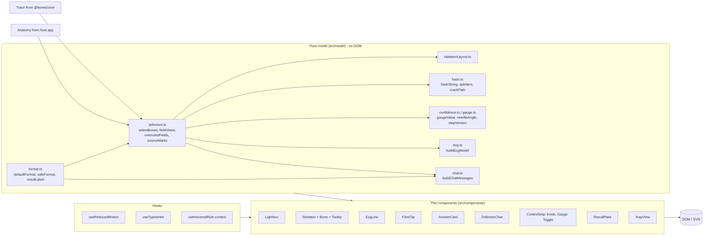
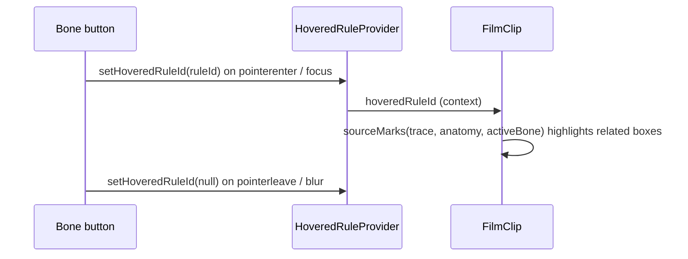

# Design Document: xray-ui

## Overview

`@bones/xray-ui` (`packages/xray-ui`) renders any `Trace` from `@bones/core` as a 1950s-radiology X-ray. The host app supplies a `Trace` and an `Anatomy`. The library treats every rule as opaque: it reads only `ruleId`, `ruleVersion`, `effect`, `conditionMet`, `evidence`, `renderedMessage`, `amountBeforeCents`, `amountAfterCents` and the Anatomy entry.

Key design principle: **all logic lives in pure functions** (selectors, builders, hashes, layout, path generators). These functions take plain data and return plain data, so they are unit- and property-testable without a DOM. React components are thin: they call the pure functions, map the result to JSX and attach event handlers. The only impure code is two small hooks (`useReducedMotion`, `useTypewriter`) and one context (`useHoveredRule`).

Design decisions and rationale:

| Decision | Rationale |
| --- | --- |
| View-model selectors (`selectBones`, `fieldViews`, `buildChatMessages`, ...) are the single source of truth for every count, label and message | Requirements 10.4 and 18.2 to 18.4 compare the DOM with these functions |
| Bones are HTML `<button>` elements absolutely positioned over a decorative SVG | Native keyboard, focus and accessible-name behaviour. SVG `<g role="button">` would need manual key handling |
| Hash visuals use FNV-1a 32-bit plus an xorshift32 stream | Tiny, pure, no `Math.random`, same output in every JS engine |
| Animation classes all start with `anim-` and are omitted in reduced-motion mode | Requirement 11.5 becomes a single regex check on the DOM |
| `xray` off only changes styling and hides Skeleton and EcgLine | Keeps FilmClip and AnswerCard logic free of mode branches |
| Dr. Bones text comes only from fixed templates plus trace values | The LLM never decides or explains (product principle) |
| Rendering code never reads the clock or randomness | Requirement 10.3 |

Research summary (versions verified with `npm view`, compatibility checked against `vitest@1.6.0`):

- `vitest@1.6.0` accepts `vite` `^5.0.0`; the workspace lockfile already resolves `vite@5.4.21`, so the package pins `vite` `5.4.21` to avoid a second copy.
- `@vitejs/plugin-react@4.3.4` supports `vite ^4.2 || ^5 || ^6`.
- `@testing-library/react@16.0.0` requires `@testing-library/dom@^10` as a peer, so `@testing-library/dom@10.4.0` is also pinned.
- `jsdom@24.1.0` has no `matchMedia`; tests install a mock.

## Core Prerequisite: Cap Before Deduct, Amounts Per Rule

This change to `@bones/core` is made first (requirement 19). xray-ui depends on it: a Bone is fractured only when its rule changed the decision, which needs the amount before and after each rule.

**Types.** `RuleOutcome` in `packages/core/src/types.ts` gains two optional fields, `amountBeforeCents?: number` and `amountAfterCents?: number` (integer cents: the running amount in the rule scope immediately before and after the rule). `traceSchemaVersion` stays `"1"`.

**Evaluation order.** `evaluate` runs blocking, then capping, then deducting. Each scope keeps a running amount that starts at its `claimedCents`:

```ts
// blocking pass: unchanged. The first firing rule returns "rejected"; blocking outcomes carry no amount fields.
// capping pass, rules sorted by rule.id ascending:
//   before = running[scope]
//   if conditionMet: cap = resolveCap(rule); after = max(0, min(before, cap)); running[scope] = after; appliedCapCents = cap
//   else: after = before
//   outcome.amountBeforeCents = before; outcome.amountAfterCents = after
// deducting pass, rules sorted by rule.id ascending:
//   before = running[scope]
//   if conditionMet: d = resolveDeduction(rule); after = max(0, before - d); running[scope] = after; deductedCents = d
//   else: after = before
//   outcome.amountBeforeCents = before; outcome.amountAfterCents = after
```

`ruleOutcomes` are listed in evaluation order (blocking, capping, deducting). The final amount per scope is the running amount clamped to `[0, claimedCents]`; the result is `partially_approved` when any scope ends below its `claimedCents`.

**Signature walkthrough** (scope `total` starts at `claimedTotalCents` = 48000):

| Step | Rule | Amount before | Amount after | Bone state |
| --- | --- | --- | --- | --- |
| 1 | `date-blocking-after`, `date-blocking-before` (not met) | n/a | n/a | passed |
| 2 | `line-item-cap` (cap 4800, fires because 48000 differs from 4800) | 48000 | 4800 | fractured |
| 3 | `meal-limit` (cap 5000 at v1, 6000 at v2, 7500 at v3) | 4800 | 4800 | passed, "applied, no change" |
| 4 | `alcohol-deducting` (deduction 650) | 4800 | 4150 | fractured |

Result `partially_approved`, `amountCents` 4150 at v1, v2 and v3. With the old order (deduct first) the same input would end at 4800 (48000 - 650 = 47350, then cap 4800), which contradicts the expected 4150, so the order changes.

**Tests.** `expense-scenarios.test.ts` starts the scope at `claimedTotalCents` (48000) and asserts the walkthrough above for expense-v1, v2 and v3, with a comment on each changed expectation showing the new arithmetic. The other core tests assert invariants (determinism, bounds, cap monotonicity, rule-order invariance, replay, trace determinism) that still hold under the new order, because the amount is `max(0, min(claimed, cap) - deduction)`; the checkpoint verifies this, and any expectation that does change gets a comment with the new arithmetic. A new property test `packages/core/src/__tests__/properties/amount-chain.test.ts` checks that for every outcome of every Decision from `evaluate` that has both fields, `amountAfterCents` is an integer, at least 0 and at most `amountBeforeCents` (requirement 19.9).

**Core spec documents.** `.kiro/specs/core/requirements.md` (4.1 and 4.3) and `.kiro/specs/core/design.md` (the Evaluate Algorithm steps for deducting and capping) are updated to the new order (requirement 19.15).

## Architecture



Data flow rules:

- Components never inspect `Trace.ruleOutcomes` directly. They receive `BoneView[]`, `FieldView[]`, `ChatMessage[]`, `EcgModel`, `GaugeModel` from the model layer.
- Each component is usable alone. It computes its own view-model from `trace` and `anatomy` props. `XrayView` only arranges components and provides a `HoveredRuleProvider`.
- The library calls no `evaluate`, no `replay`, no `fetch`. `onVersionChange` hands control to the host app, which replays and passes a new `Trace`.
- `@bones/core` is imported for **types only** in `src/` (`import type { Trace, RuleOutcome, SourceLocation, DecisionResult } from "@bones/core"`). The demo imports runtime functions.

Hover and focus sharing between Skeleton and FilmClip:



## Components and Interfaces

### Package layout

```
packages/xray-ui/
  package.json
  tsconfig.json
  vitest.config.ts
  README.md
  src/
    index.ts
    types.ts
    model/
      selectors.ts      selectBones, isFracture, isAppliedNoChange, stateText, evidenceRows, relatedBones, relatedFields,
                        fieldViews, overruledFields, sourceMarks, countPassed
      hash.ts           hashString, nextRandom, splinters, crackPath
      confidence.ts     gaugeValue, buildGaugeModel
      gauge.ts          SWEEP, needleAngle, knobAngle, stepVersion
      chat.ts           TEMPLATES, buildChatMessages
      format.ts         defaultFormat, safeFormat, resultLabel
      skeletonLayout.ts VIEWBOX, REGION_BOXES, REGION_ANCHORS, layoutBone, chipFor
      ecg.ts            buildEcgModel, ecgPath
    hooks/
      useReducedMotion.ts
      useTypewriter.ts
      useHoveredRule.tsx
    components/
      Lightbox.tsx  Skeleton.tsx  Bone.tsx  Tooltip.tsx  EcgLine.tsx  FilmClip.tsx
      AnswerCard.tsx  DrBonesChat.tsx  ControlStrip.tsx  KnobControl.tsx
      GaugeControl.tsx  ToggleSwitch.tsx  ResultPlate.tsx  XrayView.tsx
    styles/
      tokens.css  xray.css
    __tests__/            (see Testing Strategy)
  demo/
    index.html  main.tsx  anatomy.ts  demoTrace.ts  vite.config.ts
```

### package.json

```json
{
  "name": "@bones/xray-ui",
  "version": "0.1.0",
  "type": "module",
  "exports": { ".": "./src/index.ts" },
  "scripts": {
    "test": "vitest --run",
    "test:watch": "vitest",
    "typecheck": "tsc --noEmit",
    "dev": "vite --config demo/vite.config.ts"
  },
  "peerDependencies": {
    "react": "^18.3.1",
    "react-dom": "^18.3.1"
  },
  "dependencies": {
    "@bones/core": "workspace:*"
  },
  "devDependencies": {
    "@testing-library/dom": "10.4.0",
    "@testing-library/jest-dom": "6.4.6",
    "@testing-library/react": "16.0.0",
    "@testing-library/user-event": "14.5.2",
    "@types/node": "20.14.0",
    "@types/react": "18.3.3",
    "@types/react-dom": "18.3.0",
    "@vitejs/plugin-react": "4.3.4",
    "fast-check": "3.19.0",
    "jsdom": "24.1.0",
    "react": "18.3.1",
    "react-dom": "18.3.1",
    "typescript": "5.4.5",
    "vite": "5.4.21",
    "vitest": "1.6.0",
    "zod": "3.23.8"
  }
}
```

Notes: `zod` (same pin as core) is a devDependency only because the demo validates fields with `validate(fields, schema)` from core. `@types/node` supports `node:fs`/`node:path` in the vite config and tests. The root `package.json` already runs `pnpm -r test` and `pnpm -r typecheck`, and `pnpm-workspace.yaml` already includes `packages/*`, so no root change is needed.

### tsconfig.json

```json
{
  "compilerOptions": {
    "target": "ES2022",
    "module": "ESNext",
    "moduleResolution": "bundler",
    "lib": ["ES2022", "DOM", "DOM.Iterable"],
    "jsx": "react-jsx",
    "strict": true,
    "noUncheckedIndexedAccess": true,
    "exactOptionalPropertyTypes": true,
    "isolatedModules": true,
    "resolveJsonModule": true,
    "skipLibCheck": true,
    "noEmit": true,
    "types": ["vitest/globals", "@testing-library/jest-dom"]
  },
  "include": ["src", "demo", "vitest.config.ts"],
  "exclude": ["node_modules", "dist"]
}
```

`vitest/globals` is listed only for the jest-dom matcher typings; tests still import `describe/it/expect` explicitly (matches core, `globals: false`). If the typings clash, the implementer may replace it with a `src/__tests__/setup.d.ts` containing `import "@testing-library/jest-dom/vitest";`.

### vitest.config.ts

```ts
import { defineConfig } from "vitest/config";
import react from "@vitejs/plugin-react";

export default defineConfig({
  plugins: [react()],
  test: {
    globals: false,
    environment: "jsdom",
    setupFiles: ["./src/__tests__/setup.ts"],
    css: false,
    include: ["src/**/*.test.{ts,tsx}"],
  },
});
```

`src/__tests__/setup.ts`: `import "@testing-library/jest-dom/vitest"; import { afterEach } from "vitest"; import { cleanup } from "@testing-library/react"; afterEach(cleanup);`.

### demo/vite.config.ts

```ts
import { defineConfig } from "vite";
import react from "@vitejs/plugin-react";
import { fileURLToPath } from "node:url";
import { dirname, resolve } from "node:path";

const here = dirname(fileURLToPath(import.meta.url));

export default defineConfig({
  root: here,
  plugins: [react()],
  server: {
    fs: { allow: [resolve(here, "../..")] }, // packages/ so ../../core fixtures and @bones/core src load
  },
});
```

`root` is `demo/`; the allow-list is `packages/`, which contains `core/` (JSON fixtures and `src/`) and `xray-ui/`.

### Shared types (`src/types.ts`)

```ts
import type { RuleOutcome, SourceLocation, DecisionResult, Trace } from "@bones/core";

export type Region =
  | "skull" | "spine" | "ribs" | "arm-left" | "arm-right"
  | "pelvis" | "leg-left" | "leg-right";

export const REGIONS: readonly Region[] = [
  "skull", "spine", "ribs", "arm-left", "arm-right", "pelvis", "leg-left", "leg-right",
];

export interface AnatomyBone { ruleId: string; label: string; region: Region }

export interface Anatomy {
  bones: AnatomyBone[];
  fieldLabels: Record<string, string>;
  formatValue?: (path: string, value: unknown) => string;
}

export type BoneState = "passed" | "not-applicable" | "fractured";

export interface Point { x: number; y: number }
export interface Splinter { angleDeg: number; length: number; size: number }

export interface BoneView {
  ruleId: string;
  label: string;
  region: Region;            // already normalised (unknown -> "spine")
  index: number;             // index in Anatomy.bones
  state: BoneState;
  version: string | null;    // outcome.ruleVersion, null when not-applicable
  outcome?: RuleOutcome;     // absent when not-applicable
  position: Point;           // viewBox coordinates
  splinters: Splinter[];     // length SPLINTER_COUNT when fractured, else []
}

export interface EvidenceRow { path: string; label: string; value: string }

export interface FieldView {
  path: string;
  label: string;
  value: string;             // formatted
  confidenceText: string;    // "0.97" or "n/a"
  overruled: boolean;
  overruledBy: string[];     // Anatomy labels of fractured bones, Anatomy order
}

export type ChatKind = "greeting" | "fracture" | "summary" | "result";
export interface ChatMessage { id: string; text: string; kind: ChatKind }

export interface GaugeModel { value: number | null; angle: number; text: string }

export interface EcgModel {
  width: number; height: number; baseline: number;
  linePath: string;          // beats (or flat line)
  spikePath: string;         // red spikes, "" when none
  spikeXs: number[];
  flatline: boolean;
  summary: string;           // "2 spikes" | "1 spike" | "0 spikes" | "flatline"
}

export type FilmSource =
  | { kind: "text"; text: string }
  | { kind: "image"; src: string; alt: string };

export interface SourceMark {
  path: string;
  label: string;
  tag: string;               // short text label, e.g. "1", "2" (index among sources, 1-based)
  location: SourceLocation;
  highlighted: boolean;
}

export type { Trace, DecisionResult };
```

### Component props

```ts
interface CommonProps { reducedMotion?: boolean; className?: string }

interface LightboxProps extends CommonProps { title?: string; xray: boolean; children?: React.ReactNode }
interface SkeletonProps extends CommonProps { trace: Trace; anatomy: Anatomy }
interface BoneButtonProps extends CommonProps { bone: BoneView; describedBy?: string }
interface BoneGlyphProps extends CommonProps { bone: BoneView }
interface TooltipProps { id: string; bone: BoneView; anatomy: Anatomy }
interface EcgLineProps extends CommonProps { trace: Trace; anatomy: Anatomy }
interface FilmClipProps extends CommonProps {
  trace: Trace; anatomy: Anatomy; source: FilmSource;
  activeRuleId?: string | null;   // overrides the context value when provided
}
interface AnswerCardProps extends CommonProps { trace: Trace; anatomy: Anatomy }
interface DrBonesChatProps extends CommonProps {
  trace: Trace; anatomy: Anatomy;
  speedMs?: number;               // per character, default 24
  onMessagesComplete?: () => void;
  onReplay?: () => void;
  onOverride?: () => void;
}
interface KnobControlProps extends CommonProps {
  versions: string[]; value: string; onVersionChange: (version: string) => void; label?: string;
}
interface GaugeControlProps extends CommonProps { trace: Trace; anatomy?: Anatomy }
interface ToggleSwitchProps extends CommonProps { xray: boolean; onXrayChange: (next: boolean) => void }
interface ControlStripProps extends CommonProps {
  trace: Trace; anatomy: Anatomy;
  versions: string[]; value: string; onVersionChange: (version: string) => void;
  xray: boolean; onXrayChange: (next: boolean) => void;
}
interface ResultPlateProps extends CommonProps { trace: Trace; anatomy: Anatomy }
interface XrayViewProps extends CommonProps {
  trace: Trace; anatomy: Anatomy; source: FilmSource; title?: string;
  versions: string[]; version: string; onVersionChange: (v: string) => void;
  xray?: boolean; onXrayChange?: (next: boolean) => void;  // uncontrolled with default true when absent
  onReplay?: () => void; onOverride?: () => void; onMessagesComplete?: () => void;
}
```

`GaugeControl` takes the `Trace` and derives bones internally via `selectBones(trace, anatomy ?? { bones: [], fieldLabels: {} })`. When `anatomy` is absent no bone is mapped, so the gauge falls back to the average rule (the ControlStrip always passes `anatomy`).

### Pure model: format (`model/format.ts`)

```ts
export type Formatter = (path: string, value: unknown) => string;

export function defaultFormat(_path: string, value: unknown): string;
export function safeFormat(anatomy: Anatomy): Formatter;
export function resultLabel(result: DecisionResult): string;
```

- `defaultFormat`: `typeof value === "string"` returns the string unchanged; `typeof value === "number"` returns `String(value)`; otherwise `try { return JSON.stringify(value) ?? String(value) } catch { return String(value) }`. Total: never throws for any input (including `undefined`, `bigint`-free cyclic objects, symbols).
- `safeFormat(anatomy)`: returns `(p, v) => { try { const s = anatomy.formatValue ? anatomy.formatValue(p, v) : defaultFormat(p, v); return typeof s === "string" ? s : defaultFormat(p, v); } catch { return defaultFormat(p, v); } }`.
- `resultLabel`: `approved` gives `"APPROVED"`, `partially_approved` gives `"PARTIALLY APPROVED"`, `rejected` gives `"REJECTED"`. Any other runtime string falls back to `String(result).toUpperCase().replace(/_/g, " ")`.
- Field label helper (exported from `selectors.ts`): `fieldLabel(anatomy, path) = Object.prototype.hasOwnProperty.call(anatomy.fieldLabels, path) ? anatomy.fieldLabels[path] : path`. The own-property check prevents prototype keys such as `constructor` from resolving.

### Pure model: selectors (`model/selectors.ts`)

```ts
type FractureFields = Pick<RuleOutcome, "conditionMet" | "effect" | "amountBeforeCents" | "amountAfterCents">;

export function isFracture(o: FractureFields): boolean;
// o.conditionMet === true && (o.effect === "blocking" ||
//   ((o.effect === "capping" || o.effect === "deducting") &&
//    o.amountBeforeCents !== undefined && o.amountAfterCents !== undefined &&
//    o.amountAfterCents < o.amountBeforeCents))

export function isAppliedNoChange(o: FractureFields): boolean;
// o.conditionMet === true && (o.effect === "capping" || o.effect === "deducting") && !isFracture(o)

export function stateText(bone: Pick<BoneView, "state" | "outcome">): string;
// fractured -> "fractured"; passed with an outcome for which isAppliedNoChange is true -> "applied, no change";
// any other passed -> "passed"; not-applicable -> "not applicable"

export function selectBones(trace: Trace, anatomy: Anatomy): BoneView[];
export function evidenceRows(outcome: RuleOutcome, anatomy: Anatomy): EvidenceRow[];
export function relatedFields(bone: BoneView): string[];
export function relatedBones(fieldPath: string, bones: readonly BoneView[]): BoneView[];
export function overruledFields(trace: Trace, bones: readonly BoneView[]): Map<string, BoneView[]>;
export function fieldViews(trace: Trace, anatomy: Anatomy, bones: readonly BoneView[]): FieldView[];
export function sourceMarks(trace: Trace, anatomy: Anatomy, active: BoneView | undefined): SourceMark[];
export function countPassed(bones: readonly BoneView[]): number;
```

`selectBones` algorithm:

1. Build `outcomeById: Map<string, RuleOutcome>` by iterating `trace.ruleOutcomes` in order and keeping the **first** outcome per `ruleId` (`if (!map.has(id)) map.set(id, o)`).
2. For each `entry` at index `i` of `anatomy.bones`:
   - `region = REGIONS.includes(entry.region) ? entry.region : "spine"`.
   - `outcome = outcomeById.get(entry.ruleId)`.
   - `state = outcome === undefined ? "not-applicable" : isFracture(outcome) ? "fractured" : "passed"`.
   - `position = layoutBone(region, indexInRegion, countInRegion)` where `indexInRegion` is the number of earlier Anatomy entries with the same normalised region and `countInRegion` is the total for that region.
   - `splinters = state === "fractured" ? splinters(entry.ruleId) : []`.
3. Return the array in Anatomy order. Rules in the trace without an Anatomy entry never appear (requirement 2.4). Result length always equals `anatomy.bones.length` (requirement 2.2).

Precondition recorded in Error Handling: `ruleId` values are unique within `trace.ruleOutcomes` and within `anatomy.bones`. Core produces unique ids per rule set.

`evidenceRows`: `Object.entries(outcome.evidence).map(([path, v]) => ({ path, label: fieldLabel(anatomy, path), value: safeFormat(anatomy)(path, v) }))`, preserving evidence key insertion order. One row per evidence key (requirement 2.14).

`relatedFields(bone)`: `bone.outcome ? Object.keys(bone.outcome.evidence) : []`.

`relatedBones(fieldPath, bones)`: bones whose `outcome` exists and has the own evidence key `fieldPath` (exact match), in the order of `bones`.

`overruledFields(trace, bones)`: for each bone with `state === "fractured"`, for each evidence key `k` that is an own key of `trace.proposedFields`, append the bone to `map.get(k)`. Insertion order follows `bones` order. Computed keys such as `lineItems[*].amount_sum` never match a proposed field and are therefore ignored here.

`fieldViews(trace, anatomy, bones)`: for each `[path, value]` of `Object.entries(trace.proposedFields)`: `label = fieldLabel`, `value = safeFormat(anatomy)(path, value)`, `confidenceText = hasOwn(trace.confidence, path) && Number.isFinite(c) ? c.toFixed(2) : "n/a"`, `overruled = map.has(path)`, `overruledBy = map.get(path)?.map(b => b.label) ?? []`.

`sourceMarks(trace, anatomy, active)`: iterate `Object.entries(trace.sources)`, skip entries whose value is `undefined`. `highlighted = active !== undefined && relatedFields(active).includes(path)`. `tag` is the 1-based position among defined sources, as a string. Returns marks in `Object.entries` order.

`countPassed(bones)`: number of bones with `state === "passed"`. This includes bones whose rule applied without lowering the amount (`stateText` "applied, no change").

`isFracture` reads only `conditionMet`, `effect`, `amountBeforeCents` and `amountAfterCents`. A capping or deducting outcome that lacks either amount field (for example a Trace from an older core) is not a fracture, because the comparison needs both values.

### Pure model: hash (`model/hash.ts`)

```ts
export const SPLINTER_COUNT = 6;
export const CRACK_SEGMENTS = 8;

export function hashString(s: string): number;          // FNV-1a 32-bit, result in [0, 2^32)
export function nextRandom(state: number): number;      // xorshift32 step, state never 0
export function splinters(ruleId: string): Splinter[];
export function crackPath(seed: string, width: number, height: number): string; // SVG path d
```

- `hashString`: `let h = 0x811c9dc5; for (let i = 0; i < s.length; i++) { h ^= s.charCodeAt(i); h = Math.imul(h, 0x01000193) >>> 0; } return h >>> 0;`
- `nextRandom(x)`: `x ^= x << 13; x ^= x >>> 17; x ^= x << 5; return x >>> 0;` The seed passed in is `hashString(...) || 1` so the state is never 0.
- `splinters(ruleId)`: `state = hashString(ruleId) || 1`; for `n` in `0..SPLINTER_COUNT-1`: advance the state three times and take `angleDeg = r1 % 360`, `length = 10 + (r2 % 15)` (10..24), `size = 3 + (r3 % 4)` (3..6). Length always `SPLINTER_COUNT`. Rendered as small triangles (polygon with three points around the origin, rotated by `angleDeg`, translated by `length` along the angle).
- `crackPath(seed, w, h)`: `state = hashString(seed) || 1`. Main polyline has `CRACK_SEGMENTS + 1` points; point `i` has `x = round1(i * w / CRACK_SEGMENTS)` and `y = round1(h * (0.25 + 0.5 * u))` where `u = (r % 1000) / 1000` from the next random value. Two branches start at the main points with indexes `2 + (r % 3)` and `5 + (r % 2)` (clamped to `CRACK_SEGMENTS - 1`) and add three points each, offsets `dx` in `[-0.08w, 0.08w]`, `dy` in `[0.05h, 0.2h]`, clamped to `[0, w] x [0, h]`. Returns `"M x y L x y ... M x y L ..."`. `round1(v) = Math.round(v * 10) / 10`. All coordinates lie in `[0, w] x [0, h]`.

### Pure model: skeleton layout (`model/skeletonLayout.ts`)

ViewBox: `0 0 560 900`. The skeleton is centred at `x = 280`. Left and right columns (x 10 to 130 and 430 to 550) hold label chips.

```ts
export const VIEWBOX = { width: 560, height: 900 } as const;
export interface RegionBox { x: number; y: number; width: number; height: number; axis: "x" | "y"; anchor: Point }
export const REGION_BOXES: Record<Region, RegionBox>;
export function layoutBone(region: Region, indexInRegion: number, countInRegion: number): Point;
export function chipFor(region: Region): { side: "left" | "right"; x: number; width: number; height: number };
```

| Region | x | y | width | height | axis | anchor (x, y) |
| --- | --- | --- | --- | --- | --- | --- |
| skull | 230 | 20 | 100 | 110 | x | 280, 75 |
| ribs | 220 | 150 | 120 | 150 | y | 280, 225 |
| spine | 265 | 300 | 30 | 170 | y | 280, 385 |
| pelvis | 220 | 470 | 120 | 90 | x | 280, 515 |
| arm-left | 120 | 160 | 90 | 330 | y | 165, 325 |
| arm-right | 350 | 160 | 90 | 330 | y | 395, 325 |
| leg-left | 210 | 570 | 65 | 310 | y | 242, 725 |
| leg-right | 285 | 570 | 65 | 310 | y | 318, 725 |

`layoutBone(region, i, n)`: with `box = REGION_BOXES[region]` and `n >= 1`, `i` in `0..n-1`:

- If `box.axis === "y"`: `x = box.anchor.x`, `y = box.y + (i + 1) * box.height / (n + 1)`.
- If `box.axis === "x"`: `y = box.anchor.y`, `x = box.x + (i + 1) * box.width / (n + 1)`.
- Both coordinates are rounded with `Math.round(v * 100) / 100`.
- With `n = 1` the point is the centre of the box on the axis. Points are always strictly inside the box; for any `n` the points are spread evenly and ordered along the axis by `i`.

`chipFor(region)`: `arm-left` and `leg-left` use `side: "left"`, `x: 10`, width 120; all others use `side: "right"`, `x: 430`, width 120; height 22. The chip text is the Anatomy label, truncated by CSS (`text-overflow`) and exposed in full through the bone button's `aria-label`. The leader line runs from the bone point to the chip edge (`x = 130` for left chips, `x = 430` for right chips) at the bone's `y`.

Static silhouette shapes (decorative, `aria-hidden`) are defined in `Skeleton.tsx` as one `<path>` or `<ellipse>` per Region using the box geometry (skull: ellipse in the skull box; ribs: three curved arcs per side; spine: stacked rounded rectangles; pelvis: ellipse; arms and legs: rounded rectangles). They carry the class `xr-region` and `data-region`.

### Pure model: ECG (`model/ecg.ts`)

```ts
export const ECG = { width: 560, height: 60, baseline: 30, beatStart: 40, beatGap: 80 } as const;
export function buildEcgModel(trace: Trace, bones: readonly BoneView[]): EcgModel;
export function ecgPath(spikeXs: readonly number[], flatline: boolean): { linePath: string; spikePath: string };
```

Algorithm:

1. `flatline = trace.result === "rejected"`.
2. `spikeXs = flatline ? [] : bones.filter(b => b.state === "fractured").map(b => clamp(b.position.x, 12, 548))`.
3. Normal beats are at `x = 40 + k * 80` for `k = 0, 1, ...` while `x <= 520`. A beat is skipped when any spike lies within 14 units of its `x`.
4. A normal beat segment at `x`: `L x-10,30 L x-6,26 L x-3,30 L x-2,38 L x,12 L x+2,44 L x+4,30 L x+10,28 L x+14,30`. The line is built as `M0,30`, then for each beat `L x-14,30` followed by the beat segment, then `L560,30`.
5. A spike at `x`: `M x-8,30 L x-3,30 L x,2 L x+3,56 L x+8,30` (drawn in `spikePath`, red). `spikePath` is the concatenation of all spikes, `""` when none.
6. Flatline: `linePath = "M0,30 L560,30"`, `spikePath = ""`, `spikeXs = []`.
7. `summary`: flatline gives `"flatline"`; otherwise `${n} spike` with `s` when `n !== 1` (`"0 spikes"`, `"1 spike"`, `"3 spikes"`).

Because the ECG viewBox width equals the skeleton viewBox width (560), a bone's `x` is directly the spike `x`.

### Pure model: confidence and gauge (`model/confidence.ts`, `model/gauge.ts`)

```ts
export function gaugeValue(trace: Trace, bones: readonly BoneView[]): number | null;
export function buildGaugeModel(trace: Trace, bones: readonly BoneView[]): GaugeModel;

export const SWEEP = { min: -60, max: 60 } as const;
export function needleAngle(value: number | null): number;
export function knobAngle(index: number, count: number): number;
export function stepVersion(versions: readonly string[], value: string, key: string): string | null;
```

`gaugeValue(trace, bones)`:

1. `usable(k)` is true when `k` is an own key of `trace.confidence` and its value is a finite number.
2. `keys` = all evidence keys of fractured bones that satisfy `usable`. If `keys` is not empty, return `clamp01(min(trace.confidence[k] for k in keys))`.
3. Otherwise collect all finite values in `trace.confidence`. If empty return `null`; else return `clamp01(sum / count)`.

`clamp01(v)` returns `Math.min(1, Math.max(0, v))`.

`needleAngle(value)`: `null`, `NaN` or non-finite gives `SWEEP.min` (rest position); otherwise `SWEEP.min + (SWEEP.max - SWEEP.min) * clamp01(value)`. Monotone non-decreasing; result always in `[-60, 60]`.

`buildGaugeModel`: `value = gaugeValue(...)`, `angle = needleAngle(value)`, `text = value === null ? "n/a" : value.toFixed(2)`.

`knobAngle(index, count)`: `count <= 1` gives `0`; otherwise `-120 + index * 240 / (count - 1)`, clamped to `[-120, 120]`.

`stepVersion(versions, value, key)`: `i = versions.indexOf(value)`.

- `ArrowRight` or `ArrowUp`: if `i === -1` return `versions[0] ?? null`; `i + 1 < length` returns `versions[i+1]`; else `null`.
- `ArrowLeft` or `ArrowDown`: if `i === -1` return `versions[0] ?? null`; `i > 0` returns `versions[i-1]`; else `null`.
- `Home`: first version, or `null` if already first / list empty. `End`: last version, or `null` if already last / list empty.
- Any other key returns `null`. A `null` result means "make no `onVersionChange` call".

### Pure model: chat (`model/chat.ts`)

All Dr. Bones text is produced by the closed template set below. No other string literals are used in message construction.

```ts
export const TEMPLATES = {
  greeting: () => "Let's take a look at this decision.",
  fractureHead: (label: string) => `I see a fracture in the ${label} bone.`,
  fractureRule: (ruleId: string, ruleVersion: string, renderedMessage: string) =>
    `Rule ${ruleId} v${ruleVersion}: ${renderedMessage}`,
  evidenceLine: (fieldLabel: string, value: string) => `${fieldLabel}: ${value}`,
  summary: (n: number) =>
    n === 0 ? "No other bones look healthy."
    : n === 1 ? "1 other bone looks healthy."
    : `${n} other bones look healthy.`,
  result: (resultLabel: string, formattedAmount: string) =>
    `Result: ${resultLabel}. Amount: ${formattedAmount}.`,
} as const;

export const MAX_EVIDENCE_LINES = 2;
export function buildChatMessages(trace: Trace, anatomy: Anatomy): ChatMessage[];
```

`buildChatMessages` algorithm (bones = `selectBones(trace, anatomy)`):

1. `{ id: "greeting", kind: "greeting", text: TEMPLATES.greeting() }`.
2. For each outcome in `trace.ruleOutcomes` order that is a Fractured_Outcome **and** whose `ruleId` maps to an Anatomy entry (first matching entry gives the label), at fracture position `j` (0-based): `{ id: "fracture-" + j, kind: "fracture", text: lines.join("\n") }` where `lines = [fractureHead(label), fractureRule(ruleId, ruleVersion, renderedMessage), ...first MAX_EVIDENCE_LINES evidenceRows as evidenceLine(row.label, row.value)]`.
3. `{ id: "summary", kind: "summary", text: TEMPLATES.summary(countPassed(bones)) }`.
4. `{ id: "result", kind: "result", text: TEMPLATES.result(resultLabel(trace.result), safeFormat(anatomy)("amountCents", trace.amountCents)) }`.

Message count is `3 + fracturedMappedOutcomeCount`. For duplicate outcome ids only the first outcome per `ruleId` is considered (same rule as `selectBones`), so the fracture-message count equals the fractured bone count under the uniqueness precondition.

Example (demo, v1), messages in order:

- `Let's take a look at this decision.`
- Two fracture messages, in `trace.ruleOutcomes` order (capping before deducting, see the core prerequisite): first `I see a fracture in the Line-item cap bone.` plus its rule line and up to two evidence lines, then `I see a fracture in the Alcohol bone.` plus its rule line and up to two evidence lines. The `meal-limit` rule applied without lowering the amount, so it gets no fracture message.
- `3 other bones look healthy.` (the two date rules and the meal-limit rule are the passed bones; the count is computed, not fixed).
- `Result: PARTIALLY APPROVED. Amount: EUR 41.50.`

The signature case therefore has five messages (`3 + 2`).

### Hooks

`useReducedMotion(override?: boolean): boolean` (`hooks/useReducedMotion.ts`):

- Uses `useSyncExternalStore` with `subscribe(cb)`: if `typeof window === "undefined" || typeof window.matchMedia !== "function"` returns a no-op unsubscribe; otherwise `mql = window.matchMedia("(prefers-reduced-motion: reduce)")`, `mql.addEventListener("change", cb)` (falls back to `addListener` when `addEventListener` is missing) and returns the cleanup.
- `getSnapshot`: `matchMedia` missing gives `false`, else `matchMedia(query).matches`. `getServerSnapshot`: `false`.
- Return value: `override ?? mediaResult` (requirement 11.2).
- Also exported helper `animClass(reduced: boolean, name: string): string` returning `reduced ? "" : "anim-" + name`. Components build class lists with `cx(...)`, which filters empty strings.

`useTypewriter(text: string, opts: { reducedMotion: boolean; speedMs?: number; enabled?: boolean }): { shown: string; done: boolean }` (`hooks/useTypewriter.ts`):

- `reducedMotion` true: returns `{ shown: text, done: true }` on the first render, no timers.
- Otherwise state `count` starts at 0. When `enabled !== false` an effect starts `setTimeout` chain (or `setInterval`) with `speedMs` (default 24) that increments `count` by 1 until `count === text.length`, then clears itself. Resets `count` to 0 when `text` changes. `shown = text.slice(0, count)`, `done = count >= text.length`.
- Cleanup clears the timer on unmount and on dependency change. Tests use `vi.useFakeTimers()`.

`useHoveredRule` (`hooks/useHoveredRule.tsx`):

```ts
interface HoveredRuleValue { hoveredRuleId: string | null; setHoveredRuleId: (id: string | null) => void }
export function HoveredRuleProvider(props: { children: React.ReactNode }): JSX.Element; // useState inside
export function useHoveredRule(): HoveredRuleValue; // default context value: { hoveredRuleId: null, setHoveredRuleId: () => {} }
```

Without a provider the default context makes hover sharing a no-op, so each component still works alone. `FilmClip` uses `activeRuleId ?? hoveredRuleId`.

### Components

**Lightbox**: `<section class="xr-lightbox" aria-label={title ?? "X-ray viewer"}>` with a brushed-metal frame `div.xr-frame`, optional title plate `<h2 class="xr-title-plate">`, header pill `<span class="xr-pill" data-on={xray}>X-RAY ON|X-RAY OFF</span>` and `<div class="xr-viewport">{children}</div>`. No images.

**Skeleton**: `<div class="xr-skeleton" role="group" aria-label="Decision skeleton">` with `position: relative; aspect-ratio: 560 / 900`. Children in order:

1. `<svg class="xr-skeleton-svg" viewBox="0 0 560 900" aria-hidden="true" focusable="false">` containing region silhouettes, then for each bone: leader line (`<line class="xr-leader" stroke-dasharray="2 4">`), chip (`<rect class="xr-chip">` plus `<text>` with the label) and `BoneGlyph`.
2. For each bone an HTML `BoneButton` positioned at `left: (x/560*100)%`, `top: (y/900*100)%`, `transform: translate(-50%, -50%)`.
3. One `Tooltip` for the bone that is active (hover or focus).

Skeleton local state: `tooltipRuleId: string | null` (set on pointer enter and focus, cleared on pointer leave and blur) and a `dismissedRuleId` set by Escape so the tooltip stays closed until the pointer or focus leaves and returns. The same events call `setHoveredRuleId` from the context.

**BoneGlyph** (SVG `<g class="xr-bone xr-bone--{state}" data-rule-id data-state>` at `translate(x y)`): a capsule `rect` (48x16, rx 8) with two circle ends. By state:

- `passed`: cyan stroke and glow class `xr-glow-cyan`, icon glyph `✓` drawn as SVG text.
- `not-applicable`: dim stroke, dashed, glyph `–`.
- `fractured`: red stroke, class `xr-glow-red`; a crack polyline across the capsule (`<polyline class="xr-crack" points="-10,-8 -3,0 -8,4 2,8 6,2 12,8">`), `SPLINTER_COUNT` splinter polygons from `splinters(ruleId)`, a static pulse ring `<circle class="xr-pulse-ring" r="22">` and glyph `✕`. The ring has the extra class `anim-pulse` unless reduced motion. The static ring remains in reduced motion so the fracture is still visible.

**BoneButton**: `<button type="button" class="xr-bone-btn" data-rule-id data-state={state} aria-label="{label}, rule {ruleId} version {version ?? "n/a"}, {stateText}" aria-describedby={tooltipId when open}>` with visible content `<span aria-hidden="true" class="xr-bone-cue">{icon}</span><span class="xr-bone-state">{stateText}</span>`. `stateText` is `stateText(bone)` from the selectors: `fractured` gives "fractured"; a `passed` bone whose outcome is an Applied_No_Change_Outcome gives "applied, no change"; any other `passed` bone gives "passed"; `not-applicable` gives "not applicable". The visible text is kept small but present (requirements 2.11, 12.3). Example aria-label: `Line-item cap, rule line-item-cap version 1.0.0, fractured`. A capping rule that did not lower the amount reads `Meal limit, rule meal-limit version 1.0.0, applied, no change`.

**Tooltip**: `<div role="tooltip" id="xr-tip-{slug(ruleId)}" class="xr-tooltip">` containing `<p class="xr-tip-head">{ruleId} v{version}</p>`, `<p class="xr-tip-state">{stateText}</p>`, for bones with an outcome `<p class="xr-tip-msg">{renderedMessage}</p>` and `<dl class="xr-tip-evidence">` with one `<dt>{label}</dt><dd>{value}</dd>` per `evidenceRows`. `slug(s)` replaces non `[A-Za-z0-9_-]` characters with `_`. For not-applicable bones the message line reads the state text only and the list is empty. Position: absolutely placed next to the bone, flipped to the left side when `position.x > 280`.

Keyboard: `Escape` on any bone button (keydown) closes the tooltip. Tab moves between bones in Anatomy order because buttons are rendered in that order. Visible focus ring comes from `.xr-bone-btn:focus-visible`.

**EcgLine**: `<div class="xr-ecg"><svg viewBox="0 0 560 60" aria-hidden="true" class="xr-ecg-svg"><path class="xr-ecg-line" d={linePath} /><path class="xr-ecg-spikes" d={spikePath} /></svg><span class="xr-visually-hidden">ECG: {summary}</span>{flatline && <span class="xr-ecg-flat-label" aria-hidden="false">FLATLINE ✕</span>}</div>`. The class `anim-ecg-scroll` is on the line only when motion is allowed and `flatline` is false; `anim-ecg-flash` on the spikes only when motion is allowed. In `rejected` state the line has class `xr-ecg-line--flat` (red tint).

**FilmClip**: `<figure class="xr-film" aria-label="Source input">` with two clip elements (`<span class="xr-clip xr-clip--left|right" aria-hidden="true">`), then:

- `kind: "text"`: `<pre class="xr-film-text">` with each line wrapped in `<span class="xr-film-line" data-line={i}>`. Lines come from `text.split("\n")`.
- `kind: "image"`: `<div class="xr-film-image-wrap" style="position:relative"></div>`.
- Marks from `sourceMarks(trace, anatomy, activeBone)` where `activeBone = bones.find(b => b.ruleId === (activeRuleId ?? hoveredRuleId))`. For a `bbox` mark on an image source: `<span class="xr-mark xr-mark--bbox" data-highlighted style="left:{x*100}%;top:{y*100}%;width:{width*100}%;height:{height*100}%">` with a tag label `<span class="xr-mark-tag">{tag}: {label}</span>`. For a `line` mark on a text source: the matching `xr-film-line` receives class `xr-mark--line` and a trailing tag label. `bbox` marks over a text source and `line` marks over an image source are skipped. Highlighted marks get a thicker outline (3px solid vs 1px dashed) and `data-highlighted="true"`, so identification does not depend on colour (requirement 4.7).
- A source of kind `text` where `lineIndex` is out of range draws no band.

**AnswerCard**: `<article class="xr-answer" aria-label="AI answer">` with a header "AI answer", a `<dl>` where each `FieldView` renders `<div class="xr-field" data-overruled>`: `<dt>{label}</dt><dd><span class="xr-field-value">{value}</span> <span class="xr-conf">confidence {confidenceText}</span>{overruled && <span class="xr-badge">⚠ OVERRULED</span>}</dd>`. When at least one field is overruled:

- `<svg class="xr-crack-overlay" viewBox="0 0 400 300" preserveAspectRatio="none" aria-hidden="true"><path d={crackPath(trace.decisionId, 400, 300)} /></svg>`
- `<div class="xr-stamp" role="note">` with text `OVERRULED BY RULE` and a second line with the distinct `overruledBy` labels joined by `, ` (Anatomy order). The class `xr-stamp` has `transform: rotate(-12deg)`; the stamp-in animation class `anim-stamp` is added unless reduced motion; the card shake class `anim-shake` likewise.

**DrBonesChat**: `<section class="xr-chat" aria-label="Dr. Bones chat">` with `<header>` containing an avatar `<svg aria-hidden>` and `<h3>Dr. Bones · Radiologist</h3>`; `<div class="xr-chat-log" role="log" aria-live="polite">`; and an optional action row. Chat sequencing:

- `messages = useMemo(() => buildChatMessages(trace, anatomy), [trace, anatomy])`; `messagesKey = messages.map(m => m.id + ":" + m.text).join("\u0001")`.
- State `active: number` (index of the message currently being produced), reset to 0 when `messagesKey` changes (inner component keyed by `messagesKey`).
- Reduced motion: all messages render as complete bubbles immediately, no dots; an effect calls `onMessagesComplete` once per `messagesKey` on mount.
- Motion allowed: messages `0..active-1` render complete; message `active` renders `<TypingBubble>`: phase `dots` shows `<span class="xr-typing-dots anim-dots" aria-hidden>` for `DOTS_MS = 600` ms, then phase `typing` uses `useTypewriter(text, { reducedMotion: false, speedMs })`. When `done`, `active` increments. When `active === messages.length`, `onMessagesComplete` fires once.
- Bubble: `<div class="xr-bubble xr-bubble--{kind}" data-message-id>` with `white-space: pre-line` so `\n` in fracture messages renders as line breaks. During the dots phase the log contains no text node for that message.
- Actions: `onReplay` present renders `<button type="button">Replay decision</button>`; `onOverride` present renders `<button type="button">Human override</button>`; neither renders no `<footer>` at all.
- The component imports nothing that performs I/O.

**KnobControl**: `<div class="xr-knob" role="slider" tabIndex={0} aria-label={label ?? "Rule version"} aria-valuemin={0} aria-valuemax={versions.length - 1} aria-valuenow={Math.max(0, index)} aria-valuetext={value} onKeyDown>`. Handler: `const next = stepVersion(versions, value, e.key); if (next !== null) { e.preventDefault(); onVersionChange(next); }` (for non-handled keys nothing happens). Visuals: an SVG dial with one tick and one text label per version (`<text>` tick labels, `aria-hidden`), the pointer rotated by `knobAngle(index, versions.length)` through the SVG `transform` attribute. Tick labels are also rendered as `<button tabIndex={-1} aria-hidden="true">` hit targets that call `onVersionChange(version)` on click. A short `anim-knob` transition class is added unless reduced motion. The knob performs no evaluation.

**GaugeControl**: `<div class="xr-gauge" role="meter" aria-label="AI read confidence" aria-valuemin={0} aria-valuemax={1} aria-valuenow={value} aria-valuetext={text}>` (the `aria-valuenow` attribute is omitted when `value === null`). An SVG arc dial with a needle `<line transform={rotate(angle 100 100)}>` and visible text `<span class="xr-gauge-text">{text}</span>` under the label "AI READ CONFIDENCE". `anim-needle` (transition) only when motion is allowed.

**ToggleSwitch**: `<button type="button" role="switch" aria-checked={xray} class="xr-toggle" onClick={() => onXrayChange(!xray)}>` containing `<span class="xr-lamp" data-lit={xray} aria-hidden>`, `<span>X-RAY</span>` and `<span class="xr-toggle-state">{xray ? "ON" : "OFF"}</span>`. Space and Enter activate natively through `<button>`.

**ControlStrip**: `<div class="xr-strip" role="group" aria-label="Controls">` composing `KnobControl` ("RULE VERSION"), `GaugeControl` and `ToggleSwitch`, laid out bottom-left in `XrayView`.

**ResultPlate**: `<div class="xr-result" data-result={trace.result} role="status">` with an icon (`✓`, `◐`, `✕` as `aria-hidden` SVG/text), `<span class="xr-result-label">{resultLabel(trace.result)}</span>` and `<span class="xr-result-amount">{safeFormat(anatomy)("amountCents", trace.amountCents)}</span>`.

**XrayView**: wraps everything in `HoveredRuleProvider` and `Lightbox`. Layout (CSS grid):

```
+-------------------------------+--------------------+
| FilmClip      |  Skeleton     |  DrBonesChat       |
| AnswerCard    |  EcgLine      |                    |
+-------------------------------+--------------------+
| ControlStrip (bottom left)          | ResultPlate  |
+-------------------------------+--------------------+
```

`xray` handling: if `xray` / `onXrayChange` are absent, `XrayView` keeps `useState(true)`. When `xray` is `false` the Skeleton and EcgLine are not rendered, and the grid column shows a "Skeleton hidden" placeholder text; `FilmClip` and `AnswerCard` get class `xr--plain` (paper styling, no glow). When `xray` is `true` the Skeleton and EcgLine render. `reducedMotion` is forwarded to every child.

### Public exports (`src/index.ts`)

Components (`Lightbox`, `Skeleton`, `BoneButton`, `BoneGlyph`, `Tooltip`, `EcgLine`, `FilmClip`, `AnswerCard`, `DrBonesChat`, `ControlStrip`, `KnobControl`, `GaugeControl`, `ToggleSwitch`, `ResultPlate`, `XrayView`), hooks (`useReducedMotion`, `useTypewriter`, `HoveredRuleProvider`, `useHoveredRule`), all model functions listed above, `TEMPLATES`, and all types from `types.ts`. `index.ts` also imports `./styles/tokens.css` and `./styles/xray.css` so a single import brings the styles. No audio symbol is exported.

## Data Models

### View-model summary

| Type | Produced by | Consumed by |
| --- | --- | --- |
| `BoneView[]` | `selectBones` | Skeleton, EcgLine, FilmClip, AnswerCard, GaugeControl, chat builder |
| `EvidenceRow[]` | `evidenceRows` | Tooltip, chat builder |
| `FieldView[]` | `fieldViews` | AnswerCard |
| `SourceMark[]` | `sourceMarks` | FilmClip |
| `ChatMessage[]` | `buildChatMessages` | DrBonesChat |
| `GaugeModel` | `buildGaugeModel` | GaugeControl |
| `EcgModel` | `buildEcgModel` | EcgLine |

### Visual design system

Design tokens (`styles/tokens.css`, CSS custom properties on `:root` and `.xr-root`):

```css
:root {
  --xr-bg-deep: #05090d;        /* lightbox viewing area */
  --xr-bg-panel: #0b1620;       /* chat, answer card, strip background */
  --xr-bg-plate: #1b2a35;       /* result plate, tooltip, chips */
  --xr-bg-paper: #f1ead8;       /* "ordinary document" mode */
  --xr-bg-metal-light: #c9d1d6; /* title plate */
  --xr-bg-metal-dark: #3a444b;
  --xr-bg-stamp: #3a0f14;       /* stamp / badge background */
  --xr-bg-cyan-fill: #7fe9ff;   /* "X-RAY ON" pill, lit lamp label */
  --xr-bg-red-fill: #a3121f;    /* strong red label background */

  --xr-text: #d6f6ff;
  --xr-text-dim: #9cc2d0;
  --xr-text-muted: #8fa9b5;     /* not-applicable bones */
  --xr-text-on-plate: #e8f4f8;
  --xr-text-on-metal: #14202a;
  --xr-text-on-paper: #1a1a1a;
  --xr-text-on-cyan: #0a1218;
  --xr-text-on-red: #ffffff;
  --xr-text-stamp: #ffd0d0;

  --xr-cyan: #3de8ff;
  --xr-cyan-glow: rgba(61, 232, 255, 0.55);
  --xr-red: #ff7a7a;
  --xr-red-glow: rgba(255, 90, 90, 0.65);
  --xr-focus: #ffffff;

  --xr-space-1: 4px; --xr-space-2: 8px; --xr-space-3: 16px; --xr-space-4: 24px;
  --xr-radius: 6px;
}
```

Contrast pairs (ratios computed with the WCAG relative-luminance formula; the contrast test requires at least 4.5 for all of them):

| # | Foreground token | Background token | Fg hex | Bg hex | Ratio |
| --- | --- | --- | --- | --- | --- |
| 1 | `--xr-text` | `--xr-bg-deep` | #d6f6ff | #05090d | 17.58 |
| 2 | `--xr-text` | `--xr-bg-panel` | #d6f6ff | #0b1620 | 16.08 |
| 3 | `--xr-text-dim` | `--xr-bg-panel` | #9cc2d0 | #0b1620 | 9.60 |
| 4 | `--xr-text-dim` | `--xr-bg-deep` | #9cc2d0 | #05090d | 10.50 |
| 5 | `--xr-cyan` | `--xr-bg-deep` | #3de8ff | #05090d | 13.49 |
| 6 | `--xr-cyan` | `--xr-bg-panel` | #3de8ff | #0b1620 | 12.34 |
| 7 | `--xr-red` | `--xr-bg-deep` | #ff7a7a | #05090d | 7.91 |
| 8 | `--xr-red` | `--xr-bg-panel` | #ff7a7a | #0b1620 | 7.23 |
| 9 | `--xr-text-muted` | `--xr-bg-deep` | #8fa9b5 | #05090d | 8.09 |
| 10 | `--xr-text-on-metal` | `--xr-bg-metal-light` | #14202a | #c9d1d6 | 10.69 |
| 11 | `--xr-text-on-cyan` | `--xr-bg-cyan-fill` | #0a1218 | #7fe9ff | 13.48 |
| 12 | `--xr-text-on-paper` | `--xr-bg-paper` | #1a1a1a | #f1ead8 | 14.50 |
| 13 | `--xr-text-on-plate` | `--xr-bg-plate` | #e8f4f8 | #1b2a35 | 13.10 |
| 14 | `--xr-text-on-red` | `--xr-bg-red-fill` | #ffffff | #a3121f | 7.88 |
| 15 | `--xr-text-stamp` | `--xr-bg-stamp` | #ffd0d0 | #3a0f14 | 12.07 |

The test keeps this table as a typed constant `TOKEN_PAIRS: { fg: string; bg: string }[]` holding token names, reads the hex values from `tokens.css` by regex (`--name:\s*(#[0-9a-fA-F]{6})`) and asserts each ratio is at least 4.5. A second assertion verifies that every pair token exists in the CSS, so the table cannot drift. Non-text glows (`--xr-cyan-glow`, `--xr-red-glow`) are decorative and excluded.

Visual techniques (`styles/xray.css`):

- Brushed-metal frame: `.xr-frame { background: repeating-linear-gradient(90deg, rgba(255,255,255,0.07) 0 1px, rgba(0,0,0,0.07) 1px 2px), linear-gradient(145deg, #5b666d, var(--xr-bg-metal-dark) 45%, #6d7880 70%, #2b3338); border-radius: 18px; padding: 18px; box-shadow: inset 0 0 0 2px rgba(255,255,255,0.15), 0 10px 40px rgba(0,0,0,0.6); }`. The viewport inside has `background: radial-gradient(ellipse at center, #0a1b25 0%, var(--xr-bg-deep) 70%); box-shadow: inset 0 0 60px var(--xr-cyan-glow);`. No images.
- Glow: SVG elements use `filter: drop-shadow(0 0 6px var(--xr-cyan-glow))` (class `xr-glow-cyan`) and `drop-shadow(0 0 8px var(--xr-red-glow))` (class `xr-glow-red`). HTML panels use `box-shadow`.
- Fracture visuals are inline SVG: crack as `polyline`, splinters as small `polygon` triangles, pulse ring as a `circle` (stroke red, no fill). Only the class `anim-pulse` animates the ring (`@keyframes xr-pulse { from { r: 14; opacity: .9 } to { r: 30; opacity: 0 } }` implemented with `transform: scale` and `transform-origin: center` for engine support).
- AnswerCard crack overlay: absolutely positioned SVG over the card with `pointer-events: none`; stroke is `var(--xr-red)` with a thin white highlight duplicate path for a glass look.
- Stamp: bordered rotated block (`transform: rotate(-12deg)`, `border: 3px double var(--xr-text-stamp)`, background `var(--xr-bg-stamp)`).
- Typing dots: three `<span>` dots; the bounce keyframes are attached only through the `anim-dots` class. In reduced motion the dots are never rendered.
- Focus ring: `:where(button, [tabindex]):focus-visible { outline: 3px solid var(--xr-focus); outline-offset: 2px; }`.
- `.xr-visually-hidden` uses the standard clip pattern.

Animation inventory (every one lives under a class starting with `anim-` and is applied only when `reducedMotion` is false):

| Class | Element | Effect |
| --- | --- | --- |
| `anim-pulse` | fracture pulse ring | scaling ring |
| `anim-shake` | AnswerCard when overruled | short shake |
| `anim-stamp` | stamp | slam-in |
| `anim-ecg-scroll` | normal ECG line | horizontal scroll |
| `anim-ecg-flash` | ECG spikes | glow flash |
| `anim-dots` | typing dots | bounce |
| `anim-knob` / `anim-needle` | knob pointer / gauge needle | rotate transition |

As a belt-and-braces measure `xray.css` also contains `@media (prefers-reduced-motion: reduce) { [class*="anim-"] { animation: none !important; transition: none !important; } }`. The DOM guarantee in requirement 11.5 does not rely on it.

### Demo design

`demo/demoTrace.ts`:

```ts
import { evaluate, createTrace, validate, isCoreError } from "@bones/core";
import type { Rule, RuleSet, RuleCatalog, AmountScope, Trace } from "@bones/core";
import { z } from "zod";
import expenseV1 from "../../../rules/expense-auditor/rule-sets/expense-v1.json";
import expenseV2 from "../../../rules/expense-auditor/rule-sets/expense-v2.json";
import expenseV3 from "../../../rules/expense-auditor/rule-sets/expense-v3.json";
import scenario from "../../core/test-fixtures/expense/recorded/signature-scenario.json";
import alcohol from "../../../rules/expense-auditor/rules/alcohol-deducting.json";
// ... date-blocking-before, date-blocking-after, line-item-cap, meal-limit-v1, meal-limit-v2, meal-limit-v3

export const VERSIONS = ["v1", "v2", "v3"] as const;
export type DemoVersion = (typeof VERSIONS)[number];
export function buildCatalog(): RuleCatalog;           // keys "id@version", all seven rule files
export function buildTrace(version: DemoVersion): Trace; // throws Error on a CoreError (demo only)
```

- `buildCatalog` inserts `date-blocking-before@1.0.0`, `date-blocking-after@1.0.0`, `alcohol-deducting@1.0.0`, `meal-limit@1.0.0`, `meal-limit@2.0.0`, `meal-limit@3.0.0` and `line-item-cap@1.0.0` as `Rule` values (JSON cast with `as unknown as Rule`).
- `buildTrace(version)` follows `packages/core/src/__tests__/fixtures/expense-scenarios.test.ts`: validate `scenario.proposedFields` with the same zod schema (`claimedTotalCents`, `lineItemSumCents`, `alcoholLineCents`, `alcoholLineItems[]`, `lineItems[]`, `receiptDate`, `tripStart`, `tripEnd`), choose the rule set JSON for the version, set `amountScopes = [{ name: "total", claimedCents: scenario.proposedFields.claimedTotalCents }]` (48000, **not** `lineItemSumCents` 4800), call `evaluate(validated, ruleSet, catalog, amountScopes)`, then `createTrace(decision, extractionResult, ruleSet, validated, new TextEncoder().encode(scenario.rawModelOutput), ports)`.
- Ports are deterministic: `clock: () => new Date("2024-01-01T00:00:00.000Z")`, `id: () => "demo-decision-001"`, `hasher: () => "a".repeat(64)` (same stub as the core test; `inputHash` in the demo is therefore a placeholder).
- Results (derived from the rule files and the core evaluation order blocking, capping, deducting): the scope starts at 48000. `line-item-cap` (fires because 48000 differs from 4800; cap 4800) takes 48000 to 4800: **fractured**. `meal-limit` (always applies; cap 5000 at v1, 6000 at v2, 7500 at v3) takes 4800 to 4800: **passed**, shown as "applied, no change". `alcohol-deducting` takes 4800 to 4150: **fractured**. The two date rules do not fire: passed. **v1, v2 and v3 all yield `partially_approved` with `amountCents` 4150 and exactly two fractured bones (Line-item cap and Alcohol).** Only the `meal-limit` rule version (1.0.0 / 2.0.0 / 3.0.0) and its rendered message change between versions. The knob therefore visibly changes the rule version label, the tooltip, the chat text and `trace.ruleSetVersion`, but not the result or the fracture count. Requirements 16.6, 16.7 and 16.9 hold for the default `v1` and for v2 and v3.
- The demo's `inputHash` stub and the fixed `createdAt` keep `buildTrace` deterministic and testable in the smoke test.

`demo/anatomy.ts` (expense wording is allowed here because `demo/` is outside `src/`):

```ts
export const demoAnatomy: Anatomy = {
  bones: [
    { ruleId: "date-blocking-before", label: "Date before trip", region: "arm-left" },
    { ruleId: "date-blocking-after",  label: "Date after trip",  region: "arm-right" },
    { ruleId: "alcohol-deducting",    label: "Alcohol",          region: "ribs" },
    { ruleId: "meal-limit",           label: "Meal limit",       region: "pelvis" },
    { ruleId: "line-item-cap",        label: "Line-item cap",    region: "spine" },
  ],
  fieldLabels: {
    claimedTotalCents: "Claimed total",
    lineItemSumCents: "Line-item sum",
    alcoholLineCents: "Alcohol lines",
    receiptDate: "Receipt date",
    tripStart: "Trip start",
    tripEnd: "Trip end",
    amountCents: "Amount",
  },
  formatValue: (path, value) =>
    typeof value === "number" && /Cents$/.test(path)
      ? `EUR ${(value / 100).toFixed(2)}`
      : typeof value === "string" ? value : JSON.stringify(value) ?? String(value),
};
```

The demo formatter formats `*Cents` numbers as `EUR 41.50` from integer cents and uses plain string or JSON output for other values.

`demo/main.tsx`: renders `<XrayView>` with `useState<DemoVersion>("v1")`, `trace = useMemo(() => buildTrace(version), [version])`, `versions={VERSIONS}`, `source = { kind: "text", text: <receipt text lines> }` (the demo supplies the film text, because the Trace stores no input), `onVersionChange` calls `setVersion`. The demo also provides a "Replay decision" handler that bumps a key so the chat retypes, and no override handler.

## Correctness Properties

*A property is a characteristic or behavior that should hold true across all valid executions of a system-essentially, a formal statement about what the system should do. Properties serve as the bridge between human-readable specifications and machine-verifiable correctness guarantees.*

Scope note: properties assume the uniqueness precondition (unique `ruleId` within `trace.ruleOutcomes` and within `anatomy.bones`). Generators produce unique ids.

### Property 1: Fractured bone count equals mapped fractured outcomes

*For any* Trace and Anatomy, the number of Bones rendered in state `fractured` (counted in the DOM by `[data-state="fractured"]` on bone buttons) equals the number of outcomes in `trace.ruleOutcomes` that satisfy `isFracture` and whose `ruleId` appears in `anatomy.bones`. An outcome satisfies `isFracture` when `conditionMet === true` and either `effect === "blocking"` or `effect` is capping or deducting with both amount fields present and `amountAfterCents < amountBeforeCents`. Generators include capping and deducting outcomes with equal and with lower `amountAfterCents`, such outcomes without amount fields, and blocking outcomes.

**Validates: Requirements 2.5, 2.7, 18.2, 18.11, 18.12**

### Property 2: Render determinism

*For any* Trace, Anatomy and props (including `reducedMotion`), rendering `XrayView` twice from fresh mounts produces identical `container.innerHTML`.

**Validates: Requirements 10.1, 10.4, 18.3**

### Property 3: Chat text comes only from the builder and fixed templates

*For any* Trace and Anatomy, the message texts displayed by `DrBonesChat` (reduced-motion mode, in DOM order) equal `buildChatMessages(trace, anatomy).map(m => m.text)`; every message text equals the output of a `TEMPLATES` function applied to values taken from the Trace and Anatomy; `buildChatMessages` called twice returns deeply equal results; and no call to `fetch`, `XMLHttpRequest` or `WebSocket` occurs during render and completion.

**Validates: Requirements 6.2, 6.3, 6.4, 6.5, 6.12, 14.1, 18.4, 18.5**

### Property 4: Reduced motion removes all animation and shows full text

*For any* Trace and Anatomy with `reducedMotion` true, the rendered `XrayView` DOM contains no element whose class attribute matches `/(^|\s)anim-/`, the chat shows every message's full text immediately without a typing-dots element, `onMessagesComplete` is called, and every Bone still exposes its state through a text cue and an icon cue.

**Validates: Requirements 11.3, 11.4, 11.5, 11.6, 6.7, 18.6**

### Property 5: Bone states are invariant under reordering of outcomes

*For any* Trace, Anatomy and permutation of `trace.ruleOutcomes`, `selectBones` returns bones with the same `ruleId`, `state`, `position` and `version` in the same order as for the original Trace.

**Validates: Requirements 2.5, 2.6, 2.7, 10.4**

### Property 6: Needle angle is monotone and bounded

*For any* values `a <= b` in [0, 1], `needleAngle(a) <= needleAngle(b)`; for any number or `null` input the result lies in [-60, 60]; `needleAngle(null)` equals -60 (rest position).

**Validates: Requirements 7.10, 7.11**

### Property 7: Hash-derived visuals are deterministic and bounded

*For any* string `s`, `hashString(s)` is an integer in [0, 2^32) and equals `hashString(s)` on repeated calls; `splinters(s)` has length `SPLINTER_COUNT`, equals itself on repeated calls, and each splinter has `angleDeg` in [0, 360), `length` in [10, 24] and `size` in [3, 6]; for any `w, h > 0`, every coordinate in `crackPath(s, w, h)` lies in [0, w] x [0, h] and the string is identical on repeated calls.

**Validates: Requirements 2.8, 5.3, 10.2**

### Property 8: Gauge value is a valid confidence or null

*For any* Trace and Anatomy, `gaugeValue` is either `null` or a number in [0, 1]; it is `null` exactly when `trace.confidence` has no finite value; and when it is non-null and some fractured bone has an evidence key present in `trace.confidence`, it equals the minimum confidence among those keys.

**Validates: Requirements 7.8, 7.9, 7.10**

### Property 9: One bone per anatomy entry, partitioned into three states

*For any* Trace and Anatomy, `selectBones` returns exactly `anatomy.bones.length` bones in Anatomy order; adding outcomes whose `ruleId` is not in the Anatomy does not change the result; a bone is `not-applicable` exactly when no outcome shares its `ruleId`, `passed` exactly when its outcome exists and `isFracture(outcome)` is false (this includes a capping or deducting outcome with `conditionMet` true that did not lower the amount, whose `stateText` is "applied, no change"), and `fractured` exactly when `isFracture(outcome)` is true.

**Validates: Requirements 2.2, 2.4, 2.5, 2.6, 2.7, 2.17, 2.18**

### Property 10: Layout depends only on region order and stays inside the region

*For any* list of regions, the positions returned by `selectBones` depend only on the sequence of regions (not on labels or ids), every position lies inside its `REGION_BOXES` rectangle, and for bones of the same region the coordinate along the region axis is strictly increasing with Anatomy order.

**Validates: Requirements 2.3**

### Property 11: ECG model matches fractures and rejection

*For any* Trace and Anatomy, when `trace.result !== "rejected"` the number of spikes equals the number of fractured bones and each `spikeXs[i]` equals the clamped x of the i-th fractured bone; when `trace.result === "rejected"` the model has `flatline` true, no spikes and summary `"flatline"`.

**Validates: Requirements 3.1, 3.2, 3.3, 3.5**

### Property 12: Knob stepping never leaves the version list

*For any* non-empty list of distinct versions, any current `value` in the list and any key, `stepVersion` returns either `null` or a member of the list; arrow keys move by exactly one index; at the first/last index the corresponding step keys return `null`; `Home` and `End` return the first and last version respectively unless already there.

**Validates: Requirements 7.3, 7.4, 7.5**

### Property 13: Overruled fields are exactly the evidence keys of fractured bones

*For any* Trace and Anatomy, the set of keys of `overruledFields(trace, bones)` equals the set of own keys of `trace.proposedFields` that are evidence keys of at least one fractured bone; `fieldViews` marks a field `overruled` exactly when it is in that set; a field without an entry in `trace.confidence` has `confidenceText` equal to `"n/a"`; and the AnswerCard renders crack overlay and stamp exactly when the set is non-empty.

**Validates: Requirements 5.1, 5.2, 5.3, 5.4, 5.5, 5.6**

### Property 14: Default formatter is total

*For any* JavaScript value, `defaultFormat(path, value)` returns a string without throwing; strings are returned unchanged and numbers equal `String(value)`; and `safeFormat` returns a string even when `anatomy.formatValue` throws.

**Validates: Requirements 2.16, 8.5**

## Error Handling

| Situation | Behaviour |
| --- | --- |
| Rule in the Trace without an Anatomy entry | Ignored: no bone, no chat message, no ECG spike |
| Anatomy entry without an outcome | Bone state `not-applicable`, dimmed, aria "not applicable", version "n/a" |
| Empty `trace.ruleOutcomes` | All bones `not-applicable`; chat has greeting, summary ("No other bones look healthy.") and result |
| Empty `trace.confidence` | Gauge text "n/a", needle at -60; AnswerCard shows "n/a" per field |
| Field missing in `trace.confidence` or non-finite confidence | `confidenceText` "n/a"; ignored by `gaugeValue` |
| Source entry `undefined` | No mark drawn (requirement 4.8) |
| `bbox` mark on text source, `line` mark on image source, line index out of range | Mark skipped, no error |
| Evidence value of any type (object, array, `undefined`, cyclic) | `safeFormat` calls `anatomy.formatValue` inside try/catch and falls back to `defaultFormat`, which itself catches `JSON.stringify` errors and falls back to `String(value)` |
| `anatomy.formatValue` returns a non-string | Fall back to `defaultFormat` |
| Unknown `region` at runtime | TypeScript prevents it. At runtime `selectBones` normalises to `"spine"` |
| Evidence key is a computed key (e.g. `lineItems[*].amount_sum`) | Shown as-is: label falls back to the raw key; it matches no confidence or source entry and is not an overruled field |
| `fieldLabels` keyed with a prototype name (`constructor`) | `fieldLabel` uses an own-property check, so the raw path is used |
| `versions` empty | `KnobControl` renders no detents; all keys return `null`; no callback |
| `value` not in `versions` | Pointer at detent 0, `aria-valuenow` 0; Arrow keys select `versions[0]` |
| `window.matchMedia` missing (jsdom, SSR) | `useReducedMotion` returns `false` (or the prop override) |
| Duplicate `ruleId` in outcomes | First outcome wins (documented precondition, properties assume uniqueness) |
| Capping or deducting outcome without `amountBeforeCents` or `amountAfterCents` | Not a fracture: bone `passed`; with `conditionMet` true the state text is "applied, no change" |
| Duplicate `ruleId` in Anatomy | Each entry renders its own bone and shares the same outcome; React keys use `ruleId + ":" + index` |
| Callbacks (`onVersionChange`, ...) throw | Not caught: errors belong to the host app |

The library never throws from a selector for well-typed input and never logs.

## Testing Strategy

PBT applies to the pure model layer (selectors, hashes, layout, chat builder, gauge, ECG, formatters) and to whole-render invariants (determinism, reduced motion, fracture count). It does not apply to CSS, the brushed-metal look, static DOM structure of single components, config or the demo wiring; those use example-based tests.

Libraries: Vitest 1.6.0, `@testing-library/react` + `@testing-library/user-event` + `@testing-library/jest-dom` on jsdom, and `fast-check` 3.19.0 (no hand-rolled PBT). Every property test runs with `{ numRuns: 100 }` or more, is its own `it(...)` and carries the tag comment `// Feature: xray-ui, Property N: <title>`.

### Test file layout (`src/__tests__/`)

```
setup.ts                         jest-dom matchers, cleanup
helpers/
  arbitraries.ts                 fast-check generators (Trace, Anatomy, pairs)
  fixtures.ts                    hand-built Trace/Anatomy, signature-like trace
  matchMedia.ts                  installMatchMedia(reduce: boolean) mock
  contrast.ts                    WCAG helpers
  netSpy.ts                      stubs for fetch / XMLHttpRequest / WebSocket
properties/
  fracture-count.test.tsx        Property 1
  render-determinism.test.tsx    Property 2
  chat-source.test.tsx           Property 3
  reduced-motion.test.tsx        Property 4
  reorder-invariance.test.ts     Property 5
  needle-angle.test.ts           Property 6
  hash.test.ts                   Property 7
  gauge-value.test.ts            Property 8
  bone-partition.test.ts         Property 9
  layout.test.ts                 Property 10
  ecg-model.test.ts              Property 11
  step-version.test.ts           Property 12
  overruled-fields.test.tsx      Property 13
  default-format.test.ts         Property 14
components/
  Lightbox.test.tsx  Skeleton.test.tsx  Tooltip.test.tsx  EcgLine.test.tsx  FilmClip.test.tsx
  AnswerCard.test.tsx  DrBonesChat.test.tsx  KnobControl.test.tsx  GaugeControl.test.tsx
  ToggleSwitch.test.tsx  ControlStrip.test.tsx  ResultPlate.test.tsx  XrayView.test.tsx
hooks/
  useReducedMotion.test.tsx  useTypewriter.test.tsx
domain-isolation.test.ts
contrast.test.ts
no-network.test.tsx              example test with the network spy (Property 3 part)
source-hygiene.test.ts           no Math.random / Date.now / canvas / audio / API key in src
demo-smoke.test.tsx
```

### Generators (`helpers/arbitraries.ts`)

- `arbRuleId`: `fc.stringMatching(/^[a-z][a-z0-9-]{0,15}$/)`; unique lists built with `fc.uniqueArray(arbRuleId, { minLength: 0, maxLength: 12 })`.
- `arbRegion`: `fc.constantFrom(...REGIONS)`.
- `arbEffect`: `fc.constantFrom("blocking", "capping", "deducting")`.
- `arbEvidence`: `fc.dictionary(arbFieldPath, fc.anything())` where `arbFieldPath` mixes plain keys (from a small pool so matches occur) and computed keys such as `"items[*].amount_sum"`.
- `arbOutcome(ruleId)`: `{ ruleId, ruleVersion: "1.0.0" style semver, effect, conditionMet: fc.boolean(), evidence, renderedMessage: fc.string() }` plus amount fields: blocking outcomes carry none; capping and deducting outcomes carry none about one time in five, otherwise `amountBeforeCents: fc.nat()` and `amountAfterCents` drawn from `0..amountBeforeCents` and equal to `amountBeforeCents` about half of the time.
- `arbTraceAndAnatomy`: first draw a unique id list `ids`; the Anatomy maps a random subset of `ids` plus some extra anatomy-only ids; outcomes are drawn for a random subset of `ids` (including some that are unmapped). `proposedFields` uses keys from the same field pool; `confidence` covers a random subset of those keys with `fc.double({ min: 0, max: 1, noNaN: true })`; `sources` maps some keys to `bbox` / `line` / `undefined`; `result` from the three values; `amountCents` is `fc.nat()`. `decisionId` is `fc.uuid()`. The generated object is typed as the `@bones/core` `Trace` (hand-built with all fields of `types.ts`: `traceSchemaVersion: "1"`, `createdAt`, `inputHash`, `rawModelOutput`, `validatedFields`, `ruleSetId`, `ruleSetVersion`, ...), so no core runtime function is needed for property tests.
- `fixtures.ts` also offers `signatureTrace()` built by hand to mirror the demo trace at v1, with `ruleOutcomes` in core order: the two date rules (not met, passed), `line-item-cap` 48000 to 4800 (fractured), `meal-limit` 4800 to 4800 (applied, no change), `alcohol-deducting` 4800 to 4150 (fractured); `result` `partially_approved`, `amountCents` 4150. It is used for example tests (two fractured bones, five chat messages).

### Test setup and simulation

- jsdom is configured in `vitest.config.ts`; `setup.ts` loads the jest-dom matchers.
- **Reduced motion**: `installMatchMedia(reduce)` sets `window.matchMedia = (q) => ({ matches: q.includes("prefers-reduced-motion") ? reduce : false, media: q, addEventListener() {}, removeEventListener() {}, addListener() {}, removeListener() {}, onchange: null, dispatchEvent: () => false })`. Property 4 and component tests use both the mock and the `reducedMotion` prop. A hook test verifies the prop overrides the mock and that `change` events update the value.
- **Typewriter**: `vi.useFakeTimers()`; `vi.advanceTimersByTime(...)` drives the chat, verifying dots phase, partial text and completion callback.
- **Network spy**: `netSpy.ts` replaces `globalThis.fetch`, `globalThis.XMLHttpRequest` and `globalThis.WebSocket` with functions that throw `Error("network call: <name>")` and record calls; the test renders `DrBonesChat` and `XrayView`, advances timers to completion, and asserts zero calls and a successful `onMessagesComplete`. It restores the originals in `afterEach`.
- **Contrast**: `helpers/contrast.ts` implements `relativeLuminance(hex)` (sRGB linearisation `c <= 0.03928 ? c/12.92 : ((c+0.055)/1.055)^2.4`, weights 0.2126/0.7152/0.0722) and `contrastRatio(a, b) = (L1 + 0.05) / (L2 + 0.05)` with `L1 >= L2`. `contrast.test.ts` iterates `TOKEN_PAIRS` (the 15 pairs above) and requires `>= 4.5`; it also asserts every token name exists in `tokens.css`.
- **Domain isolation**: `domain-isolation.test.ts` mirrors core's test. It walks `packages/xray-ui/src` recursively with `node:fs`, skipping directories named `__tests__` and files not ending in `.ts`, `.tsx` or `.css`, and checks each file against `/\b(receipt|expense|alcohol|meal|trip|suspect)\b/i`. The word "case" is not in the list. `demo/` is not scanned.
- **Source hygiene** (`source-hygiene.test.ts`): scans `src` (excluding `__tests__`) for `Math.random`, `Date.now`, `new Date(`, `fetch(`, `XMLHttpRequest`, `WebSocket`, `<canvas`, `getContext(`, `new Audio`, `AudioContext`, `api[_-]?key` (case-insensitive) and LLM client imports (`openai`, `anthropic`); expects none. Validates requirements 10.3, 14.1 to 14.3 and 15.2.

### Example tests per component

- **Lightbox**: title plate present only when `title` given; pill text for `xray` true/false; children rendered; no `` in the frame.
- **Skeleton**: 8 region silhouettes; bone buttons per Anatomy entry; aria-label format; state cue text; hover and focus show the `role="tooltip"` with rule id, version, state, message and one `dt`/`dd` pair per evidence key; `aria-describedby` set; Escape closes it; leader lines present; default formatter used when `formatValue` absent.
- **EcgLine**: `aria-hidden="true"` on the SVG; visually-hidden summary text; spike path non-empty with fractures; flatline label for `rejected`.
- **FilmClip**: two clips; text source renders lines; image source renders `img` with `src`/`alt`; bbox rectangle percentages; line band at `lineIndex`; hover on a bone (via `HoveredRuleProvider` and `activeRuleId`) highlights exactly the related marks; undefined source draws no box; tag labels exist.
- **AnswerCard**: label, value, confidence, "n/a"; overruled badge; crack overlay and stamp text only when an overruled field exists; stamp contains the fractured bone label.
- **DrBonesChat**: title text; `role="log"` with `aria-live="polite"`; typing dots then characters under fake timers; completion callback once; Replay and Human override buttons conditional and calling their callbacks; no footer when neither callback is given.
- **KnobControl**: role slider and accessible name; key handling (ArrowRight/Up, ArrowLeft/Down, Home, End, boundaries make no call) using `user-event`; pointer rotation attribute for each detent; performs no trace change.
- **GaugeControl**: `role="meter"` attributes; "n/a" with empty confidence; text value printed.
- **ToggleSwitch**: `role="switch"`, `aria-checked`, click and Space/Enter call `onXrayChange(!xray)`, lamp `data-lit`, state text.
- **ResultPlate**: label, icon and amount for each of the three results; default formatter when `formatValue` absent.
- **XrayView**: all parts present; `xray` false hides the skeleton and keeps FilmClip and AnswerCard; hovering a bone highlights film marks.
- **useReducedMotion / useTypewriter**: as described above.
- **Demo smoke** (`demo-smoke.test.tsx`): imports `buildTrace` and asserts, for `v1`, `v2` and `v3`, `result === "partially_approved"`, `amountCents === 4150` and the per-rule amounts of the signature walkthrough (line-item cap 48000 to 4800, meal-limit 4800 to 4800, alcohol 4800 to 4150); renders `XrayView` with `demoAnatomy` without console errors; checks that exactly two bone buttons have `data-state="fractured"` (Line-item cap and Alcohol) and that the Meal limit bone has `data-state="passed"` with the state text "applied, no change"; checks that `onVersionChange` from the knob rebuilds the trace (rule set version text changes from `1.0.0` to `2.0.0`). Vite config is not needed in tests because the Vitest resolver handles JSON and workspace TS imports; if `@bones/core` source cannot be transformed outside the package root, `vitest.config.ts` adds `server.deps.inline: ["@bones/core"]`.

### Verification limits

Automated tests cover token contrast ratios, ARIA roles and keyboard behaviour only. They do not replace manual testing with assistive technologies and expert accessibility review (stated in the README, requirement 12.5).

## Known Limitations and Decisions

1. **No input in the Trace.** `Trace` stores `inputHash` and `rawModelOutput`, not the original input. `FilmClip` therefore needs an app-supplied `FilmSource`.
2. **"Overruled" is evidence-key based.** A proposed field is overruled only when its path exactly equals an evidence key of a fractured outcome.
3. **Bone-to-field relation is exact key match.** `relatedFields`/`relatedBones` use own-key equality. No fuzzy or prefix matching.
4. **Computed evidence keys.** Core evidence can contain computed keys (e.g. `lineItems[*].amount_sum`, `alcoholLineItems[*].amount_sum`). They appear in tooltips and chat rows with the raw key as label (via `fieldLabels` fallback) unless the app adds a label for them, and they never match `confidence` or `sources`.
5. **Fracture means the rule changed the decision.** A capping or deducting rule fractures a bone only when `amountAfterCents < amountBeforeCents`. A rule that applied without lowering the amount is a passed bone with the state text "applied, no change" (for example the demo `meal-limit` at every version). A capping or deducting outcome without the amount fields, such as one from an older core, is treated as not fractured.
6. **Demo results.** All three demo versions yield `partially_approved` at 4150 cents with exactly two fractured bones (Line-item cap and Alcohol); only the meal-limit rule version and message change.
7. **Demo hash.** The demo uses the stub hasher from core's tests, so `inputHash` is a placeholder.
8. **Rejected decisions.** Core stops after the first firing blocking rule, so later rules have no outcome and their bones are `not-applicable`.
9. **Unique rule ids.** Selectors assume unique `ruleId` per Trace and per Anatomy; duplicates resolve to the first outcome.
10. **No canvas and no sound.** Animations are CSS and SVG only; no audio is shipped or exposed.
11. **`xray` off is presentational.** It hides Skeleton and EcgLine and restyles film and card; the chat, strip and result plate stay visible.
